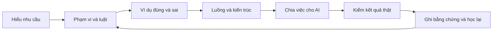

# ReNER-VN · Research Handbook

**Từ một ý tưởng web tìm trọ đến yêu cầu, kiến trúc, kiểm chứng và quy trình làm việc với AI.**

Kho kiến thức và hồ sơ nghiên cứu của dự án ReNER-VN. Bắt đầu từ proposal, học cách tổ chức sản phẩm qua KusShoes và các repo web, rồi phản biện các quyết định bằng tài liệu gốc và tình huống cụ thể. Mục tiêu là hiểu cách làm để áp dụng được cho nhiều dự án, với ReNER làm bài thực hành chính.

> **Trạng thái:** nghiên cứu và bản thảo cho demo. Repo này chưa chứa ứng dụng ReNER hoàn chỉnh. Số liệu chạy KusShoes là bằng chứng lịch sử; 26 ca ReNER chưa chạy. Repo được tạo private, chưa phải một thư viện open-source được cấp phép tái sử dụng toàn bộ.

## Bắt đầu ở đây

| Bạn muốn biết gì? | Mở tài liệu nào? |
|---|---|
| Toàn bộ hành trình đã làm được gì? | [Báo cáo tổng hợp](BAO-CAO-TONG-HOP-CONG-VIEC.md) |
| Học theo thứ tự nào để hiểu được hệ thống? | [Lộ trình đọc](docs/START-HERE.md) |
| Những mảng kiến thức đã tìm hiểu? | [Bản đồ 12 mảng kiến thức](docs/KNOWLEDGE-MAP.md) |
| Mọi file nằm đâu, gồm những mục nào? | [Danh mục tài liệu đầy đủ](docs/CATALOG.md) |
| Đâu là quyết định hiện hành, đâu chỉ là đề xuất? | [Bối cảnh và quyết định](notes/HIEN-TRANG-VA-QUYET-DINH.md) · [Trạng thái bằng chứng](docs/STATUS.md) |
| Một người dùng AI chia việc, review và đổi yêu cầu ra sao? | [Quy trình làm việc](docs/WORKFLOW.md) · [Sổ tay giao việc](notes/kusshoes-to-rener-vn/SO-TAY-CHIA-VIEC-CHO-AI.md) |

## Mạch tư duy của dự án



Waterfall được dùng để làm rõ đầu ra và điều kiện chuyển giai đoạn. Khi bằng chứng hoặc yêu cầu thay đổi, ghi tác động rồi cập nhật tài liệu sở hữu quyết định; không giả định mọi quyết định ban đầu đều đúng mãi. Xem [quy trình và change request](docs/WORKFLOW.md).

## Những phần kiến thức chính

| Nhóm | Nội dung đã nghiên cứu | Tài liệu trung tâm |
|---|---|---|
| Sản phẩm và yêu cầu | Actor, giá trị, scope, MVP/P0–P2; từ prompt ngắn đến ví dụ nghiệm thu | [Sổ kiến thức, mục 2–4 và 22](notes/kusshoes-to-rener-vn/KIEN-THUC-TONG-HOP.md) |
| UI, dashboard và motion | Sidebar KusShoes, design system, trạng thái UI, GSAP/Motion, template, khả năng tiếp cận | [Sổ kiến thức, mục 5–8 và 14](notes/kusshoes-to-rener-vn/KIEN-THUC-TONG-HOP.md) |
| Kiến trúc web | 10 repo shop/admin/full-stack, ranh giới module, frontend state, DB/API/worker | [Bản thảo v0.2](notes/design-rener-vn-waterfall.md) |
| NLP và dữ liệu thuê trọ | BIO/span, regex/LLM/Hybrid, chứng cứ, chuẩn hóa, trùng tin, leakage, đánh giá | [Nền tảng ReNER — 32 mục](project-realestate-ner/notes/foundation-2026-10-09/KIEN-THUC-NEN-TANG-RENER-VN.md) |
| Extension và vận hành | Chọn từng tin, message trust, vòng đời worker, quyền nguồn, retry, idempotency, snapshot | [Đọc sâu bổ sung](notes/nghien-cuu-sau-2026-10-11/NGHIEN-CUU-SAU-VA-THAY-DOI-TU-DUY.md) |
| AI và tổ chức GitHub | Flow ChoThueGiupViec, harness, giao việc, review, bằng chứng và giới hạn tự động hóa | [Harness, scale và AI](notes/kusshoes-to-rener-vn/NGHIEN-CUU-HARNESS-SCALE-AI.md) |
| Làm web cho khách | Brief, SOW, nghiệm thu, template/creator, bàn giao, đổi lõi và khôi phục | [Gia công web](notes/kusshoes-to-rener-vn/GIA-CONG-WEB-VA-AI-WORKFLOW.md) · [Solo AI](notes/kusshoes-to-rener-vn/TU-VIBE-CODING-DEN-GIAO-WEB.md) |
| Tự phản biện | 13 nhóm đính chính, 10 gap, 21 nguồn đọc chọn lọc và 26 ca phản chứng | [Audit](notes/audit-2026-10-11/BAO-CAO-PHAN-BIEN.md) · [Bộ ca](notes/nghien-cuu-sau-2026-10-11/BO-CA-PHAN-CHUNG-RENER.md) |

## Phạm vi đã được xác nhận

- Người dùng ưu tiên: người tìm trọ cần tìm/lọc tin và hiểu, so sánh giá thuê.
- Đầu vào dự kiến: extension để người dùng chủ động chọn và gửi từng tin.
- Mục tiêu trước mắt: demo môn học; hiện ưu tiên học và bản thảo, chưa triển khai ReNER.
- Quy mô 5.000 người là tình huống để học về tải, chưa là chỉ tiêu sản phẩm.
- Mục tiêu dài hạn: hiểu quy trình để có thể nhận làm web cho khách; không đưa toàn bộ yêu cầu doanh nghiệp vào MVP.

Proposal bốn tuần và hướng nghiên cứu mở rộng 12 tuần là hai phạm vi khác nhau. Catalog của bản thảo pilot là nội bộ cho người có quyền; chưa xác nhận quyền thu thập/chia sẻ dữ liệu thật từ Facebook.

## Kết quả và mức độ tin cậy

| Hạng mục | Mức hiện tại |
|---|---|
| KusShoes chạy local | Có báo cáo và kiểm tra lịch sử; không chứng minh server đang chạy khi bạn đọc repo |
| 10 repo web + repo sát đề tài | Đã khảo sát có chọn lọc; không gọi là “tốt nhất thế giới” hoặc audit toàn bộ code |
| Kiến trúc ReNER v0.2 | Bản thảo, chưa được duyệt hoặc triển khai |
| Đánh giá NLP, ontology và nguồn dữ liệu | Đã phân tích/đề xuất; chưa có kết quả thực nghiệm mới cho ReNER |
| 26 ca phản chứng | Đã soạn input/expected/cách quan sát; tất cả NOT RUN trên app |
| Kiểm tra repo tài liệu | Có script kiểm link/file/manifest/pattern nhạy cảm; không thay cho app test |

Chi tiết ở [STATUS](docs/STATUS.md), [ROADMAP](ROADMAP.md) và [CHANGELOG](CHANGELOG.md).

## Cấu trúc repo

```text
README.md                         Cổng đọc và phạm vi
docs/                             Lộ trình, bản đồ, quy trình, danh mục, nguồn
notes/                            Các chuyên đề web/AI, bản thảo, audit và log
project-realestate-ner/            Proposal các phiên bản và nền tảng ReNER
KusShoes/notes/                    Báo cáo khảo sát/chạy local lịch sử
KusShoes/.local/                   Helper lịch sử; cần clone/runtime gốc
evidence/                         Manifest bản xuất, nguồn, loại trừ và kiểm tra
scripts/                          Kiểm tra tài liệu, tạo danh mục
.github/                          Mẫu issue, PR và người review mặc định
templates/                        Task, quyết định và phiếu thực nghiệm
```

Đường dẫn của tài liệu nghiên cứu được giữ để truy lịch sử và liên kết chéo. Phần `before/` trong audit là bản cũ dùng đối chiếu, có thể còn nhận định đã sửa; đọc qua báo cáo audit trước. Full clone bên ngoài, raw paper/HTML nguồn, dependency, DB và env không nằm trong bản xuất; [PACKAGING](docs/PACKAGING.md) giải thích đầy đủ.

## Kiểm tài liệu trên bản clone mới

Cần Git và Python 3.10 trở lên; script kiểm dùng thư viện chuẩn, không cần cài app hoặc API key.

```bash
git clone https://github.com/VoDucNhatku/rener-vn-research-handbook.git
cd rener-vn-research-handbook
python scripts/validate_docs.py
```

Repo private yêu cầu tài khoản được cấp quyền. Chỉ muốn đọc thì mở trực tiếp các Markdown trên GitHub. Reader HTML trong foundation là bản offline lịch sử; tải về rồi mở, không phải website đã deploy.

Hướng đóng góp: [CONTRIBUTING](CONTRIBUTING.md). Nguồn và quyền sử dụng: [SOURCES](docs/SOURCES.md), [NOTICE](NOTICE.md). Không đưa khóa, dữ liệu thuê thật hoặc thông tin đăng nhập vào issue/commit.
