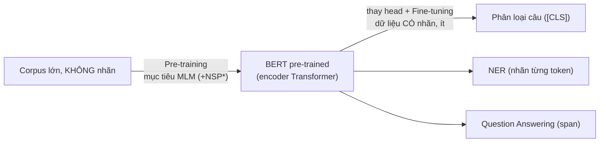

# TMG301 — Bài 08: Tinh chỉnh (Fine-Tuning) và Mô hình ngôn ngữ che từ (Masked Language Models)

> Rà soát 11/10/2026: đối chiếu script và log lưu ở `08-assets`; các con số 0,7384/0,5003/0,6198 và 21/60 có trong log lịch sử, chưa chạy lại training trong lượt audit này. Đã sửa diễn giải trọng số, masking và mức bằng chứng. [Báo cáo](audit-2026-10-11/BAO-CAO-PHAN-BIEN.md).

- **Nguồn:** `For Students/TMG/TMG/08. Fine-Tuning and Masked Language Models.ppt` (27 slide)
- **Người soạn:** Claude (admin → tóm tắt bài giảng) · **Ngày:** 2026-09-30
- **Quy ước:** nội dung **không có trong slide** được đánh dấu **(\*)**. Mọi code và output trong file này **đã chạy thật** (transformers 5.17.0, torch 2.12.0+cpu), script và log nằm ở `notes/08-assets/`.
- **Đã đọc:** toàn bộ text của 27 slide và ảnh từng slide (ngoài slide 7 là ảnh chụp code, các hình còn lại chỉ là logo và hình trang trí). Slide không có ghi chú người thuyết trình (speaker notes).

### Bản đồ slide → mục (kiểm tra độ phủ)

| Slide | Nội dung slide | Mục trong file |
|---|---|---|
| 1–2 | Tiêu đề (slide ghi "Maske", lỗi chính tả của "Masked") · Mục lục 8 phần | §0 |
| 3–6 | Introduction to Fine-Tuning: khái niệm, tận dụng tri thức pre-train, BERT/GPT-3, 4 bước | §1 |
| 7 | Example: code fine-tune BERT phân loại nhị phân | §2 (đã chạy, sửa lỗi `AdamW`) |
| 8–10 | Pre-Trained Models for Fine-Tuning: 2 lợi thế, học được gì, BERT vs GPT-3 | §3 |
| 11–12 | Processing of Fine-Tuning: 5 bước chi tiết | §4 |
| 13–14 | Benefits: 8 lợi ích | §5 (bảng lợi ích) |
| 15–17 | Limitations: 10 hạn chế | §5 (bảng hạn chế) |
| 18–20 | Masked Language Models: ý tưởng, dự đoán theo ngữ cảnh, BERT là ví dụ | §6 |
| 21–23 | MLM Objective and Architecture: 2 bước, encoder (self-attention + FFN), quy trình train | §7 |
| 24–25 | Downstream Tasks: phân loại câu, NER, MT, QA | §8 |
| 26 | Practice: Task 1 (lý thuyết), Task 2 (code che từ + accuracy) | §9 (đã làm, chạy thật) |
| 27 | Q & A | §10–11 (bẫy + câu hỏi ôn) |

---

## 0. Bức tranh một trang



- **Pre-training** (tiền huấn luyện): học "tiếng Anh nói chung" từ văn bản không nhãn. Với BERT, mục tiêu là **MLM**: che từ rồi đoán lại.
- **Fine-tuning** (tinh chỉnh): lấy trọng số đã học làm điểm khởi đầu, gắn thêm một head nhỏ cho tác vụ, rồi huấn luyện tiếp trên dữ liệu có nhãn của tác vụ đó.
- Hai nửa của bài giảng chính là hai giai đoạn này: slide 3–17 nói về fine-tuning, slide 18–25 nói về MLM.

---

## 1. Fine-tuning là gì (slide 3–6)

**Định nghĩa (slide 3):** lấy một mô hình đã tiền huấn luyện, vốn đã học được đặc trưng ngôn ngữ tổng quát, rồi **điều chỉnh tham số** để làm tốt một tác vụ hoặc một tập dữ liệu cụ thể, **đồng thời giữ lại** tri thức đã học.

**Vì sao hiệu quả (slide 4):** mô hình đã biết sẵn mẫu ngôn ngữ, quan hệ ngữ nghĩa và ngữ cảnh, nên chỉ cần **ít dữ liệu của tác vụ** là tổng quát hoá tốt.

**Trong bối cảnh BERT/GPT (slide 5):** giữ trọng số pre-trained làm điểm khởi tạo, có thể thay head rồi cập nhật một phần hoặc toàn bộ trọng số cho các tác vụ như phân loại văn bản, nhận dạng thực thể có tên (NER), phân tích cảm xúc, dịch máy…

**Bốn bước (slide 6):**

| # | Bước | Ý chính |
|---|---|---|
| 1 | Task-specific data | Thu thập dữ liệu có nhãn của tác vụ |
| 2 | Adjusting parameters | **Khởi tạo bằng trọng số pre-trained**, rồi cập nhật trên dữ liệu tác vụ |
| 3 | Optimization | Gradient descent để giảm hàm mất mát (loss) của tác vụ |
| 4 | Evaluation | Đánh giá trên tập validation/test |

> Điểm then chốt để phân biệt với "train from scratch": ở bước 2, trọng số **không** khởi tạo ngẫu nhiên. Chỉ riêng head mới gắn vào là ngẫu nhiên (xem mục 2).

---

## 2. Ví dụ code: fine-tune BERT phân loại nhị phân (slide 7), đã chạy và sửa lỗi

**⚠️ Code trên slide không còn chạy được.** Chạy nguyên văn dòng import của slide trên transformers 5.17.0 cho ra:

```
ImportError: cannot import name 'AdamW' from 'transformers'
```

`AdamW` đã bị gỡ khỏi thư viện `transformers`. **Cách sửa:** `from torch.optim import AdamW`. Phần còn lại giữ đúng logic của slide:

```python
import torch
from torch.optim import AdamW  # fix: transformers.AdamW was removed
from transformers import BertForSequenceClassification, BertTokenizer
from torch.utils.data import DataLoader, TensorDataset

model_name = "bert-base-uncased"
model = BertForSequenceClassification.from_pretrained(model_name, num_labels=2)
tokenizer = BertTokenizer.from_pretrained(model_name)

texts = ["This movie was great!", "I didn't like the book."]
labels = [1, 0]
enc = tokenizer(texts, padding=True, truncation=True, return_tensors="pt", max_length=128)
dataset = TensorDataset(enc["input_ids"], enc["attention_mask"], torch.tensor(labels))
dataloader = DataLoader(dataset, batch_size=2, shuffle=True)
optimizer = AdamW(model.parameters(), lr=2e-5)

model.train()
for epoch in range(3):
    for ids, mask, y in dataloader:
        optimizer.zero_grad()
        out = model(ids, attention_mask=mask, labels=y)   # loss = CrossEntropy computed inside
        out.loss.backward()
        optimizer.step()
```

**Output thật** (rút gọn từ `08-assets/lab_output.txt`):

```
params: 109483778
layers: 12 hidden: 768 heads: 12 vocab: 30522
tokens[0]: ['[CLS]', 'this', 'movie', 'was', 'great', '!', '[SEP]', '[PAD]', '[PAD]', '[PAD]']
epoch 0 loss 0.7384 | epoch 1 loss 0.5003 | epoch 2 loss 0.6198
```

**Đọc output để hiểu bản chất:**

1. **~110 triệu tham số, 12 lớp, hidden 768, 12 head attention.** Đây là cấu hình BERT-base (\*).
2. **Tokenizer tự chèn `[CLS]` ở đầu và `[SEP]` ở cuối**, rồi đệm `[PAD]` cho bằng độ dài câu dài nhất. `attention_mask` báo cho mô hình bỏ qua các vị trí `[PAD]`.
3. **Log khi tải mô hình** (\*) cho thấy đúng bản chất của fine-tuning:
   - `classifier.weight/bias → MISSING`: head phân loại **mới**, được khởi tạo ngẫu nhiên. Đây là phần "modify the architecture slightly" ở slide 11.
   - `cls.predictions.* → UNEXPECTED`: head MLM của checkpoint gốc bị **bỏ đi**.
   - `cls.seq_relationship.* → UNEXPECTED`: head **NSP (Next Sentence Prediction)** bị bỏ đi. Checkpoint có head NSP là dấu hiệu phù hợp với kiến trúc; căn cứ cho hai mục tiêu **MLM và NSP** của BERT gốc là [bài báo BERT, §3.1](https://aclanthology.org/N19-1423/), không chỉ riêng tên key trong log (\*).
4. **Loss dao động (0.74 → 0.50 → 0.62) là bình thường.** Chỉ có 2 câu, không có tập validation, nên đây là bản demo cú pháp chứ **không phải** thí nghiệm có ý nghĩa. Slide ghi "Fine-tuning completed!" nhưng không đánh giá, tức là thiếu bước 4 của chính slide 6.
5. `lr=2e-5` là thang learning rate điển hình khi fine-tune BERT. Bài báo BERT gợi ý khoảng {2e-5, 3e-5, 5e-5}, 2–4 epoch (\*). LR nhỏ vì chỉ cần "nắn nhẹ" trọng số đã tốt, LR lớn dễ gây quên thảm khốc (catastrophic forgetting, mục 5).

---

## 3. Mô hình tiền huấn luyện làm điểm khởi đầu (slide 8–10)

**Hai lợi thế (slide 8):**
- **Linguistic understanding:** đã học được mẫu ngôn ngữ, quan hệ ngữ nghĩa và sắc thái ngữ cảnh.
- **Transfer learning** (học chuyển giao): là nền tảng tri thức chung, giúp **giảm nhu cầu** dữ liệu lớn cho từng tác vụ.

**Học được gì (slide 9):** nghĩa theo ngữ cảnh, cấu trúc cú pháp, thành ngữ, từ đồng nghĩa/trái nghĩa… Tất cả được mã hoá trong **các lớp ẩn** (hidden layers) dưới dạng biểu diễn ngữ nghĩa.

**Hai ví dụ tiêu biểu (slide 10):**

| | BERT | GPT-3 |
|---|---|---|
| Kiến trúc (\*) | Encoder-only | Decoder-only |
| Ngữ cảnh | **Hai chiều** (trái và phải) | Một chiều (chỉ bên trái) |
| Mục tiêu pre-train (\*) | MLM (+ NSP) | Dự đoán token tiếp theo (causal LM) |
| Thế mạnh | **Hiểu** ngôn ngữ: phân loại, QA, NER | **Sinh** văn bản theo prompt |
| Cách dùng theo slide | Fine-tune cho từng tác vụ | "Not typically fine-tuned due to its scale" |

> **Lưu ý (\*):** câu "GPT-3 thường không fine-tune" là cách trình bày trong slide; file này không có số liệu để xác nhận tần suất sử dụng thực tế, đặc biệt ở thời điểm hiện tại. Phân biệt prompting/in-context learning với cập nhật trọng số; không suy ra "không thể fine-tune".

---

## 4. Quy trình fine-tuning chi tiết (slide 11–12)

1. **Chọn kiến trúc pre-trained** phù hợp với tác vụ và dữ liệu (BERT, GPT-2, RoBERTa…).
2. **Chuẩn bị dataset có nhãn** cho tác vụ, gồm input và nhãn cho train và đánh giá.
3. **Sửa kiến trúc một chút:** thêm lớp riêng cho tác vụ, hoặc đổi lớp đầu ra cho khớp số lớp/nhãn. Trong ví dụ, `num_labels=2` sinh ra `classifier` với 2 đầu ra.
4. **Fine-tune:** *initialize weights* bằng trọng số pre-trained, rồi *optimization* và *backpropagation* (tính gradient của loss theo tham số, cập nhật để giảm loss).
5. **Đánh giá và chỉnh siêu tham số** (hyperparameters) như learning rate và batch size nếu kết quả chưa tốt.

---

## 5. Lợi ích và hạn chế (slide 13–17)

### Lợi ích (8 ý, slide 13–14)

| Lợi ích | Giải thích một dòng |
|---|---|
| Faster convergence | Xuất phát từ trọng số đã tốt nên hội tụ nhanh |
| Reduced compute | Rẻ hơn nhiều so với train từ đầu |
| Improved performance | Thường đạt SOTA trên tác vụ đích |
| Lower data requirements | Cần ít dữ liệu có nhãn |
| Efficient knowledge transfer | Chuyển tri thức từ corpus lớn sang tác vụ mới |
| Scalability | Một mô hình gốc fine-tune được cho nhiều tác vụ, miền, ngôn ngữ |
| Versatility | Phân loại, tóm tắt, QA… |
| Domain adaptation | Thích nghi với văn bản pháp lý, y khoa, kỹ thuật |

### Hạn chế (10 ý, slide 15–17), kèm cách khắc phục

| Hạn chế | Vì sao xảy ra | Cách giảm (\* ngoài phần ghi chú của slide) |
|---|---|---|
| Data quality & domain mismatch | Dữ liệu tác vụ kém hoặc lệch phân phối pre-train | Làm sạch dữ liệu; pre-train tiếp trên dữ liệu miền (\*) |
| **Overfitting** | Dataset tác vụ nhỏ nên mô hình học thuộc | Early stopping, ít epoch, dropout, weight decay |
| **Freeze vs update layers** | **Lớp thấp học đặc trưng chung, lớp cao học đặc trưng riêng tác vụ** | Đóng băng lớp thấp khi ít dữ liệu; LR nhỏ hơn cho lớp thấp (\*) |
| **Catastrophic forgetting** | Cập nhật mạnh làm mất tri thức pre-train | LR nhỏ, regularization, ít epoch; PEFT như LoRA/adapter chỉ train rất ít tham số (\*) |
| Choosing hyperparameters | Siêu tham số của pre-train không hợp với fine-tune | Dò LR/batch trên validation |
| Label noise & bias | Nhãn sai hoặc thiên lệch thì mô hình học theo | Kiểm tra nhãn, audit bias |
| Sequential vs token-level | Mô hình pre-train bằng MLM không sinh tuần tự sẵn | Cần causal masking hoặc setup khác nếu muốn sinh văn bản |
| Transferability to unseen tasks | Tác vụ quá khác mục tiêu pre-train | Chọn mô hình gốc gần tác vụ hơn |
| Regularization strategies | Quá nhiều thì không học được, quá ít thì overfit | Chỉnh dropout/weight decay riêng cho fine-tune |
| Evaluation & validation set | Tập đánh giá chọn sai thì đo sai khả năng tổng quát | Tách val/test đúng cách, cùng phân phối với dữ liệu thật |

---

## 6. Masked Language Model: ý tưởng (slide 18–20)

- **MLM là một *tác vụ pre-training*** dùng để huấn luyện BERT: **che** (mask) một số từ trong câu rồi **đoán lại** chúng dựa trên ngữ cảnh xung quanh.
- Vì từ bị che có thể nằm giữa câu, mô hình phải nhìn **cả trái lẫn phải**, nên học được biểu diễn **hai chiều** (bidirectional). Đây là chữ "B" trong BERT.

**Minh chứng chạy thật (\*)**: dùng `fill-mask` với `bert-base-uncased`:

```
The capital of France is [MASK].                          -> paris 0.417, lille 0.071, lyon 0.063
I went to the [MASK] to deposit my money.                 -> bank 0.893, store 0.015, door 0.005
I sat on the [MASK] of the river and watched the water.   -> bank 0.703, edge 0.182, banks 0.077
```

Câu 2 và câu 3 đều dự đoán ra `bank`, nhưng **nghĩa khác nhau**: ngân hàng và bờ sông. Ở câu 3, manh mối quyết định (`river`, `water`) nằm **bên phải** vị trí bị che. Một mô hình một chiều trái→phải sẽ không nhìn thấy các manh mối này khi dự đoán. Đó chính là lợi thế hai chiều mà slide 19 nói tới.

> **Ghi nhớ (\*):** ở phần bài 5, embedding tĩnh (Word2Vec/GloVe) cho `bank` **một** vector duy nhất. BERT cho vector **khác nhau theo ngữ cảnh** (contextual embedding).

---

## 7. Mục tiêu MLM và kiến trúc (slide 21–23)

**Hai bước của mục tiêu MLM (slide 21):** (1) Masking words: chọn ngẫu nhiên một phần câu và thay bằng `[MASK]`. (2) Predicting masked words: mã hoá ngữ cảnh rồi đoán từ gốc.

**Chi tiết slide không nêu (\*), hay bị hỏi:**
- Chọn **15%** token để dự đoán. Trong số đó: **80%** thay bằng `[MASK]`, **10%** thay bằng token ngẫu nhiên, **10%** giữ nguyên. Đã đối chiếu với mã nguồn `DataCollatorForLanguageModeling` trong transformers 5.17.0: mặc định `mlm_probability=0.15`, `mask_replace_prob=0.8`, `random_replace_prob=0.1`.
- **Vì sao không che 100% bằng `[MASK]`?** Trong các tác vụ downstream thông thường không dùng masking, input không có `[MASK]`; riêng suy luận fill-mask vẫn dùng token này. Nếu pre-train chỉ gặp `[MASK]`, sẽ có độ lệch giữa pre-train và fine-tune (pretrain–finetune mismatch). Hai phần 10% buộc mô hình phải có biểu diễn tốt cho **mọi** token, vì nó không biết token nào đã bị tráo.
- **Loss chỉ tính trên các vị trí bị chọn** $M$, không tính trên toàn câu. Gọi $\tilde{x}$ là câu đã bị che:

$$
\mathcal{L}_{MLM} = -\sum_{i \in M} \log P_{\theta}\left(x_i \mid \tilde{x}\right)
$$

  Trong code HuggingFace, các vị trí không tính loss có nhãn `-100`.

**Kiến trúc (slide 22):** chồng nhiều **encoder layer** của Transformer. Mỗi lớp có 2 lớp con:
1. **Self-attention:** mỗi từ "nhìn" mọi từ khác để cân trọng số ngữ cảnh. Ở BERT, attention **không có causal mask**, nên từ nhìn được cả hai phía.
2. **Position-wise feed-forward network:** áp dụng cùng một mạng MLP lên **từng vị trí** độc lập.

(\*) Mỗi lớp con còn có residual connection và layer normalization, đã học ở bài 07.

**Quy trình huấn luyện MLM (slide 23):** Tokenize → chọn vị trí mục tiêu và thay token theo 80/10/10 → embedding + encoder → dự đoán ở mọi vị trí được chọn → loss với token gốc ở các vị trí đó → cập nhật trọng số. Loss gồm cả token được giữ nguyên hoặc thay ngẫu nhiên, không chỉ những vị trí đang mang `[MASK]`.

> ⚠️ **Thứ tự trên slide 23** ghi "input encoding" rồi mới "masking". Thực tế (\*), masking thực hiện trên **token id** trước khi tra embedding: `[MASK]` là một token trong từ vựng và có embedding riêng. Slide sắp xếp để dễ kể, không phải thứ tự trong code.

---

## 8. Tác vụ hạ nguồn (downstream tasks) với MLM (slide 24–25)

| Tác vụ | Cách gắn head theo slide | Chi tiết cài đặt (\*) |
|---|---|---|
| **Sentence classification** (cảm xúc, phân loại chủ đề) | Lấy biểu diễn token **`[CLS]`** ở lớp cuối, đưa vào lớp phân loại | `BertForSequenceClassification` (mục 2) |
| **NER** | Fine-tune trên dữ liệu gắn nhãn thực thể theo token, học ranh giới và loại thực thể | Head phân loại **mỗi token** (`...ForTokenClassification`), thường dùng nhãn BIO. Subword thứ 2 trở đi thường gán nhãn `-100` |
| **Question answering** | Fine-tune trên cặp câu hỏi và đoạn văn chứa đáp án (span) | Head dự đoán **vị trí bắt đầu và kết thúc** của span, ví dụ SQuAD |
| **Machine translation** | Fine-tune trên cặp câu nguồn/đích, "điều kiện" theo câu nguồn để sinh câu đích | Xem cảnh báo bên dưới |

> ⚠️ **Cảnh báo về MT (\*)**: BERT là **encoder-only**, tự nó không sinh chuỗi tuần tự tốt, vì không có decoder tự hồi quy (autoregressive). Muốn dịch máy cần kiến trúc **encoder-decoder** (ví dụ mBART, T5, hoặc dùng BERT làm encoder rồi ghép thêm decoder). Slide 25 mô tả ở mức ý tưởng. Chính slide 17 cũng thừa nhận "sequential vs token-level tasks" cần điều chỉnh. Đây là điểm dễ bị bẫy khi hỏi "BERT dùng cho dịch máy được không?".

---

## 9. Bài thực hành (slide 26), đã làm và chạy thật

**Task 1:** giải thích MLM, gồm cách huấn luyện và mô hình học được gì. Xem mục 6–7.

**Task 2:** chọn MLM → chọn câu → tokenize → hàm che ngẫu nhiên x% token → dự đoán → so sánh → tính accuracy. Script đầy đủ: `08-assets/mlm_practice.py`. Ý chính:

```python
cand = [i for i, t in enumerate(ids.tolist()) if t not in tok.all_special_ids]  # never mask [CLS]/[SEP]

def mask_tokens(ids, rate=0.15):
    k = max(1, round(rate * len(cand)))
    pos = sorted(random.sample(cand, k))
    masked = ids.clone(); masked[pos] = tok.mask_token_id
    return masked, pos

logits = model(input_ids=masked.unsqueeze(0)).logits[0]
pred = logits[pos].argmax(-1)          # compare with ids[pos]
```

**Output thật** (seed 42, 1 câu có 22 token thường, mỗi lần che 3 token, lặp 20 lần):

```
masked : [CLS] [MASK] language processing [MASK] computers understand human language, and masked language
         models learn by predicting hidden words from their [MASK]. [SEP]
orig vs pred: [('natural','natural'), ('lets',':'), ('context','context')]
masked : [CLS] natural language processing lets [MASK] understand human [MASK] [MASK] and ...
orig vs pred: [('computers','us'), ('language','language'), (',','language')]
accuracy over 20 trials: 21/60 = 0.350
```

**Nhận xét để viết báo cáo:**
- Accuracy 35% **không** có nghĩa mô hình kém. Có nhiều đáp án hợp lý: `lets`→`:` và `computers`→`us` vẫn đúng ngữ pháp và hợp nghĩa. Exact-match là thước đo khắt khe.
- **Hai `[MASK]` liền nhau khó hơn hẳn** (`human [MASK] [MASK]`): trong một lượt forward, các head dự đoán cùng dựa trên ngữ cảnh đã che và không tự điều kiện hóa trên đáp án vừa sinh ở mask khác, nên đoán `language` cho cả hai (\*).
- Bài thực hành che **100% bằng `[MASK]`** để đánh giá. Đây là cách đo khác với quy tắc 80/10/10 dùng khi *huấn luyện*.
- Để báo cáo nghiêm túc hơn: dùng **nhiều câu** thay vì 1 câu, báo cáo thêm top-5 accuracy, và cố định seed.

---

## 10. Bẫy hay gặp

| Nhầm lẫn | Đúng là |
|---|---|
| "MLM là một loại mô hình khác BERT" | MLM là **mục tiêu/tác vụ pre-training**. BERT là mô hình được huấn luyện bằng mục tiêu đó |
| "Fine-tune = train lại từ đầu trên dữ liệu mới" | Khởi tạo bằng trọng số pre-trained. Chỉ **head mới** là ngẫu nhiên |
| "BERT che 15% và thay hết bằng [MASK]" | 15% được chọn, trong đó 80/10/10 (\*) |
| "Loss MLM tính trên cả câu" | Chỉ tính trên các vị trí được chọn (\*) |
| "BERT sinh văn bản / dịch máy tốt như GPT" | Encoder-only, mạnh ở **hiểu**. Sinh văn bản cần decoder |
| "Lớp thấp học đặc trưng riêng tác vụ" | Ngược lại: **lớp thấp học đặc trưng chung, lớp cao học đặc trưng riêng tác vụ** (slide 15) |
| "`from transformers import AdamW`" | Đã bị gỡ. Dùng `torch.optim.AdamW` (đã kiểm chứng) |
| Loss giảm trên tập train là fine-tune thành công | Phải có validation/test (slide 6 bước 4, slide 17) |

---

## 11. Câu hỏi ôn thi / phỏng vấn

1. Định nghĩa fine-tuning. Nó khác gì train from scratch và khác gì feature extraction (đóng băng toàn bộ backbone)? (\*)
2. Kể 4 bước fine-tuning theo slide 6. Bước nào hay bị bỏ quên trong code demo?
3. Vì sao fine-tuning cần ít dữ liệu hơn và hội tụ nhanh hơn?
4. Catastrophic forgetting là gì? Nêu 3 cách giảm.
5. Khi dữ liệu tác vụ rất ít, nên đóng băng lớp nào? Vì sao?
6. MLM hoạt động thế nào? Vì sao nó cho biểu diễn hai chiều, còn causal LM thì không?
7. Quy tắc 15% và 80/10/10 giải quyết vấn đề gì? (\*)
8. Viết công thức loss MLM. Vì sao chỉ tính trên các vị trí bị che?
9. Mô tả 2 lớp con trong một encoder layer của BERT.
10. Với phân loại câu, NER và QA, head đặt ở đâu và dự đoán cái gì?
11. BERT có dùng trực tiếp cho dịch máy được không? Giải thích.
12. So sánh BERT và GPT-3 về kiến trúc, mục tiêu pre-train và cách dùng.
13. Trong log tải `BertForSequenceClassification`, vì sao `classifier.*` báo MISSING còn `cls.predictions.*` báo UNEXPECTED? (\*)
14. Trong bài thực hành, vì sao accuracy exact-match thấp không có nghĩa là mô hình tệ?

---

## Thuật ngữ (Glossary)

| English | Tiếng Việt | Giải thích ngắn |
|---|---|---|
| Pre-training | Tiền huấn luyện | Học từ corpus lớn không nhãn |
| Fine-tuning | Tinh chỉnh | Huấn luyện tiếp trên dữ liệu có nhãn của tác vụ, khởi tạo từ trọng số pre-trained |
| Transfer learning | Học chuyển giao | Dùng tri thức từ tác vụ/dữ liệu này cho tác vụ khác |
| Masked Language Model (MLM) | Mô hình ngôn ngữ che từ | Mục tiêu pre-train: che token rồi đoán lại từ ngữ cảnh hai phía |
| Next Sentence Prediction (NSP) | Dự đoán câu kế tiếp | Mục tiêu phụ của BERT gốc (\*) |
| Bidirectional | Hai chiều | Dùng ngữ cảnh cả bên trái lẫn bên phải |
| Head (task head) | Đầu tác vụ | Lớp nhỏ gắn trên backbone để ra dự đoán cho tác vụ |
| [CLS] / [SEP] / [PAD] / [MASK] | Token đặc biệt | Đầu chuỗi (dùng cho phân loại) / ngăn cách / đệm / bị che |
| Freezing layers | Đóng băng lớp | Giữ nguyên trọng số, không cập nhật |
| Catastrophic forgetting | Quên thảm khốc | Mất tri thức cũ khi học tác vụ mới |
| Downstream task | Tác vụ hạ nguồn | Tác vụ đích sau pre-training |
| Contextual embedding | Embedding theo ngữ cảnh | Vector của từ thay đổi theo câu chứa nó |
| Encoder-only / Decoder-only | Chỉ bộ mã hoá / chỉ bộ giải mã | BERT / GPT |
| Parameter-efficient fine-tuning (PEFT) | Tinh chỉnh tiết kiệm tham số | LoRA, adapter: chỉ train phần nhỏ tham số (\*) |
