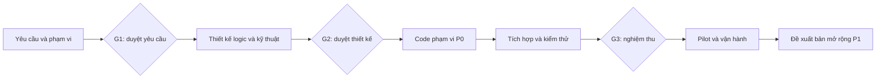
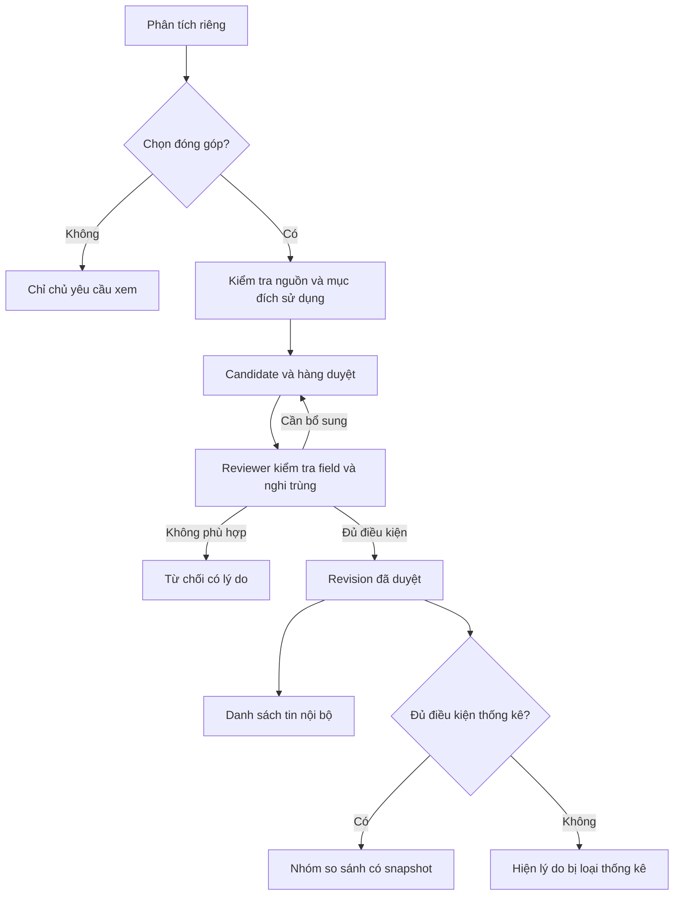
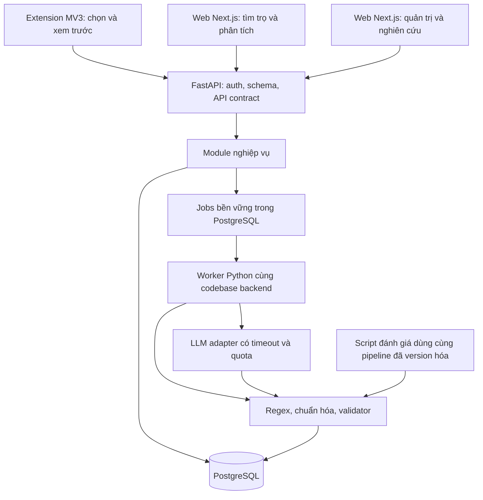
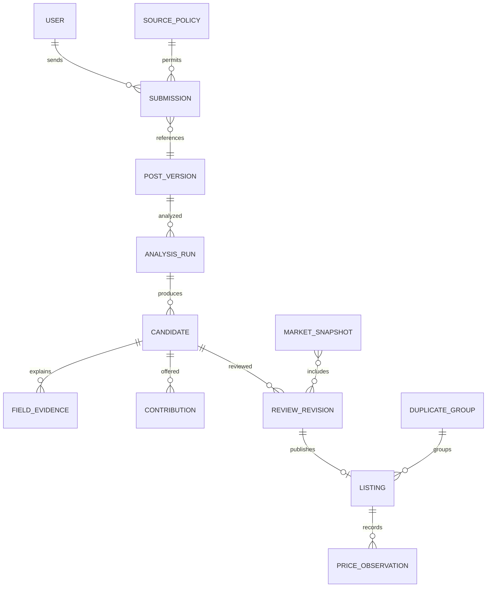
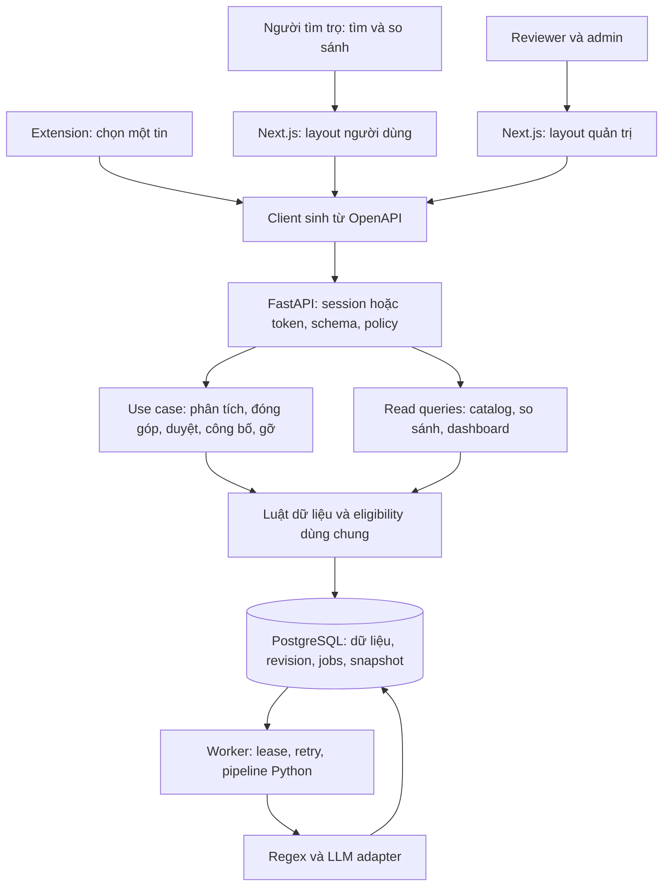

# ReNER-VN — bản thảo yêu cầu và kiến trúc hệ thống

Phiên bản **0.2 — 10/10/2026**. Trạng thái: **bản thiết kế để người dùng xem và chỉnh; chưa phê duyệt baseline, chưa code**. Mục 16 tổng hợp kiến trúc sau lượt đối chiếu code bổ sung của 10 repo; các yêu cầu P0 và lựa chọn extension từng tin giữ nguyên.

Mục tiêu sản phẩm: giúp người tìm trọ tìm được các tin phù hợp, đọc đúng giá thuê/phí và so sánh giá chào thuê dựa trên dữ liệu có thể kiểm tra lại. Extension là cửa đưa tin vào; chất lượng kho tin và kết quả người dùng hiểu được là giá trị chính.

Tài liệu này là bản thảo sản phẩm có thể đem bàn với nhóm dev. [Sổ kiến thức](kusshoes-to-rener-vn/KIEN-THUC-TONG-HOP.md) giữ nghiên cứu nguồn; [log](kusshoes-to-rener-vn/WORK_LOG.md) ghi từng phần đã làm. Mọi route, bảng, màn hình và chỉ tiêu dưới đây là **đề xuất**, chưa phải chức năng đang chạy.

**Đọc nhanh:** mục 2 là quy trình Waterfall; mục 4 là cốt lõi/mở rộng; mục 5–6 là luật và luồng; mục 7–9 là kiến trúc/data/API; mục 10 là bản thảo màn hình/admin; mục 12 là cách nghiệm thu. Phần cần góp ý đầu tiên là P0 có đúng sản phẩm muốn làm hay không, sau đó mới chốt công nghệ.

## 1. Điều đã xác nhận và giả định thiết kế

| Loại | Nội dung |
|---|---|
| Người dùng đã chọn | Người tìm trọ là đối tượng chính: tìm/lọc tin, so sánh giá thuê |
| Người dùng đã chọn trong lượt này | Extension để người dùng chọn và gửi từng tin; đưa vào bản đầu |
| Người dùng yêu cầu | Phân tích logic cốt lõi, admin/dashboard, làm bản thảo trước; phát triển theo Waterfall; chia việc và có log |
| Proposal v1.3 | PRICE, AREA, LOC, ROOM và phí; Regex/LLM/Hybrid; kho thị trường, nhóm tương tự, N tối thiểu 10; đánh giá riêng |
| Giả định có căn cứ từ proposal | Pilot nội bộ, tài khoản được mời; dữ liệu thực không tự động đăng công khai |
| Giả định cần chốt ở G1 | 3–5 phường cụ thể, nhóm người thử, thời hạn thật, nguồn được dùng, ngân sách API |
| Đề xuất kiến trúc để duyệt | Next.js + FastAPI chia module + PostgreSQL + một worker Python; cùng codebase backend |

Mục tiêu 100 bài gold, 10 held-out và 300–500 bài thị trường trong proposal là mục tiêu thu thập, chưa có bằng chứng đạt được. Mẫu minh họa trong tài liệu là dữ liệu tự tạo.

## 2. Waterfall áp dụng vào dự án này

Waterfall là **mô hình phát triển**, không phải giao thức mạng. Nó tổ chức công việc theo các giai đoạn nối tiếp, từ yêu cầu đến thiết kế, xây dựng, kiểm thử, triển khai và bảo trì. Việc chia P0/P1/P2 là **ưu tiên phạm vi**; không phải định nghĩa Waterfall. Nguồn khái niệm: [IBM — Software development models](https://www.ibm.com/think/topics/software-development).



| Giai đoạn | Hồ sơ bàn giao | Điều kiện chuyển bước |
|---|---|---|
| W1 — yêu cầu | Actor, R01–R14, scope, quy tắc nghiệp vụ, tình huống nghiệm thu | G1: chủ sản phẩm chấp nhận phạm vi P0 và nguồn dữ liệu; các giả định quan trọng có quyết định |
| W2 — thiết kế | Module, luồng/trạng thái, ERD, contract API, wireframe, kế hoạch kiểm chứng | G2: FE/BE/NLP hiểu cùng một luồng; không còn mâu thuẫn chặn triển khai |
| W3 — xây dựng | Code theo contract, migration, fixture, unit/contract test và PR | Từng phần qua review, có bằng chứng chạy; chưa coi là nghiệm thu sản phẩm |
| W4 — tích hợp/kiểm thử | E2E extension → kho → tìm/so sánh; quyền, lỗi, khôi phục; báo cáo nghiệm thu | G3: P0 đạt tiêu chí, không còn lỗi làm sai giá/quyền/mẫu thống kê |
| W5 — pilot/vận hành | Hướng dẫn chạy, bàn giao tài khoản, backup/restore, log sự cố | Người dùng pilot hoàn thành hành trình; biết ai xử lý lỗi/dữ liệu |
| W6 — bảo trì/mở rộng | Yêu cầu thay đổi và phạm vi P1 | Bắt đầu vòng yêu cầu/thiết kế mới cho phần mở rộng |

**Hiện tại:** soạn W1 và W2 để cùng xem trước. Chưa tuyên bố G1/G2 đã qua. Không chờ đến W4 mới nghĩ về test: acceptance được viết ở W1, test design ở W2, unit test đi cùng W3; W4 kiểm tra tích hợp và nghiệm thu toàn luồng.

Sau khi chốt baseline, thay đổi phải ghi mã CR, lý do, phần yêu cầu/API/data bị ảnh hưởng, công việc phát sinh và quyết định của chủ sản phẩm. Ví dụ thêm “đặt cọc phòng” là thay đổi phạm vi, không tự chèn vào ticket làm bảng giá. Sửa một lỗi khiến code không đúng baseline là bug, không phải yêu cầu mới.

## 3. Ai dùng, ai hưởng lợi, ai vận hành?

| Vai trò | Nhu cầu và hành động | Quyền dự kiến | Công việc/chi phí |
|---|---|---|---|
| Người tìm trọ | Lọc tin, xem chi tiết, so sánh giá; phân tích một tin qua extension | Đọc kho đã duyệt; đọc/xóa phân tích của mình; tự chọn đóng góp | Là bên nhận giá trị chính |
| Người đóng góp | Gửi tin mình được phép sử dụng, theo dõi trạng thái đóng góp | Tạo/rút đóng góp của mình; không tự duyệt | Bỏ công chọn nguồn và xác nhận |
| Người duyệt dữ liệu | Đọc bằng chứng, sửa nhãn/số, xử lý bài nhiều phòng và nghi trùng | Duyệt/từ chối, công bố nội bộ, ẩn tin, gộp/tách có lý do | Chịu tải kiểm tra thủ công |
| Admin vận hành | Nguồn, người dùng, quyền, job, hạn mức, lỗi, yêu cầu gỡ dữ liệu | Cấp/thu hồi quyền, tạm dừng nguồn/job, quản lý cấu hình và audit | Chịu chi phí API/hạ tầng và trách nhiệm vận hành |
| Thành viên nghiên cứu | So Regex/LLM/Hybrid, gán nhãn và đọc lỗi trên tập phát triển | Dữ liệu nghiên cứu được cấp riêng, phiên bản và kết quả đánh giá | Chịu chất lượng thực nghiệm |

Một tài khoản có thể mang nhiều quyền. Admin muốn duyệt dữ liệu phải được cấp cả quyền reviewer. Người tìm trọ đồng thời có thể là người đóng góp; không cần tạo hai loại tài khoản. Chủ nhà/người đăng tin chưa có cổng riêng trong P0. Chưa có mô hình thu phí, billing hoặc subscription.

### Ma trận quyền tối thiểu

| Hành động | Người dùng | Reviewer | Admin | Researcher |
|---|---|---|---|---|
| Xem tin đã duyệt và thống kê nội bộ | Có | Có | Có | Có |
| Xem phân tích riêng | Chỉ của mình | Không mặc định | Không mặc định | Không |
| Xem nội dung đã đóng góp để duyệt | Chỉ của mình | Có | Cần quyền reviewer | Chỉ nếu được cấp cho nghiên cứu |
| Sửa/duyệt/gộp/ẩn tin | Không | Có, ghi lý do | Cần quyền reviewer | Không mặc định |
| Retry job | Job của mình trong hạn mức | Job trong phạm vi duyệt | Có | Run nghiên cứu của mình |
| Đổi quyền/nguồn/quota | Không | Không | Có | Không |
| Chỉnh nhãn development | Không | Không mặc định | Không mặc định | Có |
| Đọc held-out trước đóng băng | Không | Không | Không mặc định | Chỉ người giữ tập test được chỉ định |

Mọi kiểm tra quyền nằm ở API theo cả vai trò và đối tượng cụ thể. Ẩn sidebar chỉ là trình bày. Người vận hành có thể thấy mã lỗi/job mà không được xem văn bản phân tích cá nhân. Không coi `admin` là quyền đọc mọi dữ liệu phục vụ nghiên cứu.

## 4. Cây tính năng: P0 → P1 → P2

### 4.1 Cốt lõi P0

**Câu kiểm tra:** bỏ tính năng này thì người tìm trọ còn tìm/lọc và hiểu được giá từ một kho dữ liệu đáng kiểm tra không? Nếu luồng giá trị đứt hoặc kết quả dễ sai mà không phát hiện được, phần đó thuộc P0.

| Mã | Tính năng | Vì sao cần từ đầu | Đầu ra quan sát được |
|---|---|---|---|
| R01 | Extension chọn một tin, xem trước, gửi để phân tích | Đường đưa dữ liệu đã được người dùng chọn | Tin đã chọn, phạm vi sử dụng, mã yêu cầu và trạng thái |
| R02 | Trích xuất, chuẩn hóa và giữ chứng cứ | Biến văn bản thành dữ liệu tìm/so sánh được | Giá, diện tích, vị trí, loại/số phòng, phí; mỗi giá trị có nguồn hoặc lý do thiếu |
| R03 | Đóng góp riêng, duyệt và xử lý trùng | Giữ kho dùng chung có chất lượng và đúng phạm vi sử dụng | Tin được chấp nhận/loại; một đối tượng không bị đếm nhiều lần |
| R04 | Tìm/lọc và chi tiết tin | Giá trị trực tiếp cho người tìm trọ | Bộ lọc theo khu vực, loại, giá, diện tích; xem giá/phí/nguồn/thời gian |
| R05 | So sánh với nhóm phù hợp | Người dùng cần bối cảnh cho giá chào thuê | N, median, P25–P75, tiêu chí, độ mới; thiếu dữ liệu có lý do |
| R06 | Đăng nhập, quyền, phân tích riêng và rút đóng góp | Cho phép pilot nội bộ hoạt động đúng ranh giới | Không xem/sửa nhầm dữ liệu người khác; có lối gỡ dữ liệu |
| R07 | Admin tối thiểu: duyệt, nguồn, job, audit, tổng quan | Kho tin và lỗi pipeline cần được xử lý | Hàng đợi việc cần làm và số liệu thật dẫn đến hành động |

R06/R07 là năng lực hỗ trợ bắt buộc của P0 dù không phải lời hứa tiếp thị. Trọng tâm không phải số trang; một màn có thể hỗ trợ nhiều hành động.

### 4.2 Mở rộng cấp hai P1

| Mã | Tính năng | Phụ thuộc |
|---|---|---|
| R08 | Lưu tin/bộ lọc và lịch sử phân tích tiện hơn | R04, R06; dữ liệu đủ hữu ích |
| R09 | Báo tin lỗi/hết phòng và thông báo xử lý | R03, R06; quy trình reviewer có người phụ trách |
| R10 | Dashboard chất lượng nâng cao, biểu đồ xu hướng theo tuần | R05, R07; đủ mẫu ở từng nhóm và từng tuần |
| R11 | Nhập theo lô CSV có preview và kết quả từng dòng | R02, R03, R07; kiểm chứng chống lặp và giới hạn chi phí |

Các chức năng P1 vẫn có giá trị nhưng không chặn nghiệm thu P0. Đường dán văn bản một tin là fallback vận hành cho extension trong P0; khác với nhập CSV theo lô.

### 4.3 Mở rộng cấp ba P2

| Mã | Tính năng | Điều kiện trước khi đưa vào scope |
|---|---|---|
| R12 | Bản đồ và khoảng cách đi học/đi làm | Vị trí đủ chính xác, nguồn bản đồ và chi phí được chốt |
| R13 | Gợi ý cá nhân, thông báo tin mới | Có nhu cầu thật, dữ liệu tốt, người dùng chọn nhận thông báo |
| R14 | Kênh chủ nhà hoặc nguồn dữ liệu khác | Quy trình xác minh, chống lạm dụng và quyền dữ liệu được thiết kế riêng |

Thanh toán, đặt cọc, booking, môi giới giao dịch và crawler hàng loạt chưa nằm trong các cam kết này. Không thêm vì một repo shop có sẵn.

### 4.4 Nhánh nghiên cứu bắt buộc của đề tài

Đây là nhánh **N**, không phải tính năng phụ có thể bỏ nếu vẫn nộp đúng proposal:

- N01: hướng dẫn gán nhãn và schema BIO cho PRICE/AREA/LOC/ROOM/FEE.
- N02: chạy Regex, LLM và Hybrid độc lập trên cùng dataset/version; không thay đổi input giữa các phương pháp.
- N03: chia theo phòng, khóa 10 held-out từ đầu, đóng băng hệ thống trước lần đánh giá theo proposal.
- N04: báo P/R/F1, chuẩn hóa, trả rỗng đúng, gộp trùng, chi phí/thời gian; lưu cách tính, phiên bản và dữ liệu sử dụng.

MVP sản phẩm có thể được kiểm tra bằng fixture trước. Nghiệm thu cả đồ án cần thêm N01–N04 và dữ liệu thực phù hợp; một dashboard đẹp không thay được đánh giá.

## 5. Luật nghiệp vụ của P0

Các luật dưới đây là hợp đồng giữa FE, BE, NLP và người duyệt. Giá trị số mang nhãn “đề xuất” phải được chốt tại G2.

| Mã | Quy tắc |
|---|---|
| B01 | Phân tích cá nhân không đồng nghĩa đóng góp. Chỉ dữ liệu có phạm vi sử dụng phù hợp và người dùng xác nhận đóng góp mới vào hàng duyệt kho. |
| B02 | Không có thông tin thì `null` kèm trạng thái/lý do; không đổi giá thiếu thành 0, không suy địa chỉ từ một mốc mơ hồ. |
| B03 | Tách giá thuê, tiền cọc, điện, nước, dịch vụ. Phân biệt VND/tháng/phòng, VND/tháng/người và giá ngày. Không tự tính tổng phí nếu thiếu lượng dùng/số người. |
| B04 | “Từ 3 triệu”, “3–5 triệu”, “inbox giá” không phải một mức giá chính xác. Giữ trạng thái và nội dung nguồn; không lấy trung điểm để so sánh. |
| B05 | Mỗi field chuẩn hóa phải trỏ vào đúng phiên bản văn bản và span. LLM xác định span/nhãn; code tất định quy đổi số. Span có thật vẫn cần kiểm tra nhãn, đơn vị và đúng đối tượng phòng. |
| B06 | Một bài có thể có nhiều phòng. P0 chuyển bài đa phòng/mơ hồ sang reviewer để tách candidate, chưa tự ghép giá A với diện tích B. |
| B07 | Gửi lại cùng yêu cầu không tạo bản sao. Cùng bài sửa nội dung tạo phiên bản mới. Cùng phòng khác bài chỉ gộp khi có bằng chứng; độ giống câu chữ chỉ đề xuất nghi trùng. |
| B08 | Trong pilot P0, tin muốn xuất hiện ở danh sách phải qua người duyệt; tự động phân tích không tự công bố. Bản sửa mới chưa duyệt không thay bản đã công bố. |
| B09 | Thống kê có điều kiện chặt hơn danh sách: giá chính xác và đơn vị phù hợp, khu vực/loại hình xác định, phạm vi được dùng cho thống kê, độ mới đạt quy tắc, không còn nghi trùng chưa xử lý. |
| B10 | N là số tin đại diện sau gộp trùng, không bảo đảm là số phòng vật lý được xác minh. Mỗi cụm dùng một quan sát mới nhất đủ điều kiện. Loại cả cụm của tin đang so sánh. |
| B11 | N < 10: trả `insufficient_data`, không hiện median/IQR hoặc kết luận cao/thấp. Không tự nới khu vực/loại phòng để lấy đủ mẫu. |
| B12 | Dữ liệu demo tách hoàn toàn khỏi kho thực và metric nghiên cứu; mọi màn demo phải có nhãn. Chỉ nói về giá chào thuê trong mẫu thu được. |
| B13 | Reviewer sửa/gộp/ẩn phải ghi lý do và phiên bản. Hai người sửa cùng revision: người đến sau nhận xung đột, không ghi đè âm thầm. |
| B14 | Rút đóng góp hoặc nguồn bị thu hồi: ngừng phục vụ dữ liệu liên quan và vô hiệu snapshot bị ảnh hưởng; yêu cầu xóa phải đi qua cả bản dẫn xuất theo retention. |
| B15 | Job thành công chỉ chứng minh xử lý xong, không chứng minh kết quả đã được duyệt hay tin vẫn còn phòng. Không hiển thị tiến độ phần trăm nếu chưa biết tổng việc. |

### 5.1 Bộ lọc và so sánh giá cụ thể

Danh sách P0 có khu vực, loại hình, khoảng giá và diện tích; sắp theo giá hoặc thời điểm quan sát mới. Bộ lọc nằm trong URL để quay lại/share trong pilot. Giá thiếu hiển thị “Chưa có giá”; khi người dùng bật lọc giá, những tin này bị loại và có số lượng giải thích. Ngưỡng khoảng giá bao gồm hai đầu; diện tích dùng khoảng nửa kín khi chia nhóm để không đếm hai lần tại biên.

Nhóm so sánh mặc định **đề xuất**: cùng phường đã xác định, cùng loại hình, cùng đơn vị thuê, cùng trạng thái phí đi kèm, cùng khoảng diện tích và cửa sổ 30 ngày. Khoảng diện tích v1: dưới 20; [20,30); [30,40); [40,60); từ 60 m². Thiếu diện tích thì chưa nhận định giá cá nhân theo nhóm này; có thể xem thống kê khu vực với nhãn nhóm rộng, không gán kết luận cho tin.

“Trạng thái phí đi kèm” phân biệt tiền thuê chưa gồm phí với gói đã bao gồm khoản cụ thể; nếu không xác định được hai mức giá có cùng phạm vi chi phí thì trả lý do chưa so sánh được. Không trừ một khoản điện ước đoán để biến gói trọn thành giá thuê thuần. Ở trang nhóm rộng, mỗi chỉ số có ngưỡng N riêng; N giá thuê đủ nhưng N giá/m² thiếu thì chỉ ẩn chỉ số giá/m².

Thời gian dùng ngày đăng nếu có nguồn tin cậy, nếu thiếu dùng lần đầu quan sát và ghi cờ. Chạy lại NLP không làm tin “mới” hơn. Tin có ngày đăng cũ vẫn là tin cũ khi thu lại. Mốc 30 ngày là cấu hình nghiệp vụ cần kiểm tra trên dữ liệu pilot, không phải khẳng định phòng còn trống.

Sau lọc và gộp trùng, tính median, P25/P75 theo phương pháp nội suy tuyến tính đã version hóa. Giá/m² chỉ dùng tin có diện tích dương, kèm N riêng; không lấy median giá chia median diện tích. IQR là độ phân tán của mẫu. Chênh lệch so median = `(giá tin - median) / median × 100`, chỉ tính khi median > 0. Màn hình dùng câu “cao hơn trung vị của nhóm tin so sánh”, không kết luận “bị hét giá”.

Nội thất có trong tiêu chí gợi ý của proposal nhưng không thuộc bốn trường chính. **Đề xuất điều chỉnh:** chưa dùng nội thất làm bộ lọc bắt buộc P0; công khai giới hạn so sánh này. Nếu muốn dùng, bổ sung schema/nhãn/độ phủ trước, không ngầm giả định nội thất giống nhau.

### 5.2 Ví dụ xuyên suốt

Tin tự tạo: “Phòng trọ 25m2 tại phường A, 3tr2/tháng/phòng; điện 3k5/số, nước 100k/người; cọc 1 tháng.”

Kết quả dự kiến: tiền thuê 3.200.000 VND/tháng/phòng; 25 m²; loại phòng trọ; chưa có số phòng ngủ; điện 3.500 VND/kWh; nước 100.000 VND/người/tháng chỉ khi nguồn xác nhận chu kỳ, nếu không giữ chu kỳ chưa rõ; cọc một tháng tiền thuê. “Phường A” chỉ là nhãn fixture, không được map thành phường thật. Sau reviewer chấp nhận fixture vào môi trường demo, người tìm trọ thấy đúng các trường và nhãn demo.

Giả sử fixture có 12 tin khác đủ điều kiện, median 3 triệu thì chênh lệch khoảng +6,7%. Nếu chỉ 9 tin, màn so sánh báo thiếu dữ liệu. Các số này để thiết kế test, không phải thống kê thị trường đã đo.

## 6. Luồng xử lý và trạng thái

### 6.1 Người dùng chọn một tin trong extension

1. Đăng nhập pilot trên web, kết nối extension với tài khoản của mình.
2. Mở trang nguồn được cấu hình cho phép; bôi chọn nội dung một tin rồi bấm extension. P0 lấy vùng văn bản do người dùng chọn; không cần dò toàn feed, tự cuộn hoặc tự bấm “Xem thêm”.
3. Xem trước text, URL nguồn nếu được lưu, ngày đăng nếu biết và phần thông tin cá nhân sẽ được bỏ. Người dùng có thể sửa/hủy. Khi không có vùng chọn, hướng dẫn chọn lại hoặc dán văn bản.
4. Bấm **Phân tích tin này**. Extension gửi input và idempotency key; API trả mã job. Đóng popup không hủy job đã nhận.
5. Backend giảm dữ liệu không cần thiết, khóa phiên bản text rồi chạy phân loại, trích xuất và xác minh. Nội dung bài là dữ liệu đầu vào, không được dùng như lệnh gọi tool/thực thi code.
6. Panel hiện giá/phí và trạng thái thiếu; mở web để xem bằng chứng và so sánh nếu đủ điều kiện.
7. Nếu muốn, người dùng bấm **Đóng góp vào kho**, xem lại mục đích sử dụng và xác nhận. Chỉ lúc này mới tạo contribution cho reviewer.

Nguồn chưa được phép hoặc sai phạm vi: báo lý do và không gửi văn bản về backend. Việc chọn một tin trong extension là thao tác chủ động của người dùng, không tự chứng minh quyền dùng nguồn. Pilot có thể chạy bằng trang fixture do nhóm sở hữu trong khi chưa có nguồn thật phù hợp.

### 6.2 Đóng góp → duyệt → công bố nội bộ



Reviewer nhìn text đã giảm dữ liệu cá nhân bên trái, kết quả và span bên phải; sửa trường nào phải nêu chứng cứ/lý do. Duyệt thực hiện trong một transaction: kiểm tra quyền và revision → kiểm tra luật → lưu bản đã duyệt → cập nhật tin/đánh dấu snapshot cần tính lại → ghi audit. Nếu lỗi, không được lưu nửa chừng.

Đơn vị công bố là **listing/candidate**, không phải toàn bài. Một bài nhiều phòng chỉ công bố những candidate đã gắn đúng span và được duyệt. Nghi trùng chưa giải quyết có thể được giữ trong hàng duyệt; không đưa vào thống kê.

### 6.3 Người tìm trọ tìm và so sánh

Mở Tìm trọ → chọn khu vực, ngân sách, loại hình → xem danh sách → mở chi tiết → xem giá/phí/thời gian/bằng chứng → mở nhóm so sánh. Trạng thái thiếu mẫu giải thích thiếu do giá, diện tích, vị trí, trùng hay số mẫu; người dùng có thể quay về sửa bộ lọc. Trang thị trường là thống kê nhóm, không thay cho kết luận về một tin chưa đủ dữ liệu.

P0 chỉ có text và trường chuẩn hóa; không scrape ảnh để làm card đẹp. Link nguồn chỉ hiện khi nguồn cho phép và người xem có quyền; mở link không bảo đảm tin còn phòng. Tồn kho phòng thực tế nằm ngoài khả năng xác nhận của hệ thống.

### 6.4 Ba vòng đời riêng biệt

| Đối tượng | Trạng thái và chuyển trạng thái | Ai điều khiển |
|---|---|---|
| Job | `queued → running → succeeded / failed`; lỗi tạm thời: `running → retry_wait → queued`; có thể `cancel_requested → cancelled` | Worker và người có quyền retry/hủy |
| Candidate review | `pending → needs_changes / approved / rejected`; bản sửa mới quay về pending | Reviewer; owner bổ sung nội dung qua bản mới |
| Tin công bố | `published → hidden / expired / withdrawn`; hidden có thể quay lại published sau duyệt; withdrawn không tự phục hồi | Reviewer, yêu cầu rút đóng góp hoặc hệ thống thời hạn |

Phân tích riêng không có trạng thái published. `succeeded` có thể kèm field thiếu/xung đột; kết quả được chuyển tới màn xem/duyệt thích hợp. Hủy khi provider đang xử lý là best effort: không công bố kết quả khi đã hủy, nhưng không hứa hoàn lại chi phí API đã phát sinh.

Tin sửa giá có bản nháp mới, giữ revision cũ đang hiển thị cho đến khi duyệt. Nếu giá cũ đã biết sai nghiêm trọng, reviewer ẩn tin ngay trong lúc chờ sửa. Việc rút một đóng góp loại đúng provenance đó; một tin có nguồn độc lập khác chỉ được tiếp tục dùng sau khi kiểm tra vẫn đủ căn cứ và mục đích.

## 7. Kiến trúc đề xuất và lý do chọn

### 7.1 Ba phương án đã cân nhắc

| Phương án | Ưu điểm | Đổi lại | Quyết định đề xuất |
|---|---|---|---|
| A. Next.js + FastAPI chia module + PostgreSQL + worker cùng backend | Bám frontend/Python trong proposal; một bộ luật NLP dùng cho web/extension/nghiên cứu; hợp với nhiều người duyệt | Vận hành thêm DB và worker; cần giữ API contract rõ | **Chọn cho bản pilot P0** |
| B. React/Vite + FastAPI + SQLite, một tiến trình xử lý | Gần KusShoes, dễ demo một máy | Cần quy định lại job và DB khi mở nhiều người ghi; khác frontend proposal | Chỉ chọn nếu nhóm quyết định thu nhỏ thành demo cá nhân |
| C. Nhiều dịch vụ ingestion/NLP/statistics độc lập | Có thể scale từng phần và giao đội lớn | Nhiều deploy, auth giữa service, queue và lỗi phân tán | Chưa phù hợp quy mô đề tài hiện tại |

“Chia module” nghĩa là tách trách nhiệm trong **một backend**, không tạo một server cho mỗi tính năng. Worker là tiến trình chạy công việc lâu, dùng chung package nghiệp vụ và schema với API. Không chọn React-admin và Refine đồng thời; P0 có thể dùng component React theo một design system, học cách tổ chức resource từ các nguồn đã khảo sát.

Chuyển SQLite của proposal sang PostgreSQL là **đề xuất cần duyệt**, vì yêu cầu mới gồm extension, reviewer và worker cùng ghi. Không tự tạo DB hay đổi proposal gốc ở lượt thiết kế này.

### 7.2 Sơ đồ thành phần



Web và extension chỉ dùng API. Next.js không tự ghi database hoặc tự tính một phiên bản median khác. Môi trường pilot dùng một origin web và `/api/v1` được reverse proxy tới FastAPI; browser dùng cookie phiên, extension dùng token giới hạn quyền. API chỉ trả DTO cần cho từng vai trò. [Next.js: authorization](https://nextjs.org/docs/app/guides/authentication) là nguồn tham khảo ranh giới quyền; trong thiết kế này FastAPI chịu quyền nghiệp vụ cuối cùng.

### 7.3 Module backend

| Module | Sở hữu việc gì | Không tự làm |
|---|---|---|
| Identity | Tài khoản được mời, session/token, role/capability | Không duyệt tin thay reviewer |
| Sources & Intake | Nguồn, phạm vi được dùng, submissions, xem trước/giảm dữ liệu | Không quyết định giá chuẩn hóa |
| Extraction | Regex/LLM/Hybrid, span, normalizer, validator, version | Không công bố tin |
| Review & Dedup | Candidate, sửa/duyệt, nghi trùng, nhóm và audit thay đổi | Không tự biến đồng thuận hai model thành sự thật |
| Catalog | Revision được công bố, truy vấn/bộ lọc/chi tiết | Không trả raw private submission |
| Comparison | Eligibility, nhóm, N/median/IQR và snapshot | Không chọn dữ liệu chưa duyệt |
| Operations | Job, quota, trạng thái nguồn, dashboard, yêu cầu gỡ | Không sửa giá qua một đường tắt |
| Experiments | Dataset release, split, run, metric và báo cáo | Không tự trộn gold/test vào kho thị trường |

API/router gọi service/use case; service thực hiện luật và transaction; repository truy cập DB. Normalizer/validator tách thành hàm nghiệp vụ dùng chung. Cấu trúc nhiều router trong một app phù hợp cơ chế [FastAPI Bigger Applications](https://fastapi.tiangolo.com/tutorial/bigger-applications/); bảng module ở đây là thiết kế riêng của ReNER.

### 7.4 Job bền vững và thất bại

Đề xuất P0 dùng bảng jobs và một worker. Giao dịch tiếp nhận tạo submission + job cùng lúc. Worker lấy việc bằng khóa DB/lease, ghi attempt và heartbeat; khi chết, job hết lease mới được lấy lại. Mỗi lease có token; worker cũ không được ghi kết quả sau khi đã mất lease. Kết quả và trạng thái succeeded được commit cùng transaction.

Thực thi là **at-least-once**, nên bước ghi kết quả và đóng góp phải idempotent. Không hứa LLM chỉ bị tính phí một lần: request timeout có thể đã được provider xử lý. Lưu attempt, usage nếu provider trả, và trạng thái chi phí chưa biết nếu không có số liệu.

Mặc định đề xuất: timeout provider 45 giây/lần; tối đa 3 lần gọi tổng cộng cho lỗi mạng/429/5xx, có backoff và tôn trọng Retry-After; lỗi schema/grounding không retry vô hạn. Giữ output Regex làm kết quả một phần, ghi rõ LLM lỗi và cần duyệt. Cache theo hash text + schema/rule/prompt/model/normalizer/dictionary version, kèm phạm vi quyền; không cho cache tiết lộ input của user khác.

UI hỏi trạng thái theo job ID, giãn tần suất khi tab không hoạt động. Hiển thị bước “đang chờ / đang trích xuất / cần kiểm tra / hoàn tất”, không giả phần trăm. Chỉ thêm Redis/Celery khi cần nhiều worker/queue hoặc tải đo được cho thấy hàng đợi DB không còn phù hợp. [FastAPI Background Tasks](https://fastapi.tiangolo.com/tutorial/background-tasks/) phân biệt tác vụ trong ứng dụng và hệ thống worker lớn; thiết kế DB lease ở trên là quyết định riêng, cần test crash/retry ở W3–W4.

### 7.5 Extension và đăng nhập

P0 dự kiến Manifest V3, `activeTab`, `scripting`, `storage`; host permission chỉ cho API đã cấu hình. Quyền tạm thời theo thao tác người dùng được mô tả tại [Chrome activeTab](https://developer.chrome.com/docs/extensions/develop/concepts/activeTab). Content script đọc vùng chọn; background kiểm tra message/sender/schema và gửi tới endpoint cố định. Không dùng message như yêu cầu fetch một URL tùy ý.

Đề xuất ghép tài khoản cho pilot: web đã đăng nhập tạo mã kết nối ngẫu nhiên mạnh, dùng một lần trong 2 phút; người dùng dán vào extension. API đổi mã atomically thành opaque token hết hạn sau 60 phút, gắn user và chỉ có quyền phân tích/đóng góp của chính user cùng quyền đọc kết quả phù hợp. Mã/token chỉ lưu hash phía server; không ghi vào log hoặc URL. Rate limit đổi mã; web cấp mã cần CSRF protection. Đây là luồng ghép nội bộ đề xuất, không tuyên bố là OAuth đã triển khai.

Token nằm trong `chrome.storage.session`, chỉ trusted extension contexts được đọc; hết phiên browser hoặc token hết hạn thì kết nối lại. Draft được lưu cục bộ tối thiểu với thời hạn; lưu submission/job ID để popup đóng/mở không gửi trùng. Backend job không phụ thuộc tuổi thọ extension service worker. Nguồn: [Chrome storage](https://developer.chrome.com/docs/extensions/reference/api/storage), [service worker lifecycle](https://developer.chrome.com/docs/extensions/develop/concepts/service-workers/lifecycle).

Không lưu tên người đăng hoặc số điện thoại trong model nghiệp vụ. URL nguồn và text đã giảm dữ liệu vẫn có thể nhạy cảm, vì vậy chỉ trả đúng phạm vi quyền. Replay test dùng fixture/text đã xử lý, không cần lưu toàn bộ HTML feed.

## 8. Mô hình dữ liệu logic

Đây là ERD khái niệm; W2 chi tiết sẽ chốt datatype/index/migration. **Bài đăng**, **lần phân tích**, **tin đã duyệt** và **phòng được cho là cùng đối tượng** là các khái niệm khác nhau.

| Thực thể | Trường/quan hệ tối thiểu và ràng buộc |
|---|---|
| User, Role, Session | User được mời, capability; session/token có hết hạn và thu hồi; không lưu token rõ |
| SourcePolicy | Nguồn, trạng thái, mục đích được dùng, bằng chứng/quyết định và version |
| Submission | Owner, source policy version, mục đích phân tích; idempotency key unique theo owner; created_at |
| PostVersion | Source reference nếu có quyền, text đã giảm dữ liệu, hash, published_at nullable, first_observed_at, phiên bản xử lý text |
| AnalysisRun | PostVersion, mode, model/rule/prompt/normalizer version, trạng thái, latency/usage và warnings |
| Candidate, FieldEvidence | Run + listing_index; nhãn, giá trị, unit/basis/status; start/end/raw_span gắn PostVersion; một bài có nhiều candidate |
| Contribution | Owner, analysis/candidate, phạm vi đóng góp và version xác nhận; active/withdrawn; riêng với mục đích phân tích |
| ReviewRevision | Candidate, số revision, before/after, reviewer, lý do; expected_revision chống ghi đè |
| Listing | Revision đã công bố, trạng thái; rent/area/location/property_type đã chuẩn hóa để query |
| DuplicateGroup, DuplicateLink | Thành viên/provenance, loại quan hệ, bằng chứng, quyết định merge/split và version; chưa xác minh thì không coi là cùng phòng chắc chắn |
| PriceObservation | Group/listing, revision, giá và thời gian nguồn; append khi thay đổi, giữ lịch sử |
| Job, JobAttempt | Owner/scope, idempotency, stage, attempt, lease token/deadline, retry_at, outcome và lỗi đã lọc dữ liệu nhạy cảm |
| MarketSnapshot | Bộ lọc/version, as_of, ID revision được chọn/loại và lý do, N, median/P25/P75; valid/invalidated |
| AuditEvent | Actor, hành động, object/version, thời điểm, diff cần thiết; hạn chế dữ liệu cá nhân trong log |
| DatasetRelease, EvaluationRun | Phạm vi N: membership/split theo nhóm phòng, hash/version khóa, phương pháp, metric; không lấy trực tiếp bảng live thay cho dataset |



Một PostVersion có thể được nhiều submission tham chiếu khi cùng nguồn/text, nhưng việc khử trùng vật lý không được mở quyền đọc giữa owner. FieldEvidence giữ offset Unicode code point trên bản text khóa; frontend chuyển đúng sang UTF-16 khi highlight. Lưu tiền bằng số nguyên VND; diện tích số thập phân dương; timestamps UTC và hiển thị Asia/Saigon.

Nguồn bị thu hồi trong lúc job chạy phải được kiểm tra lại khi lưu/đóng góp/công bố; trạng thái published không được bỏ qua kiểm tra nguồn hiện hành khi đọc. Job lỗi có trường xử lý vận hành `resolved_at/resolution_reason` riêng với trạng thái thực thi; đóng xử lý không đổi failed thành succeeded. Trường này phục vụ ô “lỗi cần xử lý” mà vẫn giữ đúng lịch sử thất bại.

Rút dữ liệu không chỉ xóa hàng Listing: phải xử lý contribution, text/provenance, kết quả/caches/snapshot theo phạm vi. Audit giữ dấu vết sự kiện gỡ và ID vô danh cần thiết, không giữ nguyên nội dung bị yêu cầu xóa. Snapshot chứa dữ liệu bị gỡ phải invalidated, không phục vụ lại chỉ vì được gọi bằng ID cũ.

## 9. Hợp đồng API ở mức bản thảo

Prefix dự kiến `/api/v1`. JSON có schema/version, ID và timestamp; lỗi có `code`, `message`, `field_errors` nếu có và `request_id`. Chi tiết OpenAPI sẽ khóa tại G2; bảng này không phải endpoint hiện tồn tại.

| Endpoint | Input → output chính | Quyền / quy tắc |
|---|---|---|
| `POST /auth/login`, `POST /auth/logout`, `GET /me` | Thông tin đăng nhập → cookie phiên / user và capabilities | Session HttpOnly, SameSite; Secure khi HTTPS; kiểm tra CSRF cho thao tác ghi |
| `POST /extension/pairing-codes`, `POST /extension/redeem` | Phiên web → mã một lần; mã → token có scope/expiry | Cấp mã cần login; redeem rate limit, single-use; không đặt mã trong query string |
| `POST /analyses` | Text, source_ref, source policy, mode cá nhân, idempotency key → `202 job_id, analysis_id` | Owner; input có giới hạn; cùng key khác body trả 409 |
| `GET /jobs/{id}`, `GET /analyses/{id}` | ID → stage / kết quả và evidence | Owner; reviewer chỉ được đọc phần đã đóng góp thuộc phạm vi của mình |
| `POST /jobs/{id}/retry`, `POST /jobs/{id}/cancel` | Job và revision → trạng thái | Chủ/phạm vi phù hợp; không retry job đang chạy/thành công; quota |
| `POST /contributions` | Analysis/candidate, scopes, consent_version → contribution và review status | Chỉ owner; kiểm tra lại source policy, không tự công bố |
| `DELETE /contributions/{id}`, `DELETE /analyses/{id}` | ID → yêu cầu gỡ/xóa được nhận | Owner; phân biệt xóa phân tích và rút đóng góp; job gỡ có thể theo dõi |
| `GET /listings`, `GET /listings/{id}` | Filters/page/sort → DTO tin được công bố | Thành viên pilot; không có raw private fields |
| `GET /comparisons` | Listing ID hoặc candidate của mình + filter_version → sufficient/insufficient + lý do | Kiểm tra quyền mục tiêu; nhóm được dùng chung phải thỏa B09–B12 |
| `GET /market/summary` | Bộ lọc → snapshot và thống kê hoặc thiếu mẫu | Không nới bộ lọc ngầm; N riêng cho từng chỉ số |
| `GET /admin/reviews`, `POST /admin/reviews/{id}/decision` | Hàng duyệt; expected_revision + decision/fields/reason → revision | Reviewer; validation+transaction+audit |
| `POST /admin/duplicates/decision`, `POST /admin/listings/{id}/visibility` | Merge/split hoặc ẩn/hiện, revision và lý do → kết quả | Reviewer; cập nhật eligibility và invalidation |
| `GET /admin/dashboard`, `GET /admin/jobs` | Thời gian/filters → counts có định nghĩa và danh sách job | Quyền operations; nội dung text hạn chế theo object |
| `/admin/sources`, `/admin/users`, `/admin/audit` | Cấu hình nguồn, tài khoản/capabilities, đọc sự kiện | Admin; nguồn/quyền có audit, không sửa log qua UI |
| `/research/datasets`, `/research/evaluations` | Nhánh N: dataset release/run/metrics | Research capability; quyền held-out tách riêng |

Ví dụ contract kết quả so sánh ở mức trường: `status`, `reason_codes`, `target_revision`, `snapshot_id`, `filter_version`, `criteria`, `n_rent`, `n_per_m2`, `median`, `p25`, `p75`, `delta_percent`, `as_of`, `examples`, `excluded_counts`. Khi thiếu mẫu, các số nhận định là null; UI dùng reason_codes để giải thích. Snapshot cũ bị gỡ dữ liệu trả trạng thái không còn phục vụ, rồi cho tính lại.

Status lỗi tối thiểu: 401 chưa đăng nhập; 403 thiếu quyền; 404 đối tượng không thuộc phạm vi đọc; 409 revision/idempotency xung đột; 422 input không hợp lệ; 429 quota; 503 dịch vụ tạm không sẵn sàng. Không trả traceback hoặc API key ra client.

## 10. Màn hình người tìm trọ và admin

### 10.1 Người tìm trọ: ưu tiên tìm phòng, không bắt đầu bằng dashboard kỹ thuật

| Route dự kiến | Nội dung/hành động | Trạng thái cần thiết |
|---|---|---|
| `/tim-tro` | Bộ lọc, tổng kết quả, card/list text; mở chi tiết | Đang tải, chưa có kho tin, không khớp bộ lọc, API lỗi, thiếu giá |
| `/tin/{id}` | Giá thuê và phí tách riêng, diện tích/loại/vị trí, thời gian nguồn; bằng chứng và so sánh | Tin bị ẩn/gỡ, không rõ còn phòng, field thiếu, không đủ mẫu |
| `/phan-tich` | Xem kết quả từ extension; dán một tin làm fallback; chọn đóng góp | Queued/running/partial/failed; xung đột; không được phép đóng góp |
| `/thi-truong` | Bộ lọc và số liệu của nhóm; tiêu chí/N/thời gian/giới hạn | N < 10, thiếu diện tích, snapshot không còn hợp lệ |
| `/dong-gop-cua-toi` | Trạng thái đóng góp, lý do từ chối, rút dữ liệu | Chưa có đóng góp, đang gỡ, đã gỡ |
| `/tai-khoan` | Phiên đăng nhập, kết nối/thu hồi extension, trợ giúp dữ liệu | Token hết hạn, kết nối lại |

Thanh điều hướng chính ngắn: **Tìm trọ · Phân tích tin · Thị trường**; phần cá nhân vào menu tài khoản. Mobile dùng bộ lọc dạng drawer. P0 không cần sidebar nhiều tầng cho người tìm trọ.

Wireframe logic, chưa phải thiết kế màu/font:

```text
ReNER-VN        Tìm trọ | Phân tích tin | Thị trường       Tài khoản
TÌM PHÒNG THEO NHU CẦU
[Khu vực] [Loại phòng] [Giá từ–đến] [Diện tích] [Lọc] [Xóa lọc]
<số kết quả> · Dữ liệu quan sát đến <thời điểm> · [Sắp xếp]
┌ Tin A: loại phòng · khu vực ─────────────────────────────────┐
│ <giá thuê hoặc Chưa có giá> · <diện tích hoặc Chưa rõ>        │
│ Phí: <biết/thiếu> · Quan sát <ngày> · [Xem chi tiết]         │
└────────────────────────────────────────────────────────────┘
Không có kết quả → lý do + nút xóa từng điều kiện
```

Trang chi tiết có bốn vùng: thông tin chính → giá/phí → chứng cứ → nhóm so sánh. Link nguồn không thay thế phần giải thích dữ liệu. Nếu thiếu mẫu, vùng so sánh vẫn giữ chỗ và giải thích thay vì biến mất.

### 10.2 Sidebar quản trị

Menu phụ thuộc capability, mỗi mục có route thật và mục đích riêng. Dấu P0 là cần trong bản đầu, N là nhánh nghiên cứu; chưa tạo màn chỉ để lấp đầy menu.

```text
ReNER-VN · Quản trị                       [Thu gọn]

TỔNG QUAN
  Tổng quan vận hành                       P0

DỮ LIỆU
  Nguồn & tiếp nhận                        P0
  Hàng đợi duyệt                 [số việc] P0
  Tin đã công bố nội bộ                    P0
  Nghi trùng & nhóm tin                    P0

VẬN HÀNH
  Công việc xử lý                [lỗi]     P0
  Người dùng & quyền                       P0, admin
  Nhật ký & yêu cầu gỡ dữ liệu              P0, theo quyền

NGHIÊN CỨU
  So sánh Regex / LLM / Hybrid              N
  Bộ nhãn & phiên bản dữ liệu               N
  Kết quả đánh giá                          N

<queued> chờ · <running> chạy · <failed> lỗi
<tài khoản> · <vai trò>             [Đăng xuất]
```

Sidebar có header cố định, menu cuộn, footer riêng; active route, focus bàn phím, tooltip khi thu gọn. Badge “cần duyệt” tính candidate chưa xử lý; không lấy tổng post. Bản mobile là drawer; mở/đóng không làm mất route hay bộ lọc. Mỗi quyền còn được kiểm tra ở API.

### 10.3 Dashboard vận hành P0

Dashboard trả lời: **có việc nào đang tắc, dữ liệu nào cần sửa, kho có đủ dùng chưa?** Nó không hiển thị doanh thu hay “độ chính xác AI” nếu không có phép đo tương ứng.

```text
TỔNG QUAN VẬN HÀNH    [Khoảng thời gian]    Cập nhật <giờ> [Tải lại]
[Cần duyệt]  [Job lỗi cần xử lý]  [Tin đang hiển thị]  [Mẫu đủ điều kiện]

ƯU TIÊN XỬ LÝ                    SỨC KHỎE DỮ LIỆU
- Xung đột giá                   - Thiếu giá / vị trí / diện tích
- Nghi trùng chưa giải quyết     - Tin cũ, nguồn tạm dừng
- Job hết lượt retry             - Nhóm có N dưới 10
- Yêu cầu gỡ đang chờ            - Độ phủ từng phường/loại hình

JOB GẦN ĐÂY                      THAY ĐỔI GẦN ĐÂY
Mã · bước · thời gian · lỗi       Ai · sửa gì · lý do · thời điểm
[Mở công việc]                   [Xem audit]
```

| Ô/chỉ số | Định nghĩa / nguồn | Bấm vào đâu |
|---|---|---|
| Cần duyệt | Candidate đang `pending` hoặc `needs_changes`, có contribution active; số hiện tại | Hàng duyệt với cùng bộ lọc |
| Job lỗi cần xử lý | Job ở trạng thái failed, chưa retry thành công/đóng xử lý; không đếm từng attempt là một job | Jobs failed |
| Tin đang hiển thị | Listing trạng thái published, còn quyền nguồn và chưa expired/withdrawn; số hiện tại | Catalog admin |
| Mẫu đủ điều kiện thống kê | Số đại diện nhóm sau gộp trùng thỏa B09 tại as_of, trước lọc mục tiêu cá nhân | Bảng eligibility với lý do loại |
| Tỷ lệ cần review trong kỳ | Candidate mới trong kỳ cần sửa/giải quyết xung đột chia tổng candidate mới trong cùng kỳ; mẫu số 0 → “Chưa có dữ liệu” | Candidate theo reason |
| Tỷ lệ lỗi job trong kỳ | Job tạo trong kỳ hiện failed chia số job cùng cohort đã ở trạng thái kết thúc; queued/running hiển thị riêng | Lọc theo cùng cohort |
| Hạn mức LLM | Số lần gọi/usage đã ghi so với cấu hình; khoản provider chưa trả usage hiển thị “chưa xác định” | Usage và job liên quan |
| Độ phủ kho | N theo phường × loại hình và số thiếu field; không phải độ phủ toàn thị trường | Thống kê nhóm |

Các ô “số hiện tại” không đổi ý nghĩa theo time range; UI ghi rõ. Các ô “trong kỳ” dùng cùng mốc UTC quy đổi khi hiển thị. Badge/sidebar và dashboard dùng cùng query nghiệp vụ; polling dự kiến 30 giây khi tab hoạt động, ghi thời điểm cập nhật. Không gắn nhãn Live nếu chỉ tải theo lịch.

### 10.4 Màn duyệt là màn admin quan trọng nhất

| Vùng | Nội dung và thao tác |
|---|---|
| Hàng đầu | Candidate ID, source, contribution scope, lý do cần xem, revision và người đang thao tác nếu biết |
| Bên trái | Text đã xử lý; click trường bên phải sẽ highlight đúng span; có nhãn chữ ngoài màu |
| Bên phải | Giá/phí/diện tích/vị trí/loại/số phòng; giá trị máy, sửa của reviewer, trạng thái và provenance |
| Phía dưới | Candidate nghi trùng, lịch sử sửa/giá; chọn khác phòng/cùng phòng/chưa đủ căn cứ |
| Thanh thao tác | Lưu nháp · Cần bổ sung · Từ chối · Duyệt; lý do bắt buộc khi sửa/từ chối/gộp |

Khi revision đổi trong lúc mở trang, giữ nháp của người đang sửa và hiển thị khác biệt để tải lại/áp dụng lại có chủ đích. Màn duyệt không được có nút “bỏ qua mọi lỗi” để ép dữ liệu vào thống kê.

## 11. Ràng buộc kỹ thuật và vận hành

### 11.1 Quyết định chạy pipeline

Chế độ phục vụ đề xuất là Hybrid có định tuyến: Regex chạy trước; khi trường cần thiết thiếu, xung đột, nhiều đối tượng hoặc luật không đủ căn cứ thì gọi LLM. Nếu không gọi, ghi `llm_status=not_run`; không giả vờ có hai phương pháp đồng thuận. LLM trả span/nhãn, validator và normalizer xử lý số, liên kết đối tượng và đơn vị. Khi hai nguồn lệch, giữ cả evidence và chuyển review, không lấy trung bình hai giá.

Trạng thái chất lượng gồm `rule_supported`, `agreement`, `needs_review`, `human_reviewed`; đây là nhãn quy trình, không phải xác suất đúng. Mọi đường đều phải qua B08 trước công bố. LLM lỗi có thể trả kết quả Regex một phần; ghi degraded và không gọi đó là kết quả Hybrid đầy đủ. Nhánh nghiên cứu chạy Regex-only, LLM-only và Hybrid với chính sách định tuyến đã khóa, báo số lần gọi/tỷ lệ không gọi/lỗi để so sánh công bằng và tái kiểm tra được.

### 11.2 Mục tiêu kiểm chứng đề xuất cho P0

| Nhóm | Yêu cầu cụ thể để thử, không phải kết quả đã đạt |
|---|---|
| Quy mô | Bộ test phần mềm 1.000 tin fixture, 10 phiên đọc đồng thời và 2 reviewer; khác mục tiêu thu 300–500 tin thực |
| Tương tác | Trên máy pilot được ghi cấu hình: API list/detail p95 ≤ 1 giây ở phép thử trên; submit trả job ID ≤ 2 giây, không chờ LLM |
| Tính đúng | Không có field giá được công bố mà thiếu provenance/duyệt; không trộn giá người với giá phòng; các tình huống AT ở mục 12 phải đạt |
| Giới hạn | P0 đề xuất tối đa 20.000 ký tự/tin, 1 job đang chạy mỗi user, 50 lần gọi LLM/user/ngày; quota toàn hệ thống chốt theo ngân sách tại G1 |
| Khôi phục | Kill worker rồi chạy lại: job không mất, không nhân bản Listing; kiểm tra lease và ghi kết quả muộn |
| Khả năng truy cập | Bàn phím/focus/label; tương phản WCAG AA theo proposal; trạng thái có chữ, reduced motion; desktop/mobile có empty/error state |
| Bảo mật ứng dụng | Escape text nguồn; không render HTML nguồn trực tiếp; quyền theo object; cookie/CSRF/rate limit; key LLM chỉ ở server, secrets không commit |

### 11.3 Thời hạn và dữ liệu bị gỡ

Đề xuất để duyệt ở G1/G2: phân tích riêng chưa đóng góp giữ tối đa 24 giờ sau khi hoàn tất; draft extension cũng hết hạn 24 giờ. Dữ liệu đóng góp giữ tối đa 90 ngày hoặc ngắn hơn theo quyền nguồn; dữ liệu nghiên cứu có lịch giữ riêng trong dataset release. Cửa sổ thống kê 30 ngày không đồng nghĩa retention 30 ngày. Cần thể hiện thời hạn trước khi gửi/đóng góp.

Pilot backup DB hằng ngày, mã hóa và giới hạn người truy cập; thử restore trước bàn giao. Mặc định đề xuất giữ backup tối đa 7 ngày; danh sách yêu cầu gỡ phải được áp lại sau restore trước khi phục vụ. “Gỡ khỏi website” thực hiện ngay bằng trạng thái/quyền; xóa vật lý và backup theo lịch được công bố, không hứa đã xóa mọi bản sao ngay lập tức. Chưa có kết luận pháp lý hoặc quyền dùng nguồn cụ thể trong bản thảo này.

Đứt LLM: web vẫn đọc kho đã duyệt; job mới có lỗi/partial đúng trạng thái. Đứt DB: API báo tạm không sẵn sàng, không nhận giả rằng dữ liệu đã lưu. Nguồn bị tạm dừng: chặn nhập mới; nếu thu hồi quyền dữ liệu thì ẩn dữ liệu liên quan và invalidation snapshot. Sửa bộ luật: tạo extraction version mới, chạy đánh giá development trước, không ghi đè kết quả lịch sử.

## 12. Tình huống nghiệm thu và trace yêu cầu

Đây là **test design**, chưa phải test đã chạy. Các fixture và mã AT sẽ trở thành test/biên bản ở W3–W4.

| Mã | Tình huống và kết quả phải thấy | Liên quan |
|---|---|---|
| AT01 | Chọn một tin, preview, gửi rồi đóng/mở popup: tiếp tục đúng job, không tạo hai tin | R01, R02; B07, B15 |
| AT02 | Chỉ phân tích, không đóng góp: user khác/reviewer không đọc được; không có tin trong kho | R01, R03, R06; B01 |
| AT03 | “5tr5/th, điện 3k5/số, cọc 1 tháng”: giá 5.500.000, điện/cọc tách riêng | R02; B03, B05 |
| AT04 | Tin chỉ có tiền điện hoặc “inbox giá”: giá thuê null, không hiện 0 hay đủ điều kiện thống kê | R02, R05; B02, B04 |
| AT05 | “Từ 3 triệu”, khoảng 3–5 triệu, giá theo người: hiển thị đúng trạng thái; không so như giá chính xác/phòng | R02, R05; B03, B04, B09 |
| AT06 | Text có emoji và tiếng Việt; click field phải tô đúng span trong đúng phiên bản | R02, R07; B05 |
| AT07 | Một bài có hai phòng/giá khác nhau: đưa review, không trộn field giữa hai phòng | R02, R03; B06 |
| AT08 | Hai tin nghi trùng không đủ bằng chứng: không tự merge; xác nhận merge/split cập nhật mẫu và audit | R03, R05; B07, B10, B13 |
| AT09 | Reviewer duyệt một contribution hợp lệ: tin xuất hiện ở search; tin chưa duyệt không xuất hiện | R03, R04, R07; B08 |
| AT10 | Cùng bộ lọc có N=9 thì không trả số nhận định; N=10 thì có; loại cả cụm mục tiêu | R05; B10, B11 |
| AT11 | Thiếu diện tích/vị trí, khác basis/phí hoặc tin cũ: loại có lý do; không tự nới nhóm | R04, R05; B09, B11 |
| AT12 | Hai reviewer sửa cùng revision: lần sau 409; không mất bản nháp hay âm thầm ghi đè | R03, R07; B13 |
| AT13 | LLM timeout/sai JSON/span bịa: retry hữu hạn hoặc partial; không tự công bố; cost chưa biết được ghi rõ | R02, R07; B05, B08, B15 |
| AT14 | Worker crash/lease hết hạn: có thể chạy lại nhưng không ghi hai kết quả công bố; worker cũ bị chặn ghi | R02, R07; B07, B15 |
| AT15 | User đổi ID để xem job người khác hoặc gọi API duyệt/đổi role: bị chặn ở API | R06, R07; B01, B13 |
| AT16 | Rút contribution/thu hồi nguồn: search/compare không dùng dữ liệu đó; snapshot cũ không còn phục vụ; restore áp lại yêu cầu gỡ | R03, R06, R07; B14 |
| AT17 | Bộ lọc giá không chứa null; tải lại URL giữ bộ lọc; 0 kết quả có cách xóa lọc | R04; B02 |
| AT18 | Dashboard số 0, mẫu số 0, job nhiều attempts: hiển thị đúng đơn vị và drill-down ra cùng tập | R07; B15 |
| AT19 | Fixture demo không vào kho thực hoặc báo cáo N; user thấy nhãn demo | R04, R05, N04; B12 |
| AT20 | Nghiên cứu khóa split theo nhóm phòng; không sửa prompt theo held-out; báo đầy đủ metric/version | N01–N04 |
| AT21 | Nguồn chưa được phép, token hết hạn/thu hồi, mã ghép đã dùng: extension không gửi nội dung trái phạm vi và không tạo job giả | R01, R06, R07; B01 |

Nghiệm thu P0 cần AT01–AT19 và AT21 đạt, cộng phép thử hiệu năng/quyền/restore ở mục 11. Nghiệm thu đồ án thêm AT20 và báo cáo thực nghiệm thực tế. N=10 là ngưỡng nghiệp vụ từ proposal; vượt ngưỡng không chứng minh mẫu đại diện toàn thị trường.

## 13. Phân vùng công việc và quản lý GitHub sau khi chốt thiết kế

Đây là thứ tự bàn giao đề xuất, chưa phải kế hoạch code chi tiết có file/commit. Một nhóm bốn người có thể nhận vai trò FE, API, NLP, Extension/Data theo proposal; chưa gán tên người hoặc cam kết thời gian khi chưa biết năng lực/lịch thật.

| Gói | Phụ thuộc | Đầu ra để review | Vai trò chính |
|---|---|---|---|
| WP0 | G1/G2 | Baseline yêu cầu/thiết kế, fixture case và OpenAPI thống nhất | Cả nhóm, chủ sản phẩm chốt |
| WP1 | WP0 | App shell, identity/source, DB/migration, contract CI, schema version | API + FE |
| WP2 | WP1 | Extension preview/ghép tài khoản/submission/job, fallback dán một tin | Extension + API |
| WP3 | WP2 | Pipeline Regex/LLM/Hybrid + span/normalizer/validator và partial/error | NLP + API |
| WP4 | WP3 | Contribution, review/dedup, publish/withdraw, audit và revision | API + FE + Data |
| WP5 | WP4 | Search/detail và nhóm so sánh có snapshot/N/thiếu dữ liệu | FE + API + NLP |
| WP6 | WP5 | Admin/dashboard số thật, lỗi/quota/gỡ/restore và accessibility | FE + API |
| WP7 | WP6 | Tích hợp toàn luồng, AT, hướng dẫn local, biên bản pilot | Cả nhóm |

Luồng N có dependency riêng: schema/nhãn và khóa split bắt đầu ở W1/W2; thực thi/evaluation sử dụng pipeline version từ WP3; hoàn thiện N04 trước nghiệm thu đồ án. Không đợi hoàn tất UI mới chia tập test.

Issue phải ghi: mã R/B/AT, người dùng thực hiện, đầu vào/đầu ra, trạng thái lỗi, dependency, người nhận, điều kiện nghiệm thu và bằng chứng cần nộp. Ví dụ issue “R03: Duyệt candidate có sửa giá” phải bao gồm quyền, evidence, 409, audit và ảnh màn, không chỉ “làm nút Duyệt”.

Milestone đề xuất: W1 Requirements → W2 Design → W3 Build P0 → W4 Verification → W5 Pilot. Board có Backlog/Ready/In progress/In review/Verified; đây là trạng thái công việc trong một phase, không đổi dự án thành Scrum. Branch nhỏ `feat/...`, `fix/...`, `docs/...`; PR nối Issue và AT, mô tả trước/sau và test thật đã chạy. Main chỉ nhận thay đổi đã review/CI theo rule nhóm chốt. Chưa tạo repo/Project/Issue/PR từ tài liệu này.

Sau mỗi gói ghi log: yêu cầu nào đã xử lý → artifact/commit → kiểm tra thực hiện và kết quả → quyết định → tồn đọng → bước tiếp. Nếu không có bằng chứng kiểm chứng thì ghi “đã soạn/đã triển khai, chưa verify”, không ghi hoàn thành.

## 14. Quyết định đề xuất, thay đổi so với tài liệu cũ và câu hỏi còn lại

| Mã quyết định | Đề xuất và lý do | Trạng thái |
|---|---|---|
| D01 | Người tìm trọ là trung tâm; tìm/lọc/so sánh là đường chính | Đã xác nhận từ người dùng |
| D02 | Extension chọn và gửi từng tin nằm trong P0 | Đã xác nhận 10/10 |
| D03 | Pilot nội bộ và nguồn có phạm vi sử dụng phù hợp | Theo proposal, cần chốt nguồn thật ở G1 |
| D04 | Next.js/FastAPI giữ hướng proposal; PostgreSQL thay SQLite cho nhiều người ghi/job | Đề xuất cần duyệt |
| D05 | Một backend chia module, worker cùng codebase, DB jobs; chưa cần nhiều dịch vụ | Đề xuất cần duyệt |
| D06 | P0 công bố sau review; đủ điều kiện thống kê là bước riêng | Đề xuất chặt hơn việc tự đưa tin độ tin cậy cao vào kho ở proposal |
| D07 | Text selection/preview thay tự bấm Xem thêm và gửi HTML toàn trang | Đề xuất bám lựa chọn extension từng tin, giảm phụ thuộc DOM |
| D08 | Nội thất chưa là filter cứng P0; diện tích/loại/khu vực/basis/phí/thời gian rõ | Điều chỉnh proposal, cần duyệt ảnh hưởng so sánh |
| D09 | Cửa sổ 30 ngày, retention/quota/token/timeout như trên | Default đề xuất để test, chốt ở G2; không phải chuẩn bắt buộc |
| D10 | Nhánh N giữ nghĩa vụ nghiên cứu; kho live không thay dataset khóa | Kế thừa proposal và nghiên cứu nền |

Ba nhóm thông tin cần chốt để đóng G1/G2: (1) phường/trường và nguồn dữ liệu được dùng; (2) người tham gia pilot, người phụ trách duyệt/nghiên cứu và deadline; (3) ngân sách/quota, máy triển khai và chấp nhận PostgreSQL. Thiếu các thông tin này không ngăn viết bản thảo, nhưng chưa nên gọi thiết kế là baseline cuối để code.

Rủi ro trọng yếu có chủ xử lý: ít mẫu → API/NLP báo thiếu dữ liệu, Data bổ sung đúng nguồn; nhiều bài mơ hồ → Reviewer đo backlog và phạm vi cần thu hẹp; LLM vượt ngân sách → Admin quota và partial; extension mất vùng chọn/nguồn đổi → Extension giữ fallback dán; dữ liệu thiếu quyền → Admin dừng nguồn và xử lý gỡ. Không dùng thêm animation để che các vấn đề này.

## 15. Nguồn và phạm vi kiểm chứng

Nguồn đã đọc/đối chiếu ngày 10/10/2026, cùng tài liệu nghiên cứu 09/10 được tái sử dụng:

- [Proposal v1.3](../project-realestate-ner/proposal-ReNER-VN-v1.3.pdf), trang 4–7: scope, pipeline, extension, thống kê và thực nghiệm. [Text đối chiếu](kusshoes-to-rener-vn/sources/proposal-v1.3-verified-text.txt).
- [Kiến trúc nền 09/10](../project-realestate-ner/notes/foundation-2026-10-09/03-system-architecture.md): provenance, riêng tư/đóng góp, multi-listing, span, dedup, snapshot và dataset. Bản này đổi đường chính sang tìm/lọc theo lựa chọn của người dùng.
- [Nghiên cứu KusShoes và 10 repo](kusshoes-to-rener-vn/KIEN-THUC-TONG-HOP.md): học sidebar/contract/module/review, không fork nguyên nghiệp vụ giày/shop.
- [IBM Software development](https://www.ibm.com/think/topics/software-development): khái niệm SDLC và Waterfall. URL phỏng đoán `/think/topics/waterfall-model` chuyển tới danh mục chung, không dùng làm bằng chứng.
- [FastAPI app nhiều module](https://fastapi.tiangolo.com/tutorial/bigger-applications/), [background tasks](https://fastapi.tiangolo.com/tutorial/background-tasks/): đối chiếu tổ chức backend và tách việc lâu.
- [Next.js authentication](https://nextjs.org/docs/app/guides/authentication): quyền gần tầng dữ liệu, DTO và kiểm tra ở mỗi đường truy cập.
- [Chrome activeTab](https://developer.chrome.com/docs/extensions/develop/concepts/activeTab), [worker lifecycle](https://developer.chrome.com/docs/extensions/develop/concepts/service-workers/lifecycle), [storage](https://developer.chrome.com/docs/extensions/reference/api/storage): quyền theo thao tác, tuổi thọ worker và lưu trạng thái extension.

Đã nghiên cứu nguồn và tự rà soát tài liệu. Chưa code, dựng prototype, chạy extension, benchmark hoặc kiểm thử các AT. Những quy tắc/giá trị riêng của ReNER trong tài liệu là quyết định thiết kế đề xuất, không phải các nguồn trên xác nhận hệ thống đã hoạt động.

## 16. Kiến trúc thống nhất sau khi đối chiếu 10 repo

Đây là phần bổ sung làm rõ mục 7–11, không tạo một kiến trúc thứ hai. Bằng chứng theo từng repo và phần không áp dụng ở [sổ kiến thức, mục 23](kusshoes-to-rener-vn/KIEN-THUC-TONG-HOP.md). “Chuẩn” ở đây được đánh giá bằng sự phù hợp nghiệp vụ, ranh giới rõ và khả năng kiểm chứng; không lấy số tầng hoặc số công nghệ làm thước đo.

### 16.1 Quyết định tổng thể

**Một repo, hai bề mặt web, một API nghiệp vụ, một database, một worker và một extension.** Web người tìm trọ và admin là hai layout trong cùng Next.js; FastAPI sở hữu nghiệp vụ; PostgreSQL lưu dữ liệu cùng jobs; worker chạy cùng pipeline Python của API/nghiên cứu. Không tạo một backend Node thứ hai để tính giá hoặc ghi DB.



Luồng tham khảo Medusa là HTTP → workflow → module, nhưng ReNER không cần engine workflow của Medusa. Use case Python điều phối đủ cho phạm vi này. React-admin/Refine cung cấp bài học list/resource; Tabler cung cấp bài học tokens. Đề xuất P0 dùng component React theo feature trong Next.js với một hệ CSS/tokens thống nhất, chưa tích hợp nguyên framework admin. Nếu sau này CRUD chiếm phần lớn sản phẩm mới đánh giá lợi ích đưa một framework vào.

### 16.2 Quy tắc phụ thuộc và quyền sở hữu

| Thành phần | Được phụ thuộc | Không được tự làm |
|---|---|---|
| Page/component | Feature hooks, API client, UI primitives/tokens | SQL, API key LLM, tự tính lại median/quyền |
| HTTP adapter | Schema, identity/policy, use case/query | Chứa toàn bộ chuỗi publish/dedup/retry |
| Use case | Domain rules, repository interfaces, transaction, audit | Import component frontend hoặc phụ thuộc request browser |
| Domain rules | Kiểu dữ liệu và hàm xác định; version cấu hình | Gọi mạng/LLM/SQL trong hàm chuẩn hóa hoặc eligibility |
| Repository/provider adapter | Database hoặc dịch vụ ngoài qua interface cụ thể | Quyết định “tin này đã được duyệt” thay use case |
| Worker/experiment runner | Cùng extraction/normalizer/validator đã version hóa | Tạo bản sao logic trích xuất khác với API |

Đây là cách phân trách nhiệm, không bắt mỗi chức năng phải có đủ sáu file. Query đơn giản có thể đi qua một query service; không tạo generic repository/base class trước khi có nhu cầu thực tế.

Ownership dữ liệu: Identity sở hữu user/session/token; Intake sở hữu submission/source/text version; Extraction sở hữu run/candidate/evidence; Review sở hữu revision/duplicate decisions; Catalog sở hữu published pointer/visibility; Comparison sở hữu snapshot; Operations sở hữu jobs/usage; Experiments sở hữu dataset/evaluation. Một use case xuyên module gọi interface công khai và dùng transaction chung, không sửa bảng của module khác bằng SQL rải rác trong route.

Ví dụ `PublishListing` phối hợp Review và Catalog; `WithdrawContribution` phối hợp Intake, Catalog và Comparison. Module không tự mở HTTP gọi module khác trong cùng backend. Audit là năng lực dùng chung; không phải đường tắt chỉnh dữ liệu nghiệp vụ.

### 16.3 Cấu trúc repo dự kiến

Cây dưới là thiết kế tổ chức, chưa tạo thư mục hoặc scaffold:

```text
rener-vn/
  apps/
    web/src/
      app/                       routes, layout người dùng/admin
      features/
        listings/ analysis/ comparisons/ reviews/ operations/
      components/ui/             primitive, list shell, dialog, empty/error
      lib/                       API adapter, query keys, session integration
    extension/src/
      content/                   đọc vùng chọn khi được yêu cầu
      background/                message validation, gửi API, theo job ID
      popup/                     preview, kết quả, đóng góp
    api/
      app/
        api/                     HTTP routers, dependencies, error mapping
        modules/
          identity/ sources/ intake/ extraction/ review/
          catalog/ comparison/ operations/ experiments/
        core/                    config, transaction, audit, shared primitives
        worker/                  claim job, lease, dispatch và retry
      migrations/
      tests/                     unit, contract, integration
  packages/
    api-client/                  TypeScript sinh từ OpenAPI, không sửa tay
    design-tokens/               token web và extension dùng chung
  tests/e2e/                     fixture → extension → review → tìm/so sánh
  docs/                          yêu cầu, kiến trúc, ADR, API, vận hành
```

Một schema request/response Python là nguồn cho OpenAPI. TypeScript được sinh cho web/extension, nhưng không mang ORM model/raw private field ra client. Pipeline core có thể dùng module Python trong apps/api; chưa cần xuất thành package riêng khi chưa có consumer độc lập cần release riêng.

### 16.4 Frontend: tách ba loại state

| State | Nơi lưu | Ví dụ |
|---|---|---|
| Điều kiện người dùng muốn xem | URL có schema hợp lệ | Khu vực, khoảng giá, sort, page, trạng thái hàng duyệt |
| Dữ liệu từ server | Query cache theo user/scope và bộ lọc | Danh sách tin, chi tiết, dashboard, job |
| Tương tác/draft | Component state; preference không nhạy cảm có thể localStorage | Drawer đang mở, nháp reviewer, sidebar thu gọn, card/table |

Đổi card/table giữ filter/sort; đổi filter đưa page về đầu. Giá trị URL được kiểm tra ở client để giải thích lỗi và ở API để thực thi. Context toàn app chỉ chứa phiên/theme/capabilities cần thiết; không nhét toàn bộ tin và kết quả LLM vào một store global.

Publish/withdraw/merge thành công làm invalidation catalog, detail, comparison và dashboard liên quan. Đăng xuất/đổi tài khoản phải hủy request đang chạy và xóa cache riêng, không để response muộn nạp lại dữ liệu người cũ. P0 dùng `no-store` cho response cá nhân và các trang pilot có quyền; chưa bật shared/CDN cache cho dữ liệu người dùng. Server rendering của Next.js vẫn phải gọi API với identity phù hợp.

Không optimistic-update thao tác duyệt/gộp/gỡ thành công trước khi API xác nhận; có thể optimistic cho đóng/mở panel hoặc đổi view. Khi API trả 409, giữ draft và yêu cầu reconcile revision, không tự gửi lại với revision mới để ghi đè.

### 16.5 Transaction và snapshot tránh dữ liệu nửa chừng

Luồng công bố mẫu: xác thực actor → đọc/khóa revision và policy nguồn → xác minh expected_revision → áp luật field/dedup → ghi review + published pointer + audit + tăng catalog revision trong cùng transaction → commit → trả DTO. Không gọi LLM hoặc dịch vụ mạng trong transaction đang giữ khóa DB.

`catalog_revision` là số phiên bản tăng khi dữ liệu có thể ảnh hưởng tập phục vụ thay đổi: publish/ẩn/gỡ, source quyền đổi, merge/split hoặc correction. Snapshot ghi revision này cùng filter/config version và ID quan sát. Chỉ cache lookup khi các khóa khớp, và vẫn kiểm tra quyền/phạm vi nguồn hiện hành. Nếu dữ liệu đổi trong lúc tính, phép tính phải đọc từ một transaction snapshot nhất quán hoặc retry khi revision kiểm tra cuối khác đầu. Không trộn N trước sửa với median sau sửa.

Gỡ dữ liệu chặn các request mới ngay khi transaction gỡ commit; tab đã hiển thị dữ liệu cần refetch để cập nhật. P0 không hứa thu hồi được nội dung đã đọc/chụp màn hình. Invalidation client sau thao tác của mình và polling phù hợp ở tab hoạt động giúp giao diện hội tụ; snapshot cũ không được trả lại qua API chỉ vì client biết ID.

Mọi background task quan trọng tạo job trong cùng transaction ghi trạng thái cần xử lý; P0 có thể dùng chính jobs table cho side effect được xác định. Chưa thêm event bus/outbox riêng chỉ để giống một hệ commerce. Khi có side effect ra hệ thống khác, thiết kế lại delivery/idempotency trước khi thêm tích hợp.

### 16.6 Phân quyền và tính nhất quán contract

Kiểm tra gồm bốn câu hỏi: user có capability thực hiện hành động không; có quyền với object này không; object đang ở trạng thái cho phép không; nguồn/mục đích còn hiệu lực không? Endpoint và use case cùng giữ ranh giới; extension token giới hạn scope không được nâng thành admin dù account có thêm role trên web.

Outline cho mẫu policy theo object/state; Immich cho ví dụ controller permission cộng requireAccess theo ID trong service. Cal.diy cho một phản ví dụ cần kiểm lại: service đang đọc có checker trả true, test thay bằng mock. ReNER vì vậy cần integration test dùng **policy thật**, không mock toàn bộ auth rồi chỉ kiểm tra HTTP 200/403 của mock.

OpenAPI diff là đầu vào CI: sinh client → kiểm tra client không lệch → type-check web/extension → contract test request/response và permission. Domain rule chỉ có một bản backend; FE validation bổ trợ UX không thay nguồn quyết định cuối. Mã lỗi ổn định để UI xử lý, phần message có thể dịch/đổi cách diễn đạt.

### 16.7 Triển khai tối thiểu và điều kiện mở rộng

Pilot có ba tiến trình ứng dụng web/API/worker và PostgreSQL, có thể chạy cùng một máy; extension được nạp riêng trong browser. API và worker dùng cùng phiên bản backend nhưng lệnh khởi động khác. Database giữ trên volume bền vững; migration chạy một lần theo đợt triển khai, không mỗi worker tự chạy migration khi khởi động. Secret chỉ cấp cho tiến trình cần dùng, LLM key chỉ cho nơi chạy extraction.

| Khi gặp bằng chứng thực tế | Thay đổi xem xét |
|---|---|
| Queue wait vượt mục tiêu dù đã tối ưu, nhiều tác vụ cạnh tranh | Đo lease/DB contention rồi cân nhắc queue library/broker và thêm worker |
| Query catalog/so sánh chậm trên tải pilot | Xem query plan/index/pagination trước; chỉ thêm search engine khi truy vấn thật yêu cầu |
| Web/admin cần nhịp release hoặc quyền vận hành độc lập | Tách deploy frontend; vẫn giữ contract và design tokens |
| Nhiều nhóm độc lập dùng cùng pipeline NLP | Trích package/version hoặc service nếu cần ranh giới deploy, không chỉ vì có nhiều folder |
| Có nguồn ảnh hoặc tài liệu thật | Thiết kế object storage/retention/scan riêng; chưa thêm S3 cho text-only P0 |

Chưa đặt ngưỡng throughput tưởng tượng để biện minh microservices. Các mục tiêu pilot ở mục 11 là đầu vào phép đo; nếu không đạt phải ghi số đo và nguyên nhân trước khi nâng hạ tầng.

### 16.8 Bộ kiểm tra kiến trúc trước khi qua G2/G3

| Mã | Điều kiện cần chứng minh khi triển khai |
|---|---|
| AR01 | Web và extension không có LLM secret/SQL client; request nghiệp vụ đi qua API contract |
| AR02 | Một fixture qua web/extension/runner cùng pipeline version cho cùng output chuẩn hóa, khác nhau chỉ ở metadata context cho phép |
| AR03 | Publish thất bại giữa bước không để tin xuất hiện mà thiếu review/audit; retry không tạo hai published revision |
| AR04 | User không có quyền, role có nhưng sai owner, token thiếu scope, object sai trạng thái: bị chặn bằng policy thật |
| AR05 | Withdraw/source revoke/merge làm snapshot bị vô hiệu; median và N đọc cùng một tập ID/revision |
| AR06 | Đổi view giữ filter, đổi user xóa cache, response muộn sau logout không tái hiện dữ liệu riêng |
| AR07 | OpenAPI thay đổi không tương thích bị CI phát hiện trước merge; web/extension sinh từ cùng contract |
| AR08 | Worker crash/retry/lease và restore sau yêu cầu gỡ được thử thực tế trước pilot |

AR bổ sung góc nhìn cấu trúc cho AT01–AT21; chưa có AR nào được gọi là pass. G1/G2 vẫn cần người dùng chốt scope/giả định; sau đó mới lập implementation plan theo file/issue. Bản tổng hợp này không được hiểu là đã triển khai ứng dụng hay chứng nhận kiến trúc theo một tiêu chuẩn bên ngoài.
