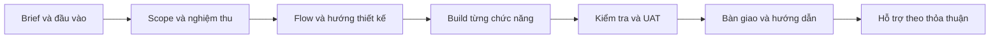

# Gia công website và cách làm web nhanh bằng AI

Ngày nghiên cứu: **11/10/2026**, Asia/Saigon. Theo yêu cầu: học cách nhận yêu cầu/hợp đồng làm web và cách creator dùng AI, template rồi tinh chỉnh. Chưa nhận dự án khách hàng, mua template, ký hợp đồng hoặc triển khai web.

Tài liệu là khung học về sản phẩm, kỹ thuật và quản lý dự án. Phần thỏa thuận thương mại là gợi ý để trao đổi; trước khi dùng ký hợp đồng tại Việt Nam cần người có chuyên môn pháp lý rà soát điều khoản theo trường hợp thực tế.

## 1. “Gia công web” có những loại việc nào?

Không nên báo giá chỉ bằng số trang. Một trang dashboard có quyền, lọc, xuất dữ liệu và cập nhật trạng thái có thể phức tạp hơn nhiều trang giới thiệu.

| Loại đầu việc | Đầu ra cần hiểu | Câu hỏi phân biệt scope |
|---|---|---|
| Landing/website giới thiệu | Nội dung, giao diện responsive, form liên hệ, công cụ cập nhật nội dung | Ai viết nội dung? Form gửi đi đâu? Khách tự sửa bài/ảnh thế nào? |
| Shop | Catalog, biến thể, giỏ hàng, đơn, thanh toán, vận chuyển, quản trị | Sandbox hay thanh toán thật? Đồng bộ kho nào? Ai xử lý webhook/refund? |
| Web app/dashboard | Tài khoản, vai trò, dữ liệu, thao tác nghiệp vụ, lịch sử thay đổi | Ai được xem/sửa bản ghi nào? Dashboard đếm theo luật nào? |
| Tích hợp AI/extension | Thu nhận dữ liệu, model/API, job, kiểm tra kết quả và quota | AI làm gì? Dữ liệu nào được gửi ra ngoài? Khi API lỗi/giới hạn thì sao? |
| Bảo trì/nâng cấp | Sửa lỗi, nâng dependency, thêm tính năng, vận hành | Đâu là lỗi của phạm vi đã ký, đâu là yêu cầu mới? |

**Template là vật liệu đầu vào. Giá trị bàn giao là hành vi đúng, nội dung phù hợp và khả năng vận hành.** Dựng nhanh một trang nhìn đẹp chỉ giải quyết một phần công việc.

## 2. Bộ yêu cầu và thỏa thuận cần chốt trước khi nhận việc

Nên có ba lớp: **brief** để hiểu vấn đề → **phạm vi công việc/SOW** để biết sẽ bàn giao gì → **thỏa thuận thương mại/pháp lý** để quy định trách nhiệm. Dự án nhỏ có thể gộp thành một tài liệu rõ ràng, không cần bắt chước bộ hồ sơ doanh nghiệp lớn.

Nguồn đối chiếu: [UK Model Services Contract — Guidance for Buyers](https://www.gov.uk/government/publications/guidance-on-the-model-services-contract), bản 2.2A năm 2025, có phần implementation, testing, intellectual property, change control và exit management. Đã đọc chọn lọc, không audit toàn bộ 132 trang. Đây là mẫu cho dịch vụ lớn/phức tạp của Anh; chỉ học cách tách trách nhiệm và bằng chứng, không coi đó là luật hoặc mẫu hợp đồng mặc định cho freelancer Việt Nam.

### 2.1 Bảng câu hỏi thực tế cho khách hàng

Các mục dưới là khung đề xuất tổng hợp cho dự án web, không phải trích nguyên một mẫu hợp đồng.

| Nhóm | Cần chốt bằng thông tin cụ thể | Nếu ghi mơ hồ dễ xảy ra gì? |
|---|---|---|
| Mục tiêu | Người dùng chính, việc họ cần làm, tiêu chí thành công | Làm nhiều màn nhưng không giúp khách đạt mục tiêu |
| Chức năng | Trang/luồng, actor, quyền, input/output, trạng thái lỗi | “Có admin” bị hiểu thành mọi chức năng quản lý |
| Phạm vi loại trừ | Thanh toán thật, chat, app mobile, dữ liệu lịch sử, ngôn ngữ phụ… nếu chưa bao gồm | Những phần không báo giá trở thành yêu cầu ngầm |
| Nội dung/asset | Ai cung cấp logo, ảnh, font, bài viết, bản dịch và ngày giao | Website chờ nội dung nhưng deadline vẫn bị tính như đủ đầu vào |
| Hướng giao diện | Mẫu tham khảo, điểm muốn học, bản thiết kế được duyệt, màn hình cần hỗ trợ | “Giống mẫu” nhưng mỗi bên hiểu một phần khác nhau |
| Tích hợp | API nào, môi trường test/live, account owner, người cấp quyền | UI có nút nhưng thiếu khóa hoặc quyền để hoạt động |
| Dữ liệu | Nguồn, quyền sử dụng, nhập/chuyển dữ liệu, dữ liệu nhạy cảm, xóa/xuất | Demo dùng data giả bị hiểu là đã có hệ thống dữ liệu thật |
| Chất lượng | Trình duyệt/viewport, keyboard, lỗi form, bảo mật theo chức năng, cách đo hiệu năng | Những câu “mượt”, “chuẩn SEO”, “bảo mật tuyệt đối” không thể nghiệm thu rõ |
| Tiến độ | Milestone, điều kiện bắt đầu, phụ thuộc khách, người duyệt và lịch phản hồi | Chậm duyệt/chậm API nhưng không có cách điều chỉnh lịch |
| Vòng chỉnh sửa | Số vòng cho mỗi mốc thiết kế, cách gom feedback, phạm vi mỗi vòng | “Sửa đến khi ưng” biến thành vòng lặp không kết thúc |
| Nghiệm thu | Dataset, bước kiểm tra, kết quả mong đợi, phân loại lỗi, cách xử lý chưa đạt | Mỗi bên tự định nghĩa “xong” khi đến hạn thanh toán |
| Phí và chi phí ngoài | Giá phần việc, mốc thanh toán, thuế/hóa đơn theo thỏa thuận, phí AI/domain/hosting/template | Giá làm web bị nhầm là đã bao gồm mọi chi phí vận hành mãi mãi |
| Quyền và bàn giao | Code/Figma/repo thuộc ai, license bên thứ ba, tài khoản nền tảng và thời điểm chuyển giao | Khách có URL nhưng không có quyền quản lý hoặc di chuyển |
| Hỗ trợ sau bàn giao | Thời hạn sửa lỗi, giờ hỗ trợ, mức ưu tiên, phản hồi khác thời gian khắc phục | Một lỗi ngoài giờ bị hiểu là có cam kết hỗ trợ 24/7 |
| Thay đổi/dừng dự án | Ai duyệt change request, ảnh hưởng phí/lịch, bàn giao phần đã làm, xử lý dữ liệu/tài khoản | Scope đổi nhưng công sức và trách nhiệm không được ghi lại |

### 2.2 Đặc biệt cần nói rõ nếu bên gia công dùng AI/template

- Khách cho phép dùng AI vào những công đoạn nào; tài liệu/dữ liệu nào được gửi tới công cụ bên ngoài. Dữ liệu demo và dữ liệu khách thật cần được nhận diện rõ.
- Liệt kê template, component, plugin, font, ảnh và dịch vụ trả phí. Quyền dùng code không tự đồng nghĩa quyền dùng toàn bộ ảnh/video minh họa đi kèm.
- Chốt “thiết kế riêng” nghĩa là riêng ở mức nào: từ bố cục mới, tùy biến template hay sử dụng component có sẵn. Không bán lại một mẫu có sẵn như thể toàn bộ là tài sản độc quyền tự tạo.
- Ai sở hữu workspace, repo, domain, database, tài khoản API; ai trả phí và quản lý quota sau bàn giao.
- Nếu giao project trong một builder, ghi đúng thứ được giao và giới hạn chuyển nền tảng; không mặc định có source chạy độc lập chỉ vì có nút Publish.
- Bên gia công vẫn phải kiểm tra đầu ra đã cam kết. Dòng “AI sinh ra” không thay bằng chứng nghiệm thu.

Ví dụ về license đã kiểm tra: [Webflow template license](https://webflow.com/templates/template-licenses) có quy định single-use cho một end product; [21st Terms](https://docs.21st.dev/terms) phân biệt quyền component với demo/preview/media. Cần xem license của đúng vật liệu, đúng cách sử dụng; không suy từ “tải được” thành “được dùng cho mọi khách hàng”.

### 2.3 Cách báo giá và kiểm soát thay đổi — mô hình học tập

| Cách làm | Hợp khi | Cần ghi rõ |
|---|---|---|
| Giá cố định theo scope | Đầu ra và nghiệm thu đủ rõ | Giả định, phần loại trừ, số vòng thiết kế, quy trình change request |
| Tính theo thời gian | Khám phá/tích hợp chưa biết trước, nhiều thay đổi | Đơn giá, trần ngân sách, báo cáo thời gian/kết quả và điểm dừng |
| Chia giai đoạn | Bài toán còn mơ hồ nhưng cần kiểm soát ngân sách | Discovery/bản thảo trước; ước lượng phần build sau khi scope rõ |

Không chốt bảng giá thị trường hoặc tỷ lệ đặt cọc “chuẩn” ở đây. Tốc độ AI sinh code không phải toàn bộ công sức: còn khám phá, nội dung, chỉnh sửa, tích hợp, kiểm thử, bàn giao và hỗ trợ.

**Phân biệt ba việc:** đổi màu trong hướng đã duyệt là chỉnh sửa; filter trả sai so với acceptance là lỗi; thêm đặt cọc online ngoài scope là tính năng mới. Giới hạn vòng chỉnh giao diện không nên bị dùng để coi lỗi chưa đáp ứng acceptance là công việc phát sinh.

Mẫu ghi thay đổi: `CR-01 — yêu cầu gì → khác baseline ở đâu → ảnh hưởng màn/API/data/test → ảnh hưởng phí/lịch → người duyệt → phiên bản áp dụng`. Không có thay đổi được xác nhận thì chưa ghi nó vào phạm vi đã cam kết.

## 3. Biến yêu cầu mơ hồ thành tiêu chí nghiệm thu

| Khách nói | Cách viết rõ hơn — ví dụ học tập |
|---|---|
| “Web đẹp như mẫu này” | Ghi các phần tham khảo: hierarchy, spacing, typography; duyệt bản của dự án; chỉ ra viewport và các trạng thái cần có |
| “Có dashboard” | Chốt từng chỉ số, nguồn, bộ lọc thời gian, ai thấy được và hành động đi kèm; không dùng số giả khi nghiệm thu dữ liệu thật |
| “Tìm kiếm nhanh” | Chốt lượng dữ liệu, loại query, số người/tần suất, môi trường và ngưỡng đo; không chỉ ghi một số user |
| “Responsive” | Chốt nhóm thiết bị/viewport thử; không tràn nội dung; menu/form dùng được; không chỉ co ảnh desktop |
| “AI lấy đúng giá” | Chốt schema/đơn vị, missing=null, tập đánh giá giữ riêng, metric/ngưỡng và cách xử lý không đủ evidence |
| “Bàn giao source” | Repo tại commit xác định + dependency lock + cấu hình mẫu không có secret + migration/seed hợp lệ + lệnh chạy + hướng dẫn account/deploy |

**Ví dụ cho ReNER, chỉ để học viết acceptance:** dữ liệu mẫu có tin giá/phòng và giá/người; khi lọc giá/phòng/tháng, kết quả chỉ gồm bản ghi đủ điều kiện tương ứng; tin chưa rõ đơn vị không bị tự quy đổi. Người thường gọi trực tiếp API quản trị phải bị từ chối. Khi gửi lặp cùng một yêu cầu sau lỗi mạng, hệ thống không tạo tác dụng trùng ngoài ý muốn.

Các ngưỡng hiệu năng, độ chính xác, thời gian bảo hành và số vòng sửa phải được thỏa thuận cho dự án thật; tài liệu này không tự đặt chúng cho demo ReNER.

### 3.1 Flow bàn giao theo các mốc có duyệt



Mỗi mốc có output và người duyệt. AI/template có thể rút ngắn phần dựng ban đầu; các mốc vẫn cần bằng chứng. Khi scope thay đổi, cập nhật baseline và ảnh hưởng thay vì xem Waterfall là “cấm thay đổi”.

Bàn giao tốt phải để người nhận tự thực hiện được việc thường ngày: sửa nội dung, quản lý người dùng, xem lỗi, lấy dữ liệu và chạy lại trong phạm vi đã cam kết. Một URL mở được chưa chứng minh đã bàn giao đủ.

## 4. Nghiên cứu creator/YouTube: họ làm nhanh bằng cách nào?

**Cách khảo sát:** đọc chọn lọc transcript, mô tả, chapter và metadata công khai; đối chiếu docs chính thức. Không phát và xem toàn bộ video trực tiếp. YouTube có lần trả lỗi/throttled nên transcript của ba video được đọc tại trang video do Lovable đăng; bản HTML/text đã lưu. Với Astro chỉ xác minh mô tả video qua kết quả YouTube; với Lenny chỉ dùng phần giới thiệu công khai, không truy cập phần trả phí. Không dùng các trang AI tự tóm tắt video làm bằng chứng chính.

### 4.1 Năm ví dụ có đường dẫn và mức bằng chứng

| Creator / video | Dữ liệu đã đọc | Điều đáng học |
|---|---|---|
| **Brock Mesarich** — [Brand NEW Lovable x Figma Integration](https://www.youtube.com/watch?v=c_qnRGzQUxA), metadata 23/01/2025 | Transcript/mô tả tại [Lovable](https://lovable.dev/video/brand-new-lovable-x-figma-integration-build-amazing-ui) | 00:43 chọn template Figma; 01:21 dùng Builder plugin; 01:48 chỉnh Auto Layout; 02:22 so output; 02:53 đưa sang Lovable. Tại 04:23, người nói nêu nút chưa có chức năng. Một UI import thành công chưa hoàn thành web app |
| **Lukas Margerie** — [Building a Dashboard in Lovable](https://www.youtube.com/watch?v=SL0GDHkQX9A), metadata 24/02/2025 | Chapter và các đoạn transcript tại [Lovable](https://lovable.dev/video/building-a-dashboard-in-lovable-claude-ai-mockups-figma-to-lovable-framer-landing-page) | Claude mockup → html.to.design/Figma → Auto Layout → Lovable → chỉnh responsive → thêm chức năng/auth; Framer làm landing. Chapter 35:05 mobile, 44:16 chức năng, 53:39 auth, 59:24 thử auth. Khoảng 48:54, “fine-tuning your product” chỉ việc sửa sản phẩm qua prompt |
| **Flux Academy** — [Did Lovable Kill Webflow?](https://www.youtube.com/watch?v=qe2M17aVito), metadata 11/03/2025 | Các đoạn transcript tại [Lovable](https://lovable.dev/video/did-lovable-kill-webflow) | Khoảng 05:01 bàn về nội dung/sitemap/asset với khách trước khi build; khoảng 13:07 đặt vấn đề khách sửa nội dung/CMS thế nào. Hữu ích để thấy phần bàn giao mà video “làm nhanh” dễ bỏ qua |
| **Astro K Joseph** — [This Is My Secret To Building Dope UI Using AI](https://www.youtube.com/watch?v=yhIsMcwGPko), mô tả YouTube ghi 30/12/2025 | Tiêu đề, tác giả, mô tả và danh sách nguồn; chưa xác minh đầy đủ transcript | Mô tả giới thiệu 21st.dev, Uiverse, Landingfolio, Land-book, Navbar Gallery. Dùng để tìm nguồn tham khảo; không lấy lời hứa tốc độ/chất lượng làm benchmark |
| **Lenny Rachitsky / Lazar Jovanovic** — [The rise of the professional vibe coder](https://youtu.be/0XNkUdzxiZI), trang bài 08/02/2026 | [Giới thiệu công khai của tác giả](https://www.lennysnewsletter.com/p/getting-paid-to-vibe-code); phần takeaways có trả phí, chưa đọc | Trang giới thiệu nhấn mạnh planning, PRD/Markdown và quản lý context. Đây là lời chia sẻ của khách mời làm tại Lovable, không là đánh giá độc lập về mọi nền tảng |

Các video 2025 được dùng để học **cách làm**, không coi giao diện/tooling của video là phiên bản hiện tại. Có affiliate, tiếp thị hoặc liên hệ với nền tảng ở một số nguồn; chưa xác minh doanh thu, thời gian tiết kiệm hoặc mức độ “production-ready” được quảng bá.

### 4.2 Điểm chung rút ra — suy luận tổng hợp

1. **Chuẩn bị trước phần khó diễn đạt:** mẫu, nội dung, flow, một hướng thiết kế và component. Video bắt đầu gõ prompt không có nghĩa công việc bắt đầu từ đó.
2. **Dùng lại vật liệu:** bố cục/template, form, bảng, icon, auth hoặc dịch vụ có sẵn; giảm phần dựng thủ công.
3. **Chia công việc:** bố cục trước, responsive tiếp, chức năng và dữ liệu sau; mỗi lần chỉ sửa một nhóm vấn đề.
4. **Dùng phản hồi trực quan:** chỉ phần tử hoặc screenshot, mô tả khác biệt, sửa, xem lại. Prompt “làm đẹp hơn” thiếu đích kiểm tra.
5. **Giữ ngữ cảnh:** yêu cầu, style, contract và quyết định trong tài liệu; tránh mỗi lượt AI tự đổi hướng.

Không có bằng chứng các ví dụ này cần tự huấn luyện một model mới để dựng UI. Video dài 5 phút hoặc ghi “1 giờ” cũng không chứng minh tổng công sức gồm khám phá, quay dựng, chuẩn bị, kiểm thử và bảo trì chỉ có từng đó.

## 5. Lấy mẫu ở đâu và đưa cho AI cái gì?

Phải phân biệt **ảnh để tham khảo**, **file thiết kế**, **component có code** và **ứng dụng mẫu**. Chúng có mức hoàn thiện khác nhau.

| Nguồn | Loại vật liệu | Cách dùng có ích |
|---|---|---|
| [Mobbin](https://mobbin.com/) | Tham khảo màn hình/flow của ứng dụng | Học cách lọc, onboarding, trạng thái; ghi rõ phần muốn áp dụng, không suy ra có source code |
| [Landingfolio](https://www.landingfolio.com/) | Tham khảo landing và các tài nguyên thiết kế | Học thứ tự nội dung, hero, CTA; phân biệt gallery với tài nguyên có license dùng lại |
| Figma — nguồn có file thiết kế phù hợp | Frame, Auto Layout, component, token | Đưa cấu trúc/giá trị cụ thể cho công cụ; kiểm tra nguồn và quyền của từng file |
| [shadcn/ui](https://ui.shadcn.com/docs) | Code component có thể sửa trực tiếp | Dùng form, table, dialog, sidebar làm nền nhất quán; vẫn phải nối nghiệp vụ |
| [21st.dev](https://21st.dev/) | Registry nhiều tác giả/component, prompt để tích hợp | Chọn component đúng stack, preview rồi đưa code/prompt cho AI; rà lại dependency và style |
| [Uiverse](https://uiverse.io/) | UI element với HTML/CSS, Tailwind, React/Figma | Học hoặc dùng button/input/loader cụ thể; tránh ghép quá nhiều phong cách |
| [Webflow templates](https://webflow.com/templates) / [Framer templates](https://www.framer.com/marketplace/templates/) | Template dành cho nền tảng | Hợp website nội dung/marketing nếu khả năng chỉnh sửa và bàn giao phù hợp; không mặc định biến thành app FastAPI |
| [Relume](https://www.relume.ai/resources/docs/building-a-sitemap-with-ai) | Sitemap và cấu trúc trang hỗ trợ bởi AI | Dùng brief để tạo cây trang/wireframe, chỉnh trước khi lên visual; chưa thay luồng nghiệp vụ của web app |
| [v0 templates](https://v0.app/docs/templates) và repo mẫu đã khảo sát | Khung code/app có sẵn | Kiểm kê route, data giả, auth và integration trước khi lấy làm nền |

**Ví dụ chọn mẫu cho ReNER:** cần học catalog có filter, card có giá/đơn vị, trang chi tiết có nguồn và admin có bảng duyệt. Một landing nhiều hiệu ứng có thể không giúp giải quyết các phần này. Đây là tiêu chí chọn để học, chưa chốt thiết kế mới.

### 5.1 Docs hiện hành khác video cũ ở đâu?

[Lovable Figma docs](https://docs.lovable.dev/integrations/figma), đọc ngày 11/10/2026, phân biệt ba đường: plugin, Figma MCP và upload `.fig`. Upload `.fig` cung cấp token/style/cấu trúc và preview; **không tự nhập lại toàn bộ thiết kế tương tác/component**. MCP trong docs yêu cầu app desktop và điều kiện Figma tương ứng. Vì vậy không diễn giải mọi thao tác “đưa file Figma vào” là giống nhau. Chưa tự thử các integration này.

[Lovable 21st.dev guide](https://docs.lovable.dev/tips-tricks/21stdev) hướng dẫn dùng component; [preview toolbar](https://docs.lovable.dev/features/preview-toolbar) cho chọn phần tử, sửa text, vẽ chú thích và comment. Công cụ chọn đúng phần tử giúp prompt có vị trí rõ hơn. [v0 Figma docs](https://v0.app/docs/figma) là một đường tham khảo khác, không cần đi qua mọi công cụ trong video.

Khi chọn workflow, ưu tiên số bước chuyển đổi vừa đủ. Chuỗi Claude → HTML → Figma → Builder → Lovable minh họa một cách làm của creator, không là công thức bắt buộc. Mỗi lần chuyển định dạng có thể phát sinh lỗi layout, font hoặc component cần xem lại.

## 6. “Fine-tune” website ở đây nghĩa là gì?

| Việc làm | Thực chất thay đổi gì? | Có huấn luyện trọng số model không? |
|---|---|---|
| Sửa prompt | Mô tả yêu cầu/ràng buộc rõ hơn | Không |
| Đưa reference/code/tài liệu | Bổ sung ngữ cảnh cho lần xử lý | Không |
| Đưa ví dụ mẫu | Hướng dẫn bằng ví dụ trong context | Không |
| Sửa token/CSS/component | Thay code hoặc thông số của website | Không |
| Preview → góp ý → sửa | Lặp để tinh chỉnh sản phẩm | Không |
| Fine-tuning mô hình đúng nghĩa | Huấn luyện tiếp tham số/adapter từ dữ liệu để đổi hành vi model | Có, cần dữ liệu, quy trình train và đánh giá riêng |

Với mục tiêu “làm website đẹp, đúng flow và nhanh hơn”, trước hết là **tinh chỉnh sản phẩm và context**. Fine-tune model không phải bước mặc định. Nếu sau này nghiên cứu fine-tune NLP cho tin trọ, đó là bài toán riêng: cần dữ liệu có quyền sử dụng, tập đánh giá độc lập và so sánh với baseline. Lượt này không đề xuất hoặc chạy huấn luyện.

### 6.1 Cách tinh chỉnh theo thứ tự, tránh sửa lan man

1. **Nội dung và flow:** người dùng thấy gì, làm gì tiếp, thông tin nào cần để quyết định.
2. **Bố cục:** thứ bậc, độ rộng vùng nội dung, khoảng cách, sidebar và cách xuống hàng trên mobile.
3. **Style chung:** màu, font, cỡ chữ, spacing, border/radius; sửa ở token/component dùng chung trước.
4. **State:** mặc định, hover/focus, loading, empty, error, disabled, success.
5. **Dữ liệu/quyền:** nối dữ liệu thật hoặc fixture được gắn nhãn; thử đúng/sai quyền và input lỗi.
6. **Motion:** thêm để giải thích thay đổi trạng thái, kiểm tra reduced motion; tránh che lỗi chức năng bằng hiệu ứng.
7. **Regression:** thử lại màn/flow có thể bị ảnh hưởng, lưu commit và evidence.

Một lỗi API phải được xử lý bằng kiểm tra request/response/server, không tiếp tục chỉnh CSS. Một vấn đề bố cục nên có vị trí/viewport cụ thể, không yêu cầu AI viết lại toàn app.

### 6.2 Ba prompt minh họa — tài liệu học, chưa thực thi

**Trước khi chọn mẫu:**

```text
Đây là brief, flow và hai ảnh tham khảo. Hãy phân tích từng ảnh:
phần nào giúp người dùng hoàn thành nhiệm vụ, phần nào chỉ trang trí.
Đề xuất một hướng bố cục nhất quán và liệt kê các trạng thái còn thiếu.
Chỉ viết bản thảo; các giả định chưa có trong brief phải ghi riêng.
```

**Khi sửa một phần UI đã có:**

```text
Chỉnh vùng bộ lọc trên màn danh sách theo ảnh có chú thích.
Mục tiêu: người dùng nhìn rõ giá và đơn vị, nhãn dài không tràn.
Dùng token và component hiện có. Ở mobile, bộ lọc mở trong drawer.
Giữ hành vi tìm/lọc đã thống nhất. Sau khi sửa, kiểm tra desktop,
mobile, keyboard và các trạng thái rỗng/lỗi. Báo file đổi và bằng chứng.
```

**Khi yêu cầu thêm một chức năng:**

```text
Trước khi code, đối chiếu acceptance và API contract của chức năng.
Chỉ ra input, quyền, trạng thái, dữ liệu cần lưu và phụ thuộc còn thiếu.
Nếu API chưa có, ghi rõ mock nào sẽ dùng và giới hạn của mock.
Sau khi triển khai, chứng minh cả trường hợp thành công, sai quyền
và mất kết nối; không coi nút click được là đã hoàn thành chức năng.
```

Các prompt này có giá trị khi kèm brief/ảnh/contract thật. Chúng không bảo đảm kết quả nếu đầu vào thiếu hoặc không kiểm tra lại.

## 7. Áp dụng bài học vào ReNER ở mức bản thảo

Giữ nguyên mục tiêu demo, người tìm trọ và extension chọn từng tin. Không thêm công nghệ hoặc nâng yêu cầu chịu tải từ chuyên đề này.

| Điều học thêm | Chuyển thành việc chuẩn bị nào? |
|---|---|
| Scope và nghiệm thu của dự án gia công | Mỗi tính năng demo có mô tả rõ, đầu vào và điều kiện quan sát được |
| Template/component tiết kiệm công dựng | Chọn tài nguyên phù hợp catalog/admin; ghi phần học và phần tự làm |
| AI cần context có cấu trúc | Tái sử dụng proposal, luật giá/đơn vị, trạng thái và log đã có |
| Video nhanh thường giới hạn phạm vi | Tách UI mẫu, dữ liệu mẫu, chức năng tích hợp và bằng chứng thật |
| Khách cần tự quản lý sau bàn giao | Nghĩ trước admin chỉnh/duyệt gì, dashboard giúp quyết định gì, cách chạy lại demo |

Ví dụ với sidebar: menu nên xuất phát từ công việc như xem tin, theo dõi phân tích, duyệt tin và quản lý nguồn/quyền. Học cách nhóm menu/badge/collapse từ KusShoes; không mặc định mang Billing hoặc Bake Jobs sang đề tài chỉ vì mẫu có sẵn.

## 8. Nên đọc/xem theo thứ tự nào?

1. **Astro K Joseph:** tìm các nhóm nguồn mẫu; sau đó mở trực tiếp 21st/Uiverse/Mobbin để hiểu mỗi loại cho mình cái gì.
2. **Brock:** xem đường Figma → code và điểm UI còn thiếu chức năng; khi thử thật dùng docs hiện hành.
3. **Lukas:** ưu tiên các chapter user flow, mobile, thêm chức năng và auth; quan sát số bước tinh chỉnh thay vì chỉ xem kết quả cuối.
4. **Flux Academy:** đọc/xem phần làm cho khách và cập nhật nội dung sau bàn giao.
5. **Lenny/Lazar:** xem như góc nhìn về planning/context, rồi đối chiếu với harness/ticket/evidence đã nghiên cứu.

Nguồn lưu và mức kiểm chứng xem [hồ sơ nguồn](sources/outsourcing-ai-2026-10-11/README.md); tiến trình xem [WORK_LOG](WORK_LOG.md). Tài liệu này bổ sung cho [chuyên đề AI/harness trước](NGHIEN-CUU-HARNESS-SCALE-AI.md), không thay bản kiến trúc v0.2.
