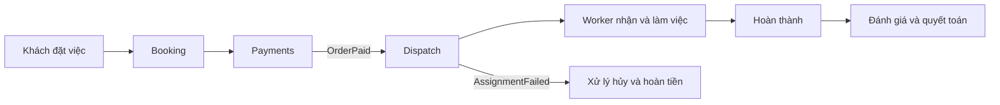
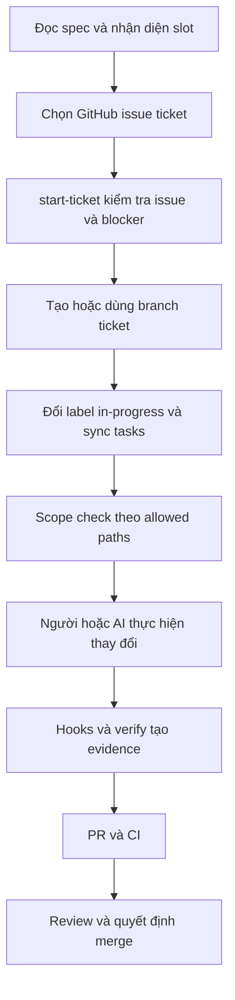
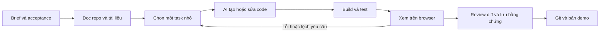

# ReNER-VN — học từ harness, khả năng chịu tải và luồng AI làm web

Ngày nghiên cứu: 10/10/2026. Phạm vi: **kiến thức và bản thảo để làm demo**, theo xác nhận mới nhất của người dùng. Ví dụ 5.000 người chỉ để học, không trở thành yêu cầu tải của dự án. Không đổi thiết kế v0.2, không code app, không triển khai dịch vụ trong lượt này.

Đọc cùng [sổ kiến thức tổng hợp](KIEN-THUC-TONG-HOP.md), [kế hoạch](PLAN.md), [log](WORK_LOG.md). Các phần dưới phân biệt: **quan sát từ code**, **tuyên bố của tác giả**, **suy luận áp dụng cho ReNER** và **ví dụ giả định**. Repo nhiều star là nguồn học, không phải chứng nhận an toàn hoặc phù hợp.

## 1. ChoThueGiupViec: sản phẩm chạy như thế nào?

Nguồn ghim: [kiet-ta/ChoThueGiupViec, commit 1b45c1f](https://github.com/kiet-ta/ChoThueGiupViec/tree/1b45c1f4cce8a5b40bdae9d24ac262437b857b0d). Có bản clone đọc tại [sources/ChoThueGiupViec](sources/ChoThueGiupViec). Đây là khảo sát chọn lọc spec, kiến trúc, script, một số handler và CI; chưa chạy ứng dụng hoặc toàn bộ test suite.

### 1.1 Luồng nghiệp vụ và cấu trúc code

Actors trong spec gồm khách hàng, người giúp việc tự do/nhân viên agency, đối tác agency và admin. Luồng được mô tả:

1. Khách chọn dịch vụ Economy/Premium, địa chỉ, ca và thông tin đặt việc.
2. Hệ thống tính giá, tạo đơn chờ thanh toán và mã QR.
3. Payment xử lý thông báo thanh toán, xác thực và chống xử lý lặp; phát `OrderPaid`.
4. Dispatch nhận sự kiện để bắt đầu phân công/offer cho worker.
5. Worker nhận việc, check-in, thực hiện; khách xác nhận, đơn hoàn thành.
6. Đánh giá và quyết toán/payout; nhánh ngoại lệ xử lý không tìm được worker, hủy, vắng mặt, tranh chấp, hoàn tiền.

Đây là flow mục tiêu được spec mô tả, không phải chứng nhận tất cả bước đã chạy end-to-end. Code [OrderPaidDispatchHandler](https://github.com/kiet-ta/ChoThueGiupViec/blob/1b45c1f4cce8a5b40bdae9d24ac262437b857b0d/Backend/Application/Features/Dispatch/OrderPaidDispatchHandler.cs) thực sự nhận `OrderPaid`. [JobOrderStateMachine](https://github.com/kiet-ta/ChoThueGiupViec/blob/1b45c1f4cce8a5b40bdae9d24ac262437b857b0d/Backend/Domain/StateMachines/JobOrderStateMachine.cs) quy định các chuyển trạng thái như PendingPayment → Paid → Dispatching → Assigned → Completed, kèm các nhánh Cancelled và phân công lại.

Stack đọc từ repo: backend .NET 10/SQL Server; web React/TypeScript/Vite/Tailwind và shadcn; mobile Flutter. Backend chia Domain, Application, Infrastructure, WebAPI trong cấu trúc dự án của họ. Có 12 vùng nghiệp vụ: Identity, Customers, Booking, Payments, Dispatch, Workers, Agencies, Skills, Ratings, Disputes, Payouts, Admin. Nhiều module không có nghĩa là nhiều microservice.

Request đi qua API → command/query và handler → domain rule/state machine → repository/port → persistence/integration. MediatR giúp định tuyến handler/sự kiện trong ứng dụng; bản thân nó không chứng minh có hàng đợi bền vững hoặc đảm bảo event không mất khi process chết.

**Port** là giao diện một module yêu cầu từ module khác. **Fake** là implementation giả cho phát triển/test khi chức năng thật chưa sẵn sàng. [DependencyInjection](https://github.com/kiet-ta/ChoThueGiupViec/blob/1b45c1f4cce8a5b40bdae9d24ac262437b857b0d/Backend/Infrastructure/DependencyInjection.cs) đăng ký module thật trước, fake dùng TryAdd sau đó. Vì vậy có thể khởi động và làm phần mình mà chưa có tất cả integration. Đổi lại, “app mở được” chưa đủ để kết luận đang dùng toàn bộ implementation thật. PaymentsModule ở commit đã đọc đăng ký RefundService thật.

**Học cho ReNER:** diễn tả dữ liệu đi qua nhận tin → trích xuất → kiểm tra → duyệt → công bố → tìm/lọc/so sánh. Tách trạng thái và điều kiện chuyển trạng thái; chỉ số dashboard lấy từ trạng thái thật. Đây là bài học, không thêm module booking/payment vào ReNER.

### 1.2 Flow phát triển: không đủ căn cứ gọi Waterfall thuần

Nguồn: [overview](https://github.com/kiet-ta/ChoThueGiupViec/blob/1b45c1f4cce8a5b40bdae9d24ac262437b857b0d/.spec/plan/00-overview.md), [team](https://github.com/kiet-ta/ChoThueGiupViec/blob/1b45c1f4cce8a5b40bdae9d24ac262437b857b0d/.spec/team.md), [AGENTS](https://github.com/kiet-ta/ChoThueGiupViec/blob/1b45c1f4cce8a5b40bdae9d24ac262437b857b0d/AGENTS.md).

| Lớp tổ chức | Có gì trong repo | Giải quyết vấn đề gì? |
|---|---|---|
| Bài toán | PRD, spec, decisions | Biết làm cho ai, luật nào được thống nhất |
| Hợp đồng | `.spec/contracts/` | Chốt endpoint, DTO, lỗi trước khi các bên tích hợp |
| Phân việc | Team M1–M6, plan theo module/wave | Biết người nào phụ trách vùng nào, việc nào bị chặn |
| Thực thi | GitHub issue có label `ticket`, branch theo ticket, PR | Liên kết yêu cầu với thay đổi code |
| Kiểm tra | Scope, verify, evidence, CI | Có bằng chứng thay đổi nằm đúng phạm vi và qua các check đã định nghĩa |

Các vai trò phân công: M1 nền tảng/identity/customers; M2 booking/payments; M3 dispatch/field và nền mobile; M4 workers/quality; M5 agency/B2B/skills; M6 ratings/disputes/payout/admin và nền web. Đây là cách chia cho đội 6 người của họ, không bắt buộc đội demo ReNER cũng chia sáu vai trò.

G0 skeleton/port/fake → G1 data → G2 auth → G3 contract → G4 OpenAPI/client. Tại snapshot, overview đánh dấu G0–G2 xong, G3–G4 chưa xong. Checklist là trạng thái tác giả ghi, cần đối chiếu code/CI khi dùng để quyết định công việc. Plan cho phép backend các module chạy song song, web/mobile bắt đầu với mock khi contract sẵn sàng.

Nhận định phù hợp: **phát triển theo spec, có gate và tích hợp tăng dần qua ticket/PR**. Chưa đủ căn cứ nói họ vận hành Waterfall thuần. Waterfall mô tả trình tự yêu cầu → phân tích → thiết kế → triển khai → kiểm thử → vận hành; P0/P1/P2 mô tả ưu tiên/phạm vi tính năng, không phải tên các giai đoạn Waterfall.

## 2. Harness: cơ chế thật và giới hạn

Harness ở đây là tập hợp tài liệu, script, hooks và CI bao quanh quá trình sửa code. Nó giúp AI/người làm đúng ticket và đưa bằng chứng kiểm tra; không phải một mô hình AI riêng, không tự bảo đảm code đúng nghiệp vụ.

### 2.1 “Chạy lên hỏi mình là ai” đúng tới đâu?

**Có hướng dẫn hỏi tên trong AGENTS.md. Không có hành vi hỏi tên trong `harness/run.ps1`.**

Theo AGENTS, khi người dùng nói **“phân tích dự án”**, AI được hướng dẫn:

1. Hỏi “Bạn tên gì?” và chờ câu trả lời.
2. Đối chiếu tên/alias với `.spec/team.md` để tìm slot M1–M6; không khớp thì hỏi lại slot.
3. Đọc tiến độ mới, plan, quyết định và ticket; kiểm tra bằng chứng thay vì tự tin vào dấu tick.
4. Báo vai trò, vùng phụ trách, gate, việc hoàn tất/ready/blocked và tối đa ba việc đề xuất.
5. Sau khi người dùng chọn ticket mới bắt đầu ticket; biết tên không đồng nghĩa tự code mọi việc của người đó.

Đây là **giao thức hội thoại cho agent có đọc rule**, không phải tính năng nhận diện tài khoản tự động. Nó phụ thuộc AI/editor thực sự nạp và làm theo file. Không cần chạy app để kích hoạt câu hội thoại ấy.

[run.ps1](https://github.com/kiet-ta/ChoThueGiupViec/blob/1b45c1f4cce8a5b40bdae9d24ac262437b857b0d/harness/run.ps1) nhận `-Tool` rồi gọi đúng script Node/Git Bash. Bốn lựa chọn: verify, scope-check, guard-command, start-ticket. Root package.json chỉ có prepare Husky; không có lệnh npm tổng quát hỏi tên rồi tự phân vai.

### 2.2 Từ ticket đến code và PR

| Cơ chế | Thực sự làm gì theo file đã đọc | Không chứng minh được điều gì? |
|---|---|---|
| `sync-issues.mjs` | Đọc tối đa 200 issue label ticket; sinh `.spec/tasks.md` từ status, allowed paths, acceptance, blockers | Issue đóng chưa chắc đã triển khai thành công; không xác minh runtime |
| `start-ticket.mjs` | Đọc issue qua gh; từ chối closed/blocked/review hoặc blocker chưa đóng; tìm/tạo branch; đổi label, thử assign @me, sync và scope-check | Không kiểm tra người chạy đúng slot; không khóa ticket độc quyền; không tự gọi agent để code |
| `scope-check.sh` | Branch phải là ticket; ticket in-progress; so file thay đổi với allowed paths và protected paths | Đúng file chưa chắc đúng logic; không chứng minh không có xung đột nghiệp vụ |
| `guard-command.sh` | Kiểm tra chuỗi command theo denylist | Không phải sandbox của hệ điều hành; không bảo đảm mọi công cụ đều đi qua guard |
| `check-agent-config.sh` | Kiểm tra file, JSON/frontmatter, mirror config và một số mẫu cấu hình/path credential | Không thể chứng minh AI thực sự tuân thủ rule chỉ từ cấu hình hợp lệ |
| Husky hooks | Pre-commit chạy scope và kiểm tra theo folder; pre-push chạy verify L2 | Chỉ là một lớp kiểm tra local; hiệu lực repo còn phụ thuộc CI và branch protection |
| GitHub Actions | PR có scope check; job verify-l3 build/test và upload evidence | Không thay review nghiệp vụ, test luồng thật, hay cấu hình branch protection |

Nguồn script ghim: [harness](https://github.com/kiet-ta/ChoThueGiupViec/tree/1b45c1f4cce8a5b40bdae9d24ac262437b857b0d/harness), [CI](https://github.com/kiet-ta/ChoThueGiupViec/blob/1b45c1f4cce8a5b40bdae9d24ac262437b857b0d/.github/workflows/dotnet.yml), [hooks](https://github.com/kiet-ta/ChoThueGiupViec/tree/1b45c1f4cce8a5b40bdae9d24ac262437b857b0d/.husky).

Start-ticket gồm nhiều thao tác Git/GitHub nối tiếp, không phải transaction duy nhất: một bước sau lỗi có thể để lại branch/label đã đổi. `--dry-run` vẫn đọc GitHub nhưng thoát trước các thay đổi chính. Lượt nghiên cứu này không chạy start-ticket trên repo của họ.

`sync-issues` coi issue CLOSED là done, không phân biệt đóng vì hoàn thành hay không làm. Việc dependency đã đóng chỉ là tín hiệu điều phối, cần bằng chứng acceptance/PR để kết luận chức năng đã có. Giới hạn 200 liên quan số issue đọc, không liên quan số người dùng app.

### 2.3 Verify L1/L2/L3 và bằng chứng thực tế

| Level | Check đọc được trong script |
|---|---|
| L1 | Agent config, dotnet format whitespace, frontend oxlint |
| L2 | L1 + dotnet build + TypeScript tsc |
| L3 | L2 + dotnet test --no-build + frontend build + kiểm tra namespace kiến trúc và một số mẫu secret |

Evidence được lưu dưới `.harness/evidence/`. Trong script đã đọc, **L3 không gọi frontend `npm test`**, dù frontend có script test; cũng không chạy Flutter test. Scope-check là bước riêng, không tự nằm trong mọi lần verify. Chưa đo thời gian chạy hoặc kiểm chứng toàn bộ test coverage.

Ví dụ cụ thể [PR #260](https://github.com/kiet-ta/ChoThueGiupViec/pull/260) / [issue #259](https://github.com/kiet-ta/ChoThueGiupViec/issues/259): bổ sung RefundService thật, migration trường refund, reserve bằng conditional UPDATE trước gateway và hoàn tác nếu lỗi. PR ghi 1.553 backend tests pass trong môi trường container của tác giả; **đó là số tác giả báo, không phải mình chạy lại**. PR cũng ghi SQL Server không kết nối được, migration chưa áp dụng và chưa có DB-backed test cho thay đổi này. Các hạn chế refund retry/capacity hold được nêu trong PR.

GitHub check-runs API cho commit ghim trả `verify-l3: success`, `scope: skipped`; snapshot lưu tại [check_runs.json](sources/scale-ai-harness-2026-10-10/check_runs.json). Trạng thái này không chứng minh mọi PR scope đã bị bỏ qua: workflow scope chỉ chạy cho sự kiện PR, còn đây là kết quả ở commit đã merge. Chưa tải và audit từng dòng CI log. Chưa xác minh cấu hình required checks/branch protection của GitHub.

### 2.4 Những điểm nên học và không sao chép máy móc

- **Nên học:** yêu cầu có mã, contract trước tích hợp, state machine, ticket có acceptance và allowed paths, PR nối issue, log có command/kết quả/giới hạn; các nguyên tắc này giảm việc AI đoán yêu cầu.
- **Phải bổ sung khi tự làm:** đường chạy có dữ liệu thật; nhận diện fake/mock rõ; test object permission và failure/retry; các kiểm tra thực sự cần thiết được gọi trong CI; cập nhật tài liệu khi script đổi.
- **Có drift trong tài liệu:** HARNESS đầu file còn nói design proposal trong khi phần sau/script đã hiện hữu; hướng dẫn tasks/status cũ khác AGENTS/code mới. README có hướng dẫn ngoại lệ hook khác rule AGENTS. Khi xung đột, ghi nhận khác biệt và xem code/CI ở commit cụ thể.
- **Không sao chép khẩu hiệu hiệu năng:** các tuyên bố 0 JOIN/O(1) trong tài liệu không thay cho đo query; B-tree không có bảo đảm tổng quát O(1). JOIN có index và query plan phù hợp có thể là lựa chọn đúng. ReNER cần provenance và quan hệ dữ liệu rõ, không có yêu cầu cấm JOIN.
- **Không gọi repo hoàn thiện production:** spec/checklist/test có giới hạn; nhiều tầng, nhiều branch, CI xanh chưa đủ chứng minh hành vi với DB, tích hợp ngoài và lỗi mạng.

Kết luận học tập: điều giá trị nhất là **khả năng truy ngược một thay đổi về yêu cầu, người phụ trách và bằng chứng**, hơn là số lượng folder hoặc số bước buộc AI đọc.

## 3. Học về scale: vì sao CPU và RAM chưa đủ?

**Không thể đổi số người dùng trực tiếp thành cấu hình máy.** Phải biết họ làm gì, tần suất, dữ liệu bao nhiêu, mức chậm/lỗi chấp nhận được. Phần này là mô hình giải thích, chưa benchmark ReNER và không đặt mục tiêu phục vụ 5.000 người.

### 3.1 Bốn con số hay bị nhầm

| Khái niệm | Nghĩa | Ví dụ trong web thuê trọ |
|---|---|---|
| Tài khoản đăng ký | Tổng người từng đăng ký | 5.000 tài khoản, có thể chỉ vài người đang dùng |
| Người hoạt động/ngày | Số người dùng khác nhau trong ngày | Không nói được giờ cao điểm có bao nhiêu người |
| Người dùng đồng thời | Người đang có phiên hoạt động cùng lúc | Một người đang đọc tin chưa chắc gửi request |
| RPS / request đang xử lý | Số request mỗi giây / request chưa hoàn tất | Một thao tác lọc có thể gọi nhiều API |

**Ví dụ giả định**, không phải phép đo: 5.000 người cùng hoạt động, mỗi người 20 giây thao tác một lần → 250 thao tác/giây. Nếu mỗi thao tác gọi ba API → khoảng 750 RPS. Nếu thời gian trung bình từ nhận đến trả kết quả là 0,2 giây, trong trạng thái ổn định số request đang xử lý trung bình xấp xỉ 750 × 0,2 = 150. Đây là ứng dụng quan hệ L = λW; không suy ra cần 150 core hoặc 150 DB connection. Số trung bình không mô tả hết burst và đuôi độ trễ.

Một quyết định UI cũng đổi tải: 5.000 tab đều hỏi trạng thái mỗi 5 giây tạo khoảng 1.000 request/giây; mỗi 30 giây khoảng 167 request/giây. Tốt hơn nữa là chỉ cập nhật khi có job đang chạy, dừng khi tab ẩn hoặc job xong. Đổi polling cần giữ trải nghiệm phản hồi phù hợp, không chỉ làm số RPS đẹp.

### 3.2 Các điểm nghẽn và cách nhận biết

| Thành phần | Dấu hiệu cần đo | Bài học tối ưu, chưa phải quyết định triển khai |
|---|---|---|
| CPU | CPU cao khi xử lý/serialize, event loop bị chặn | Tránh công việc CPU nặng trong request; profile rồi tách xử lý phù hợp |
| RAM | Bộ nhớ tăng theo dữ liệu/worker, swap hoặc OOM | Phân trang; không giữ toàn bộ dataset mỗi request; giới hạn batch/cache |
| Database | Query chậm, scan nhiều hàng, lock wait, hết pool | EXPLAIN, index phù hợp filter/sort, tránh N+1, transaction ngắn |
| Disk/I/O | DB chờ đọc/ghi, export/import làm chậm | Giảm lượng đọc, batch hợp lý, xem I/O trước khi mua thêm CPU |
| Network | Payload lớn, thời gian download cao | Nén, phân trang, ảnh vừa kích thước; CDN cho tài nguyên phù hợp |
| Dịch vụ LLM | 429, timeout, tăng chi phí hoặc hàng đợi | Hạn mức theo người/project, job queue, retry có backoff và trần |
| Frontend | JS/render chậm dù API nhanh | Đo riêng trình duyệt; giảm bundle, render bảng quá lớn và animation nặng |
| Nghiệp vụ | Job trùng, publish lặp, thống kê sai sau cập nhật | Idempotency, điều kiện trạng thái, transaction, invalidation đúng |

[PostgreSQL EXPLAIN](https://www.postgresql.org/docs/current/using-explain.html) cho biết kế hoạch thực thi; có index không bảo đảm mọi truy vấn dùng index, và planner có thể chọn scan hợp lý. `EXPLAIN ANALYZE` thực sự chạy query, nên cần chú ý khi query có ghi dữ liệu. Không lấy một khẩu hiệu như “không JOIN” làm bằng chứng tối ưu.

### 3.3 Thêm máy có giúp không?

**Scale up:** tăng CPU/RAM cho một máy, dễ triển khai hơn nhưng có giới hạn và không sửa được mọi query/lock/quota. **Scale out:** thêm process/máy để chia tải, đòi hỏi xử lý trạng thái và tài nguyên dùng chung đúng.

Ví dụ ba API replica, mỗi replica pool tối đa 20 connection, worker dùng thêm 10 → tiềm năng 70 connection, chưa tính công cụ quản trị. Thêm replica mà không tính pool có thể làm database hết connection sớm hơn. PostgreSQL có giới hạn connection và chi phí tài nguyên liên quan: [tài liệu connection](https://www.postgresql.org/docs/current/runtime-config-connection.html).

Session, cache và job lưu riêng trong RAM của từng process không tự đồng bộ. Process A biết job đã xong nhưng B có thể không biết; hai worker có thể cùng nhận một việc nếu thiếu cơ chế claim. Replica cần phối hợp qua storage/cơ chế phù hợp. Trong bản thảo cũ ReNER, DB job lease và idempotency đã nhằm giải quyết loại vấn đề đó, không có nghĩa nay phải thêm Redis/Kubernetes.

FastAPI giải thích nhiều worker thường có bộ nhớ riêng; model/dữ liệu nạp trong mỗi process làm RAM tăng theo số process. Thêm worker không tương đương chia sẻ một bản model cho tất cả: [deployment concepts](https://fastapi.tiangolo.com/deployment/concepts/).

### 3.4 Tải đọc tin và tải phân tích tin khác nhau

Người tìm trọ đọc dữ liệu đã chuẩn hóa. Không nên gọi LLM lại mỗi lần mở card tin hoặc đổi bộ lọc. Phân tích nội dung mới là công việc riêng có thời gian và chi phí lớn hơn.

Ví dụ giả định: 20 tin mới/phút, mỗi tin cần trung bình 30 giây xử lý. Chỉ để đạt throughput trung bình này đã cần khoảng 10 job thực sự được xử lý song song; cần thêm dư địa cho biến động và quota. Nếu chỉ xử lý tối đa hai job cùng lúc, năng lực lý tưởng là 4 tin/phút, backlog tăng khoảng 16 tin/phút. Đây là mô hình đơn giản; lỗi/retry/DB/network có thể làm năng lực thấp hơn.

Hàng đợi giúp tiếp nhận và kiểm soát việc xử lý, **không tự tạo thêm năng lực xử lý**. Cần quan sát độ tuổi job chờ, tốc độ hoàn tất, số retry và số job lỗi. Async giúp không chặn trong lúc chờ I/O; không làm phép tính CPU tự nhanh lên.

Gemini có hạn mức RPM, TPM, RPD và các giới hạn khác theo model/tier; hạn mức áp dụng theo project, không phải mỗi API key đều được một quota độc lập. Vì vậy nâng server không giải quyết quota nhà cung cấp. Không chốt số quota cụ thể khi chưa xem project thật: [rate limits](https://ai.google.dev/gemini-api/docs/rate-limits).

### 3.5 Muốn nói “chịu được tải” phải chứng minh gì?

1. Nêu workload: bao nhiêu đọc tin, tìm kiếm, gửi phân tích, review; kích thước và số lượng bản ghi.
2. Đặt mục tiêu trước: độ trễ p95/p99, lỗi, throughput, job chờ; các ngưỡng phải gắn với trải nghiệm chấp nhận được.
3. Test đúng loại: số phiên ảo cố định khác với tốc độ lượt mới đi vào cố định. Closed model có thể giảm tốc độ request khi server chậm; arrival-rate model giúp quan sát tải đến độc lập. [k6 open/closed models](https://grafana.com/docs/k6/latest/using-k6/scenarios/concepts/open-vs-closed/).
4. Đo đồng thời ứng dụng, DB, worker, quota và máy phát tải; kiểm tra dữ liệu đúng sau khi test, không chỉ HTTP 200.
5. Sửa điểm nghẽn đã đo rồi test lại cùng điều kiện. Ghi cả cấu hình, dataset, commit, thời lượng và giới hạn mô phỏng.

**Đối với demo hiện tại:** ưu tiên flow đúng và lặp lại được, dữ liệu mẫu có nguồn rõ, phân biệt kết quả thật với fixture, thông báo lỗi/đang xử lý rõ. Chưa có yêu cầu chạy stress test 5.000 người hay thuê thêm hạ tầng. Một demo sạch giúp học đúng các nguyên tắc trên mà không phải vận hành hệ thống lớn.

## 4. Người ta “dùng AI làm web thẳng” bằng luồng thông tin nào?

Không có một luồng duy nhất cho mọi công cụ. Dưới đây là mô hình tổng hợp để học, có ví dụ từ tài liệu nhà cung cấp; không phải khảo sát thống kê mức độ phổ biến toàn thế giới.

### 4.1 AI lấy thông tin ở đâu?

| Nguồn | Ví dụ đầu vào | Điều cần hiểu |
|---|---|---|
| Kiến thức đã học của model | Mẫu lập trình và khái niệm web | Không thể nhìn một câu trả lời rồi kết luận model đã học từ repo cụ thể nào |
| Yêu cầu hiện tại | Đề tài, người dùng chính, P0, acceptance | Thiếu luật thì AI có thể tự điền giả định; cần ghi giả định ra |
| Context dự án | Source code, package lock, AGENTS, schema, API contract, quyết định | Agent chỉ có thể dựa vào phần được đưa vào hoặc được công cụ đọc; không mặc định biết mọi file |
| Tài liệu được truy xuất | Docs hiện hành, repo mẫu, connector | Phải lưu URL/commit và phân biệt tài liệu với chỉ thị của chủ dự án |
| Tham khảo hình ảnh | Screenshot, Figma, design tokens | Cho biết hình thức; ảnh không cho biết auth, data model hay hành vi lúc lỗi |
| Kết quả công cụ | Compiler errors, test, network response, browser screenshot | Là phản hồi để agent sửa; build pass chưa đủ chứng minh flow nghiệp vụ |

Ví dụ chính thức: Lovable mô tả workspace/project knowledge, project code, integration knowledge và instruction files là nguồn context. Đây là cơ chế sản phẩm họ công bố, không là bảo đảm mọi chỉ dẫn luôn được tuân thủ: [knowledge](https://docs.lovable.dev/features/knowledge). v0 nhận screenshot/file để suy ra layout, màu và component: [screenshots](https://v0.app/docs/screenshots). GitHub Copilot có repository custom instructions: [GitHub Docs](https://docs.github.com/en/copilot/how-tos/copilot-in-your-ide/customize-copilot/configure-custom-instructions/add-repository-instructions-in-your-ide).

**Điểm mới học được từ harness:** làm AI có ích không chỉ là viết một prompt dài. Cần đưa đúng trạng thái dự án, phạm vi task, tài liệu nguồn và lệnh kiểm chứng; đồng thời giữ log để lần sau không diễn giải lại từ đầu.

### 4.2 Mẫu lấy ở đâu? Mỗi loại giải quyết một việc

| Loại tham khảo | Nguồn minh họa đã khảo sát | Nó giúp gì? |
|---|---|---|
| Template ứng dụng | [v0 Templates](https://v0.app/docs/templates), Vercel Commerce/FastAPI template ở khảo sát trước | Có cấu trúc khởi đầu; phải đọc phần nào thật, phần nào mock |
| Bộ component quản trị | React-admin, Refine, Tabler trong nhóm 10 repo | Bảng, form, điều hướng, resource và pattern CRUD |
| Mẫu hình ảnh | Screenshot người dùng cung cấp, file Figma phù hợp | Bố cục, hierarchy, màu, spacing; cần chuyển thành component có trạng thái |
| Thư viện animation | [GSAP](https://gsap.com/docs/v3/), [Motion for React](https://motion.dev/docs/react) | Tween/timeline/scroll hoặc animation gắn trạng thái React |
| Repo nghiệp vụ | Commerce/Medusa/Saleor, ChoThueGiupViec | Học domain flow, state, transaction, permission, CI; không chỉ copy CSS |

Trong ảnh chat trước, “Gsap frame work” gần như chắc đang chỉ GSAP, một thư viện animation. “Interactive motion” **chưa đủ thông tin để xác định chính xác một website/sản phẩm**; có thể là cách nói về chuyển động tương tác. Motion.dev là một nguồn phù hợp để học, nhưng không gán chắc đó là link người kia định nói.

Với màn quản trị: transition đóng/mở sidebar, phản hồi nút, skeleton loading, trạng thái đang lưu thường hữu ích hơn hiệu ứng trang trí lớn. Animation không làm cho workflow đúng hơn. Trước khi chọn thư viện cần biết tương tác nào cần thể hiện; học GSAP và Motion không đồng nghĩa phải cài cả hai.

### 4.3 Luồng làm việc có thể kiểm chứng

Ví dụ học tập cho ReNER: “Cho chọn một tin, xem lại nội dung rồi gửi phân tích” phải có acceptance cho bỏ chọn, URL thiếu, bấm hai lần, mạng lỗi và đóng popup. Nếu chỉ yêu cầu “làm extension đẹp”, AI có thể làm xong một popup mà chưa có luồng dữ liệu thật.

Một task tốt cung cấp: mục tiêu; phạm vi được sửa; dữ liệu/contract mẫu; trạng thái thành công, rỗng, chờ, lỗi; tiêu chí kiểm chứng; các quyết định đã chốt. Không đưa API key vào prompt/file được commit. Sau khi sửa, lưu kết quả kiểm tra thực tế và phần chưa kiểm chứng.

**Bộ hồ sơ học tập tối thiểu trước khi code**, không tạo cấu trúc app mới ở đây:

1. Brief: bài toán, actor chính, giá trị, P0 và ngoài phạm vi.
2. Glossary + business rules: “giá phòng/tháng”, “giá/người”, “tin trùng”, “được công bố” nghĩa là gì.
3. Flow/state: dữ liệu đi đâu, ai được đổi trạng thái nào, ngoại lệ xử lý thế nào.
4. Contract + ví dụ dữ liệu: frontend/extension/backend trao đổi gì.
5. Acceptance: cách quan sát để biết tính năng đúng; không chỉ “UI đẹp”.
6. Decision/work log và nguồn: thay đổi gì, vì sao, đã kiểm tra bằng gì.

## 5. Local, tunnel và deploy: chọn theo cách trình bày demo

“Deploy” không đồng nghĩa “chạy local”; local cũng có thể chạy bản build dùng để demo. Không có căn cứ nói phần lớn thế giới chỉ deploy local cho giáo viên. Đây là các cách có thể dùng:

| Hình thức | Ai mở được? | Công cụ/ví dụ | Đổi lại điều gì? |
|---|---|---|---|
| Local trên máy thuyết trình | Người thao tác trực tiếp trên máy | Runtime web/API/DB, có thể dùng Docker Compose | Dễ kiểm soát; phải chuẩn bị dữ liệu và lệnh khởi động |
| LAN | Thiết bị cùng mạng nếu bind/firewall cho phép | Server bind địa chỉ phù hợp, IP LAN | URL API không thể để localhost của máy người xem; phải thử trên thiết bị thứ hai |
| Tunnel vào local | Người có URL và đủ quyền truy cập | Cloudflare Tunnel/Quick Tunnel | Máy local và tiến trình phải hoạt động, phụ thuộc mạng |
| Cloud staging | Người có URL và quyền truy cập qua Internet | v0/Vercel; Lovable publish; web service/worker/DB trên nền tảng phù hợp | Phải cấu hình môi trường, secrets, storage, migration và chi phí |

[Docker Compose](https://docs.docker.com/compose/intro/compose-application-model/) mô tả nhiều service, network và volume để chạy cùng nhau. Nó giúp tái lập môi trường; bản thân Compose không tự tạo public domain hay giải quyết mọi yêu cầu scale.

[v0 deployments](https://v0.app/docs/deployments) và [Lovable publish](https://docs.lovable.dev/features/publish) cho thấy AI builder có đường xuất bản web, không chỉ preview local. Backend FastAPI và worker có vòng đời khác frontend: ví dụ [Render background workers](https://render.com/docs/background-workers) là tiến trình chạy nền, không nhận request HTTP như web service. Chưa chọn nhà cung cấp hoặc gói dịch vụ cho ReNER.

[Quick Tunnel](https://developers.cloudflare.com/tunnel/get-started/quick-tunnels/) phù hợp thử nghiệm: URL tạm, dừng tiến trình thì hết truy cập; docs hiện ghi không có uptime guarantee, tối đa 200 request đang xử lý và không hỗ trợ SSE. Đây là giới hạn riêng của Quick Tunnel, không phải con số chịu tải của web ReNER hay của mọi Cloudflare Tunnel.

**Đối với buổi demo:** nên hiểu và luyện đường chạy local trước. Nếu giáo viên cần tự mở link thì mới cân nhắc LAN/tunnel/staging theo bối cảnh. Cần chuẩn bị dataset mẫu và tài khoản demo; phân biệt live AI với kết quả fixture; có cách reset dữ liệu và thông báo khi quota/mạng lỗi. Không giả kết quả lưu sẵn là kết quả AI vừa chạy. Extension có thể nạp dạng unpacked để thử, nhưng vẫn cần kiểm chứng quyền truy cập và địa chỉ API đúng môi trường.

Kiểm tra sau khi đổi môi trường phải chạm vào một flow thật: gửi tin → thấy job → lấy kết quả → dữ liệu xuất hiện đúng người/quyền. Trang mở được chỉ chứng minh frontend phục vụ được trang ấy. Các lựa chọn trên hiện là kiến thức, chưa có bước deploy nào được thực hiện.

## 6. Tám repo bổ sung sát từng phần đề tài

Star lấy trực tiếp GitHub API ngày 10/10/2026, không phải xếp hạng “tốt nhất”. Cả tám repo trả archived=false tại thời điểm đọc. Lưu commit, README, nguồn và SHA256 trong [manifest](sources/related-repos-2026-10-10/manifest.json). Mức khảo sát: README + docs chính thức liên quan; chỉ Chrome Focus Mode và LangExtract data model được đọc thêm code nhỏ. Chưa build/test hoặc audit đầy đủ tám repo.

| Repo | Star tại lúc đọc | Học gì cho ReNER? | Giới hạn cần nhớ |
|---|---:|---|---|
| [WXT](https://github.com/wxt-dev/wxt) | 10.592 | Entrypoint popup/background/content script, build extension, framework UI linh hoạt | Framework không tự hiểu cấu trúc bài Facebook; chưa chọn làm dependency |
| [Plasmo](https://github.com/PlasmoHQ/plasmo) | 13.167 | React/TypeScript, messaging và storage cho extension | README vẫn ghi alpha; cần ghim phiên bản và thử compatibility trước khi dùng |
| [Chrome Extensions Samples](https://github.com/GoogleChrome/chrome-extensions-samples) | 17.803 | Mẫu API và mẫu chức năng nhỏ; học manifest, quyền và sự kiện | Có thư mục MV2 archive; đọc mẫu MV3 phù hợp, không copy mẫu cũ vô thức |
| [Doccano](https://github.com/doccano/doccano) | 10.793 | Gán nhãn sequence/NER, cộng tác và xuất dữ liệu | Là công cụ tạo gold dataset, không tự chuẩn hóa giá thuê tiếng Việt |
| [Label Studio](https://github.com/HumanSignal/label-studio) | 28.434 | Label UI cấu hình, annotation/prediction, NER span | Không mặc định mọi tính năng enterprise đều có trong OSS; không cần nhúng cả nền tảng vào web demo |
| [LangExtract](https://github.com/google/langextract) | 38.934 | Trích xuất theo instruction/examples, truy ngược span, visualization | Grounding có thể thiếu; chưa có bằng chứng độ chính xác cho tin trọ tiếng Việt |
| [Scrapy](https://github.com/scrapy/scrapy) | 64.703 | Scheduler → downloader → spider → item pipeline; tách thu thập và xử lý | Không phải extension; không giải quyết sẵn đăng nhập/DOM Facebook, không là luồng P0 đã chọn |
| [PropertyWebBuilder](https://github.com/etewiah/property_web_builder) | 645 | Catalog bất động sản, filter, nội dung đa ngôn ngữ/tiền tệ, vùng quản lý | Rails khác stack bản thảo; website listing không phải mô hình NLP/đo giá thị trường của ReNER |

Metadata license: WXT/Plasmo/Doccano/PropertyWebBuilder MIT; Chrome Samples/Label Studio/LangExtract Apache-2.0; Scrapy BSD-3-Clause. Đây là metadata API, chưa kiểm toán license từng asset/dependency; trước khi tái sử dụng cần xem file license/phạm vi cụ thể. Repo 645 star vẫn đáng học nếu sát domain hơn một repo rất nhiều star.

### 6.1 Bóc tách extension để hiểu, chưa chốt implementation

| Thành phần | Vai trò | Chỗ dễ nhầm |
|---|---|---|
| Manifest | Khai báo entrypoint, quyền và cấu hình extension | Không phải backend config và không phải nơi cất secret |
| Popup/side panel | UI xem lại nội dung và gửi | Đóng popup không nên làm mất việc backend đã nhận |
| Content script | Làm việc với phần trang được phép truy cập | DOM nguồn có thể đổi; nó không có cùng môi trường với app server |
| Extension service worker | Nhận sự kiện/message, phối hợp thao tác | Có thể bị trình duyệt dừng; không phải server worker luôn chạy |
| Backend API/job | Nhận dữ liệu, xác thực, lưu và xử lý lâu | Phải kiểm tra lại dữ liệu/quyền, không tin client vì client là extension |

[activeTab](https://developer.chrome.com/docs/extensions/develop/concepts/activeTab) cấp quyền tạm khi người dùng chủ động kích hoạt, có thể kết hợp scripting để thao tác tab. Nó không tự giới hạn nội dung thành “một bài”: code và UI vẫn phải bảo đảm chỉ chọn đúng phần người dùng muốn gửi. Quyền truy cập API riêng cần cấu hình phù hợp; activeTab không thay auth của backend.

Code mẫu [Focus Mode manifest](sources/related-repos-2026-10-10/GoogleChrome--chrome-extensions-samples/functional-samples/tutorial.focus-mode/manifest.json) khai báo MV3, background service worker, activeTab+scripting. [background.js](sources/related-repos-2026-10-10/GoogleChrome--chrome-extensions-samples/functional-samples/tutorial.focus-mode/background.js) đợi action click và đổi CSS trên hai vùng URL tài liệu Chrome. Mẫu này chứng minh cơ chế user gesture → quyền → thao tác tab; **không phải mẫu cào Facebook hoặc gửi tin về API**.

[Message passing](https://developer.chrome.com/docs/extensions/develop/concepts/messaging) nối content script, UI extension và service worker. [Service worker lifecycle](https://developer.chrome.com/docs/extensions/develop/concepts/service-workers/lifecycle) giải thích worker có thể bị dừng và biến global có thể mất. Vì vậy job ID/draft cần lưu ở nơi phù hợp nếu muốn khôi phục; công việc NLP dài nên được backend quản lý. Đây là suy luận ứng dụng cho lựa chọn extension từng tin đã có, không phải triển khai mới.

Luồng học tập minh họa: người dùng chọn một tin → kiểm tra nội dung/URL → xác nhận gửi → backend nhận và trả job ID → xem trạng thái/kết quả. Sau đó **đóng góp dữ liệu** là hành động riêng, không coi mọi phân tích cá nhân tự động là tin công khai. Nguồn thiếu hoặc không đủ điều kiện thì chưa đưa vào tập thống kê.

Các tình huống cần hiểu trước khi code:

- Chỉ thấy đoạn rút gọn: báo nội dung chưa đủ; không tự coi đó là toàn bộ bài.
- Một bài chứa nhiều phòng: giữ đúng quan hệ giá–diện tích–địa chỉ, không ghép tùy ý thành một listing.
- Bấm gửi hai lần hoặc mất phản hồi: cần xác định backend đã nhận chưa; chống lặp và khôi phục job ID.
- Đổi tab/đóng popup: draft hoặc job không được nhầm sang bài khác.
- URL không phải permalink của bài: phải cho thấy nguồn hiện có và thiếu gì, không tự bịa permalink.
- Backend/LLM lỗi: trả trạng thái lỗi hoặc cho thử lại; không giữ loading vô hạn.

Chưa kiểm thử selector Facebook; không tuyên bố WXT/Plasmo khắc phục mọi thay đổi của Facebook. Bài học thu thập từ Scrapy hữu ích cho pipeline và item validation, nhưng không biến luồng người dùng chọn từng tin thành crawler chạy nền.

### 6.2 NER: đọc được chữ chưa đồng nghĩa hiểu đúng giá

Ví dụ tự tạo: “Phòng 25m², 3tr2/tháng, điện 4k, ở ghép 1tr5/người”. Có ít nhất hai cơ sở giá khác nhau. Giá 3.200.000 VND/phòng/tháng và 1.500.000 VND/người không thể gộp thành một nhóm median chỉ vì đều là số tiền. “Điện 4k” không nên tự thêm `/kWh` nếu nguồn/luật không xác nhận đơn vị.

Các lớp kiến thức cần tách:

1. **Capture:** giữ văn bản nguồn và provenance.
2. **Annotation:** con người xác định span và nhãn PRICE/AREA/LOC/ROOM/fees theo guideline; Doccano/Label Studio giúp làm việc này.
3. **Extraction:** model/rule đưa ra dự đoán; cần đánh giá trên tập giữ riêng, không dùng toàn bộ gold làm few-shot rồi báo đó là test độc lập.
4. **Normalization:** quy đổi ký hiệu sang giá trị/đơn vị, giữ null khi chưa rõ, phân biệt per-person/per-room và phí.
5. **Eligibility:** kiểm tra phạm vi, độ mới, trùng, nguồn và dữ liệu đủ so sánh. Không lấy mọi dự đoán làm thị trường thật.

LangExtract đáng đọc vì nối output về nguồn. Nhưng code [data.py](sources/related-repos-2026-10-10/google--langextract/langextract/core/data.py) cho phép `char_interval=None` và `alignment_status=None`; docstring nêu interval có thể thiếu khi không tìm được text trích xuất trong nguồn. Vì vậy UI phải biểu thị “không tìm được evidence” và cần kiểm tra lại, không luôn vẽ highlight như đã xác minh.

Có span cũng chưa chứng minh model chọn đúng loại giá hoặc đúng phòng. Một giá trị được tìm thấy trong câu có thể bị gán nhầm cho listing khác. Đây là lý do vẫn cần tập gold, luật chuẩn hóa và kiểm tra association. LangExtract là nguồn tham khảo/baseline có thể đánh giá sau; chưa thay thế pipeline Regex/LLM/Hybrid của proposal.

### 6.3 Thứ tự học để không bị ngợp

1. Đọc Chrome Focus Mode và docs activeTab/messaging/lifecycle, tự mô tả mỗi thành phần làm gì.
2. So WXT với Plasmo ở entrypoint, quyền, messaging, storage và cách build; chỉ chọn sau một thử nghiệm nhỏ được yêu cầu.
3. Xem Doccano hoặc Label Studio để hiểu span/gold; xem LangExtract để hiểu prediction và grounding.
4. Xem catalog/filter PropertyWebBuilder; đối chiếu với quy tắc giá/đơn vị riêng của ReNER.
5. Quay lại flow ticket/harness của ChoThueGiupViec để nối từng điều vừa học với acceptance và bằng chứng.

Không cần cài cả tám repo. Mục tiêu học là biết **mỗi công cụ giải quyết phần nào và điều gì vẫn phải tự chứng minh**.

## 7. Kiến thức mới so với bản tổng hợp 10 repo trước

| Trước đó đã biết | Nghiên cứu lần này làm rõ hơn | Tác động hiện tại |
|---|---|---|
| Cần contract, ownership, CI | Ticket → branch → allowed paths → evidence có script thực thi cụ thể; tên người chỉ là bước định tuyến hội thoại | Bổ sung cách tổ chức việc và log, chưa dựng harness |
| Cần test trước khi kết luận | L3 có giới hạn; số test và CI xanh không thay DB-backed/integration evidence | Khi viết log phải nói rõ đã chạy gì, chưa chạy gì |
| Worker cho NLP lâu | Hàng đợi không tăng throughput; quota LLM, pool DB và worker RAM có thể chặn scale | Thêm kiến thức đo tải, không nâng target demo |
| Extension gửi từng tin | Quyền activeTab, message contexts, worker bị dừng và job persistence là các cơ chế riêng | Làm rõ rủi ro cần học/kiểm chứng, chưa chốt framework |
| NLP cần evidence | Grounding có thể null; có span vẫn có thể sai association hoặc đơn vị giá | Giữ kiểm tra độc lập extraction/normalization/eligibility |
| AI tạo UI nhanh | Context, mẫu, code, feedback công cụ và quy trình review là các đầu vào khác nhau | Chuẩn bị hồ sơ rõ trước code, không trông vào một prompt duy nhất |
| Có thể chạy demo local | Local/LAN/tunnel/cloud có điều kiện và vòng đời khác nhau | Giữ local làm bối cảnh học, chưa chọn hosting |

**Điều vẫn giữ nguyên:** người tìm trọ là đối tượng chính; extension chọn từng tin; demo là mục tiêu; bản thiết kế v0.2 vẫn là bản thảo chưa triển khai. Những phần học thêm ở đây không tự trở thành feature, milestone hay yêu cầu hạ tầng.

## 8. Từ điển ngắn để đọc tài liệu không bị mắc ở thuật ngữ

| Thuật ngữ | Hiểu theo ví dụ ReNER |
|---|---|
| MVP / P0 | Phạm vi nhỏ nhất vẫn tạo ra giá trị cốt lõi; không phải mọi màn hình đều phải có ngay |
| Domain / business rule | Bài toán và luật thực tế, như không so giá/người với giá/phòng |
| Module | Nhóm code phụ trách một vùng chức năng, chưa chắc là một server riêng |
| API contract / DTO | Thỏa thuận request/response/lỗi và cấu trúc dữ liệu trao đổi giữa các bên |
| State machine | Danh sách trạng thái và những chuyển đổi được phép, ví dụ chưa duyệt thì chưa công bố |
| Event | Thông báo một việc đã xảy ra; độ bền/lặp của việc xử lý còn tùy cơ chế triển khai |
| Port / fake / mock | Giao diện cần dùng / cách thực hiện giả / đối tượng mô phỏng trong test; không đại diện tích hợp thật |
| Transaction | Một nhóm thao tác DB được commit cùng nhau hoặc rollback; không tự bao trùm một API bên ngoài |
| Idempotency | Lặp cùng một yêu cầu không tạo thêm tác dụng ngoài ý muốn, như không tạo hai job cho một lần gửi bị retry |
| Lease | Quyền xử lý job có thời hạn; hết hạn có thể được nhận lại, nên vẫn phải kiểm soát việc xử lý lặp |
| Cache / invalidation | Bản dữ liệu lưu để đọc nhanh / làm hết hiệu lực khi dữ liệu hoặc quyền thay đổi |
| Replica / pool | Bản chạy thêm của dịch vụ / tập kết nối tái sử dụng; nhiều replica có thể cộng dồn số kết nối DB |
| Throughput / latency | Số việc hoàn tất mỗi đơn vị thời gian / thời gian chờ một việc; tăng một chỉ số không bảo đảm chỉ số kia tốt |
| p95 | 95% mẫu đo có độ trễ không vượt giá trị này; không phải thời gian tối đa của mọi request |
| Quota / rate limit | Hạn mức sử dụng hoặc tốc độ được phép; có thể đến từ nhà cung cấp API |
| Acceptance criteria | Điều kiện quan sát được để chấp nhận tính năng, gồm cả lỗi và quyền, không chỉ “đã viết code” |
| CI / evidence | Kiểm tra tự động khi push/PR / bằng chứng command, kết quả, commit, môi trường và giới hạn |
| Grounding / provenance | Nối kết quả về đoạn nguồn / ghi nguồn gốc và lịch sử dữ liệu; có nguồn chưa tự chứng minh kết quả đúng |
| Gold / held-out / baseline | Nhãn tham chiếu đã kiểm tra / phần để riêng khi đánh giá / phương pháp mốc để so sánh công bằng |
| Fixture | Dữ liệu/kết quả mẫu dùng để kiểm thử hoặc trình bày; phải phân biệt với kết quả vừa xử lý trực tiếp |

Khi gặp một thuật ngữ mới, nên hỏi ba việc: nó giữ dữ liệu gì, chịu trách nhiệm gì, và mình quan sát bằng gì để biết nó hoạt động đúng. Cách đọc này áp dụng được cho cả repo nhỏ lẫn repo nhiều star.
