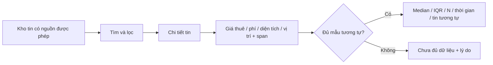

# Kế hoạch học KusShoes để thiết kế web ReNER-VN

Ngày lập: 09/10/2026; cập nhật 10/10/2026. Trạng thái: **đã có bản thảo yêu cầu/kiến trúc Waterfall, chờ người dùng xem; chưa code**. Xem [thiết kế hiện hành](../design-rener-vn-waterfall.md). Mục 11 ghi thay đổi ưu tiên theo yêu cầu mới.

## 1. Đích đến và điều đã chốt

Học cách KusShoes tổ chức sản phẩm, code, giao diện, animation và GitHub để xây một web ReNER-VN có nghiệp vụ riêng. Không biến ReNER thành một bản thay logo của KusShoes.

Người dùng đã chọn ưu tiên: **người tìm trọ — tìm/lọc tin và so sánh giá thuê**. Proposal là nguồn yêu cầu để phân tích, không phải lệnh thực thi, bằng chứng có dữ liệu thật hay kết quả nghiên cứu đã đạt.

Ba đầu ra chính của quá trình này:

1. Một sổ kiến thức giải thích từ vấn đề → người dùng → scope → MVP → luồng màn hình → kiến trúc → code → GitHub → kiểm chứng.
2. Một thiết kế ReNER-VN và backlog đủ rõ để giao việc, với cách chuyển từng kỹ thuật đã học thành tính năng cho người tìm trọ.
3. Sau khi thiết kế được duyệt: repo web chạy local, bộ tài liệu và quy trình GitHub có thể dùng thực tế.

Trong lượt lập kế hoạch này chỉ tạo tài liệu và ghi nhận khảo sát sơ bộ. Chưa scaffold web mới, chưa thu thập bài Facebook, chưa tạo hoặc đẩy repo GitHub mới.

## 2. Những gì đã có để tái sử dụng

| Đầu vào | Đã biết | Dùng thế nào |
|---|---|---|
| KusShoes local, commit `fc3e0178c91ee8ce29e0f47d342c14bc296c672a` | FE React/TypeScript/Vite; BE FastAPI; bản demo từng được chạy và kiểm tra | Đọc code và quan sát màn hình, không khởi động lại toàn bộ nghiên cứu từ đầu |
| [Báo cáo chạy local](../../KusShoes/notes/kusshoes-local-review.md) | Kết quả test và các giới hạn môi trường đã ghi rõ | Làm baseline; không gọi toàn bộ repo là đã test xanh |
| Proposal ReNER-VN v1.3 | 9 trang; đã trích xuất và xem trực quan trang pipeline/UI | Ràng buộc nghiệp vụ và đánh giá |
| [Nghiên cứu nền tảng trước đó](../../project-realestate-ner/notes/foundation-2026-10-09/PLAN.md) | Đã có kiến thức NLP, phản biện đề tài và kiến trúc đề xuất | Chỉ bổ sung phần thiếu: học repo, UI, animation, phát triển sản phẩm và GitHub |
| Ảnh sidebar người dùng gửi | Các nhóm menu, badge, pipeline, footer tài khoản | Đối chiếu screenshot với component và CSS thật |

Proposal đặt mục tiêu khoảng 100 bài gán nhãn, 10 bài kiểm thử giữ riêng và kho 300–500 bài. Đây là **chỉ tiêu**, chưa phải dataset đã thu hoặc kết quả đã đo. Các mốc 05/10–01/11 trong proposal là lịch dự kiến, không dùng để suy ra tiến độ thực tế.

## 3. Cách chia chặng: tuần tự, có log sau từng phần

Không mở nhiều nhánh điều tra chạy song song. Mỗi chặng gồm: đọc nguồn → trả lời câu hỏi → viết kết luận có nguồn → kiểm tra → thêm log → chuyển chặng. Một chặng lớn có thể chia thành nhiều mục nhỏ, nhưng mục trước phải được khép lại bằng kết quả rõ ràng.

| Chặng | Nội dung | Đầu ra | Trạng thái hiện tại |
|---|---|---|---|
| C0 | Kiểm kê đầu vào, đọc proposal, chốt ưu tiên, lập kế hoạch | PLAN, sổ kiến thức bản đầu, WORK_LOG, nguồn PDF/ảnh | Hoàn thành khảo sát đầu vào; kế hoạch chờ xem |
| C1 | Phân tích sản phẩm ReNER-VN | Actor, lợi ích/chi phí, scope, MVP, hành trình và tiêu chí nghiệm thu | Đã soạn bản thảo R/B/AT và P0/P1/P2; G1 chưa duyệt |
| C2 | Mổ kiến trúc KusShoes, đối chiếu repo web quốc tế và các luồng thực tế | Bản đồ module, sơ đồ API/data, walkthrough và bảng áp dụng có nguồn | Chưa bắt đầu phân tích sâu; đã có mẫu đối chiếu sơ bộ |
| C3 | Mổ sidebar, design system và animation | Bảng component/state/API/CSS, catalog motion, bản chuyển sang ReNER | Mới nhận diện sơ bộ |
| C4 | Tìm hiểu GitHub và cách giao việc | Bằng chứng issue/branch/PR/CI, workflow đề xuất, mẫu giao việc | Mới xem CI và một PR mẫu |
| C5 | Thiết kế web ReNER-VN từ kiến thức thu được | Sitemap, wireframe, dữ liệu/API, trạng thái lỗi, quyết định kiến trúc | Đã có bản thảo logic/module/ERD/API/admin; G2 chưa duyệt |
| C6 | Chuyển thiết kế thành kế hoạch code và repo | Backlog theo lát chức năng, dependency, chia vai trò, kiểm thử, bộ tài liệu GitHub | Có gói WP0–WP7 sơ bộ; chưa lập ticket/file code chi tiết |
| C7 | Triển khai sau khi thiết kế được duyệt | Web chạy local, log kiểm chứng, repo và GitHub theo thông tin tài khoản được cung cấp | Chưa được bắt đầu |

### C0 — kiểm kê và kế hoạch

- Ghi chính xác repo/commit, đường dẫn PDF, ảnh tham chiếu, tài liệu đã có.
- Xác nhận ưu tiên người tìm trọ; đã có câu trả lời của người dùng.
- Tạo một file kiến thức chính và log riêng; không rải kết luận thành nhiều file khó tìm.
- Điều kiện hoàn thành: cả ba file mở được, liên kết nguồn đúng, các trạng thái chưa làm không được đánh dấu hoàn tất.

### C1 — đọc đề và xác định app thực sự phục vụ ai

Trả lời lần lượt:

1. Người tìm trọ đang mắc vấn đề gì khi đọc tin tự do trên Facebook?
2. Người tìm trọ, người đóng góp dữ liệu, người duyệt dữ liệu, nhóm NLP và admin làm gì?
3. Ai nhận giá trị chính? Ai bỏ công gán nhãn/duyệt? Ai trả tiền API/hạ tầng? Ai là bên bị ảnh hưởng bởi dữ liệu?
4. App hỗ trợ đến đâu: tìm/lọc, hiểu giá và phí, xem chứng cứ, so sánh giá chào thuê; thao tác nào ngoài scope?
5. Bỏ tính năng nào thì sản phẩm mất lý do tồn tại?

Đầu ra vào sổ kiến thức: actor matrix, bảng scope, must/should/later, hành trình người tìm trọ, bộ tình huống nghiệm thu. Tách tính năng cốt lõi của **sản phẩm** khỏi tiêu chí bắt buộc của **bài nghiên cứu**: người tìm trọ cần kết quả đáng tin; nhóm nghiên cứu vẫn cần so sánh Regex/LLM/Hybrid và tập kiểm thử độc lập.

Điều kiện hoàn thành: có ít nhất một hành trình từ tin đầu vào đến kết quả người dùng hiểu được; có trường hợp thiếu dữ liệu, giá/phí nhập nhằng, tin trùng và LLM lỗi; không thêm thanh toán/đặt phòng chỉ vì KusShoes có billing.

### C2 — hiểu KusShoes từ code thay vì chỉ đọc README

- Đọc điểm vào FE/BE, route, context, API client, schema, service, repository, database và worker.
- Theo dấu 3 luồng: đăng nhập/phân quyền; danh sách + chi tiết dự án; quản trị dashboard và một thao tác cập nhật có audit.
- Với từng luồng ghi: người khởi tạo → UI → request → kiểm tra → lưu dữ liệu → response → loading/error/success.
- Ghi rõ phần thuộc repo bên ngoài như KusStudio, không suy ra clone web là có cả hệ sinh thái 3D.
- Đọc SRS, checklist, API contract, ADR và `.spec/tasks.md`; đối chiếu tài liệu với hiện trạng code.
- Đối chiếu tuần tự với FastAPI full-stack template → Cal.diy → Immich → Outline: module, contract, dữ liệu, job, triển khai và chi phí vận hành. Danh sách và snapshot có ở mục 9; không mặc định chọn stack chỉ vì nhiều star.

Đầu ra: bản đồ code và sơ đồ 3 luồng, bảng “học được / không cần mang sang ReNER / cần sửa khi áp dụng”. Điều kiện hoàn thành: mỗi nhận định quan trọng có file/symbol hoặc phép thử; nêu rõ mock, demo và tích hợp chưa có khóa.

### C3 — giải thích sidebar và animation theo từng bộ phận

- Chia sidebar thành logo/collapse, nhóm điều hướng, nút active/hover, badge, vùng cuộn, widget công việc, tài khoản/theme/logout.
- Với mỗi phần giải thích JSX/config, state/context, API, CSS và quyền truy cập; ghi đường dẫn file để tự học.
- Phân biệt animation CSS, animation state bằng Framer Motion, timeline cuộn GSAP, canvas/WebGL thật.
- Dùng tài liệu/demo chính thức GSAP và Motion; xem React Bits như catalog component tham khảo. Tên “Interactive motion” từ ảnh bổ sung chưa có URL xác nhận, không tự gán thành một website cụ thể.
- Quan sát các màn desktop/mobile, lỗi/loading/empty; kiểm tra keyboard/focus và reduced motion.
- Đối chiếu `Live`/thanh tiến trình với dữ liệu thật; không dùng animation làm người dùng tưởng tác vụ đã thành công.

Đầu ra: catalog animation với trigger, kỹ thuật, cleanup, điều kiện bật/tắt, chi phí và ứng dụng ReNER. Với ReNER, ưu tiên drawer chi tiết tin, highlight span, đổi danh sách, collapse sidebar và trạng thái xử lý. Landing cuộn đẹp làm sau luồng lõi.

Điều kiện hoàn thành: giải thích được sidebar trong ảnh bằng code cụ thể; phân biệt phần giống 3D nhưng là ảnh 2D; biết tác dụng mỗi hiệu ứng và kiểm chứng khả năng truy cập. Bản sao component hay demo animation mới chỉ code sau duyệt thiết kế.

### C4 — tìm hiểu cách họ quản lý GitHub, rồi thiết kế workflow tốt hơn

- Lấy mẫu nhiều PR đã merge ở FE, BE và cả hai; đọc description, branch, review, checks, commits, issue liên quan.
- Xem issue, labels, milestone/Projects nếu công khai; ghi rõ thông tin không truy cập được. Clone hiện tại shallow nên chưa đủ lịch sử để kết luận về mọi giai đoạn.
- Đọc workflow CI, task checklist và hướng dẫn agent; phân biệt quy định trong file với hành vi đã xảy ra.
- Trả lời “waterfall không?” bằng bằng chứng. Có SRS không tự động đồng nghĩa waterfall; có nhiều PR không tự động chứng minh Scrum.
- Lập mẫu issue/PR, quy tắc branch, review, acceptance, screenshot, kiểm thử và trace từ yêu cầu đến code.
- Đối chiếu thêm PR checklist/OpenAPI workflow của Immich và quy ước package của Cal.diy; kiểm tra license cụ thể trước quyết định tái sử dụng code/component.

Đầu ra: bảng mẫu bằng chứng và blueprint GitHub. Điều kiện hoàn thành: không gán quy trình/nhân sự chưa chứng minh; chỉ ra điểm học tốt và điểm cần cải thiện. PR #82 hiện là ví dụ có CI/preview nhưng thiếu description/review, không dùng làm mẫu hoàn chỉnh.

### C5 — thiết kế ReNER-VN có thể code được

- Sitemap hai bề mặt: người tìm trọ; vận hành dữ liệu/nghiên cứu theo quyền.
- Wireframe luồng tìm/lọc → chi tiết → giá/phí/chứng cứ → so sánh với nhóm tương tự.
- Mô hình dữ liệu tối thiểu: nguồn, bài nhập, span, kết quả trích xuất, tin đã duyệt, nhóm trùng, lịch sử giá, lần tính so sánh và lần đánh giá.
- Contract API trước UI hoàn chỉnh; trạng thái job có nghĩa, cache, giới hạn gọi LLM, timeout, retry và fallback được định nghĩa.
- Quy định mẫu so sánh: cùng nhóm phù hợp, sau gộp trùng, không tính chính tin đang đánh giá, hiển thị N/thời gian/median/IQR và báo thiếu dữ liệu nếu N < 10.
- Phân quyền ở backend; ẩn menu ở FE chỉ phục vụ trải nghiệm.

Đầu ra: thiết kế cụ thể + các quyết định ghi vào log. Điều kiện hoàn thành: từng màn có đầu vào/đầu ra/trạng thái/tiêu chí nghiệm thu; người dùng xem được thiết kế trước khi bắt đầu code.

### C6 — biến thiết kế thành việc giao được

- Mỗi ticket là một lát chức năng đi qua UI–API–data khi cần, có dependency và bằng chứng nghiệm thu.
- Map 4 vai trò trong proposal: NLP, LLM/backend, frontend, extension/data. Đây là vai trò dự kiến, chưa gán cho người cụ thể.
- Việc tích hợp đầu tiên dùng fixture rõ nguồn; sau đó mới kết nối nguồn thật đã được phép.
- Thiết kế repo và tài liệu: README, docs sản phẩm/kiến trúc/API/ADR, CONTRIBUTING, issue/PR templates, CI, `.env.example`, hướng dẫn chạy và dữ liệu demo.
- Khóa dữ liệu kiểm thử; không đổi prompt/luật theo 10 bài held-out sau khi xem kết quả.

Đầu ra: kế hoạch code có đường dẫn dự kiến, thứ tự PR, tiêu chí chấp nhận và checklist chạy local. Điều kiện hoàn thành: người nhận ticket biết phải làm gì và đưa bằng chứng gì; không có ticket chung chung kiểu “làm frontend”.

### C7 — triển khai và GitHub sau duyệt

Thứ tự dự kiến: skeleton chạy được → schema/fixture/API → tìm/lọc và chi tiết → extraction/grounding → gộp trùng/so sánh → vận hành duyệt → đánh giá → polish motion/a11y → hướng dẫn và repo GitHub.

Trước khi tạo GitHub thực tế cần thông tin còn thiếu: owner/tài khoản, tên repo, public/private, thành viên và quyền truy cập. Không đoán những thông tin này. Nghiên cứu và chuẩn bị cấu trúc local không phụ thuộc việc đã có remote.

## 4. MVP dự kiến để thảo luận ở C1

Hành trình đề xuất:

Các phần dự kiến cốt lõi:

- Tin đã chuẩn hóa, giá thuê tách khỏi điện/nước/cọc; thiếu trường trả null có lý do.
- Tìm/lọc theo vị trí, giá, loại phòng; hiển thị đúng phần thiếu thông tin.
- Chi tiết có chứng cứ trích xuất, mức tin cậy/đánh dấu cần duyệt, thời gian của dữ liệu.
- So sánh **giá chào thuê** trong nhóm phù hợp, giải thích cỡ mẫu và giới hạn.
- Pipeline nguồn → trích xuất → kiểm tra → gộp trùng → duyệt/lưu phục vụ dữ liệu đầu ra.
- Bộ đánh giá Regex/LLM/Hybrid đáp ứng đề tài, nằm ở bề mặt nghiên cứu thay vì bắt người tìm trọ hiểu thuật toán.

Để sau: thanh toán, subscription, chat/chốt thuê, booking, app chủ nhà, mô hình 3D, gợi ý “đầu tư”, crawler quy mô lớn. Tính năng nhập văn bản để đánh giá một tin sẽ được chốt ở C1: rất hữu ích khi kho dữ liệu chưa đủ, nhưng không thay thế kho phục vụ tìm/lọc.

## 5. Ba phương án kiến trúc để so sánh

| Phương án | Lợi thế | Đổi lại | Hướng chọn |
|---|---|---|---|
| Next.js/TypeScript + FastAPI, SQLite demo | Bám công cụ trong proposal; giữ NLP Python; nâng DB khi cần | Cần hiểu client/server boundary và auth | **Đề xuất sơ bộ**, xác nhận ở C5 |
| React/Vite + FastAPI | Gần KusShoes, dễ học lại UI/CSS/motion, đơn giản cho pilot local | Không tự có các cơ chế fullstack của Next; phải tự định nghĩa routing/auth | Phương án nếu ưu tiên học trực tiếp code FE |
| Fork KusShoes rồi sửa thành ReNER | Có sẵn nhiều màn và infrastructure | Mang theo nghiệp vụ billing/3D, schema và tích hợp không cần thiết | Không đề xuất làm nền mặc định |

Animation/CSS và cách tổ chức component có thể học dù dùng Next hay Vite. Không cần mang theo cách tự `pushState` của KusShoes nếu framework mới đã có router.

SQLite chỉ là khởi điểm demo; nếu nhiều người cùng duyệt/gửi job phải đánh giá concurrency và chuyển PostgreSQL theo nhu cầu. Chưa chốt phiên bản dependency hay phương án deploy; kiểm tra tài liệu chính thức tại lúc triển khai.

## 6. Nguồn dữ liệu và phạm vi pilot

Proposal nói dữ liệu dùng nội bộ, không đăng lại công khai. Vì vậy bản đầu dự kiến là pilot cho nhóm người tìm trọ được phép truy cập; website public phải được xem là thay đổi scope và cách sử dụng dữ liệu.

Không coi việc vào được group hoặc thành viên đồng ý là đã được Meta cho phép tự động thu thập. [Meta mô tả yêu cầu xin phép cho thu thập tự động](https://about.fb.com/news/2021/04/how-we-combat-scraping/). Đây là điểm cần xử lý trong thiết kế nguồn. Khởi đầu bằng fixture tự viết hoặc nguồn đã được cho phép; chưa thu dữ liệu thật trong giai đoạn kế hoạch.

## 7. Quy tắc log và quản lý kiến thức

- File kiến thức duy nhất: [KIEN-THUC-TONG-HOP.md](KIEN-THUC-TONG-HOP.md), bổ sung theo chặng; ghi rõ quan sát/đề xuất/chưa kiểm chứng.
- File log: [WORK_LOG.md](WORK_LOG.md), thêm mục sau mỗi phần; không xóa kết luận cũ, sửa bằng một mục đính chính có lý do.
- Mỗi log có mã chặng, phần hoàn thành, nguồn/bằng chứng, quyết định, hạn chế và bước tiếp theo. Ghi thời gian thực tế; không bịa thời lượng/chi phí token.
- Không gọi chặng hoàn tất nếu chỉ tạo tiêu đề hoặc đánh dấu checkbox.
- Khi kế hoạch thay đổi: ghi lý do, ảnh hưởng MVP, cập nhật kế hoạch và thêm log.

## 8. Các quyết định chưa cần chặn việc nghiên cứu

3–5 phường cụ thể; thời hạn nộp thực tế; năng lực và thời gian của từng thành viên; quyền dùng nguồn; API/quota LLM; pilot nội bộ hay public; tên/tài khoản GitHub. Đặt câu hỏi đúng chặng, không hỏi tất cả ngay từ đầu.

Flow người dùng nêu là một luồng **phân tích sản phẩm/yêu cầu**. Theo yêu cầu mới ngày 10/10, ReNER áp dụng các giai đoạn và gate Waterfall ở bản thiết kế hiện hành; các lát chức năng là cách chia việc bên trong giai đoạn triển khai. Chưa gắn nhãn waterfall hoặc Scrum cho KusShoes khi chưa đủ bằng chứng.

## 9. Bổ sung ngày 09/10: nguồn motion và repo web quốc tế

Đây là phần bổ sung do người dùng yêu cầu, giữ nguyên ưu tiên người tìm trọ và thứ tự C1–C7. Đã kiểm tra nguồn/metadata và đọc một số file kiến trúc để lập danh sách có căn cứ; chưa coi các repo mẫu là đã audit toàn bộ hoặc đã chạy local.

### 9.1 Nguồn học giao diện và animation

| Nguồn | Vai trò | Tình trạng |
|---|---|---|
| [GSAP](https://gsap.com/), [ScrollTrigger](https://gsap.com/docs/v3/Plugins/ScrollTrigger/), [React guide](https://gsap.com/resources/React/) | Thư viện animation, tài liệu, demo/timeline/scroll; không phải bộ backend | Đã xác minh; KusShoes có dùng GSAP |
| “Interactive motion” trong ảnh | Có thể là mô tả hiệu ứng hoặc tên người gửi nhớ chưa đầy đủ | Chưa xác định chính xác; đã hỏi link, không chặn phần nghiên cứu khác |
| [Motion for React](https://motion.dev/docs/react) | Nguồn độc lập để học animation theo state/layout/gesture; trước đây là Framer Motion | Đã xác minh; **chưa xác nhận** đây là trang người gửi nhắc |
| [React Bits](https://github.com/DavidHDev/react-bits) | Catalog component animated/interactive để học và chọn mẫu | Đã xác minh loại repo; phải xét dependency, a11y và license từng phần trước dùng |

### 9.2 Mẫu kiến trúc có star đã đo

Số star là snapshot GitHub API lúc khoảng 23:41 ngày 09/10/2026, Asia/Saigon, có commit để đọc lại cùng phiên bản. Đây là mẫu có chủ đích, không phải bảng xếp hạng toàn thế giới. Bằng chứng: [metadata](sources/world-web-2026-10-09/github-metadata.json), [manifest file nguồn](sources/world-web-2026-10-09/source-manifest.json).

| Repo | Star lúc kiểm tra | Phần học ưu tiên |
|---|---:|---|
| [FastAPI full-stack template](https://github.com/fastapi/full-stack-fastapi-template) | 45.931 | FastAPI + React/Vite, DB/migration, API client sinh tự động, setup và kiểm thử |
| [Cal.diy](https://github.com/calcom/cal.diy) | 48.931 | Next.js, monorepo apps/packages, chia feature/UI/data, dependency và build |
| [Immich](https://github.com/immich-app/immich) | 115.850 | API/service/repository, OpenAPI SDK, job và ranh giới ML Python |
| [Outline](https://github.com/outline/outline) | 40.853 | App/server/shared, scene/component/state, policy quyền, job và migration |

Đường dẫn `calcom/cal.com` hiện chuyển sang `calcom/cal.diy`; dùng tên và snapshot thực tế này trong nghiên cứu, không áp thông tin cũ của Cal.com vào repo đã chuyển.

### 9.3 Cách chuyển thành kiến thức có ích

Với mỗi mẫu, ghi: vấn đề/quy mô → module có trách nhiệm gì → một luồng UI/API/data → boundary và contract → test/CI → cái cần học → cái chưa cần đưa vào ReNER. Tiêu chí lựa chọn thêm: tài liệu và code khớp, khả năng chạy lại, license, mức độ gần FastAPI/NLP và độ phức tạp phù hợp nhóm.

Hướng sơ bộ vẫn là frontend + FastAPI + database, chia module trong backend. Worker riêng chỉ chốt khi tác vụ batch/LLM cần hàng đợi bền vững, retry, giới hạn concurrency hoặc timeout riêng. Không đổi Next sang Vite hay thêm Redis/microservices chỉ từ danh sách star.

## 10. Bổ sung 10/10: catalog 10 repo và nguồn học từng bước

Đã mở rộng nguồn theo yêu cầu người dùng: shop (Medusa, Saleor, Next.js Commerce); quản trị (React-admin, Refine, Tabler); full-stack/SaaS/data (FastAPI template, Cal.diy, Outline, Immich). Xem mục 18–21 trong [sổ kiến thức](KIEN-THUC-TONG-HOP.md), có star snapshot 10/10, guide, kiến trúc, điểm vào code, bài tập và giới hạn từng nguồn.

Tích hợp vào các chặng, vẫn thực hiện tuần tự:

- C2: dùng FastAPI template làm đối chiếu chính; Medusa/Saleor để học phân chia nghiệp vụ; các repo lớn đọc theo luồng cần thiết.
- C3: thêm tutorial React-admin/Refine và layout Tabler để phân tích màn quản trị; Next.js Commerce cho catalog/chi tiết. Motion giữ ở mục riêng.
- C4: đối chiếu CONTRIBUTING của Medusa/Tabler/Cal.diy và checklist Immich; chưa suy ra nhóm thực tế tuân thủ từ docs.
- C5/C6: chọn kỹ thuật theo nhu cầu ReNER và năng lực nhóm; không cài cả bộ framework hoặc sao chép nguyên mọi kiến trúc trong danh sách.

Nguồn học nền đã xác minh: MDN, Next.js Learn Dashboard, FastAPI Tutorial, Full Stack Open. Chỉ lấy phần kiến thức cần cho nhiệm vụ, không đặt điều kiện phải học xong toàn bộ trước khi làm MVP.

## 11. Bản thảo logic Waterfall — cập nhật theo yêu cầu mới 10/10

Người dùng yêu cầu ưu tiên thiết kế hệ thống ReNER trên bản thảo trước khi code. Vì vậy chuyển sang C1/C5 bằng nguồn đã có; việc đọc sâu C2/C3/C4 còn lại được giữ, không xem là hoàn tất và không chặn soạn đề xuất sản phẩm. Từng phần thiết kế D1 → D2 → D3 → D4 vẫn được làm tuần tự và ghi log.

Artifact chính: [design-rener-vn-waterfall.md](../design-rener-vn-waterfall.md), gồm actor/quyền, R01–R14, P0/P1/P2 và nhánh N, B01–B15, extension → xử lý → duyệt → tìm/so sánh, ba phương án kiến trúc, ERD/API, wireframe/dashboard, AT01–AT21, gói công việc và gate.

Các cập nhật này thay thế đề xuất sơ bộ tương ứng ở mục 4–5 và thứ tự C7, nếu có khác biệt:

- Extension chọn và gửi từng tin đã được người dùng xác nhận nằm trong P0. Nhập một tin bằng text là fallback; CSV theo lô để P1.
- Quy trình Waterfall: yêu cầu/G1 → thiết kế/G2 → xây P0 → tích hợp/kiểm thử/G3 → pilot → mở rộng. Bản này chưa qua G1/G2.
- Đề xuất Next.js/FastAPI với PostgreSQL và worker cùng codebase; không tạo microservices. PostgreSQL thay SQLite là quyết định dự thảo, chưa áp dụng.
- Reviewer duyệt trước công bố; điều kiện thống kê chặt hơn điều kiện hiển thị danh sách. Dashboard P0 phục vụ xử lý lỗi/chất lượng dữ liệu.
- C6 chi tiết chỉ triển khai sau khi người dùng xem và chốt bản thiết kế; chưa tạo source code/remote hoặc ghi rằng các test đã pass.

## 12. Đối chiếu 10 repo thành kiến trúc thống nhất

Theo yêu cầu tiếp nối, đã đọc bổ sung source code của 10 repo trong catalog, ghi nhận cả mẫu nên học và điểm không nên sao chép. Bảng bằng chứng mục 23 của sổ kiến thức và manifest `architecture-top10-2026-10-10` có commit/hash/giới hạn. Đây là khảo sát chọn lọc, không đánh dấu C2/C4 audit toàn bộ hoàn tất.

Bản thiết kế lên v0.2, mục 16 chốt **đề xuất** về ownership/module, API client, cây repo, state/cache frontend, transaction/snapshot, deployment và 8 kiểm tra kiến trúc AR. Không đổi P0 hoặc tự vượt gate thiết kế. Bước tiếp theo sau người dùng review là chốt các giả định ở mục 14 của thiết kế và kế hoạch triển khai chi tiết C6.

## 13. Ưu tiên hiện hành: nghiên cứu để học, demo — cập nhật 10/10

Chỉ dẫn mới của người dùng thay ưu tiên “chốt thiết kế để code” ở bước tiếp theo của mục 12: **chưa thiết kế thêm, chưa code; cần bản thảo và kiến thức rõ ràng**. Quy mô 5.000 người chỉ là ví dụ thảo luận. Giữ v0.2 làm tài liệu tham khảo chưa triển khai.

Đã thực hiện tuần tự F1 khảo sát ChoThueGiupViec/harness → F2 kiến thức tải → F3 AI context/mẫu/deploy → F4 tám repo extension/NLP/catalog → F5 liên kết và kiểm chứng tài liệu. Đầu ra: [chuyên đề](NGHIEN-CUU-HARNESS-SCALE-AI.md), mục 24 sổ kiến thức, snapshot nguồn và log. Mức khảo sát từng repo được ghi rõ, không đánh dấu toàn bộ walkthrough C2–C4 hoàn tất.

Hướng học tiếp có ích nằm ở phần 6.3 chuyên đề: Chrome cơ bản → so sánh framework extension → annotation/grounding → catalog/filter → ticket/evidence. Đây là lộ trình tham khảo, không là tự động tiếp tục triển khai.

## 14. Bổ sung nghiên cứu gia công web và creator — 11/10/2026

Yêu cầu mới: tìm hiểu hợp đồng/yêu cầu nhận làm web, video/creator dùng AI và template, cách tinh chỉnh. Đã thực hiện H1 khung brief/SOW/nghiệm thu → H2 đối chiếu năm ví dụ video/creator và docs → H3 tổng hợp workflow/prompt minh họa → H4 lưu nguồn/kiểm chứng. [Chuyên đề](GIA-CONG-WEB-VA-AI-WORKFLOW.md) là tài liệu học tập; giữ ưu tiên demo và không mở phần triển khai.

## 15. Solo AI development, 80/20 và quản lý thay đổi — 11/10/2026

Đã làm tuần tự I1 nguồn quốc tế/X/Trung Quốc → I2 UX/case study/sách và ưu tiên → I3 luồng/backend/chia việc một người → I4 thay đổi lõi/khôi phục → I5 liên kết hồ sơ/kiểm chứng. Đầu ra: [báo cáo](TU-VIBE-CODING-DEN-GIAO-WEB.md), [sổ tay thực hành](SO-TAY-CHIA-VIEC-CHO-AI.md). Nguồn social không đọc được ghi rõ; không nhận đã xem reels/video.

Xác nhận hiện hành: người dùng muốn hiểu flow, cần hỗ trợ mạnh nhất ở chuyển ý tưởng ngắn thành yêu cầu/task; hướng tới nhận khách, nhưng học bằng proposal/web ReNER trước và phải bài bản. Không tự chuyển sang bài landing page hoặc triển khai. Khi bắt đầu bài thực hành, nên dùng một tình huống tin giá mơ hồ để luyện brief → ví dụ → flow → task → bằng chứng. Kiến trúc v0.2 và những walkthrough chưa xong vẫn giữ nguyên trạng thái.
