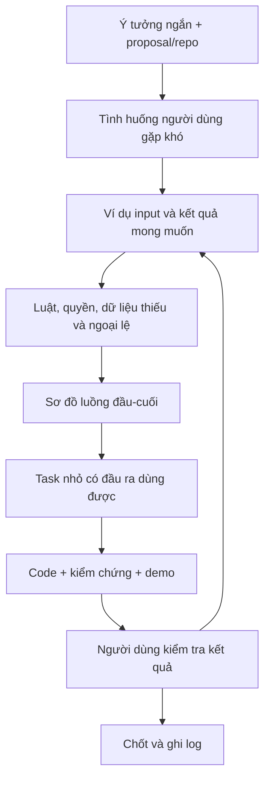

# Sổ tay: từ một câu ý tưởng đến công việc AI có thể làm và kiểm tra

**11/10/2026 — bản thực hành đề xuất.** Dùng proposal/ReNER-VN làm bài chính, để luyện cách nghĩ áp dụng được cho dự án khác. Không phải task đã được phê duyệt để triển khai; chưa tạo issue/branch hay sửa ứng dụng. Đọc nền tảng tại [báo cáo nghiên cứu](TU-VIBE-CODING-DEN-GIAO-WEB.md).

## 1. Bạn làm gì, AI làm gì?

Bạn nêu hoàn cảnh, mục đích và phản hồi theo ví dụ. AI có trách nhiệm tìm chỗ mơ hồ, đối chiếu repo/proposal, đề xuất phương án, lập bản đồ và chia việc. Bạn không phải tự viết PRD dài trước khi gọi AI, nhưng phải hiểu và chốt các quyết định làm thay đổi sản phẩm.

Ví dụ mở đầu đủ dùng: **“Tao muốn người tìm trọ lấy từng tin Facebook và so giá cho dễ. Ưu tiên demo nhưng làm đủ bài bản để hiểu và mở rộng.”** Đây là đầu vào phân tích, chưa đủ để lập trình mọi thứ.

Thay vì bổ sung ngay 20 tính năng, AI cần trả lại ba nhóm:

| Nhóm | Ví dụ ReNER |
|---|---|
| Đã xác nhận | Người tìm trọ; tìm/lọc/so giá; extension chọn từng tin; mục tiêu demo; giữ proposal làm nền |
| Đề xuất cần bạn xem | Đường đi màn hình, cách báo giá chưa rõ, thứ tự xây các phần |
| Chưa biết có ảnh hưởng thật | Bộ ví dụ dữ liệu; quy tắc phí/loại giá chưa có trong tài liệu; tiêu chí người dùng hoàn thành demo |

**Một nguyên tắc:** không hỏi lại điều đã có đáp án; không coi “chưa thấy trong prompt” là “người dùng không quan tâm”. Đọc đúng tài liệu liên quan trước rồi mới hỏi.

## 2. Luồng biến ý tưởng thành yêu cầu



Vòng quay lại không phải thất bại quy trình. Nó giúp phát hiện hiểu sai trước khi thay đổi lan rộng. Nếu môn học yêu cầu hồ sơ Waterfall, lưu yêu cầu/baseline và change request theo chặng; vẫn có thể dùng bản nháp và ví dụ để kiểm chứng sớm.

### 2.1 Mẫu brief một trang — điền bằng ngôn ngữ thường

| Câu hỏi | Bản điền minh họa |
|---|---|
| Ai? | Người đang tìm thuê trọ, gặp tin ở Facebook |
| Đang làm việc gì? | Đọc nhiều tin, nhớ giá/địa điểm/diện tích rồi so thủ công |
| Khó ở đâu? | Tin thiếu trường, nhiều loại giá, khó đối chiếu có căn cứ |
| Kết quả cần? | Lọc được tin phù hợp; biết khi nào có/không đủ điều kiện so sánh |
| Đầu vào được phép? | Một tin do người dùng chủ động chọn gửi; fixture cho demo |
| Ranh giới cần giữ? | Phân tích cá nhân khác đóng góp công khai; thông tin thiếu không tự biến thành 0 |
| Thế nào là xong đợt đầu? | Một hành trình đầu-cuối chạy được với ví dụ thành công và ví dụ bị từ chối/thiếu dữ liệu |
| Ngoài đợt đầu? | Thu thập hàng loạt, thanh toán, tối ưu cho hàng nghìn người; không tự thêm vào scope |
| Chưa xác minh? | Nhu cầu thực tế người dùng, chất lượng trích xuất và cách extension hoạt động trên Facebook thật |

Các mô tả tình huống trong bảng là giả thuyết minh họa dựa trên mục tiêu đã trao đổi. Chưa phải kết quả phỏng vấn khách.

### 2.2 Chia câu hỏi thành đợt nhỏ

Đợt đầu hỏi **tác vụ và kết quả**; đợt sau hỏi **dữ liệu/quyền/ngoại lệ**; sau đó mới hỏi **hình thức và ưu tiên**. Mỗi đợt chỉ chọn vài câu đang chặn quyết định tiếp theo. Đừng hỏi người mới “muốn CQRS hay hexagonal?”; trình bày tác động thực tế rồi AI đề xuất kỹ thuật.

Chẳng hạn: “Nếu hai tin dùng giá/phòng và giá/người, bạn muốn hệ thống chặn so sánh hay yêu cầu bổ sung số người?” hữu ích hơn “muốn dùng thuật toán nào?”. Nếu proposal đã có quy tắc, AI phải chỉ ra quy tắc trước khi hỏi bạn có muốn thay đổi.

## 3. Viết ví dụ trước khi chia file

**Bộ ví dụ giả lập dưới đây chỉ để học cách đặc tả; không phải dữ liệu Facebook đã thu thập.** Các kết quả là đề xuất để đối chiếu luật hiện có trước khi chốt.

| ID | Input/tình huống | Hành vi cần thấy |
|---|---|---|
| EX01 | “Phòng 25m², 3 triệu/tháng” | PRICE = 3.000.000; AREA = 25; giữ đơn vị và bằng chứng văn bản |
| EX02 | “1,5 triệu/người/tháng” | Không trộn vào nhóm giá/phòng khi chưa biết cách quy đổi hợp lệ |
| EX03 | “Phòng đẹp, inbox giá” | Giá thiếu/null; UI không hiện miễn phí hoặc 0 đồng |
| EX04 | “2 phòng: 20m² giá 2tr, 30m² giá 3tr” | Không ghép giá phòng này với diện tích phòng kia; nếu chưa hỗ trợ tách thì báo cần xử lý |
| EX05 | Gửi hai lần cùng một thao tác do mạng chậm | Không tạo hai job/bản tin riêng cho cùng idempotency key và cùng user |
| EX06 | Worker đang xử lý, người dùng sửa nội dung | Kết quả revision cũ không ghi đè revision mới |
| EX07 | User A biết ID bản nháp riêng của B | Backend từ chối đọc/sửa đúng chính sách; UI ẩn nút chưa đủ |
| EX08 | Kết quả trích xuất còn mơ hồ | Cho thấy phần chưa chắc; không tự gắn nhãn “đã xác minh thực tế” |
| EX09 | Chưa có hành động đóng góp hợp lệ | Tin riêng không xuất hiện trong catalog hoặc thống kê công khai |
| EX10 | Nhóm thị trường có dưới 10 mẫu hợp lệ | Không trình median/IQR như kết luận đủ dữ liệu theo ngưỡng proposal |

Sau đó mới viết yêu cầu: **ai — khi nào — làm gì — theo luật nào — thấy kết quả gì — nếu lỗi thì sao**. Một tên tính năng như “search”, “dashboard” hoặc “AI extraction” chưa phải yêu cầu đủ để nghiệm thu.

Ví dụ học tập, không thêm vào danh sách R01… hiện có:

> R-Learn-01: Khi chủ tin gửi một văn bản hợp lệ để phân tích cá nhân, hệ thống lưu nguồn và một lần xử lý gắn revision. Gửi lại cùng yêu cầu không tạo bản ghi trùng. Chủ tin thấy trạng thái; tài khoản khác không đọc được bản nháp đó.

Truy vết đề xuất: `R-Learn-01 → EX05/EX07 → luồng gửi tin → task S1 → test quyền/idempotency → bằng chứng demo`. Khi yêu cầu đổi, theo đường này để tìm phần cần xem lại.

## 4. Chia việc theo kết quả nhìn thấy được

Tránh bắt đầu bằng ba task khổng lồ “xong toàn DB”, “xong toàn backend”, “xong toàn frontend”. Chúng có thể được làm riêng nhưng khó biết đã tạo giá trị hay chưa. Học cách chia **một phần chức năng xuyên UI–API–DB**; công việc hạ tầng dùng chung vẫn tồn tại nhưng phải nối với phần đang cần nó.

| Task minh họa | Phụ thuộc | Kết quả demo | Trường hợp cần thử |
|---|---|---|---|
| S0 — kiểm chứng điểm chưa chắc | Không | Quyết định có căn cứ về một điểm rủi ro, ví dụ input extension | Làm được/không được; giới hạn của thử nghiệm; chưa gọi là feature hoàn chỉnh |
| S1 — nhận và xem lại một tin riêng | Quy tắc nguồn/quyền + hạ tầng tối thiểu | Nhận fixture hoặc input hợp lệ; chủ tin xem lại nguồn và trạng thái | Trống/quá dài, gửi lặp, người khác truy cập |
| S2 — một loại tin rõ ràng được trích xuất | S1 + contract kết quả | Giá/diện tích/đơn vị có bằng chứng; trường thiếu rõ ràng | EX01–04; timeout/response model không hợp lệ |
| S3 — sửa kết quả và giữ revision | S2 | Sửa lỗi trích xuất và nhìn thấy bản hiện hành | EX06, user khác sửa, lưu đồng thời |
| S4 — đóng góp và duyệt để công khai | S3 + luật publication | Một tin đủ điều kiện vào tập công khai qua hành động đúng quyền | EX07–09, thu hồi, kết quả cũ không tự xuất bản |
| S5 — tìm/lọc/so sánh đúng tập tin | S4 + luật so sánh | Một người hoàn thành tác vụ tìm tin và giải thích kết quả | Không có kết quả, thiếu giá, khác đơn vị, EX10 |

Đây là thứ tự để luyện phân rã, không thay kế hoạch/kiến trúc đã có. Actor chính vẫn là người tìm trọ; phần admin phục vụ chất lượng dữ liệu và vận hành flow đó. Những yêu cầu học thuật về baseline/đánh giá NLP phải có task riêng và liên kết sang S2/S5, không bị che mất bởi web chạy được.

**Khi nào task còn quá to?** Bạn không thể demo bằng một câu; có nhiều quyết định nghiệp vụ chưa liên quan nhau; muốn nghiệm thu phải chờ ba task khác chưa rõ; hoặc AI phải đổi nhiều module không cùng một lý do. Khi đó chia theo hành vi nhỏ hơn. Không đặt số file/dòng hay thời lượng cứng cho mọi việc.

## 5. Một task card hoàn chỉnh — chỉ là ví dụ

```markdown
ID: LEARN-S1 — nhận và xem lại một tin riêng
Trạng thái: bản nháp để học, chưa triển khai

Vì sao: người dùng cần biết văn bản nào đã được nhận trước khi phân tích.
Hiện trạng: AI phải kiểm tra repo và ghi file/symbol thật; chưa có thì nói chưa có.
Input: văn bản người dùng chọn, nguồn và idempotency key của thao tác gửi.
Output: ID bản ghi, revision và trạng thái nhận; không hứa đã phân tích xong.

Luật:
- Chỉ chủ sở hữu được đọc bản nháp theo chính sách đã chốt.
- Tin riêng không tự trở thành tin công khai.
- Lần gửi lại cùng key và cùng payload không tạo bản ghi thứ hai.
- Cùng key nhưng payload khác phải xử lý xung đột rõ, không âm thầm thay nội dung.

Phạm vi:
- Luồng nhận tin và hiển thị lại; tái sử dụng auth/storage đã có nếu phù hợp.
- Chưa trích xuất LLM, chưa xử lý selector Facebook ở task này.
- AI đề xuất file sẽ sửa sau khi đọc repo; được thêm helper nội bộ có lý do.
- Đổi schema, quyền, dữ liệu hoặc contract ngoài nội dung này phải nêu tác động.

Kiểm chứng:
1. Đăng nhập đúng user, gửi fixture, tải lại và đọc đúng văn bản.
2. Gửi lại cùng key/payload: vẫn một bản ghi; kiểm cả gửi đồng thời nếu cơ chế có rủi ro này.
3. Dùng user khác gọi trực tiếp API: bị từ chối theo chính sách.
4. Input không hợp lệ: lỗi dễ hiểu, không tạo dữ liệu dở dang.

Bằng chứng bàn giao:
- Test/lệnh đã chạy và kết quả thực; hình hoặc bước demo luồng.
- Đường đi request qua file/symbol; phần nào chưa kiểm chứng.
- Migration/config nếu có và khả năng quay lại bản trước.
```

Không cần bạn tự điền endpoint/tên bảng khi chưa hiểu repo. AI phải đề xuất từ hiện trạng, giải thích rồi giữ nhất quán. Nếu toàn bộ input/output do AI tự đoán và tự test theo chính điều nó đoán, test xanh vẫn có thể là sai yêu cầu.

## 6. Bộ prompt ngắn dùng được nhiều lần

### P1 — biến ý tưởng ngắn thành yêu cầu

```text
Tao muốn [ý tưởng]. Bối cảnh/tài liệu: [đường dẫn]. Chưa code.
Đọc nguồn liên quan rồi cho tao: đã biết, đang giả định, cần hỏi.
Hỏi tối đa 3 câu quan trọng trong mỗi đợt, ưu tiên câu làm đổi phạm vi/luồng/dữ liệu.
Khi đủ, viết brief một trang, một flow đầu-cuối và 5 ví dụ đúng/sai.
Đề xuất phương án, đừng ép tao chọn framework khi chưa giải thích tác động.
Các chi tiết dễ đảo ngược thì tự đề xuất và ghi giả định; không hỏi mọi tên biến.
```

### P2 — cho AI mở không gian sáng tạo

```text
Theo brief đã thống nhất, đề xuất 2 hướng giải khác nhau có lý do.
Mỗi hướng nêu: người dùng thao tác thế nào, điểm mạnh, điều đánh đổi,
phần chưa biết và cách thử rẻ nhất. Giữ nguyên các luật dữ liệu/quyền đã chốt.
Nếu muốn đổi một luật, nêu rõ đó là đề xuất đổi yêu cầu; chưa tự áp dụng.
Chọn một hướng khuyến nghị dựa trên hoàn cảnh dự án, không chạy theo trend.
```

### P3 — chia việc và giải thích phụ thuộc

```text
Từ flow và ví dụ đã thống nhất, chia thành task theo kết quả demo được.
Mỗi task có: vì sao, input/output, luật, phụ thuộc, ngoài phạm vi,
trường hợp lỗi cần thử và bằng chứng xong. Chỉ chi tiết hóa task sắp làm;
task xa để mức khung. Cho biết task nào cần khảo sát trước, chưa được hứa chắc.
Vẽ thứ tự làm và giải thích bằng tiếng Việt vì sao phải theo thứ tự đó.
Không tạo issue, code hay thay kiến trúc nếu yêu cầu hiện tại chỉ là bản thảo.
```

### P4 — hiểu code theo một hành trình

```text
Hãy lần theo thao tác [hành động] trong repo hiện tại.
Giải thích: ai kích hoạt → input → request → quyền/luật → dữ liệu → output → lỗi.
Mỗi bước dẫn file và symbol có thật. Dùng một ví dụ dữ liệu chạy xuyên luồng.
Chỉ ra nơi sửa nếu tao đổi [quy tắc], phần nào sẽ bị ảnh hưởng.
Phân biệt đọc code với việc đã chạy thử. Chưa sửa code ở lượt này.
```

### P5 — giao thực hiện một task đã rõ

```text
Làm task [ID] trong phạm vi đã thống nhất. Đọc brief, luật và code liên quan trước.
Tái sử dụng phần đang có; chọn giải pháp dễ đọc, ít phụ thuộc phù hợp.
Được tự quyết chi tiết triển khai có thể đảo ngược trong scope.
Nếu phát hiện cần đổi nghiệp vụ/quyền/schema/chi phí ngoài scope, nêu tác động.
Kiểm chứng hành vi thành công và trường hợp lỗi quan trọng theo task.
Không bỏ test hoặc nới điều kiện chỉ để xanh. Báo đầu ra, bằng chứng và phần chưa thử.
```

### P6 — review kết quả không dựa vào lời tự báo

```text
Đọc yêu cầu và diff task [ID], coi báo cáo của người thực hiện là thông tin cần kiểm tra.
Tìm lỗi hành vi, quyền theo đối tượng, dữ liệu thiếu, retry/concurrency,
tương thích migration và tác động ngoài phạm vi. Ưu tiên rủi ro có tình huống cụ thể.
Cho mỗi lỗi: cách xảy ra, bằng chứng code/test, mức ảnh hưởng và hướng sửa.
Nếu chưa đủ bằng chứng thì ghi chưa xác minh; đừng bịa đã chạy thử.
```

### P7 — khách thay đổi tính năng lõi

```text
Yêu cầu mới: [trước → sau và lý do]. Trước mắt phân tích, chưa sửa dữ liệu.
Theo flow, liệt kê ảnh hưởng tới UI, contract, luật, DB, job, quyền và test.
Đưa phương án giữ tương thích/thay dần hoặc thay scope, điểm không đảo ngược,
cách demo nghiệm thu và cách phục hồi. Phân biệt rollback code với phục hồi dữ liệu.
Chỉ hỏi quyết định còn thiếu; yêu cầu mới của tao có thể cập nhật baseline cũ.
```

## 7. Cách giữ repo dễ hiểu mà không cấm AI sáng tạo

Giữ khoảng vài quy tắc bền vững trong file hướng dẫn agent: nơi đọc yêu cầu, lệnh chạy/kiểm tra thật, ranh giới nghiệp vụ quan trọng, cách báo bằng chứng. Hướng dẫn riêng của từng module để gần module. Tài liệu dài chỉ nạp phần task cần; nhiều chữ không tự tạo context tốt.

| Quy tắc cũ dễ gây cứng nhắc | Điều chỉnh phù hợp với bạn |
|---|---|
| Mọi thiếu thông tin đều dừng | Hỏi khi chạm ý nghĩa dữ liệu, quyền, scope/chi phí hoặc điều khó đảo; chi tiết nội bộ dùng giả định ghi rõ |
| Spec luôn cao hơn lời người dùng mới | Người dùng được thay yêu cầu; AI chỉ ra phần xung đột và cập nhật baseline, không âm thầm giữ bản cũ |
| Không được tạo thứ chưa có trong ticket | Không bịa API/package hiện hữu; vẫn được thiết kế helper/interface mới trong phạm vi, nêu lý do |
| Khóa danh sách file trước khi đọc code | Dùng phạm vi module/hành vi; sau khảo sát mới dự kiến file; mở rộng nhỏ có giải thích |
| Một tầng kiến trúc bắt buộc cho mọi CRUD | Thêm tầng khi giảm phụ thuộc hoặc giúp kiểm thử/thay đổi thật sự |
| AI làm, AI nói pass là xong | Xem log/test/output thật; đối chiếu ví dụ do người dùng hiểu; thử lại luồng quan trọng |

Đây là điều chỉnh cho khung học của bạn, không sửa chính sách bảo mật của công cụ hay coi prompt có thể thay quyền hệ điều hành. Rule không phải sandbox. Review bằng AI khác vẫn có thể bỏ sót cùng lỗi.

### 7.1 Giữ code dễ đọc bằng cách nào?

- Tên theo hành vi: `publish_listing`, `normalize_monthly_rent`, `can_view_submission`; tránh tên như `handleData2`.
- Tách luật và I/O đủ để một ví dụ nghiệp vụ kiểm được mà không gọi mọi dịch vụ.
- Luật giống nhau dùng cùng một chỗ; chỉ gộp khi thật sự cùng ý nghĩa, không chỉ trùng vài dòng.
- Lỗi có tên và nghĩa; không bắt mọi exception rồi trả “success”.
- Luồng dữ liệu có kiểu/schema; phân biệt missing, null, 0 và giá trị chưa xác định.
- Hàm/module có trách nhiệm rõ; không tối ưu chỉ số số dòng mà làm người đọc phải nhảy qua nhiều lớp rỗng.
- Sau thay đổi, yêu cầu AI giải thích một ví dụ đi xuyên code. Không giải thích được thì chưa đủ dễ bảo trì.

### 7.2 Git và log cho một người

Một nhánh cho một mục đích; commit khi đạt mốc hợp lý, không trộn sửa giá với thay toàn theme. Trước task đọc status để bảo vệ việc đang dở. Trước merge xem diff và kiểm tra phù hợp; dùng tag cho mốc demo ổn định khi cần. Đây là quy trình đề xuất, chưa tạo branch/commit/tag nào ở lượt này.

Không đưa secret/dữ liệu cá nhân thô vào Git hoặc log công khai. `.gitignore` không xóa được secret đã lỡ commit; nếu rò rỉ cần xử lý credential, không chỉ xóa file. Với dự án nhận khách, quyền repo/tài khoản/dịch vụ phải có cách bàn giao rõ.

Mẫu log ngắn sau mỗi task:

```markdown
Ngày / task / yêu cầu liên quan:
Hành vi trước → sau:
Quyết định đáng kể và lý do:
File/commit/artifact liên quan:
Kiểm tra đã chạy, kết quả và phần chưa kiểm tra:
Dữ liệu/migration/khả năng khôi phục:
Việc tiếp theo / câu hỏi còn mở:
```

## 8. Bài thực hành phù hợp ngay lúc này

**Bài đầu nên làm trên bản thảo: “Một tin giá mơ hồ đi qua ReNER như thế nào?”** Chọn một tin giả lập, dùng P1 làm rõ yêu cầu, P4 lần theo bản thảo/code hiện có (phần chưa có code phải nói rõ), rồi P3 tạo một task có thể nghiệm thu. Chưa cần code cả web để học điều này.

Tiêu chí bạn tự chấm:

1. Bạn kể lại được tin đi qua những phần nào và vì sao cần từng phần.
2. Bạn chỉ được quyết định do bạn chốt, quyết định AI tự chọn và chỗ chưa biết.
3. Bạn phân biệt được UI đẹp với dữ liệu/luật đúng.
4. Bạn biết dùng tình huống nào để chứng minh task xong và tình huống nào phải thất bại.
5. Khi đổi luật giá, bạn gọi tên được các phần cần xem lại và phần dữ liệu không thể quay lại chỉ bằng Git.

Đó là kỹ năng mang sang shop, đặt lịch hay quản trị: thay actor, dữ liệu và luật; giữ cách hỏi, lập luồng, chia phần, chứng minh và quản lý thay đổi. Mục tiêu không phải nhớ một cây thư mục rồi áp vào mọi dự án.

Nguồn phương pháp và giới hạn xem trong [báo cáo nghiên cứu](TU-VIBE-CODING-DEN-GIAO-WEB.md). Bộ prompt trên là tổng hợp riêng theo bối cảnh của bạn, chưa được benchmark hiệu quả và không bảo đảm AI không mắc lỗi.
