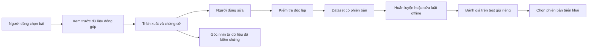

# Nền tảng học thuật và thiết kế thực nghiệm — Real Estate NER tiếng Việt

Ngày kiểm chứng: **09/10/2026**. Chưa có thực nghiệm mới. Các ví dụ là **tự tạo**, không phải bài đăng thu thập.

**Quy ước:** `[nguồn]` có công trình hỗ trợ; `[thiết kế]` là đề xuất; `[giả thuyết]` cần kiểm định; `[suy luận]` chưa được thực nghiệm ở miền này. “Đọc toàn văn chọn lọc” chỉ các phần liên quan; không tuyên bố thẩm định mọi thí nghiệm. Đây là rà soát có mục tiêu, không phải tổng quan hệ thống.

## 1. Định vị đúng bài toán và bằng chứng gần nhất

Ba mục tiêu: **đọc đúng bài đăng; lưu chứng cứ; trả góc nhìn so sánh có điều kiện**. Extraction tạo bài toán paper NLP; website tạo sản phẩm và vòng phản hồi. Nhiều chức năng chưa chứng minh đóng góp khoa học.

`[nguồn]` NER bất động sản tiếng Việt đã có công trình của Huynh và cộng sự tại NICS 2021. Abstract tác giả mô tả dataset gán tay và so sánh encoder; kết quả MishWindowEncoder 90,72% micro-F1 thuộc **bài 2021**. Nghiên cứu IEEE Access 2022 là công trình khác. Không lấy con số này làm thành tích của dự án hoặc bằng chứng model sẽ đạt mức tương tự trên Facebook. [Abstract tác giả NICS 2021](https://independent.academia.edu/SonHuynh73), [chương trình hội nghị](https://edas.info/web/nics21/program.html).

`[nguồn]` Bài IEEE Access 2022 đã có hệ thống thu thập tin web, lọc nhiễu, NER, kho dữ liệu và dashboard. Phần III dùng mô tả từ các website; tiêu chí hữu ích ưu tiên một bất động sản và đủ thông tin. Vì vậy “NER + dashboard” và “pipeline đầu cuối” không tự nó tạo novelty. [Bản toàn văn do tác giả tải lên](https://www.researchgate.net/publication/362502848_An_End-to-End_Named_Entity_Recognition_Platform_for_Vietnamese_Real_Estate_Advertisement_Posts_and_Analytical_Applications), DOI: [10.1109/ACCESS.2022.3195496](https://doi.org/10.1109/ACCESS.2022.3195496).

`[nguồn]` SEND/PACLIC 2022 đưa ra ViND gồm 12.862 tin từ năm website và nghiên cứu nhận diện nhiễu. Trong định nghĩa của họ, một bài chứa nhiều bất động sản hoặc thiếu thông tin quan trọng có thể là noise. Đây là định nghĩa theo mục đích sử dụng, không phải kết luận bài đó vô giá trị với mọi nghiên cứu. [SEND, §2–3](https://aclanthology.org/anthology-files/pdf/paclic/2022.paclic-1.71.pdf).

`[suy luận]` Điểm cần thay đổi ở dự án này là **giữ lại sự thiếu giá như một trạng thái có ý nghĩa**, thay vì xóa mọi tin thiếu giá để đạt điểm NER đẹp. Các tài liệu trên cho phép xác định khoảng trống đáng thử: độ đúng bản ghi và khả năng tránh bịa giá trên văn bản xã hội thiếu thông tin. Chúng chưa chứng minh đây là hướng chưa từng có trên toàn thế giới.

## 2. NER chỉ là một bộ phận của Information Extraction

`[thiết kế]` Xem hệ thống như năm phép biến đổi có đầu vào, đầu ra và cách kiểm tra riêng:

| Tầng | Câu hỏi | Ví dụ lỗi cần bắt |
|---|---|---|
| Nhận diện ý định và đối tượng | Bán, cho thuê, tìm mua, tìm thuê? Một hay nhiều căn? | “Cần thuê tầm 5tr” bị xem là giá chào thuê |
| Phát hiện span | Đoạn chữ nào biểu đạt giá, diện tích, vị trí, số phòng? | Bắt số điện thoại làm giá |
| Gắn vai trò và căn | Số này thuộc giá thuê, cọc, phí điện hay căn thứ hai? | Gán 30 m² của căn A với giá căn B |
| Chuẩn hóa | Đổi về giá trị, đơn vị, thời hạn và kiểu thích hợp | “3tr5” sai thành 3 triệu; giá/m² thành tổng giá |
| Kiểm chứng và xuất bản ghi | Có chứng cứ đủ để hiển thị hay cần người duyệt? | JSON hợp lệ nhưng giá do model tự thêm |

`[nguồn]` CRF là nền tảng mô hình hóa nhãn có cấu trúc của chuỗi. Nó cho phép xét quan hệ giữa các nhãn; CRF không tự giải quyết chuẩn hóa giá trị hay xác định căn nào sở hữu mỗi giá. [Lafferty, McCallum và Pereira, ICML 2001](https://web.cs.ucla.edu/~yzsun/classes/2014Spring_CS7280/Papers/Probabilistic_Models/crf_sequence.pdf).

`[thiết kế]` Trong BIO/IOB2, `B-PRICE` mở span giá, `I-PRICE` tiếp tục, `O` ở ngoài. Lưu **character offsets**, rồi chuyển thành nhãn token để regex/LLM/encoder chung mặt bằng đánh giá. Quy định Unicode code point hay UTF-16: JavaScript/Python có thể đếm khác với emoji. Giữ bản văn bất biến và ánh xạ về đầu vào để highlight đúng.

`[nguồn]` PhoBERT là mô hình tiền huấn luyện dành cho tiếng Việt; bài gốc phân biệt âm tiết với từ và dùng dữ liệu đã tách từ. `[thiết kế]` Nếu sử dụng PhoBERT, pipeline tách từ và ánh xạ subword→word→span phải được ghi phiên bản. Không áp dụng quy trình này như yêu cầu chung của mọi LLM. [PhoBERT, §2](https://aclanthology.org/2020.findings-emnlp.92.pdf).

`[thiết kế]` Ví dụ “Cho thuê 30m², 3tr5/tháng, cọc 1 tháng, điện 4k/kWh” có giá thuê 3.500.000 VND/tháng, diện tích 30 m², một điều kiện cọc và đơn giá điện. Chỉ bắt được bốn con số không đủ. Với “4×16, nở hậu”, tích 64 m² chỉ là diện tích hình chữ nhật suy ra; không thay thế diện tích được công nhận. “Phòng trọ” không tự chứng minh một phòng ngủ độc lập. “2PN+1” nên giữ hai phòng ngủ và một không gian thêm chưa xác định chức năng.

`[nguồn]` ViLexNorm nghiên cứu chuẩn hóa văn bản mạng xã hội tiếng Việt. Phần đánh giá ngoài cho thấy hiệu quả tùy tác vụ; một số trường hợp spam giảm kết quả. `[thiết kế]` Vì thế chuẩn hóa viết tắt là một ablation cần đo, không phải bước chắc chắn luôn tốt. Giữ cả raw text và normalized view; không thay chữ mà mất dấu vết nguồn. [ViLexNorm, §5 và Limitations](https://aclanthology.org/2024.eacl-long.85.pdf).

## 3. Giá thiếu là một đối tượng nghiên cứu

`[thiết kế]` Trước tiên tách **chất lượng lần thu thập** khỏi **trạng thái nội dung giá**. Văn bản bị cắt ở “Xem thêm”, ảnh chưa OCR hoặc không lấy được nội dung không đủ để kết luận chủ tin không công khai giá. `capture_complete=false` phải chặn suy diễn này.

| Trạng thái giá | Bằng chứng cần có | Cách lưu |
|---|---|---|
| `explicit` | Có giá đủ rõ, gắn đúng vai trò | Giá trị hoặc khoảng; loại tiền; đơn vị; span |
| `withheld` | Dấu hiệu như “inbox giá” | Null; span dấu hiệu; không suy đoán số |
| `not_stated` | Bản văn thu thập đủ nhưng không có giá | Null; kết luận chỉ về văn bản đã có |
| `ambiguous` | “3.x”, nhiều mức mâu thuẫn chưa giải quyết | Giữ chuỗi và các ứng viên; cần duyệt |
| `unavailable_input` | Thu thập thiếu hoặc giá có thể ở ảnh chưa đọc | Null; lý do kỹ thuật |

Thương lượng là một **thuộc tính bổ sung**: “3tr5 còn thương lượng” vẫn có giá explicit. “Giá thỏa thuận” không chứa giá số. Giá khoảng cần `min/max`; không rút gọn thành trung bình mà giấu mất bản chất. Mỗi record phải phân biệt giá bán, giá thuê theo thời hạn, giá trên m², ngân sách, phí và cọc.

`[giả thuyết]` Nhận xét “nhà đẹp hay giấu giá, phòng trọ thường công khai giá” đáng khảo sát. Chưa có bằng chứng ở đây để kết luận mọi tin trọ **bắt buộc** ghi giá. “Nhà đẹp” là đánh giá chủ quan; ảnh đẹp, nhiều tiện nghi, giá cao, loại tài sản và người đăng có thể bị trộn lẫn. Phiên bản đo được trước là: **tỷ lệ nêu giá khác nhau giữa tin bán nhà và tin cho thuê phòng, trong mẫu nguồn và thời gian đã định**.

`[thiết kế]` Gán nhãn độc lập ý định, loại tài sản, trạng thái giá và dấu hiệu giấu giá. Lấy cả tin có và không có giá theo quy trình lấy mẫu mô tả trước. Báo mẫu số theo từng nhóm, nguồn, tuần và số record duy nhất. Một tin được repost 20 lần không tương đương 20 căn. Giới hạn kết luận theo khung mẫu; người dùng extension tự chọn tin để đóng góp có thể tạo thêm thiên lệch lựa chọn.

`[nguồn]` Lý thuyết missing data phân biệt missing completely at random, missing at random và các cơ chế không thể bỏ qua. Để dùng giả định MAR phải nói rõ dữ liệu quan sát và cơ chế thiếu; không thể gọi mọi giá thiếu là ngẫu nhiên. [Seaman và cộng sự, Statistical Science 2013, §2 và §7](https://arxiv.org/pdf/1306.2812).

`[suy luận]` Nếu xác suất công khai giá còn phụ thuộc vào chính mức giá chưa quan sát sau khi điều kiện hóa trên đặc trưng đã có, ta có một tình huống phù hợp với **MNAR**. Nhưng chỉ nhìn bài đăng thiếu giá không xác nhận được cơ chế đó. Giấu giá có thể do cách đăng, môi giới, quy tắc nhóm hoặc nội dung ở ảnh. Dự án phải khảo sát độ nhạy và nêu giả định, thay vì tuyên bố đã giải quyết selection bias.

## 4. “Mức giá sàn” cần đổi thành một đại lượng đo được

`[thiết kế]` Giai đoạn đầu chỉ nên đưa ra **phân bố giá chào quan sát được của nhóm tin tương đồng**: trung vị, các phân vị, số căn, ngày cập nhật và tỷ lệ có giá. Không gọi giá nhỏ nhất, P10 hay cận dưới khoảng dự đoán là “giá sàn thật”. Giá chào có thể đổi, thương lượng, thiếu phí hoặc không được giao dịch.

Công thức sau là **định nghĩa mục tiêu [design] [cần thực nghiệm]**: mô tả phân bố dữ liệu giá chào đã thu được, không có bảo đảm đại diện thị trường:

$$Q_{\tau}\bigl(Y_{\mathrm{asking}}\mid X=x, R=1, S=s, T=t\bigr).$$

Ở đây `Y_asking` là giá chào, `X` gồm loại tài sản/khu vực/diện tích đã biết, `R=1` nghĩa là giá số được công khai và đọc đủ, `S` là phạm vi nguồn lấy mẫu, `T` là khoảng thời gian. P10 mô tả phần thấp của **phân bố này**; không đại diện mọi căn trong khu vực. Nếu chỉ hiển thị thống kê mô tả cho người đọc, chưa cần train một model dự đoán giá.

`[thiết kế]` Ví dụ minh họa: nếu website có 100 tin đủ nội dung, 30 tin có giá và sau gộp trùng còn 20 căn có giá, biểu đồ phải nêu cả ba mẫu số. Đặt ngưỡng số căn tối thiểu và độ chi tiết địa lý bằng thí nghiệm nội bộ; khi không đủ dữ liệu, hiển thị “chưa đủ tin tương đồng”. Không tự chuyển sang nhóm quá rộng mà giữ nguyên nhãn “cùng khu vực”.

Nếu mở rộng sang dự đoán, dùng baseline trung vị nhóm trước, rồi hồi quy đơn giản hoặc model cây; train trên giá chào đã xác thực. Chuẩn hóa thời hạn thuê và tách giá trên m² khỏi tổng giá. Đánh giá trên giá chào tương lai có quan sát, vì chưa có giá thật của tin withheld. Che ngẫu nhiên một giá đã biết chỉ kiểm tra **artificial masking**; không chứng minh dự đoán đúng những giá bị giấu có chọn lọc.

`[nguồn]` Split conformal dùng tập calibration giữ riêng để xây tập/khoảng dự đoán; bảo đảm thông thường là **marginal coverage** dưới điều kiện thích hợp như exchangeability. Nó không tự bảo đảm mỗi phường hay mỗi căn đều có coverage mục tiêu. [Angelopoulos và Bates, §1](https://arxiv.org/pdf/2107.07511).

`[nguồn]` Barber và cộng sự nghiên cứu khi exchangeability bị phá bởi dịch chuyển phân bố; weighting có thể giúp nhưng vẫn cần điều kiện và phân tích mất coverage. `[thiết kế]` Vì vậy không gắn nhãn “chắc chắn 90% đúng” cho giá nhà chỉ vì có thư viện conformal. Đo coverage và độ rộng theo thời gian/nhóm; tách khoảng dự đoán của một tin khỏi khoảng bất định của trung vị hoặc phân vị. [Conformal Prediction Beyond Exchangeability, §1–2](https://arxiv.org/pdf/2202.13415).

## 5. Dữ liệu cộng đồng: từ đóng góp đến nhãn đáng dùng

`[thiết kế]` Website “bị động” có thể hiểu là ban đầu nhận dữ liệu seed qua nguồn được phép và qua nhập tay; extension bổ sung dữ liệu khi người dùng chủ động chọn nội dung. Vòng học cần được thiết kế rõ:

Đóng góp dữ liệu, sửa nhãn và xác nhận sự thật là ba việc khác nhau. Người dùng sửa “3tr5” thành 3.500.000 có thể xác nhận diễn giải văn bản; không chứng minh căn phòng còn trống hoặc chủ nhà thực sự cho thuê với giá đó. Dữ liệu nên có `contributor_proposed`, `reviewed`, `rejected` cùng người/phiên bản duyệt và chứng cứ. Không tự đưa mọi sửa đổi vào gold set.

`[nguồn]` Snorkel mô hình hóa các nguồn nhãn yếu như heuristic, có thể bất đồng hoặc abstain; nhãn tổng hợp dùng để train model. `[thiết kế]` Regex và LLM có thể tạo **silver labels**, còn test cần gán độc lập. LLM tự gán gold rồi tự đánh giá kết quả có nguy cơ tái tạo chính sai sót của nó. [Snorkel, §2–3](https://arxiv.org/pdf/1711.10160).

`[nguồn]` Raykar và cộng sự nghiên cứu độ tin cậy khác nhau giữa annotator; majority vote không đương nhiên là truth, và mô hình của họ cũng có giả định độc lập. `[thiết kế]` Trong MVP, dùng guideline, gán kép một phần mẫu, adjudication và kiểm tra mẫu định kỳ trước khi xây thuật toán uy tín phức tạp. [Learning From Crowds, §1–2](https://jmlr.csail.mit.edu/papers/volume11/raykar10a/raykar10a.pdf).

`[nguồn]` Active learning đặt câu hỏi nhãn cho những ví dụ được chọn, thay vì gán mọi dữ liệu. `[thiết kế]` Có thể ưu tiên bất đồng regex/LLM, đơn vị lạ hoặc nhiều căn, nhưng giữ một nhánh lấy mẫu ngẫu nhiên để nhìn được lỗi phổ biến. So sánh theo số phút người gán, không chỉ số bài: một bài dài nhiều căn tốn thời gian khác một tin ngắn. [Settles, abstract Technical Report 1648](https://minds.wisconsin.edu/handle/1793/60660).

## 6. Một paper có phạm vi đủ rõ

**RQ chính [thiết kế]:** *Trên bài đăng bất động sản tiếng Việt thiếu hoặc mơ hồ thông tin, kết hợp trích xuất span, chuẩn hóa có chứng cứ và cơ chế abstain có cải thiện độ đúng bản ghi so với regex, sequence labeling và LLM có schema, ở cùng mức coverage và ngân sách xử lý hay không?*

Phân tích công khai giá là nhánh dataset phụ; định giá là hướng mở rộng. Tập trung extraction **đúng khi thiếu thông tin**, dùng website làm case study; không chia sớm thành ba paper thiếu dữ liệu.

**Đóng góp dự kiến [thiết kế]:** guideline giá thiếu; benchmark kiểm soát trùng/nguồn; pipeline giữ null và chứng cứ; trade-off sai–coverage–chi phí. Dataset cần chất lượng, sampling rõ và tái lập phù hợp quyền dữ liệu. Chưa có đóng góp được thực nghiệm; không claim “first”, “state of the art” hay bảo đảm Q1.

| Baseline/thành phần | Vai trò trong thí nghiệm | Điều kiện so sánh |
|---|---|---|
| Regex + từ điển + normalizer | Mốc rẻ và dễ hiểu | Rules chỉ phát triển trên train/dev |
| Sequence labeling | Đối chứng học có giám sát | PhoBERT-base; CRF hoặc token head ghi rõ |
| LLM theo schema | Đối chứng linh hoạt | Model, prompt, phiên bản, thời điểm và retry cố định |
| Hybrid + validator + abstain | Phương pháp đề xuất | Chung schema; ghi tất cả call và lần từ chối |
| GLiNER | Đối chứng tùy ngân sách | Chọn checkpoint có hỗ trợ phù hợp, thử tiếng Việt trước |

`[nguồn]` GLiNER dùng encoder hai chiều để nhận thực thể theo mô tả loại. Kết quả benchmark gốc không bảo đảm trích “5ty2” hoặc vị trí Việt Nam tốt. [GLiNER, NAACL 2024](https://aclanthology.org/2024.naacl-long.300.pdf). `[nguồn]` JSONSchemaBench tách việc tuân schema, độ phủ các ràng buộc và chất lượng nội dung. `[suy luận]` JSON parse được không chứng minh giá đúng. [JSONSchemaBench, 2025](https://arxiv.org/html/2501.10868v3).

**Ablation [thiết kế]:** bỏ grounding để đo giá không có chứng cứ; bỏ chuẩn hóa ngữ nghĩa để thấy lỗi đơn vị/vai trò; bỏ phân loại ý định để đo ngân sách bị nhận thành giá chào; bỏ abstain để xem đổi coverage và sai; bỏ nhãn trạng thái thiếu giá để đo ảnh hưởng trên withheld/not_stated. Không thay nhiều thành phần cùng lúc rồi gán công lao cho một module. Với hybrid gọi thêm model, báo kết quả theo ngân sách ngang nhau và có đường Pareto chất lượng–chi phí.

## 7. Dataset và splits chống kết quả đẹp giả

Toàn bộ đoạn này là **protocol đề xuất [thiết kế]**. Trước khi gán diện rộng, một pilot nhỏ phải đo tỷ lệ loại tin, thời gian gán, bất đồng và lỗi thu thập. Các con số kế hoạch chỉ chốt sau pilot; không có ngưỡng “300 bài là đủ cho paper”. Cỡ mẫu test cần phục vụ độ chính xác của ước lượng và đủ ca của từng nhóm khó, không chỉ đủ tổng số bài.

Lưu riêng `post_id`, `source`, thời điểm đăng nếu biết, thời điểm thu thập, fingerprint, `duplicate_cluster_id` và đối tượng bất động sản ước đoán. Một post có thể chứa nhiều listings. Nhiều post có thể cùng một listing. Nhóm gần trùng phải xét nội dung, thuộc tính và thời gian; gộp sai hai căn khác nhau cũng là lỗi cần audit.

Ba kiểu đánh giá nên được phân biệt:

1. **Theo cụm:** cùng một căn/tin repost không nằm ở cả train và test. Chia sau khi tạo cụm, rồi audit những cặp gần trùng giữa các phần.
2. **Theo nguồn:** giữ một nguồn/group/tập tác giả phù hợp làm nguồn chưa thấy; đo độ chuyển miền. Không giả vờ website listing giống social posts chỉ vì cùng tiếng Việt.
3. **Theo thời gian:** train cũ, dev tiếp sau, test tương lai. Nếu mục tiêu là căn mới, loại cụm đã thấy khỏi test; nếu mục tiêu theo dõi giá của căn đã thấy, đặt một nhiệm vụ longitudinal riêng và ghi rõ.

Khóa manifest split trước khi chỉnh prompt/regex cuối cùng. Gazetteer, từ điển viết tắt, luật grouping và nhãn bạc dùng cho training phải khai báo nguồn/phiên bản và tránh lấy thông tin từ test để tune. Tập calibration cho abstain hoặc dự đoán không đồng thời là test. Tách role reviewer khỏi model assistance khi tạo nhãn test hoặc ít nhất ghi lại và có bước đọc độc lập.

## 8. Đo từ span đến record, không dừng ở một F1

`[nguồn]` CoNLL-2003 đánh giá một entity đúng khi khớp chính xác entity chuẩn; dataset và test phục vụ so sánh các hệ thống. `[thiết kế]` Áp dụng nguyên tắc strict span/type matching nhưng dùng nhãn bất động sản của mình, không sao chép nhóm PERSON/ORG của CoNLL. [CoNLL-2003, §2.3–2.4](https://aclanthology.org/W03-0419.pdf).

| Thước đo đề xuất | Trả lời điều gì | Điều cần công bố |
|---|---|---|
| Strict span precision/recall/F1 | Đúng ranh giới và loại chưa? | Micro, per-type và số support |
| Normalized field exact match | Giá trị, đơn vị, thời hạn, vai trò đúng chưa? | So cả các null có trạng thái đúng |
| Record exact match | Các trường có đúng và thuộc cùng căn chưa? | Quy tắc match record khi nhiều căn |
| Price-state macro-F1 | Phân biệt explicit/withheld/absent/ambiguous? | Confusion matrix, class support |
| Unsupported-value rate | Có giá trị không có chứng cứ hợp lệ? | Mẫu số tất cả giá trị được xuất |
| Risk–coverage | Chấp nhận bao nhiêu và sai bao nhiêu? | Cùng coverage; không chỉ điểm sau lọc |
| Thời gian và chi phí | Tốc độ/chí phí sử dụng thực tế? | Latency, call, token, retries, phút sửa |

Các metrics trong bảng là **thiết kế đánh giá**, chưa có số kết quả. Rule “hai model đồng ý” là một tín hiệu kiểm tra, chưa phải confidence 95%. Cùng nguồn huấn luyện hoặc cùng giả định có thể khiến cả hai cùng sai. Muốn biểu diễn xác suất, phải hiệu chỉnh và đo trên dữ liệu giữ riêng.

“Abstain” là trạng thái hệ thống cần người xem lại, khác `not_stated` là nội dung không có giá. Model trả null cho mọi thứ không được thưởng bằng accuracy cao nhờ nhiều trường thiếu. Báo accuracy trên các trường có mặt, độ đúng trạng thái thiếu và coverage riêng. Bootstrap hoặc thống kê so sánh phải lấy mẫu theo cụm tương ứng với tính phụ thuộc; không xem mọi token hoặc repost là quan sát độc lập.

## 9. Lộ trình đọc và quyết định thực dụng

| Chặng | Đọc/làm | Quyết định cần giải quyết |
|---|---|---|
| 0 | Schema, quyền nguồn, pilot và thời gian gán | Có dữ liệu đủ nội dung, đủ tin cậy để đo? |
| 1 | NICS → Access → SEND | Nhãn/source/splits/lọc noise khác dự án ở đâu? |
| 2 | CRF/PhoBERT/CoNLL, ViLexNorm, JSONSchemaBench | Baseline vừa máy; span và record được chấm riêng? |
| 3 | Snorkel/Raykar/Settles; review rồi active learning | Cộng đồng tạo thêm nhãn đúng hay lặp tin dễ? |
| 4 | Thống kê giá chào; Seaman/conformal | Cần prediction không; dữ liệu và test tương lai đủ chưa? |

Chưa có benchmark phase 0 nên chưa hứa throughput, giá API hoặc độ chính xác. Nếu extraction chưa tin cậy, hồi quy trên dữ liệu sai vẫn tạo kết quả khó kiểm chứng.

## 10. Sổ nguồn đã kiểm chứng

Truy cập **09/10/2026**. `FT-chọn lọc`: đọc phần liên quan trong toàn văn; `ABS`: abstract; `META`: bibliographic identity. Không suy kết quả chưa đọc.

| ID | Công trình và metadata | URL đọc / mức đọc | Nhận định chính xác được hỗ trợ; giới hạn |
|---|---|---|---|
| R01 | Huynh et al., *Named Entity Recognition for Vietnamese Real Estate Advertisements*, NICS 2021, tr.23–28; DOI 10.1109/NICS54270.2021.9701519 | [Abstract tác giả](https://independent.academia.edu/SonHuynh73) ABS; [program](https://edas.info/web/nics21/program.html) META | Công trình có thật; benchmark encoder và MishWindowEncoder 90,72 micro-F1 thuộc bài này. Chưa đọc full text 2021, không khẳng định license/dataset khả dụng. |
| R02 | Binh T. Nguyen et al., *An End-to-End Named Entity Recognition Platform for Vietnamese Real Estate Advertisement Posts and Analytical Applications*, IEEE Access 10, 87681–87697, 2022; DOI 10.1109/ACCESS.2022.3195496 | [Toàn văn tác giả](https://www.researchgate.net/publication/362502848_An_End-to-End_Named_Entity_Recognition_Platform_for_Vietnamese_Real_Estate_Advertisement_Posts_and_Analytical_Applications) FT-chọn lọc abstract/§III–V | Pipeline noise→NER→kho→Superset đã có; dữ liệu website; định nghĩa useful/noisy. Không chứng minh hiệu năng trên Facebook. |
| R03 | Khanh Quoc Tran et al., *SEND: A Simple and Efficient Noise Detection Algorithm for Vietnamese Real Estate Posts*, PACLIC 36, 647–656, 2022; Anthology 2022.paclic-1.71 | [PDF ACL](https://aclanthology.org/anthology-files/pdf/paclic/2022.paclic-1.71.pdf) FT-chọn lọc §2–3 | ViND 12.862 tin/năm website; nhiều căn và thiếu thông tin có thể là noise. Không suy tỷ lệ thiếu giá social media từ dataset này. |
| R04 | Dat Quoc Nguyen, Anh Tuan Nguyen, *PhoBERT: Pre-trained language models for Vietnamese*, Findings EMNLP, 1037–1042, 2020; DOI 10.18653/v1/2020.findings-emnlp.92 | [PDF ACL](https://aclanthology.org/2020.findings-emnlp.92.pdf) FT-chọn lọc intro/§2 | Encoder tiếng Việt, dữ liệu tách từ; phù hợp làm baseline. Kết quả miền gốc không là dự báo BĐS. |
| R05 | John Lafferty, Andrew McCallum, Fernando Pereira, *Conditional Random Fields: Probabilistic Models for Segmenting and Labeling Sequence Data*, ICML 2001, 282–289 | [Author postprint lưu tại UCLA](https://web.cs.ucla.edu/~yzsun/classes/2014Spring_CS7280/Papers/Probabilistic_Models/crf_sequence.pdf) FT-chọn lọc §1–3 | Cơ sở structured sequence labeling; không phải phương pháp định giá. |
| R06 | Thanh-Nhi Nguyen, Thanh-Phong Le, Kiet Nguyen, *ViLexNorm: A Lexical Normalization Corpus for Vietnamese Social Media Text*, EACL 2024, 1421–1437; DOI 10.18653/v1/2024.eacl-long.85 | [PDF ACL](https://aclanthology.org/2024.eacl-long.85.pdf) FT-chọn lọc §5/limitations | Corpus normalization social text; tác động downstream không đồng nhất. Chưa là bằng chứng cải thiện RE-NER. |
| R07 | Erik F. Tjong Kim Sang, Fien De Meulder, *Introduction to the CoNLL-2003 Shared Task: Language-Independent Named Entity Recognition*, CoNLL 2003, 142–147; Anthology W03-0419 | [PDF ACL](https://aclanthology.org/W03-0419.pdf) FT-chọn lọc §2 | Exact entity match, train/dev/test, IOB không overlap; nguồn nguyên tắc span evaluation. |
| R08 | Urchade Zaratiana, Nadi Tomeh, Pierre Holat, Thierry Charnois, *GLiNER: Generalist Model for Named Entity Recognition using Bidirectional Transformer*, NAACL 2024, 5364–5376; DOI 10.18653/v1/2024.naacl-long.300 | [PDF ACL](https://aclanthology.org/2024.naacl-long.300.pdf) FT-chọn lọc abstract | Encoder nhận loại thực thể linh hoạt; checkpoint và chất lượng tiếng Việt phải thử riêng. |
| R09 | Alexander Ratner et al., *Snorkel: Rapid Training Data Creation with Weak Supervision*, PVLDB 11(3), 269–282, 2017; DOI 10.14778/3157794.3157797 | [arXiv toàn văn](https://arxiv.org/pdf/1711.10160) FT-chọn lọc §2–3 | Labeling functions, abstention, nhãn xác suất và phụ thuộc nguồn; không biến silver thành gold. |
| R10 | Burr Settles, *Active Learning Literature Survey*, University of Wisconsin–Madison Technical Report 1648, 2009 | [University abstract](https://minds.wisconsin.edu/handle/1793/60660) ABS; [PDF tác giả](https://burrsettles.com/pub/settles.activelearning_20090109.pdf) truy cập được nhưng fetch lại timeout | Chọn ví dụ để hỏi nhãn; survey phương pháp. Hiệu quả ở dataset dự án là giả thuyết. |
| R11 | Vikas C. Raykar et al., *Learning From Crowds*, JMLR 11, 1297–1322, 2010 | [PDF JMLR](https://jmlr.csail.mit.edu/papers/volume11/raykar10a/raykar10a.pdf) FT-chọn lọc §1–2 | Annotator khác độ tin cậy; majority vote và giả định độc lập có giới hạn. Không trực tiếp xử lý spam extension. |
| R12 | Shaun Seaman, John Galati, Dan Jackson, John Carlin, *What Is Meant by “Missing at Random”?*, Statistical Science 28(2), 257–268, 2013; DOI 10.1214/13-STS415 | [Author full text arXiv](https://arxiv.org/pdf/1306.2812) FT-chọn lọc §2, §7 | Định nghĩa MAR/MCAR và điều kiện ignorability; không chứng minh giá BĐS Việt Nam là MNAR. |
| R13 | Anastasios N. Angelopoulos, Stephen Bates, *A Gentle Introduction to Conformal Prediction and Distribution-Free Uncertainty Quantification*, arXiv:2107.07511, bản v6 2022; first submission 2021 | [arXiv PDF](https://arxiv.org/pdf/2107.07511) FT-chọn lọc §1 | Calibration giữ riêng, marginal coverage, giả định exchangeability; không xác nhận fair price. |
| R14 | Rina Foygel Barber, Emmanuel J. Candès, Aaditya Ramdas, Ryan J. Tibshirani, *Conformal Prediction Beyond Exchangeability*, Annals of Statistics 51(2), 816–845, 2023; DOI 10.1214/23-AOS2276 | [Author PDF arXiv](https://arxiv.org/pdf/2202.13415) FT-chọn lọc §1–2 | Drift/dependence ảnh hưởng coverage; extension weighting có điều kiện, không xóa mọi selection bias. |
| R15 | Saibo Geng et al., *JSONSchemaBench: A Rigorous Benchmark of Structured Outputs for Language Models*, arXiv:2501.10868v3, 27/02/2025 | [Toàn văn HTML](https://arxiv.org/html/2501.10868v3) FT-chọn lọc abstract/evaluation | Phân biệt compliance, constraint coverage và content quality. Dùng tên của v3; không tự khẳng định venue chưa xác minh. |

**Kiểm tra chất lượng:** claims nguồn có dẫn chứng; kết quả dự án chưa đo; công khai giá là giả thuyết; công thức là thiết kế. Không suy giá chào thành giao dịch hoặc hứa mức tạp chí. Identity/đoạn nguồn đã xem có độ tin cậy cao; feasibility/novelty/hiệu năng cần thực nghiệm.
