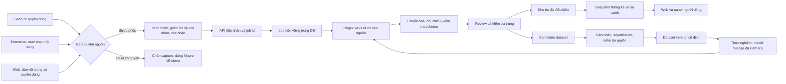

# ReNER-VN: kiến trúc có thể xây, kiểm chứng và phát triển

Ngày nghiên cứu: **09/10/2026**, múi giờ Asia/Saigon. Đọc đối chiếu proposal ReNER-VN v1.3, mục 4–5.5, và ảnh đề tài số 8. Đây là **thiết kế đề xuất**, chưa phải hệ thống đã triển khai hay kết quả thực nghiệm. Các số liệu trong ví dụ đều tự tạo.

## 1. Quyết định kiến trúc quan trọng nhất

Xây hệ thống **trích xuất thông tin thuê nhà có bằng chứng nguồn**, sau đó cung cấp thống kê của các tin chào thuê quan sát được. Extension là kênh nhập thuận tiện; website là nơi xem, sửa, quản lý và so sánh. Paper đánh giá thuật toán và dữ liệu bằng quy trình độc lập với số người dùng sản phẩm.

Ba điều cần sửa trong proposal: không thu mọi bài khi người dùng lướt; không gửi HTML toàn trang; không đưa mọi đóng góp trực tiếp vào tập huấn luyện. Thay bằng **chọn một nội dung có quyền sử dụng → xem trước → xác nhận → trích xuất → kiểm tra → tiếp nhận có điều kiện**. Cách này làm quy trình dữ liệu kiểm soát được và giữ đường triển khai ngay cả khi nguồn Facebook không được phép thu tự động.

“Web bị động” nên hiểu là server nhận yêu cầu và xử lý đóng góp, không tự tìm dữ liệu. Cold start cần một bộ seed có quyền dùng do nhóm chuẩn bị. AI không tự tạo giá thị trường; AI giúp đọc văn bản. Muốn học mô hình giá cần dữ liệu, mục tiêu dự đoán, tập kiểm thử và sai số riêng. MVP chưa làm việc đó.

## 2. Quyền trình duyệt, quyền nguồn và pháp lý

Chrome `activeTab` cấp quyền truy cập tạm thời khi người dùng chủ động gọi extension. Đây là cơ chế kỹ thuật, **không cấp phép thu thập dữ liệu từ chủ website**. [Chrome activeTab](https://developer.chrome.com/docs/extensions/develop/concepts/activeTab)

Meta giải thích rằng tự động lấy dữ liệu Facebook khi chưa có sự cho phép trước của Meta vi phạm điều khoản, kể cả nội dung người bình thường có thể xem. Vì vậy, “thành viên nhóm”, “quy mô nhỏ”, “user đồng ý” không đủ để tự kết luận hợp lệ. [Meta: How We Combat Scraping](https://about.fb.com/news/2021/04/how-we-combat-scraping/)

Proposal ghi Groups API bị loại bỏ ngày 22/04/2024. Trong phiên nghiên cứu này, hai URL chính thức [v19 changelog](https://developers.facebook.com/docs/graph-api/changelog/version19.0/) và [thông báo v19](https://developers.facebook.com/blog/post/2024/01/23/introducing-facebook-graph-and-marketing-api-v19/) trả HTTP 429; trang [Automated Data Collection Terms](https://www.facebook.com/legal/automated_data_collection_terms) chuyển sang đăng nhập/bị chặn. Vì chưa đọc trực tiếp được các trang này, không coi chúng là xác minh độc lập đầy đủ về mọi trạng thái API năm 2026. **Thiết kế không phụ thuộc Groups API**; trước khi dùng nguồn Meta phải kiểm tra lại điều khoản hiện hành và quyền cụ thể.

Công báo xác nhận Luật 91/2025/QH15 hiệu lực 01/01/2026; Chính phủ xác nhận Nghị định 356/2025/NĐ-CP hướng dẫn thi hành cùng ngày hiệu lực. Các metadata này không chứng minh dự án đã tuân thủ. Cần rà soát quyền xử lý, thời hạn lưu, bên cung cấp LLM, chuyển dữ liệu và nghĩa vụ áp dụng khi triển khai thật. [Luật](https://congbao.chinhphu.vn/van-ban/luat-so-91-2025-qh15-45578.htm), [Nghị định](https://vanban.chinhphu.vn/?classid=1&docid=216387&pageid=27160)

**Policy gate đề xuất:** nguồn `approved` mới bật capture; `unknown/denied` chặn DOM extraction. Để demo, dùng trang fixture do nhóm sở hữu, văn bản tự viết và dữ liệu được tác giả/cấp phép cho sử dụng. Dán văn bản chỉ là fallback nhập liệu; người dán vẫn phải có quyền dùng nội dung. Không truy cập nhóm riêng tư, cookie, token hay endpoint ẩn để vượt gate.

## 3. Một backend chia module là đủ

Đề xuất Next.js/React + TypeScript cho web, extension Chrome Manifest V3 bằng TypeScript, FastAPI/Pydantic cho API và Python NLP. SQLite phù hợp demo một máy; chuyển PostgreSQL trước khi có nhiều người ghi dữ liệu đồng thời. Đây là lựa chọn thiết kế theo kỹ năng nhóm, không phải khẳng định stack khác kém hơn.

Backend chia module ingestion, extraction, normalization, review, deduplication, statistics và experiment trong một ứng dụng. Một worker lấy job từ bảng `jobs`, xử lý bằng pipeline và ghi kết quả giao dịch. Chưa cần microservices, Kafka, vector database hay agent tự hành. Đầu ra JSON có schema đủ cho MVP; chỉ bổ sung hạ tầng khi số liệu tải chứng minh nhu cầu.

Nếu cả nhóm mạnh JavaScript, có thể dùng một backend TypeScript và gọi Python như module/batch nghiên cứu. Nếu thời gian rất ít, web React đơn giản thay Next.js. Giữ một hợp đồng API và một bộ normalizer dùng chung để extension, web và script đánh giá không tính khác nhau.



Mũi tên vào dataset là quy trình tuyển chọn. Nó không có nghĩa đồng ý đóng góp thị trường đồng nghĩa đồng ý huấn luyện hoặc công bố corpus.

## 4. Extension: mỗi lần chọn là một giao dịch

Manifest tối thiểu dự kiến gồm `activeTab`, `scripting`, `storage`, quyền host chỉ tới API dự án; thêm `contextMenus` khi thực sự có chức năng chọn văn bản bằng menu. Không xin `<all_urls>`, lịch sử duyệt hay cookie. Chrome yêu cầu quyền hẹp nhất cần thiết cho tính năng hiện có. [Use of Permissions](https://developer.chrome.com/docs/webstore/program-policies/permissions)

Luồng sử dụng: user bôi đen bài hoặc nhấn “Phân tích bài này”; extension kiểm tra nguồn được phép; content script lấy phần văn bản đã chọn; panel hiện nội dung sắp gửi, URL nếu được lưu, cảnh báo dữ liệu cá nhân còn sót và mục đích xử lý. User có thể sửa, hủy, chọn “Phân tích” và tùy chọn riêng “Đóng góp”. Không tự mở rộng hàng loạt bài, tự cuộn feed hay theo dõi browsing liên tục.

Content script chỉ đọc; service worker gửi API bằng message passing với schema cố định. Kiểm tra loại message, sender và kích thước; không nhận một URL bất kỳ để worker fetch thay. Chrome cung cấp `runtime.sendMessage`/`tabs.sendMessage` cho giao tiếp giữa các ngữ cảnh. [Message passing](https://developer.chrome.com/docs/extensions/develop/concepts/messaging), [Network requests](https://developer.chrome.com/docs/extensions/develop/concepts/network-requests)

Service worker có thể bị dừng; biến toàn cục không giữ trạng thái bền vững. Lưu draft và `submission_id` vào storage, gửi job ngắn, nhận `job_id`, rồi hỏi trạng thái. Không chạy LLM nhiều phút trong extension. [Service worker lifecycle](https://developer.chrome.com/docs/extensions/develop/concepts/service-workers/lifecycle)

Khi DOM thay đổi, báo “không lấy được nội dung”, cho dùng bản dán hoặc fixture. Replay nên lưu **text đã giảm dữ liệu cá nhân + extraction JSON**, không lưu toàn HTML trang chứa profile/comment/ID. Logic extension đóng gói tại chỗ; cấu hình từ server chỉ là dữ liệu, không mã chạy động. [MV3 requirements](https://developer.chrome.com/docs/webstore/program-policies/mv3-requirements)

## 5. Hợp đồng dữ liệu: bài đăng khác tin cho thuê

Một `Post` là đơn vị văn bản nguồn. Một `Listing` là một đối tượng cho thuê. Một bài có thể giới thiệu ba loại phòng; một phòng có thể xuất hiện trong nhiều bài và nhiều lần sửa. Nếu schema chỉ có bốn cột trên một bài, hệ thống dễ ghép giá phòng A với diện tích phòng B.

| Thực thể | Vai trò | Trường cốt lõi đề xuất |
|---|---|---|
| SourcePolicy | Quyền và hạn chế nguồn | source, status, proof_ref, permitted_purposes, review_date |
| Submission | Hành động gửi của user | submission_id, actor_id giả danh, consent_version, scopes, submitted_at |
| PostVersion | Văn bản tại một lần quan sát | post_id, version_id, text_redacted, text_hash, observed_at, published_at hoặc null |
| ListingCandidate | Một tin tách từ bài | listing_id, post_version_id, listing_index, property_type, transaction_type |
| FieldEvidence | Giá trị và chứng cứ | label, span_start, span_end, raw_span, normalized_value, status |
| ExtractionRun | Lần chạy có phiên bản | run_id, input_hash, rule_version, prompt_version, model_id, config, output, latency |
| Review | Bản sửa có trách nhiệm | reviewer_id, before, after, reason, status, created_at |
| DuplicateLink | Liên kết trùng có bằng chứng | entity_a, entity_b, relation, confidence_band, evidence, review_status |
| DatasetRelease | Tập nghiên cứu đóng băng | version, item_ids, split_map, annotation_version, manifest_hash |
| MarketSnapshot | Mẫu thống kê tái lập | snapshot_id, filter_version, accepted_ids, as_of, exclusions, extractor_version |

Timestamp lưu UTC; UI đổi sang giờ Việt Nam. Phân biệt ngày đăng được thấy với ngày thu; không thay ngày đăng thiếu bằng ngày thu mà không có cờ. Chỉ lưu URL và reference phục vụ kiểm chứng khi quyền cho phép; không mặc định công khai link tới nguồn bị hạn chế.

Bằng chứng span phải trỏ vào **đúng phiên bản text**. Chuẩn hoá/ẩn thông tin trước rồi khóa text dùng cho gán nhãn; nếu xử lý text sau đó, cần map offsets hoặc sinh lại span. Thống nhất offset Unicode code point, chuyển đúng sang UTF-16 khi highlight JavaScript. Sai khác offset có thể khiến UI tô nhầm dù mô hình trích đúng.

## 6. Giá thiếu là trạng thái nghiệp vụ

`null` một mình không đủ. Giá nên có `status`: `explicit`, `range`, `starting_from`, `negotiable_without_amount`, `not_stated`, `ambiguous`, `image_only_unread`, `not_applicable`. Nếu chưa chắc, giữ raw span và reason. `amount_vnd`, `period`, `basis` phân biệt tháng/ngày và phòng/người; phí điện, nước, cọc là field riêng.

“Giá từ 3 triệu” là giới hạn dưới của quảng cáo, không phải giá thuê tất cả phòng. “3–5 triệu” là khoảng; không tự lấy trung điểm làm nhãn chuẩn. “Inbox giá” chưa có số để đánh giá. “1,2 triệu/người” không so thẳng với “3 triệu/phòng”. Khi chưa biết số người, tổng chi phí ở không được tự tính.

Quan sát “nhà đẹp thường giấu giá” là giả thuyết hành vi đăng tin; “trọ bắt buộc có giá” không được coi là quy tắc pháp luật hay sự thật mọi nhóm. Có thể đo tỷ lệ công khai giá theo phân khúc trên mẫu được phép, rồi mô tả giới hạn. Không dùng vẻ đẹp ảnh để điền nhãn giá; MVP không xử lý ảnh. Tin không có giá vẫn hữu ích để đo missingness nhưng không vào phép tính median giá.

## 7. NLP có neo nguồn và khả năng từ chối

Pipeline phân loại mục đích → tách listing → tìm span → chuẩn hoá → kiểm tra liên kết → quyết định nhận/từ chối. Regex là baseline tất định. LLM phân loại con số theo ngữ cảnh và trả span; normalizer Python quy đổi “5tr5/th” sang số nguyên VND/tháng. Bộ lai chạy cùng schema; không để UI chọn một field từ pipeline này và field khác từ phiên bản khác mà không ghi provenance.

Kiểm tra một raw span thật sự có trong text là điều kiện cần, chưa đủ. LLM vẫn có thể chọn tiền cọc làm giá hoặc nối đúng span với sai phòng. Validator kiểm tra label, unit, amount, listing relation và offset; xung đột đi review. Cụm “regex và LLM cùng đúng” không được suy ra chỉ từ việc hai bên đồng ý: cả hai có thể mắc cùng lỗi.

MVP dùng các nhãn tin cậy dạng `verified`, `rule_supported`, `needs_review`; chưa hiển thị “95% đúng” nếu chưa hiệu chuẩn xác suất trên dữ liệu độc lập. Một người sửa không biến giá trị thành sự thật giao dịch. Review xác nhận điều bài viết nói; cần ghi rõ provenance `human_corrected`.

Version đầy đủ gồm model/provider, prompt hash, rule version, schema version, dictionary và normalizer. Cache key phụ thuộc input hash và toàn bộ phiên bản ảnh hưởng đầu ra. Paper phải giữ kết quả lần chạy, bởi cùng tên dịch vụ có thể thay đổi; không hứa model API sẽ tái lập từng byte mãi mãi.

## 8. Ba kho khác nhau: operational, market, research

**Operational store** lưu đầu vào/đầu ra đủ cho chức năng người dùng, có retention. **Market store** chỉ nhận listing đủ điều kiện dùng thống kê. **Research dataset** chỉ nhận mẫu đã kiểm tra quyền dùng cho nghiên cứu, gán nhãn và chia tập. Có thể cùng database vật lý nhưng bảng và quyền tách rõ.

Nguồn seed giúp web có giá trị trước khi có user: fixture tổng hợp để kiểm thử phần mềm; seed thực được cấp quyền để nghiên cứu; seed market đủ điều kiện để thống kê. Fixture không được pha vào số liệu thị trường hay báo cáo độ chính xác miền thực. Nếu chưa có seed thực, sản phẩm chỉ demo khả năng đọc văn bản và trạng thái “chưa đủ dữ liệu”.

Đóng góp → candidate → kiểm tra chất lượng/quyền → hai người gán một phần và adjudication → khóa dataset. Chia tập theo cụm cùng phòng/cùng bài và thời gian khi đánh giá tổng quát hóa. User corrections có thể làm dữ liệu phát triển, nhưng không tự sửa nhãn test sau khi đã thấy kết quả. Chưa train/fine-tune trong MVP; regex + API LLM không cần dữ liệu training cho một mô hình mới.

Chu kỳ cải tiến nên theo release: chọn lỗi phổ biến trên development, sửa luật/prompt, chạy bộ regression, kiểm tra held-out thích hợp, phát hành version mới. Không online learning sau mỗi click. Theo dõi drift theo thời gian/nguồn, độ phủ field và tỷ lệ cần review; chỉ cập nhật khi có bằng chứng.

## 9. Gộp trùng và phiên bản phải giữ lịch sử

Trùng gửi do retry giải bằng idempotency. Trùng bài theo source reference hợp lệ và text hash. Cùng bài đổi text tạo `PostVersion`; cùng phòng đổi giá tạo quan sát mới, không ghi đè bằng giá gần nhất rồi mất lịch sử.

Gộp cùng phòng khó hơn: nhiều phòng có cùng diện tích/giá/địa điểm; môi giới dùng template giống nhau. TF-IDF/cosine chỉ tạo ứng viên. Liên kết `same_property` cần nhiều bằng chứng và người kiểm tra khi yếu; `repost` khác `same_building`, `same_template`, `uncertain`. Không dùng số điện thoại đã loại bỏ làm khóa gộp bí mật.

Thống kê chọn một quan sát đủ mới cho mỗi entity được xác nhận; nếu chưa biết entity, báo rõ N là số tin sau khử trùng bài và còn có nguy cơ trùng phòng. Một snapshot lưu các ID sử dụng/excluded để kiểm tra lại. Thay thuật toán dedup có thể làm N và median đổi dù không có tin mới; UI phải ghi thay đổi phiên bản.

## 10. Đưa góc nhìn giá đúng mức bằng chứng

Mẫu quan sát chỉ là **giá chào thuê đã thu**, có selection bias và missingness. Không có dữ liệu giao dịch thì không suy ra giá giao dịch, giá công bằng hay “giá sàn”. Giá thấp nhất dễ là bait, lỗi unit, tin cũ hoặc loại phòng khác. P25 là tứ phân vị dưới của mẫu; nó cũng không phải sàn thị trường.

Bộ so sánh lọc giao dịch thuê, cùng loại hình, cùng basis/period, khu vực tương thích, khoảng diện tích và thời gian. Vị trí “gần trường X” không đủ xác định một phường cụ thể. Giữ tên địa danh nguyên văn, normalized candidate và phiên bản gazetteer; không ép map tên cũ sang một phường mới nếu quan hệ mơ hồ.

UI hiện median, P25–P75, N, cửa sổ thời gian, mức phủ diện tích/nội thất, tiêu chí lọc và số loại vì thiếu giá. Khoảng tứ phân vị biểu diễn độ phân tán **không phải khoảng tin cậy median hoặc prediction interval**. Threshold N≥10 trong proposal là quy tắc MVP cần kiểm tra, không chứng minh đáng tin; N lớn nhưng mẫu lệch vẫn lệch.

Khi không đủ mẫu, trả reason cụ thể; có thể cho user xem nhóm rộng hơn sau khi ghi rõ tiêu chí nới. Không âm thầm trộn trọ với căn hộ hay địa bàn xa để hiện con số. Dùng câu “Giá tin này cao hơn median của 18 tin so sánh 12%” thay “bị hét giá”. Ba tin gần nhất là bằng chứng minh họa có quyền hiển thị, không bảo đảm toàn bộ ba tin còn sẵn thuê.

## 11. Website cần năm màn hình hữu ích

1. **Phân tích:** dán/chọn text, nhìn bốn field, trạng thái thiếu và highlight bằng chứng; click field trỏ về span.
2. **So sánh:** phân bố giá cùng tiêu chí, ngày snapshot, N, thiếu dữ liệu và lý do; mở được tiêu chí chọn mẫu.
3. **Đóng góp của tôi:** draft/accepted/review/rejected, sửa và yêu cầu xóa; không thưởng theo số lượng tin vì dễ khuyến khích spam.
4. **Review:** người được phân quyền so input với output, xử lý multi-listing, xung đột giá, duplicate candidate; ghi lý do sửa.
5. **Nghiên cứu:** dashboard riêng cho nhóm, so regex/LLM/lai trên dataset khóa, đọc error cases và export báo cáo phiên bản.

Đường mặc định đơn giản: user muốn hiểu một tin → thấy kết quả → thấy so sánh nếu đủ mẫu → chọn đóng góp riêng. Không bắt đóng góp để được đọc kết quả. Bảng kỹ thuật model/prompt phục vụ màn nghiên cứu; màn user dùng “trích từ bài”, “cần kiểm tra”, “thiếu giá”. Màu đi cùng nhãn/chú giải, hỗ trợ bàn phím và tương phản đủ.

Chrome Web Store yêu cầu chính sách riêng tư đúng với hoạt động thực tế, disclosure và informed consent; Limited Use giới hạn dữ liệu theo mục đích đã công bố. Nếu người nghiên cứu đọc raw text, phải thiết kế consent/quyền tương ứng, không giả định dữ liệu đã tổng hợp vẫn được dùng mọi cách. [Privacy](https://developer.chrome.com/docs/webstore/program-policies/privacy), [Disclosure](https://developer.chrome.com/docs/webstore/program-policies/disclosure-requirements), [Limited Use](https://developer.chrome.com/docs/webstore/program-policies/limited-use)

## 12. API MVP: gửi ngắn, xử lý nền

| Endpoint đề xuất | Input / output | Ràng buộc |
|---|---|---|
| `POST /v1/analyses` | text đã xem trước, source policy ref, scopes → `202 job_id` | Auth hoặc quota demo; không mặc định đóng góp |
| `GET /v1/jobs/{id}` | `queued/running/succeeded/failed`, result ref | Chỉ chủ yêu cầu hoặc reviewer được phép |
| `GET /v1/analyses/{id}` | listings, fields, spans, versions, warning codes | Schema thống nhất web/extension |
| `POST /v1/contributions` | analysis_id, purpose scopes, consent_version | Gate quyền nguồn, xác nhận độc lập |
| `POST /v1/corrections` | field/duplicate correction, expected_revision | Xung đột sửa trả `409`, tạo audit event |
| `GET /v1/comparisons` | listing_id, snapshot_id hoặc latest | Trả selection/exclusion counts, abstention reason |
| `DELETE /v1/contributions/{id}` | yêu cầu xóa/rút đóng góp | Xử lý dữ liệu liên quan và snapshot theo policy |

Ví dụ payload rút gọn, không phải API đang tồn tại:

```json
{
  "submission_id": "synthetic-0001",
  "text": "Phòng 25m2, 3tr/th, điện 4k/số, tại khu A",
  "source_policy_ref": "fixture-owned-v1",
  "scopes": ["analyze"],
  "consent_version": "demo-v1"
}
```

`Idempotency-Key` cùng actor + body hash trả cùng job; cùng key khác body trả conflict. Transaction ghi submission/job trước khi acknowledge. Worker nhận lease có hạn, retry có giới hạn, trạng thái lỗi đủ cho UI; lỗi LLM không đánh dấu thành công trống. Không ghi API key vào extension. Lưu secrets server, CORS allowlist và authorization; CORS không thay authentication.

## 13. Các mối đe dọa cụ thể

| Vấn đề | Tình huống | Biện pháp đề xuất |
|---|---|---|
| Prompt injection | Bài viết bảo model bỏ schema/invent giá | Treat text as untrusted data; no tools/network action; schema và span validator; review |
| XSS | Text có HTML/script | Render plain text; escape output, không innerHTML raw |
| PII sót | Tên/phone/địa chỉ nhận diện trong text | Giảm ở client và server; preview; hạn chế raw/log; retention và quyền đọc |
| Poisoning | Một người gửi hàng trăm giá giả | Quota, quarantine, contributor audit, sample review, duplicate clusters |
| IDOR | User đổi analysis_id đọc tin khác | Authorization trên từng object, random ID chỉ hỗ trợ |
| SSRF | Submit URL yêu cầu backend fetch | MVP không fetch URL nguồn tùy ý; URL chỉ reference |
| Replay/retry | Worker chết rồi chạy lại | Durable jobs, idempotent writes, bounded retries |
| Leakage | Test vào prompt hoặc kho sửa | Split manifest khóa; access separation, log thực nghiệm |

Không log toàn text/request body, prompt chứa PII hay credential. Tách role contributor/reviewer/research-admin. Consent của contributor không tự thay quyền của người đăng hoặc các cá nhân được nhắc trong bài. Xóa phải xét raw, extraction, cache, dataset candidate và snapshot phụ thuộc; backup có thời hạn và quy trình khôi phục tôn trọng tombstone. Hash/ẩn phone không tự bảo đảm dữ liệu hết khả năng nhận diện.

## 14. Ba luồng minh họa tổng hợp

**A — Tin rõ ràng.** Fixture: “Cho thuê phòng 25m2 khu A, 3tr/th, điện 4k/số, cọc 1 tháng.” Extension lấy đoạn đã chọn, user xác nhận phân tích. Regex/LLM nhận giá 3.000.000 VND/tháng/phòng, diện tích 25m², giữ phí riêng. Khu A chỉ là địa danh tổng hợp; không tự geocode. Nếu user đóng góp, candidate đi gate; đủ điều kiện mới vào market. Đây không phải bằng chứng hệ đạt độ chính xác nào.

**B — Không công khai giá.** “Nhà đẹp 2PN tại khu B, inbox nhận giá.” Output phòng ngủ 2, giá `negotiable_without_amount`, amount null. Không thay bằng median. Có thể nói “Có các tin cho thuê 2PN trong mẫu khu B” nếu đủ phân khúc; phân bố tham khảo tách khỏi nhãn giá bài hiện tại. Tin vẫn vào nghiên cứu thiếu giá nếu quyền cho phép.

**C — Một bài nhiều loại phòng và retry.** “Loại A: 20m², 2tr5; loại B: 30m², 3tr8; cùng khu C.” Tạo hai listing gắn đúng span. Thiếu kỳ trả tiền thì không tự chuẩn hoá tháng nếu guideline chưa cho phép. Mạng đứt sau server nhận: extension gửi lại cùng key, nhận cùng job; không nhân đôi kho. Một bài sửa giá B tuần sau tạo version, chỉ một quan sát mới nhất đủ điều kiện/entity vào snapshot hiện tại.

## 15. Lộ trình theo cổng phụ thuộc

| Cổng | Có thể làm song song | Bằng chứng qua cổng | Khi thất bại |
|---|---|---|---|
| G0 — scope/quyền | UX fixture, đọc tài liệu NLP | Loại hình thuê, địa bàn giả định/đã chốt; source policy | Không capture nguồn chưa được phép |
| G1 — schema/seed | Web text view, regex baseline | Guideline, multi-listing, missingness, seed manifest | Thu nhỏ label set, không bịa seed |
| G2 — pipeline | Extension fixture, annotation | Normalizer và span mapping đúng trên case khó | Regex + review, giữ lỗi LLM |
| G3 — market | Dedup review, screen compare | Eligibility, N/exclusions, snapshot tái lập | Chỉ hiện trích xuất và thiếu mẫu |
| G4 — experiments | Paper structure, diagram, demo | Dataset split khóa, configs, outputs thực | Báo pilot/giới hạn, không claim tổng quát |
| G5 — release | Tài liệu cài/demo | Permission/disclosure/auth/deletion/retry được thử | Demo cục bộ, chưa phát hành rộng |

Trong cửa sổ bốn tuần, ưu tiên thứ tự G0–G4; extension trên fixture không cần chờ Facebook để chứng minh công nghệ. Màn phân tích và so sánh mẫu đơn giản có giá trị trước dashboard phức tạp. Paper mạnh lên bằng dataset có quyền dùng, chuẩn hoá chính xác và phân tích lỗi; việc thêm nhiều màn hình không thay kết quả khoa học.

## 16. Chi phí và tiêu chí hoàn thành

Không giữ giả định “gần như bằng 0” chỉ vì có free tier. Chi phí gồm calls/tokens LLM, retry, storage/backups, hosting, công gán nhãn, xử lý quyền và maintenance DOM. Đo số call/post, tỷ lệ fallback, token tổng, latency p50/p95 và giờ annotation; tính ngân sách theo đơn giá nhà cung cấp đã kiểm tra tại ngày chạy. Caching có version, giới hạn request và quota nội bộ ngăn bill ngoài dự kiến; hết quota vẫn cho regex/review.

MVP hoàn thành khi: bài được phép đi từ preview đến kết quả; field có chứng cứ/thiếu rõ; retry không sinh trùng; sửa giữ lịch sử; multi-listing không ghép nhầm; thống kê truy lại snapshot; đóng góp không lẫn test; job thất bại/xóa dữ liệu có hành vi kiểm tra được. Đây là tiêu chí đề xuất cần biến thành acceptance checks khi triển khai, không phải xác nhận đã đạt.

### Sổ nguồn chính thức và giới hạn đọc

Các nguồn Chrome liên kết ở từng mục đã mở đọc ngày 09/10/2026. Meta Newsroom đã mở đọc; là giải thích chính thức năm 2021, không thay toàn bộ điều khoản 2026. Ba trang Meta legal/changelog/blog hiện bị chặn/429, đã nêu rõ. Luật/Nghị định đã xác minh metadata chính thức; PDF Nghị định mở được nhưng chưa phân tích toàn bộ 71 trang trong phần kiến trúc này. Mọi quyết định stack, schema, thresholds, API và roadmap ở trên là đề xuất thiết kế, cần thử bằng dữ liệu và quyền nguồn thực tế.
