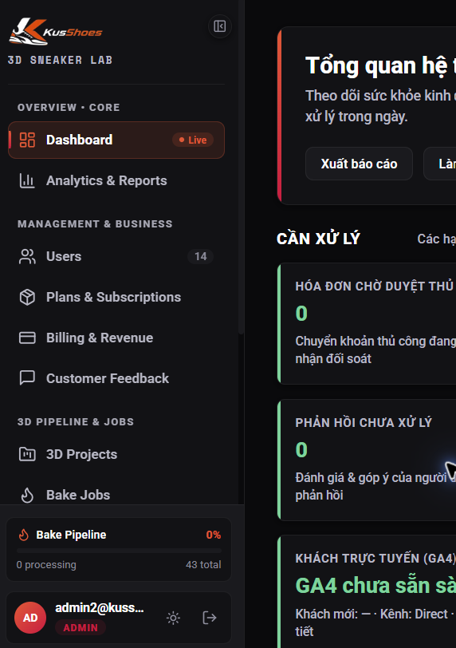
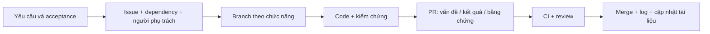
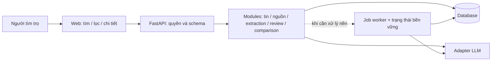
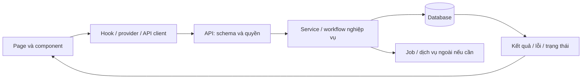

# Sổ kiến thức: từ KusShoes đến web ReNER-VN

Phiên bản 0.10 — đọc sâu bổ sung 12/10/2026. **Mục 28 có thay đổi tư duy, 26 ca phản chứng và sổ 21 nguồn đọc chọn lọc.** **Mục 27 dẫn tới báo cáo audit và bối cảnh hiện hành.** **Mục 26 bổ sung solo AI, 80/20, UX và cách chia việc/thay đổi lõi; lấy ReNER làm bài thực hành để phát triển năng lực nhận khách.** **Mục 25 bổ sung yêu cầu gia công web và workflow AI/template của creator; mục 24 giữ chuyên đề harness, scale và tám repo sát đề tài.** Người dùng xác nhận chỉ nghiên cứu/bản thảo, mục tiêu demo; 5.000 người là ví dụ học tập. Đối chiếu 10 repo ở mục 23; kiến trúc v0.2 giữ nguyên trạng thái bản thảo. Mục 18–21 giữ catalog/tutorial; mục 22 giữ lịch sử thiết kế ban đầu; walkthrough sâu KusShoes vẫn theo kế hoạch.

Tài liệu này là điểm tra cứu chung cho toàn bộ kiến thức của các chặng trong [kế hoạch](PLAN.md); các phân tích dài có file chuyên đề liên kết để đọc riêng. Mỗi kết luận phân biệt: **quan sát** từ code/tài liệu, **đề xuất** cho ReNER-VN, hoặc **chưa xác minh**. [Log công việc](WORK_LOG.md) ghi phần đã thực hiện.

## 1. Nguồn và độ chắc chắn

| Mã | Nguồn | Cách dùng / giới hạn |
|---|---|---|
| U1 | Yêu cầu của người dùng và ảnh sidebar | Yêu cầu học repo, kế hoạch trước, làm tuần tự, log, file kiến thức trong TMG301 |
| U2 | Câu trả lời: người tìm trọ tìm/lọc và so sánh giá | Ưu tiên sản phẩm đã xác nhận |
| P1 | [Proposal v1.3](../../project-realestate-ner/proposal-ReNER-VN-v1.3.pdf), 9 trang | Yêu cầu/mục tiêu/lịch dự kiến; không phải dữ liệu hoặc kết quả đã đạt |
| P2 | [Text trích xuất đã đối chiếu](sources/proposal-v1.3-verified-text.txt) | Có marker trang để tìm lại nội dung |
| K1 | [KusShoes](https://github.com/EXE-CAPSTONE-TEAM/KusShoes) | Code local tại commit `fc3e0178c91ee8ce29e0f47d342c14bc296c672a`; không suy ra toàn bộ lịch sử từ shallow clone |
| K2 | [Báo cáo local](../../KusShoes/notes/kusshoes-local-review.md) | Bằng chứng chạy và giới hạn đã ghi ở lượt trước; không thay phép kiểm tra mới khi code đổi |
| G1 | [PR #82](https://github.com/EXE-CAPSTONE-TEAM/KusShoes/pull/82) | Một mẫu PR đã đọc; chưa đại diện mọi PR |
| M1 | [Meta: How We Combat Scraping](https://about.fb.com/news/2021/04/how-we-combat-scraping/) | Nguồn chính thức về thu thập tự động; không thay việc kiểm tra quyền cho nguồn cụ thể |
| F1 | [Tài liệu nền tảng đã có](../../project-realestate-ner/notes/foundation-2026-10-09/PLAN.md) | Tái sử dụng NLP/kiến trúc đề xuất; không xem đó là code đã chạy |

SHA256 của PDF v1.3 đã đọc: `39104A3310BA12766FA556C6B6C0D5C7B1190F8F476D15072A849234D46D8471`.

Ảnh tham chiếu người dùng gửi:

## 2. Hiểu đề trước khi chọn thư viện

“Đọc đề → ai dùng → họ làm gì → ai hưởng lợi/ai bỏ công → app hỗ trợ đến đâu → tính năng mất là app vô nghĩa” là một luồng phân tích tốt. Nó trả lời **xây gì và cho ai**. Waterfall là cách tổ chức các giai đoạn phát triển; riêng luồng phân tích này chưa đủ để xác định phương pháp phát triển.

Một yêu cầu sản phẩm phải đi đến hành vi kiểm chứng được. Ví dụ “giúp tìm trọ” còn chung chung; “lọc tin cùng khu vực theo ngân sách, xem giá thuê tách khỏi phí và biết nhóm so sánh có đủ mẫu hay không” đủ rõ để thiết kế màn hình và kiểm thử.

Các thuật ngữ cần phân biệt:

| Thuật ngữ | Ý nghĩa trong dự án này |
|---|---|
| Actor | Người/hệ thống tương tác với app; không phải actor nào cũng cần tài khoản |
| Scope | App cam kết hỗ trợ những việc nào và dữ liệu/địa bàn nào |
| MVP | Bản nhỏ nhất cung cấp giá trị cốt lõi có thể kiểm chứng cho người dùng |
| Prototype | Mô phỏng để học thiết kế; dữ liệu giả không chứng minh chất lượng thị trường |
| Acceptance criteria | Các điều kiện quan sát được để biết ticket đã hoàn thành |
| Definition of Done | Yêu cầu chung trước khi coi việc đã xong: chạy được, kiểm chứng, tài liệu và review theo quy mô nhóm |
| Research baseline | Regex/LLM/Hybrid dùng để so sánh nghiên cứu; khác với MVP trải nghiệm người tìm trọ |

## 3. ReNER-VN: người dùng, giá trị và chi phí

Đây là bảng **đề xuất ban đầu**, sẽ kiểm tra đầy đủ ở C1.

| Bên liên quan | Họ cần/làm gì | Giá trị hoặc chi phí |
|---|---|---|
| Người tìm trọ — chính | Tìm/lọc, hiểu giá/phí, xem tin và so sánh | Giảm công đọc tin rối và biết giới hạn mẫu |
| Người đóng góp — tùy chọn | Gửi nội dung có quyền sử dụng, chọn đóng góp | Bỏ công xác nhận nguồn và dữ liệu |
| Người duyệt dữ liệu | Sửa trường xung đột, gộp trùng, duyệt tin | Bỏ công kiểm tra; cần UI evidence và lịch sử sửa |
| Nhóm NLP/nghiên cứu | Gán nhãn, phát triển luật/prompt, đánh giá | Chịu công tạo gold set và giữ độc lập test |
| Admin/vận hành | Quyền, nguồn, job, quota, sự cố | Chịu chi phí API/hạ tầng và trách nhiệm vận hành |
| Người đăng tin | Bên có dữ liệu bị dùng | Cần được xét quyền sử dụng; chưa tự động trở thành account chủ nhà |

Nếu nói “thượng đế / bị bào” theo ví dụ người dùng: người hưởng lợi chính là người tìm trọ; công việc và chi phí chủ yếu nằm ở nhóm tạo/duyệt dữ liệu và vận hành. Chưa có bằng chứng phải thu phí hay mô hình lợi nhuận nào, nên chưa thêm plans/billing vào ReNER.

## 4. Proposal biến thành sản phẩm thế nào?

Theo P1 trang 4–7, đề tài hỗ trợ tin thuê nhà/phòng, địa bàn nhỏ quanh trường, bốn trường PRICE/AREA/LOC/ROOM và phí phụ trợ. Pipeline là trích xuất có neo nguồn rồi chuẩn hóa, đối chiếu, gộp trùng và thống kê nhóm tương tự.

Ví dụ tự tạo để giải thích, không phải dữ liệu Facebook đã thu:

> Cho thuê CCMN 1PN 30m2 gần ĐH FPT, giá 5tr5/th, điện 3k5/số, nước 100k/người, cọc 1 tháng.

Kết quả mong muốn: giá thuê 5.500.000 VND/tháng; diện tích 30 m²; phòng ngủ 1; vị trí là mốc được nêu, không tự bịa địa chỉ; điện/nước/cọc lưu riêng và giữ đúng đơn vị. Nếu không có thông tin thì null. Số tiền thuê và phí không được cộng tùy tiện khi chưa biết mức sử dụng điện/số người.

Mỗi trường cần span nguồn, giá trị chuẩn hóa, nguồn phương pháp và trạng thái cần duyệt. “LLM trả JSON” chưa đủ: JSON có thể hợp lệ mà nội dung không nằm trong tin gốc. Bộ xác minh deterministic phải kiểm tra span và số liệu.

Mức high/medium/low trong quy tắc lai của proposal là độ tin cậy theo heuristic. Không hiển thị thành phần trăm xác suất nếu chưa hiệu chỉnh bằng dữ liệu đánh giá.

So sánh giá chào thuê cần hiển thị: nhóm tương tự, số mẫu sau gộp trùng, độ mới dữ liệu, median, khoảng tứ phân vị và các tin minh họa. P1 quy định N < 10 thì chưa đủ dữ liệu. **Đề xuất bổ sung:** loại chính tin mục tiêu khỏi nhóm tính để tránh tự so sánh. Không gọi đây là giá giao dịch thật hoặc định giá tài sản.

Mục tiêu 100 bài gold / 10 held-out / 300–500 market và ngân sách API trong proposal là ước lượng. Chưa đo Precision/Recall/F1, chi phí hay latency trong lượt này. Tách tập gold khỏi kho phục vụ thống kê; gộp các tin cùng phòng khi chia tập để giảm rò rỉ.

**MVP dự kiến:** kho tin chuẩn hóa có nguồn → tìm/lọc → chi tiết có evidence → so sánh có cỡ mẫu và trường hợp thiếu dữ liệu. Nhập văn bản đánh giá một tin là ứng viên quan trọng cho giai đoạn kho còn nhỏ, chốt ở C1.

## 5. Kiến trúc KusShoes đã nhận diện

| Tầng | Hiện trạng quan sát | Học để áp dụng |
|---|---|---|
| FE | React 19 + TypeScript + Vite 8; API client, context, CSS Modules | Component theo nhiệm vụ, contract API, trạng thái UI |
| BE | Python >= 3.12 + FastAPI + schema/service/repository | Giữ NLP Python, tách kiểm tra dữ liệu khỏi UI |
| Dữ liệu | SQLAlchemy/Alembic/PostgreSQL | Model, migration, transaction và trace dữ liệu |
| Công việc nền | Redis/Celery | Chỉ đưa vào ReNER khi tác vụ/quy mô cần; không sao chép toàn bộ ngay |
| Asset | S3/presigned URL; MinIO/R2 theo cấu hình | Học quản lý file nếu có nhu cầu thật; NLP text không cần toàn bộ pipeline 3D |
| Ngoài repo | KusStudio/mobile/KIRI relay | Không kết luận clone web là có quy trình 3D trọn vẹn |

README mô tả Node/Express nhưng code backend hiện là FastAPI. Bài học: tài liệu phải được đối chiếu với manifest và điểm vào chạy thật. [Báo cáo local K2](../../KusShoes/notes/kusshoes-local-review.md) có đường dẫn và các phép kiểm tra.

Các nguồn nên đọc theo thứ tự: `FE/src/App.tsx` → `FE/src/api/client.ts` → `BE/app/main.py` → router/schema/service/repository/model của một luồng; rồi mới đọc toàn hệ thống. C2 sẽ đưa bản đồ symbol và luồng cụ thể.

## 6. Sidebar trong ảnh được làm như thế nào?

Nguồn chính: [AdminSidebar.tsx](https://github.com/EXE-CAPSTONE-TEAM/KusShoes/blob/fc3e0178c91ee8ce29e0f47d342c14bc296c672a/FE/src/pages/Admin/AdminLayout/AdminSidebar.tsx), [AdminSidebar.module.css](https://github.com/EXE-CAPSTONE-TEAM/KusShoes/blob/fc3e0178c91ee8ce29e0f47d342c14bc296c672a/FE/src/pages/Admin/AdminLayout/AdminSidebar.module.css), [AdminApp.tsx](https://github.com/EXE-CAPSTONE-TEAM/KusShoes/blob/fc3e0178c91ee8ce29e0f47d342c14bc296c672a/FE/src/pages/Admin/AdminApp.tsx).

| Phần nhìn thấy | Cấu tạo và hành vi quan sát | Nguồn để học | Áp dụng ReNER |
|---|---|---|---|
| Logo + tên lab + collapse | Header, state `collapsed`; lưu lựa chọn vào localStorage | Sidebar TSX dòng 33–55; CSS `.collapsed` | Brand riêng; collapse giữ lựa chọn |
| Tiêu đề nhóm | Cấu hình `navGroups`, render bằng map | TSX dòng 79 | Chia theo nhiệm vụ của từng vai trò |
| Icon + tên menu | Lucide icon; button nhận activePage/navigate | TSX `renderNavItem` | Danh sách tin, thị trường, kiểm tra tin |
| Active/hover | Class theo page, nền/viền/indicator CSS | CSS `.navItem`, `.active` | Giúp định vị trang, có focus keyboard |
| Badge users/exports | State lấy số liệu qua API | TSX `useEffect` dòng 61 | Số tin đã duyệt/cần duyệt nếu dữ liệu thật |
| Chấm Live | Badge cấu hình và keyframe pulse | CSS `navPulse` | Chỉ ghi Live khi có cơ chế cập nhật phù hợp |
| Vùng menu cuộn | Flex và `overflow-y: auto` | CSS `.scrollArea` dòng 62 | Menu dài vẫn giữ footer tài khoản |
| Bake Pipeline | Counts từ API health; thanh có width động | TSX dòng 145, 216–232 | Widget xử lý tin với định nghĩa số đo rõ |
| Footer tài khoản | Initials/email/role, ThemeContext và logout | TSX dòng 235 trở đi | Tài khoản/quyền/theme/logout nếu pilot cần |
| Tooltip khi thu gọn | Radix Tooltip | Sidebar TSX | Icon vẫn có nhãn truy cập được |

Sidebar rộng 252px, khi thu gọn 76px; cao 100vh, sticky phía trên; vùng menu co giãn/cuộn và footer nằm riêng. Hiệu ứng rộng, hover và pulse dùng CSS. Đây không cần một engine 3D.

Hai chi tiết dễ hiểu sai:

- `bakePct = bakeActive / bakeTotal * 100`, với active là queued + processing. Đây là **tỷ lệ job đang chờ/chạy trên tổng**, không phải phần trăm hoàn thành một job. Không sao chép công thức rồi đặt tên “tiến độ xử lý 90%”.
- Badge `Live` không chứng minh streaming. Component đang gọi API ở effect khi mount; chưa thấy polling/WebSocket trong phần này. C3 sẽ kiểm tra các màn liên quan trước kết luận rộng hơn.

`AdminApp` chọn trang theo URL, gọi `history.pushState` và nghe `popstate`. Khi dùng Next.js nên dùng router của framework. Ẩn menu audit theo `isAdmin` giúp UX; backend vẫn phải kiểm tra quyền.

### Menu ReNER dự kiến

| Người tìm trọ | Người vận hành/nghiên cứu |
|---|---|
| Tìm phòng | Tổng quan dữ liệu |
| So sánh thị trường | Nguồn và nhập dữ liệu |
| Kiểm tra một tin — chốt C1 | Hàng đợi cần duyệt |
| Lưu bộ lọc/tin — để sau nếu không cốt lõi | Tin chuẩn hóa / nhóm trùng |
| Trợ giúp, giới hạn dữ liệu | Trích xuất / đánh giá / job / audit |

Menu người tìm trọ có thể ngắn, không nhất thiết đặt sidebar quản trị đầy đủ. C5 sẽ xem mobile và hành trình rồi chọn sidebar/topbar phù hợp.

## 7. Animation: chọn công cụ theo việc cần diễn đạt

Nguồn: [ShoeHeroExperience.tsx](https://github.com/EXE-CAPSTONE-TEAM/KusShoes/blob/fc3e0178c91ee8ce29e0f47d342c14bc296c672a/FE/src/components/ShoeHeroExperience/ShoeHeroExperience.tsx), [Projects.tsx](https://github.com/EXE-CAPSTONE-TEAM/KusShoes/blob/fc3e0178c91ee8ce29e0f47d342c14bc296c672a/FE/src/pages/Projects/Projects.tsx), [Settings.tsx](https://github.com/EXE-CAPSTONE-TEAM/KusShoes/blob/fc3e0178c91ee8ce29e0f47d342c14bc296c672a/FE/src/pages/Settings/Settings.tsx), [Billing.tsx](https://github.com/EXE-CAPSTONE-TEAM/KusShoes/blob/fc3e0178c91ee8ce29e0f47d342c14bc296c672a/FE/src/pages/Billing/Billing.tsx), [CSS chung](https://github.com/EXE-CAPSTONE-TEAM/KusShoes/blob/fc3e0178c91ee8ce29e0f47d342c14bc296c672a/FE/src/index.css).

| Nhóm hiệu ứng | Kỹ thuật đã thấy | Cách hiểu | Hướng dùng cho ReNER |
|---|---|---|---|
| Hover, focus, collapse, pulse | CSS transition/keyframe | Thay đổi style theo trạng thái | Menu/filter/chip; không cần thêm thư viện cho mọi nút |
| Modal/tab/list xuất hiện–biến mất | Framer Motion `motion`, `AnimatePresence` | Giữ phần tử đủ lâu để exit animation | Drawer tin, đổi tab evidence, chuyển kết quả |
| Danh sách đổi bố cục | `layout`, `popLayout` trong Projects | Nội suy vị trí giữa hai layout | List khi lọc; tránh animate quá nhiều dòng |
| Hero nghiêng theo chuột | GSAP `quickTo` với rotationX/Y và bóng | Nội suy transform từ pointer | Không cần cho màn tìm trọ; có thể học kỹ thuật riêng |
| Hero gắn với cuộn | GSAP ScrollTrigger `pin` + `scrub`, timeline nhiều đoạn | Scroll điều khiển tiến độ chuyển cảnh | Landing giải thích pipeline, sau MVP |
| Model tương tác thật | Repo có Three/R3F trong stack | Canvas cần asset/lifecycle/performance riêng | Chưa có nhu cầu cốt lõi ở ReNER |

Hero giày trong component đã đọc dùng ảnh `.webp` được biến đổi transform. Cảm giác 3D không chứng minh đó là model WebGL. GSAP được import động, giữ loader dùng chung; setup có context và cleanup `revert`. Không lấy con số “60fps” trong comment làm kết quả benchmark.

CSS chung có `prefers-reduced-motion`, nhưng chưa đủ để khẳng định các timeline JavaScript đều tắt đúng theo cài đặt đó. C3 phải quan sát và kiểm tra cụ thể. Khi phát triển ReNER cần trạng thái DOM đọc được ngay cả khi tắt motion.

Nguyên tắc đề xuất: animation biểu đạt chuyển trạng thái có thật; không dùng delay để giả backend, không gán % khi không có tổng công việc đo được. Highlight span là nội dung chứng cứ, không chỉ là trang trí; người dùng phải hiểu loại trường cả khi không phân biệt được màu.

## 8. Design system và trạng thái UI

[DESIGN.md](https://github.com/EXE-CAPSTONE-TEAM/KusShoes/blob/fc3e0178c91ee8ce29e0f47d342c14bc296c672a/docs/DESIGN.md) và [ADMIN_DESIGN_SYSTEM.md](https://github.com/EXE-CAPSTONE-TEAM/KusShoes/blob/fc3e0178c91ee8ce29e0f47d342c14bc296c672a/docs/ADMIN_DESIGN_SYSTEM.md) có quy ước token/theme, typography, spacing, component, loading/error và admin. Chưa audit đầy đủ mức tuân thủ code theo từng quy ước.

Khi áp dụng ReNER cần token màu/nền/chữ/border/radius/spacing/motion dùng chung; component filter, table/card, badge, form, empty state và dialog thống nhất. Có thiết kế loading/empty/error/insufficient-data ngay trong wireframe. Không biến thuật ngữ nội bộ như worker, cosine, prompt thành ngôn ngữ bắt buộc với người tìm trọ.

## 9. GitHub của KusShoes: bằng chứng ban đầu

- [`.spec/tasks.md`](https://github.com/EXE-CAPSTONE-TEAM/KusShoes/blob/fc3e0178c91ee8ce29e0f47d342c14bc296c672a/.spec/tasks.md) chia việc thành T01/T02… theo FE, BE+FE và quyết định sản phẩm, nêu file, hành vi mock, acceptance và quyết định có ngày. Đây là cách học được để chuyển công việc thành việc nghiệm thu.
- [Frontend CI](https://github.com/EXE-CAPSTONE-TEAM/KusShoes/blob/fc3e0178c91ee8ce29e0f47d342c14bc296c672a/.github/workflows/frontend-ci.yml) chạy cài dependency, lint, test và build theo paths khi PR/push main. File đã đọc chưa pin Node bằng setup-node; nên ghi phiên bản runtime rõ khi tạo repo mới.
- [Backend CI](https://github.com/EXE-CAPSTONE-TEAM/KusShoes/blob/fc3e0178c91ee8ce29e0f47d342c14bc296c672a/.github/workflows/backend-ci.yml) dựng dịch vụ, migration DB test, chạy tập test chọn lọc, build image; không nên gọi là “chạy toàn bộ test” khi workflow chỉ chọn một số nhóm.
- Có SRS, checklist, API contract và ADR. Chỉ có tài liệu không chứng minh mọi thay đổi đều theo tài liệu.

PR #82 `Feat/invoice paid time` được merge 08/10/2026 từ `feat/invoice-paid-time` vào main, có hai commit, preview Vercel và checks. Trang mẫu không có description, review, labels, Project hay milestone; bot Sonar báo quality gate failed. Một PR chưa đủ để kết luận review/quality gate được bắt buộc hoặc toàn nhóm không dùng chúng. [Nguồn PR](https://github.com/EXE-CAPSTONE-TEAM/KusShoes/pull/82).

**Chưa kết luận waterfall/Scrum.** Task nối mock với API thể hiện phát triển tích hợp theo phần. SRS và checklist thể hiện có tài liệu. Muốn gọi tên phương pháp còn phải có bằng chứng lịch sử, nhịp iteration và cách thay đổi yêu cầu; C4 sẽ mở rộng mẫu.

## 10. Workflow GitHub đề xuất cho ReNER

Đây là thiết kế sơ bộ, không phải workflow đã tạo trên GitHub.

Giao việc theo lát chức năng: “lọc theo giá/vị trí có API, empty state và dữ liệu demo” dễ nghiệm thu hơn “làm frontend”. Giữ main chạy được; branch nhỏ theo `feat/...`, `fix/...`, `docs/...`; tên branch minh họa, chưa tạo branch nào ở repo mới.

Issue mẫu cần: vấn đề, actor, phạm vi, acceptance, dependency, nguồn dữ liệu, người phụ trách và cách kiểm chứng. PR mẫu cần: vấn đề/hành vi sau sửa, issue liên quan, ảnh hoặc video UI khi hữu ích, test đã chạy và giới hạn. Không đánh dấu test pass chỉ vì số test pass xuất hiện nếu process exit khác 0.

Repo trông chuyên nghiệp phải làm người khác chạy được và đánh giá được: README khớp code, hướng dẫn setup, demo có nhãn, sơ đồ kiến trúc, docs sản phẩm/API, ADR, roadmap, license được chọn có chủ đích, hướng dẫn góp code, issue/PR template và CI. Số badge không thay cho chất lượng repo.

Các vai trò trong proposal chưa có tên thành viên thật. Chưa kiểm tra license repo gốc để cho phép sao chép code/asset; ưu tiên học và triển khai riêng. Nếu định tái sử dụng phải kiểm tra điều kiện license và ghi nguồn tại C4/C6.

## 11. Thiết kế nguồn và quyền truy cập

P1 nói dữ liệu dùng nội bộ và không công khai đăng lại; không mặc định biến đề tài thành website public chứa bài nguồn. [Meta](https://about.fb.com/news/2021/04/how-we-combat-scraping/) phân biệt truy cập thông thường với thu thập tự động và yêu cầu được phép. Thành viên group tự nguyện không tự chứng minh có quyền tự động thu thập từ nền tảng.

Hướng thiết kế đã có từ F1: source gate trước nhập dữ liệu; fixture tự viết/nguồn được phép cho demo; che số điện thoại, không lưu tên người đăng không cần thiết; thông tin nguồn và thời hạn sử dụng được theo dõi. Đây là điều kiện của dữ liệu đáng tin và phạm vi đề tài, không phải kết luận quyền cho một group cụ thể.

## 12. Những gì bản local chứng minh và chưa chứng minh

K2 ghi FE build thành công; backend unit test 42 pass; smoke test đăng nhập/API/storage thành công ở cấu hình demo. Frontend test có 205 test pass/13 skip nhưng exit 1 vì hai lỗi teardown GSAP/jsdom. Chưa chạy toàn bộ integration/backend harness; các dịch vụ 3D/payment/OAuth chưa có cấu hình thật.

Các kết quả này thuộc lần kiểm tra trước được lưu trong báo cáo. Chúng không chứng minh máy vẫn chạy tại mọi thời điểm hay repo có chất lượng production. Khi bắt đầu walkthrough C2 phải kiểm tra readiness mới, không suy diễn từ screenshot.

## 13. Các phần sẽ bổ sung theo chặng

| Chặng | Cần bổ sung vào sổ này |
|---|---|
| C1 | Actor/use case đầy đủ, scope và MVP được duyệt, acceptance theo tình huống |
| C2 | Bản đồ module/symbol, 3 luồng API/data với đường dẫn và giới hạn |
| C3 | Catalog animation đã quan sát, sidebar từng state, mobile/keyboard/reduced motion |
| C4 | Nhiều mẫu issue/PR, lịch sử được phép đọc, workflow và template cụ thể |
| C5 | Sitemap/wireframe/schema/API, source policy, trạng thái và ADR |
| C6 | Backlog/branch/CI/repo plan, chia vai trò và dependency |
| C7 | Code thực tế, cách chạy, phép kiểm chứng mới, ảnh và liên kết GitHub đã tạo |

Các mục trên **chưa hoàn thành**. Bản này giữ kết quả khảo sát đầu vào để kế hoạch có căn cứ; các chặng sau sẽ thay đề xuất bằng thiết kế và bằng chứng đã kiểm tra.

## 14. Kiểm tra gợi ý “GSAP framework / Interactive motion”

Người dùng bổ sung một ảnh tin nhắn gồm đúng hai tên này. Ảnh không có URL. Đây là nguồn gợi ý để kiểm tra, không phải chỉ thị dùng một dependency hoặc xác nhận một người có kỹ năng full-stack.

**GSAP: đúng hướng tham khảo.** Tên đầy đủ GreenSock Animation Platform; nhà phát triển gọi đây là thư viện animation JavaScript. Nó cung cấp công cụ tạo chuyển động, sequencing và plugin, đồng thời có docs/demo/showcase. Có thể học hiệu ứng hoặc đọc ví dụ rồi triển khai theo thiết kế riêng. Không tự cung cấp đăng nhập, database hay hệ thống web đầy đủ. [Nguồn chính thức](https://gsap.com/).

**“Interactive motion”: chưa xác định được trang.** Cụm này cũng có nghĩa thông thường là chuyển động phản hồi tương tác; search không đủ để gán một URL duy nhất. Đã hỏi người dùng link để xác nhận. Trong lúc chờ, thêm Motion và React Bits như **nguồn độc lập**, không khẳng định chúng là trang bạn kia nói.

### 14.1 Ba loại nguồn cần phân biệt

| Loại | Ví dụ đã kiểm tra | Lấy được gì | Còn phải tự thiết kế |
|---|---|---|---|
| Thư viện animation | [GSAP](https://gsap.com/), [Motion](https://motion.dev/docs/react) | API/easing/timeline/state/layout/gesture | UX, bố cục, dữ liệu và nghiệp vụ |
| Catalog component/demo | [React Bits](https://github.com/DavidHDev/react-bits), [Motion examples](https://examples.motion.dev/react) | Thành phần UI/hiệu ứng có ví dụ và code | Tích hợp, token, a11y, loading/error và dependency |
| Repo full-stack | FastAPI template, Cal.diy, Immich, Outline | Cách nối UI–API–database–job–test–deploy | Domain và scope thuê trọ của mình |

Motion for React là tên hiện tại của thư viện trước đây gọi Framer Motion. Tài liệu hiện dùng import `motion/react`; KusShoes hiện import `framer-motion`. Khi học repo cũ cần đọc đúng version; việc đổi package chỉ thực hiện theo upgrade guide và kiểm chứng, không thay tên import hàng loạt trong lúc nghiên cứu. [Motion React guide](https://motion.dev/docs/react).

Catalog và thư viện lõi không đồng nghĩa mọi mẫu đều miễn phí: Motion có ví dụ free/premium; React Bits có phần Pro riêng. Chỉ chọn ví dụ đọc được, biết điều kiện sử dụng và không phụ thuộc nội dung trả phí chưa có. [Motion examples](https://examples.motion.dev/react), [React Bits README](https://github.com/DavidHDev/react-bits).

### 14.2 Map effect → kỹ thuật → màn ReNER

| Mong muốn nhìn thấy | Kiến thức cần học | Đề xuất cho ReNER |
|---|---|---|
| Hover/collapse nhẹ | CSS transition; phân biệt state React với style | Sidebar/filter/chip; ưu tiên CSS khi đủ |
| Drawer mở/đóng, tab evidence | Motion AnimatePresence và transition theo state | Chi tiết tin; giữ focus/đóng bằng keyboard |
| List dịch chuyển khi lọc | Motion layout, key ổn định | Kết quả tìm phòng; hạn chế số item animate |
| Animation gắn cuộn/pin | GSAP ScrollTrigger `scrub`/`pin` và timeline | Landing giới thiệu pipeline sau MVP |
| Chuột làm phần tử nghiêng | GSAP quickTo hoặc motion values | Bài học kỹ thuật; không bắt buộc trên màn tìm kiếm |
| Highlight giá/diện tích/vị trí | Span/render DOM + tên trường + optional reveal | Chứng cứ phải đọc được khi tắt animation |

[ScrollTrigger docs](https://gsap.com/docs/v3/Plugins/ScrollTrigger/) xác nhận pin/scrub; [Motion component docs](https://motion.dev/docs/react-motion-component) mô tả state/gesture/layout. Bảng ứng dụng ReNER là đề xuất của nghiên cứu, chưa có component mới được code.

React cần quản lý vòng đời animation: GSAP có `useGSAP`/context, scope và cleanup; handler tạo animation sau hook cần được quản lý riêng. [React & GSAP](https://gsap.com/resources/React/). Reduced motion cần xử lý ở thư viện JS, ngoài CSS: Motion có MotionConfig/useReducedMotion, GSAP có matchMedia theo cài đặt người dùng. [Motion accessibility](https://motion.dev/docs/react-accessibility), [GSAP accessibility](https://gsap.com/resources/a11y/). Chưa benchmark FPS hay bundle của các mẫu trong lượt này.

## 15. Repo nhiều star: kiến trúc đã kiểm tra sơ bộ

Số star được lấy trực tiếp GitHub API ngày 09/10/2026, khoảng 23:41 Asia/Saigon. Lưu số nguyên, commit đầu nhánh và timestamp trong [github-metadata.json](sources/world-web-2026-10-09/github-metadata.json). File được đọc theo commit, có URL/SHA256 trong [source-manifest.json](sources/world-web-2026-10-09/source-manifest.json). Không chỉ nhìn screenshot hay README để gọi tên kiến trúc; chưa clone/chạy/test trọn các repo mẫu.

Không có một mẫu kiến trúc duy nhất được quyết định bởi star. Star giúp chọn nguồn phổ biến để xem, còn quyết định cho ReNER phải dựa vào công việc, nhân lực và chi phí vận hành. Bốn mẫu sau không phải “top 4 toàn cầu”.

| Repo / star snapshot | Tổ chức quan sát | Phần học cho ReNER |
|---|---|---|
| [FastAPI full-stack template](https://github.com/fastapi/full-stack-fastapi-template), **45.931** | `frontend`, `backend`, cấu hình Compose; FastAPI/SQLModel/Postgres và React/Vite/TanStack | Contract/OpenAPI client, schema/migration, setup local và test luồng |
| [Cal.diy](https://github.com/calcom/cal.diy), **48.931** | Next.js; monorepo `apps`/`packages`; package UI/features/Prisma/tRPC và Turborepo | Ranh giới package, feature ownership, build theo dependency |
| [Immich](https://github.com/immich-app/immich), **115.850** | `web`, `server`, `machine-learning`, SDK; SvelteKit, NestJS và ML Python/FastAPI | Service/repository, API sinh SDK, việc nền và ranh giới ML |
| [Outline](https://github.com/outline/outline), **40.853** | `app`, `server`, `shared`; React/Vite và Koa/Sequelize; queue và policy quyền | Component/scene/state, quyền backend, migration, job và utility dùng chung |

### 15.1 FastAPI template — nguồn gần ReNER để học tích hợp

Đã đọc `frontend/package.json`, `backend/pyproject.toml`, `backend/app/main.py`, `compose.yml`, `development.md`. Manifest xác nhận React/Vite/TanStack và FastAPI/SQLModel/Alembic/Postgres. Điểm vào hiện include API router và phục vụ frontend đã build; development guide ghi Vite chạy riêng lúc dev, build được chuyển vào backend. Vì vậy không mặc định production phải có một container FE riêng. [Entrypoint theo commit](https://github.com/fastapi/full-stack-fastapi-template/blob/7257e606cb94eada1dca40173e2b7f99dd549bc6/backend/app/main.py), [development guide](https://github.com/fastapi/full-stack-fastapi-template/blob/7257e606cb94eada1dca40173e2b7f99dd549bc6/development.md).

README có client FE sinh tự động và Playwright. Đây là ứng viên học để tránh type FE/BE lệch và để kiểm tra hành trình thật. Template là nền khởi đầu, không chứng minh đã có nghiệp vụ trích xuất/gộp trùng/so sánh cho ReNER. [Repo](https://github.com/fastapi/full-stack-fastapi-template).

### 15.2 Cal.diy — học monorepo và ownership

Đường dẫn cũ `calcom/cal.com` hiện redirect sang `calcom/cal.diy`; metadata và nguồn đều dùng repo thực tế. Không suy ra deployment hay lịch sử hiện tại của công ty Cal.com từ snapshot này.

Root khai báo workspace `apps/*`, `packages/*` và nhóm features/embeds/platform; script build dùng Turborepo filter. Web phụ thuộc package nội bộ UI, features, Prisma, tRPC. **Monorepo** là đặt nhiều phần trong một repo để quản lý chung, chưa tự chứng minh chúng là các microservice triển khai độc lập. [Root package](https://github.com/calcom/cal.diy/blob/54343aa685ae8f33159d2f485ec4a57bad5c574a/package.json), [web package](https://github.com/calcom/cal.diy/blob/54343aa685ae8f33159d2f485ec4a57bad5c574a/apps/web/package.json).

Đề xuất học cách phân chia trách nhiệm và dependency. Với API NLP Python, không mang tRPC/Prisma của hệ TypeScript sang chỉ vì nguồn này dùng; OpenAPI/schema là hướng cần đối chiếu ở C5. Chưa truy vết đầy đủ booking hoặc access policy của repo này.

### 15.3 Immich — học boundary API, việc nền và ML

Docs mô tả client REST/OpenAPI, server NestJS tách services/repositories và ML Python/FastAPI. Manifest đã đọc xác nhận các công nghệ này; Compose snapshot có server, machine-learning, database và service tên redis sử dụng **Valkey**. Docs có đoạn còn nhắc container microservices riêng nhưng Compose đã đọc không có nó: cần ghi khác biệt, không chép nguyên sơ đồ cũ. [Architecture docs](https://docs.immich.app/developer/architecture/), [Compose theo commit](https://github.com/immich-app/immich/blob/b4f35cb43d74969af0cfa146676eb26df9fcfd8c/docker/docker-compose.yml).

Học để ReNER có contract API rõ và tác vụ dài có retry/status/quota. Chưa cần một ML service riêng khi Regex/Gemini nhỏ chạy ổn trong backend Python. Hướng dẫn scaling của họ cũng nói nhiều container trên một máy không chắc đem lại lợi ích. [Scaling guide](https://docs.immich.app/guides/scaling-immich/).

### 15.4 Outline — học cấu trúc màn hình và quyền

Architecture docs chia React FE thành scenes, component, hook, model/store và route lazy; state/style liên quan đặt gần component. BE dùng Koa/Sequelize, policy quyền riêng và Redis/Bull cho job; shared giữ logic dùng chung. Manifest đã đọc khớp các dependency chính. [Architecture theo commit](https://github.com/outline/outline/blob/f6f27d51296978b3f5d7305c556c2bd4f81a666f/docs/ARCHITECTURE.md).

Áp dụng vào màn danh sách/chi tiết/duyệt của ReNER: tách trạng thái UI khỏi dữ liệu server, action nghiệp vụ phải đi qua policy/backend; shared chỉ chứa thứ thực sự dùng chung. Không cần mang trình soạn thảo tài liệu/realtime của Outline sang. Chưa đọc hết implementation để đánh giá mức tuân thủ kiến trúc.

### 15.5 Metadata của nguồn animation, không trộn với mẫu full-stack

| Repo | Star snapshot | Vai trò |
|---|---:|---|
| [greensock/GSAP](https://github.com/greensock/GSAP) | 28.963 | Animation engine |
| [motiondivision/motion](https://github.com/motiondivision/motion) | 33.912 | Animation library |
| [DavidHDev/react-bits](https://github.com/DavidHDev/react-bits) | 48.780 | Catalog component/animation |

Những repo này có nhiều star nhưng không dùng để suy ra kiến trúc backend của một sản phẩm hoàn chỉnh.

## 16. Chuyển bài học kiến trúc thành quyết định cho ReNER

Các quyết định dưới đây là **đề xuất cần đối chiếu C1/C5**, không phải hạ tầng đã dựng.

| Bài học rút ra | Cách làm dự kiến | Tín hiệu cần mở rộng |
|---|---|---|
| Boundary quan trọng hơn số service | Backend chia module theo nghiệp vụ, schema giữa FE/API | Team hoặc tải cần triển khai/tách vòng đời riêng |
| Contract giảm lệch UI/API | OpenAPI, sinh type/client khi phù hợp; lỗi có cấu trúc | Có thêm extension/client mới |
| Tác vụ dài phải có lifecycle | Job status thực, retry có giới hạn, idempotency và quota | Batch lớn, timeout, cần bền qua restart |
| Dữ liệu cần trace | Nguồn, span, phiên bản extractor, duyệt và nhóm trùng | Audit/sửa sai hoặc benchmark cần tái lập |
| Build/check phải chạy được | Pin runtime, lệnh local ngắn, CI đúng nhóm thay đổi | Nhiều package cần dependency-aware build |
| Component catalog chỉ là một phần UI | Dùng token và component cốt lõi trước, thêm motion có mục đích | Đã có MVP ổn và phép đo UX/performance |

Stack Next/FastAPI trong proposal và React/Vite/FastAPI như KusShoes đều vẫn được giữ để so sánh. Chưa đổi framework từ thông tin bổ sung này.

## 17. GitHub và tái sử dụng: thêm nguồn để kiểm tra

[PR checklist của Immich](https://docs.immich.app/developer/pr-checklist/) có check theo web/server/ML và yêu cầu regenerate API client khi schema đổi. Bài học áp dụng: thay contract cần xem ảnh hưởng FE/extension; không chỉ chạy test của file vừa sửa. Đây là quy định trong docs, chưa chứng minh tất cả PR của họ tuân thủ.

License cần đọc thật, không suy ra “nhiều star = copy thoải mái”. Snapshot hiện cho thấy template FastAPI và Cal.diy là MIT; Immich AGPL-3.0. Outline ghi Business Source License 1.1, không gọi chung mọi repo công khai là open source cùng điều kiện. React Bits có MIT + Commons Clause; cũng không coi giống MIT thuần. Các thông tin này là nhận diện nguồn trước tái sử dụng, chưa kết luận pháp lý cho cách triển khai tương lai. [Outline LICENSE](https://github.com/outline/outline/blob/f6f27d51296978b3f5d7305c556c2bd4f81a666f/LICENSE), [React Bits LICENSE](https://github.com/DavidHDev/react-bits/blob/d86fccbd477786f94ca7eb891fbe0ec039d3cd3b/LICENSE.md).

**Phần bổ sung đã hoàn thành:** xác minh GSAP, giữ tên thứ hai chưa rõ, lấy metadata 7 repo, đọc các file chọn lọc của 4 mẫu full-stack, lập bảng bài học và cập nhật kế hoạch. **Phần còn lại:** đúng URL “Interactive motion”; walkthrough sâu, đo UI/motion, nhiều mẫu PR và thiết kế MVP theo các chặng đã định.

## 18. Mười repo web đáng học cho shop, quản trị và sản phẩm full-stack

Ngày khảo sát: **10/10/2026**, Asia/Saigon. Đây là danh sách mình chọn theo mục tiêu học của người dùng: có code công khai, nhiều star, tài liệu chính thức, bài học kiến trúc và độ đa dạng. Không phải bảng xếp hạng chất lượng toàn cầu. Số thứ tự dùng để tra cứu, không khẳng định repo số 1 tốt hơn mọi repo khác.

Đã đọc hướng dẫn và các file code/manifest chọn lọc, chưa chạy local cả 10 repo. Hai repo FastAPI template/Cal.diy giữ nguyên commit so với hôm trước nên tái sử dụng nguồn đã đọc; Outline/Immich có commit mới nên đã đối chiếu các file liên quan. Bằng chứng: [metadata mới](sources/web-top10-2026-10-10/github-metadata.json), [30 file nguồn theo commit](sources/web-top10-2026-10-10/source-manifest.json).

### 18.1 Bảng chọn nhanh

Star lấy lúc khoảng **10:43 ngày 10/10/2026**, có timestamp từng repo trong JSON. Các nhận xét độ khó là đánh giá để hướng dẫn học, không phải số đo benchmark.

| # | Repo | Star | Mảng / loại nguồn | Phần học nổi bật |
|---|---|---:|---|---|
| 1 | [Medusa](https://github.com/medusajs/medusa) | 36.673 | Nền tảng shop có backend và admin | Module nghiệp vụ, workflow, mở rộng admin |
| 2 | [Saleor](https://github.com/saleor/saleor) | 23.428 | Commerce API, có dashboard/storefront đi kèm ở repo khác | Python/Django, GraphQL, tách các bề mặt sản phẩm |
| 3 | [Next.js Commerce](https://github.com/vercel/commerce) | 14.294 | Storefront shop | Trang sản phẩm, giỏ hàng, server rendering, adapter Shopify |
| 4 | [React-admin](https://github.com/marmelab/react-admin) | 26.959 | Framework quản trị + demo bán hàng | Resource, table/form, data/auth provider |
| 5 | [Refine](https://github.com/refinedev/refine) | 35.830 | Framework quản trị và internal tools | Logic CRUD tách khỏi UI, demo Finefoods |
| 6 | [Tabler](https://github.com/tabler/tabler) | 41.840 | Bộ giao diện dashboard | Sidebar, layout, bảng, form, theme, responsive |
| 7 | [Full Stack FastAPI Template](https://github.com/fastapi/full-stack-fastapi-template) | 45.931 | Khung ứng dụng full-stack | React/Vite ↔ FastAPI ↔ PostgreSQL, contract/test |
| 8 | [Cal.diy](https://github.com/calcom/cal.diy) | 48.933 | SaaS đặt lịch | Next.js monorepo, package và feature boundary |
| 9 | [Outline](https://github.com/outline/outline) | 40.854 | Quản lý tri thức/tài liệu | Scene/component/state, policy quyền, job |
| 10 | [Immich](https://github.com/immich-app/immich) | 115.878 | Quản lý ảnh/video, có ML | API/SDK, việc nền, ranh giới ML Python |

### 18.2 Medusa — lựa chọn ưu tiên để học shop trọn luồng

**Kiến trúc:** storefront/admin gọi API; route thực thi workflow; workflow phối hợp module nghiệp vụ và dữ liệu. Repo chia package commerce, framework và admin React. Đây là nguồn phù hợp để hiểu một thao tác như thêm sản phẩm đi qua nhiều tầng. [Architecture](https://docs.medusajs.com/learn/introduction/architecture).

**Học theo thứ tự:** [cài đặt](https://docs.medusajs.com/learn/installation) → [Brand module, workflow, API](https://docs.medusajs.com/learn/customization/custom-features) → phần Customize Admin cùng tutorial → [storefront](https://docs.medusajs.com/learn/storefront-development). Tutorial có trình tự xây tính năng cụ thể, tốt hơn đọc toàn monorepo ngay lúc bắt đầu.

**Điểm vào code đã đọc:** `packages/medusa/package.json`, `packages/admin/dashboard/package.json`, root package và CONTRIBUTING. Bản sao nằm trong snapshot nguồn. **Bài tập đề xuất:** thêm một thông tin phân loại, lưu qua API rồi hiển thị trong admin; tự giải thích module nào sở hữu dữ liệu. Độ khó: trung bình–cao. Với ReNER, học phân chia nghiệp vụ/duyệt dữ liệu; không cần mang checkout vào MVP.

### 18.3 Saleor — shop với backend Python và GraphQL

**Kiến trúc:** core là API commerce Python/Django/GraphQL; admin và storefront là client riêng. `pyproject.toml` và `saleor/urls.py` đã được đối chiếu. Repo chính không bao gồm toàn bộ giao diện cửa hàng. README dẫn sang [dashboard](https://github.com/saleor/saleor-dashboard) và [storefront](https://github.com/saleor/storefront); star ở bảng là của core, không cộng các repo. [Nguồn core](https://github.com/saleor/saleor).

**Nguồn học:** [Docs](https://docs.saleor.io/) → [self-hosting](https://docs.saleor.io/setup/overview) hoặc [Cloud quickstart](https://docs.saleor.io/quickstart/cloud) → [GraphQL](https://docs.saleor.io/api-usage/overview) → [mở rộng dashboard](https://docs.saleor.io/recipes/extending-dashboard).

**Bài tập đề xuất:** lần theo danh sách sản phẩm từ UI đến query và quyền truy cập; ghi rõ tại sao giá/tồn kho thuộc backend. Độ khó: cao, phù hợp sau khi đã hiểu API. Với ReNER, học contract và ranh giới giữa người dùng/admin; Python không đồng nghĩa phải chọn Django/GraphQL thay FastAPI.

### 18.4 Next.js Commerce — học mặt tiền shop và data fetching

**Kiến trúc:** App Router với Server Components/Server Actions; thư mục `app`, `components`, `lib`. File `lib/shopify/index.ts` gom phần kết nối commerce. Đây là storefront dùng Shopify cho nghiệp vụ phía sau; cần cấu hình dịch vụ để có dữ liệu thật. [Repo và README](https://github.com/vercel/commerce).

**Nguồn học:** [Next.js Learn](https://nextjs.org/learn/dashboard-app) để hiểu nền tảng, sau đó [hướng dẫn tích hợp Shopify–Vercel](https://vercel.com/kb/guide/deploy-headless-shopify-storefront-with-vercel) và đọc code catalog/giỏ hàng. Đã xem manifest và adapter Shopify, chưa thực hiện checkout.

**Bài tập đề xuất:** vẽ luồng trang danh sách → chi tiết → chọn biến thể → giỏ hàng; xác định dữ liệu nào lấy phía server và action nào cập nhật. Độ khó: trung bình. Với ReNER, học bố cục catalog, URL bộ lọc và chi tiết tin; hành vi giỏ hàng không phải MVP tìm trọ.

### 18.5 React-admin — nguồn sát nhất với màn quản lý trong ảnh

**Kiến trúc:** React UI khai báo `Resource`; `dataProvider` đổi thao tác list/create/update thành lời gọi API; `authProvider` xử lý tích hợp xác thực. Có core logic và package UI Material UI. Đây là framework frontend quản trị, backend vẫn do ứng dụng cung cấp. [Tutorial](https://marmelab.com/react-admin/Tutorial.html).

**Code đáng đọc:** [demo App.tsx](https://github.com/marmelab/react-admin/blob/f1213e048d60d83df74900b2fc8415fd3287610c/examples/demo/src/App.tsx) đăng ký customers, orders, invoices, products, categories, reviews; có dashboard, login, layout và theme. Đây là ví dụ trực tiếp cho câu hỏi “sidebar có gì và mỗi mục nối đến đâu?”.

**Bài tập đề xuất:** đổi một resource mẫu thành danh sách tin thuê với giá, diện tích, trạng thái duyệt; chỉ ra loading/error/filter/pagination và response API tương ứng. Học tutorial theo list → trường hiển thị → form → quan hệ → auth/layout. Độ khó: trung bình khi đã biết React. Demo/tutorial có dữ liệu mẫu; không xem đó là hệ thống phân quyền production đã kiểm chứng.

### 18.6 Refine — quản trị có thể tự chọn giao diện

**Kiến trúc:** core cung cấp logic làm việc với dữ liệu, resource, auth và routing integration; UI có thể dùng thư viện khác nhau. [Tutorial](https://refine.dev/core/tutorial/essentials/intro/) đi qua fetch/update/list, form/table, auth, routing và UI integration.

**Code đáng đọc:** [Finefoods App.tsx](https://github.com/refinedev/refine/blob/2352eb5b6539e2f39ad9aef652279ad1dcf2c467/examples/finefoods-antd/src/App.tsx) cấu hình dataProvider/authProvider/resources; có màn đơn hàng, sản phẩm, khách, cửa hàng và người giao hàng. Bản demo gọi API demo được cấu hình sẵn, không tự bao gồm backend kinh doanh của mình.

**Bài tập đề xuất:** nối một API của mình vào màn list, đổi bộ lọc và giữ trạng thái trên URL; chỉ ra phần nào của provider cần đổi. Độ khó: trung bình. So với React-admin, nguồn này đáng học khi muốn tự chủ UI nhiều hơn; lựa chọn thực tế cần thử với màn duyệt ReNER.

### 18.7 Tabler — học bố cục quản trị dễ quan sát

**Kiến trúc:** UI kit HTML/CSS/JS dựa trên Bootstrap; source tách `core` (SCSS/JS), `preview`, `docs`, `shared`. Có layout/table/form/theme để học trực quan. Màn login trong bộ mẫu là giao diện; xác thực, quyền và API cần được tích hợp riêng. [Repo](https://github.com/tabler/tabler).

**Nguồn học:** [Docs](https://docs.tabler.io/) → layout/navbar → table/form → theme; [hướng dẫn tích hợp React](https://docs.tabler.io/ui/getting-started/frameworks/react). [Preview](https://preview.tabler.io) do README chính thức dẫn tới; chưa kiểm thử mọi trang preview.

**Bài tập đề xuất:** dựng một sidebar + bảng có trạng thái active, rỗng và mobile; mô tả CSS nào quyết định vùng cuộn/footer. Độ khó: dễ nhất trong danh sách để học bố cục khi đã biết HTML/CSS. Không trộn nguyên hệ Bootstrap của Tabler với design tokens của một UI kit khác mà chưa chọn hướng thiết kế.

### 18.8 FastAPI template — nguồn gần stack ReNER nhất

**Kiến trúc:** React/Vite frontend, FastAPI backend và PostgreSQL; schema/migration, API client sinh tự động và kiểm thử. Chi tiết đã có ở mục 15.1, commit hôm nay không đổi. [Repo](https://github.com/fastapi/full-stack-fastapi-template).

**Nguồn học:** [FastAPI tutorial từng bước](https://fastapi.tiangolo.com/tutorial/) → [development guide của template](https://github.com/fastapi/full-stack-fastapi-template/blob/7257e606cb94eada1dca40173e2b7f99dd549bc6/development.md) → theo một CRUD xuyên UI/API/database. Tutorial framework và template tích hợp là hai tài liệu bổ trợ nhau.

**Bài tập đề xuất:** thêm trường của tin thuê qua model/schema/migration/API rồi cập nhật client và màn hình. Độ khó: trung bình; ưu tiên cao nhất khi học cách nối web với NLP Python. Dùng nguồn này để so sánh, chưa quyết định đổi Next.js trong proposal.

### 18.9 Cal.diy — học SaaS và monorepo lớn

**Kiến trúc:** Next.js cùng package feature/UI/Prisma/tRPC và build Turborepo; xem mục 15.2. `CONTRIBUTING.md` xác định đây là dự án cộng đồng phát triển riêng; không đồng nhất code này với hệ thống production hiện tại của Cal.com. [Repo](https://github.com/calcom/cal.diy).

**Nguồn học:** setup trong README, rồi [CONTRIBUTING](https://github.com/calcom/cal.diy/blob/54343aa685ae8f33159d2f485ec4a57bad5c574a/CONTRIBUTING.md), root workspace và `apps/web/package.json`. Mức hướng dẫn: tài liệu dự án/đóng góp, không phải khóa viết app từ số 0.

**Bài tập đề xuất:** chọn một màn nhỏ, lập sơ đồ nó phụ thuộc package nào và ai nên sở hữu phần thay đổi. Độ khó: cao. Học cách giữ logic nghiệp vụ và UI dùng chung; chưa cần nguyên hệ monorepo lớn cho nhóm ReNER nhỏ.

### 18.10 Outline — học ứng dụng quản lý dữ liệu có quyền

**Kiến trúc:** React/Vite frontend, Koa/Sequelize backend, policy quyền, queue và shared code; đã phân tích ở mục 15.4. File kiến trúc tại commit mới được đối chiếu và không đổi so với lần đọc trước.

**Nguồn học:** [Architecture](https://github.com/outline/outline/blob/f00ff8e4a1aaf7193a4fb6cde68a41cea6e5a8d8/docs/ARCHITECTURE.md) → [chạy từ source](https://docs.getoutline.com/s/hosting/doc/from-source-BlBxrNzMIP) → một scene và quyền của hành động tương ứng. Đây là nguồn đọc kiến trúc thực tế, độ khó cao hơn tutorial CRUD.

**Bài tập đề xuất:** mô tả cách chặn một người không đủ quyền khi UI vẫn gửi request; chỉ ra policy cần nằm ở đâu. Áp dụng vào duyệt/sửa tin và lịch sử sửa của ReNER. License của bản đã đọc là BSL, cần đọc điều kiện khi có ý định tái sử dụng code.

### 18.11 Immich — học hệ thống web có tác vụ AI nền

**Kiến trúc:** web SvelteKit, server NestJS, service ML Python/FastAPI; API/SDK và job queue. Chi tiết ở mục 15.3. Đối chiếu mới cho thấy server manifest giữ nguyên, Compose thêm cấu hình revision model; không suy ra có thay đổi toàn kiến trúc từ commit mới.

**Nguồn học:** [Architecture](https://docs.immich.app/developer/architecture/) → [developer setup](https://docs.immich.app/developer/setup/) → [PR checklist](https://docs.immich.app/developer/pr-checklist/).

**Bài tập đề xuất:** vẽ luồng gửi một tác vụ → chờ/chạy/lỗi/thành công → lưu kết quả → cập nhật UI. Liên hệ với batch trích xuất tin và retry khi LLM lỗi. Độ khó: cao; học nguyên tắc xử lý nền trước khi chọn hạ tầng. License AGPL-3.0 theo metadata; chưa chạy thử phiên bản này.

## 19. Nguồn hướng dẫn chi tiết và thứ tự học đề xuất

Nếu muốn “cầm tay chỉ việc”, ưu tiên tutorial có bài tập theo thứ tự; repo sản phẩm lớn dùng để đối chiếu sau. Khuyến nghị này dựa trên nội dung đã đọc, không dựa riêng vào star.

| Nguồn | Dạy cụ thể gì | Khi nên học |
|---|---|---|
| [MDN Learn](https://developer.mozilla.org/en-US/docs/Learn_web_development) | Nền HTML/CSS/JavaScript và kỹ năng frontend | Khi còn chưa rõ component, DOM, layout hoặc HTTP |
| [Next.js Learn: Dashboard](https://nextjs.org/learn/dashboard-app) | Tự xây dashboard có login, database, search/pagination, thêm/sửa/xóa, xử lý lỗi | **Ưu tiên đầu cho mục tiêu web có giao diện quản lý**; cần JavaScript/React cơ bản |
| [React-admin Tutorial](https://marmelab.com/react-admin/Tutorial.html) | CRUD quản trị qua API, resource/table/form/layout | Học cách một admin app được lắp ghép |
| [Refine Tutorial](https://refine.dev/core/tutorial/essentials/intro/) | CRUD, auth, route, provider và tích hợp UI | So sánh cách quản trị linh hoạt hơn |
| [Medusa Learn](https://docs.medusajs.com/learn/customization/custom-features) | Xây tính năng commerce qua model/workflow/API/admin | Học shop có nghiệp vụ và khả năng mở rộng |
| [FastAPI Tutorial](https://fastapi.tiangolo.com/tutorial/) | Schema, API, dependency, auth, DB, cấu trúc app và testing | Backend Python/NLP cho ReNER |
| [Full Stack Open](https://fullstackopen.com/en/) | React, REST/Node, TypeScript, GraphQL và các phần full-stack | Học nền rộng; phần backend không dùng FastAPI |

Đề xuất thứ tự cho bạn: **nền React/JS cần thiết → Next.js Dashboard → React-admin hoặc Refine → FastAPI template → một luồng Medusa → chọn phần cần của các repo lớn**. Không cần hoàn thành cả bảy khóa hoặc clone cả mười repo để bắt đầu ReNER.

Với hiệu ứng, học CSS state trước, rồi Motion cho tương tác UI và GSAP cho timeline cuộn; nguồn đã có ở mục 14. Các repo nhiều sao không tự động có animation giống KusShoes, phải xem component cụ thể.

## 20. Cách nghiên cứu một repo để học được cách làm

Mỗi lần chỉ chọn **một luồng có đầu ra**. Ví dụ: “admin sửa giá sản phẩm, người mua thấy giá mới” hoặc “reviewer sửa tiền thuê, người tìm trọ thấy dữ liệu đã duyệt”. Quy trình đề xuất:

1. Xem demo/ảnh và ghi actor, hành động, dữ liệu cần đọc/ghi, trạng thái loading/error/success.
2. Đọc README/setup/manifest để biết app cần database, API hoặc service bên ngoài nào.
3. Tìm route/page → component → hook/provider/API client → API/controller → service/workflow → model/database.
4. Kiểm tra quyền, validation, cache, cập nhật UI và cách xử lý thất bại của đúng luồng đó.
5. Đọc test, CONTRIBUTING và PR liên quan; phân biệt quy định trong docs với bằng chứng thực thi.
6. Ghi một trang “học được / cách áp dụng / phần không cần / nguồn / điều chưa xác minh”; thử một thay đổi nhỏ khi vào chặng triển khai được duyệt.

Sơ đồ để nhớ ranh giới thường gặp, không khẳng định cả 10 repo đều dùng đủ các tầng:

Đây là điểm cần học để tái lập web khác: đổi domain sản phẩm thành tin thuê sẽ đổi model, scope, quyền và acceptance; giữ được cách chia trách nhiệm, contract và kiểm chứng.

## 21. Bài học giao việc GitHub và ưu tiên áp dụng

Đã đọc tài liệu đóng góp chọn lọc; các quy định sau là của repo nguồn, chưa được áp dụng tự động vào workspace này:

- **Medusa:** hướng dẫn issue trước thay đổi, branch từ `develop`, có test project để kiểm tra framework qua một ứng dụng. Học việc gắn thay đổi với vấn đề và kiểm tra ở luồng dùng thật. [CONTRIBUTING](https://github.com/medusajs/medusa/blob/146c46b0ad1146b40595c8ef586c4d5890982603/CONTRIBUTING.md).
- **Tabler:** một thay đổi có phạm vi nhỏ; build/check phù hợp, changeset khi ảnh hưởng package; source tách framework/preview/docs. Học việc tài liệu và trang demo đi cùng component. [CONTRIBUTING](https://github.com/tabler/tabler/blob/c2a7cbf0262d201d97d7b5f9e7cc9ed5a346108e/CONTRIBUTING.md).
- **Cal.diy:** issue/PR phải tự đủ ngữ cảnh, có lý do, liên kết vấn đề và cách kiểm tra. Học cách viết để người vào sau vẫn hiểu được quyết định. [CONTRIBUTING](https://github.com/calcom/cal.diy/blob/54343aa685ae8f33159d2f485ec4a57bad5c574a/CONTRIBUTING.md).
- **Immich:** checklist riêng web/server/ML và cập nhật API client khi schema đổi. Học kiểm tra tác động qua nhiều thành phần. [PR checklist](https://docs.immich.app/developer/pr-checklist/).

Cho ReNER, ưu tiên thực dụng: **FastAPI template cho tích hợp; React-admin/Refine cho màn duyệt; Tabler cho layout; Medusa cho cách phân tích và chia nghiệp vụ**. Cal.diy/Outline/Immich dùng để đọc sâu theo vấn đề xuất hiện. Các đề xuất này chưa chốt thay thế stack trong proposal.

Trước tái sử dụng, đối chiếu license và phạm vi edition: Medusa core là MIT nhưng phần Enterprise được tách riêng trong LICENSE; React-admin có Enterprise Edition riêng; Outline là BSL; Immich là AGPL. Nghiên cứu ý tưởng và copy code là hai việc cần được ghi nguồn đúng phạm vi. [Medusa LICENSE](https://github.com/medusajs/medusa/blob/146c46b0ad1146b40595c8ef586c4d5890982603/LICENSE), [React-admin docs](https://marmelab.com/react-admin/Tutorial.html).

## 22. Thiết kế logic ReNER-VN theo Waterfall

Theo yêu cầu ngày 10/10, đã lập [bản thảo yêu cầu và kiến trúc](../design-rener-vn-waterfall.md) để người dùng xem trước khi code. Đây là tài liệu thiết kế riêng giúp review và sau này đóng baseline; nghiên cứu nguồn vẫn tập trung trong sổ này.

Điều xác nhận mới: **extension cho người dùng chọn và gửi từng tin nằm trong bản đầu**. Luồng giá trị: chọn tin → phân tích có span → tự chọn đóng góp → duyệt/gộp trùng → kho đã duyệt → tìm/lọc/chi tiết → so sánh có N và giới hạn. Phân tích riêng không tự vào kho.

Waterfall được dùng như mô hình giai đoạn có gate, không gọi là giao thức. P0/P1/P2 là thứ tự ưu tiên sản phẩm. P0 gồm extension, extraction, review/dedup, search/detail, comparison, identity và admin tối thiểu. P1 có lưu tin/bộ lọc, báo lỗi, dashboard nâng cao, CSV; P2 có bản đồ, gợi ý và cổng chủ nhà có điều kiện. Nhánh N giữ các nghĩa vụ đánh giá của đề tài, không bị coi là phần trang trí.

Kiến trúc đề xuất: Next.js + FastAPI chia module + PostgreSQL + một worker cùng backend. Cần duyệt thay đổi DB so với proposal; chưa có code hoặc quyết định phiên bản dependency. Các bài học đã chuyển thành thiết kế: module nghiệp vụ từ Medusa/FastAPI, sidebar từ KusShoes/Tabler, UI quản trị từ React-admin/Refine, job/provenance từ nghiên cứu nền và các repo có xử lý dữ liệu.

Bản thảo có 14 yêu cầu sản phẩm, 15 luật nghiệp vụ, 21 tình huống nghiệm thu; có role matrix, luồng/trạng thái, ERD, API, sitemap, wireframe và công thức dashboard. Đã nêu rõ giá thiếu/range/per-person, multi-listing, lỗi LLM, lease/retry, xung đột reviewer, rút dữ liệu và mẫu thiếu. Các chỉ tiêu test/retention/quota là đề xuất cần chốt, không phải kết quả đo.

**Trạng thái:** hoàn thành việc soạn và tự kiểm tra bản thảo; chưa được người dùng phê duyệt G1/G2, chưa triển khai hoặc chạy AT. Các nguồn/giới hạn có ở mục 15 của thiết kế; từng phần D1–D4 được ghi trong [WORK_LOG](WORK_LOG.md).

## 23. Từ 10 repo đến một kiến trúc thống nhất — khảo sát code bổ sung

Ngày 10/10/2026. Hiểu “10 repo sau đây” trong yêu cầu tiếp nối là 10 repo ở mục 18. Dùng cùng commit đã ghim trong metadata để không trộn phiên bản. Lượt này đọc thêm route, workflow, mutation, page, policy và service/test; không chỉ dựa README hoặc số star. [Manifest mới](sources/architecture-top10-2026-10-10/source-manifest.json) ghi URL, commit, thời điểm và SHA256; [README nguồn](sources/architecture-top10-2026-10-10/README.md) ghi phạm vi đọc và lỗi đã xử lý.

“Chuẩn nhất” được chuyển thành tiêu chí: đúng luồng nghiệp vụ; quyền/dữ liệu không bị đi vòng; code dễ thay đổi; lỗi có cách phục hồi; giao diện dùng được; contract/test/docs có thể kiểm chứng; hạ tầng vừa quy mô. Đây là lựa chọn phù hợp ReNER, không phải tuyên bố có kiến trúc tốt nhất cho mọi website.

### 23.1 Bảng bằng chứng và quyết định cho từng repo

| Repo / nguồn code mới | Quan sát trực tiếp | Áp dụng vào ReNER | Phần không mang nguyên sang |
|---|---|---|---|
| Medusa — [route sản phẩm](https://raw.githubusercontent.com/medusajs/medusa/146c46b0ad1146b40595c8ef586c4d5890982603/packages/medusa/src/api/admin/products/route.ts), [workflow tạo sản phẩm](https://raw.githubusercontent.com/medusajs/medusa/146c46b0ad1146b40595c8ef586c4d5890982603/packages/core/core-flows/src/product/workflows/create-products.ts) | POST nhận validatedBody, gọi workflow rồi đọc DTO trả về; workflow chia validate/create/link/variant/event/hook | Tách use case PublishListing/WithdrawContribution khỏi HTTP handler; điều phối nhiều bước có đầu ra rõ | Workflow engine commerce, sales channel, shipping, payment và toàn bộ cơ chế plugin |
| Saleor — [ProductCreate](https://raw.githubusercontent.com/saleor/saleor/782a751f622c4a047798ce7084b7c66c0877ec6f/saleor/graphql/product/mutations/product/product_create.py) | Mutation có permission, clean_input, transaction khi lưu, error type và post-save action | Schema đầu vào, policy, validation, transaction và response/error là các trách nhiệm rõ | GraphQL không bắt buộc cho bài toán; class mẫu đang kế thừa DeprecatedModelMutation nên không sao chép API legacy |
| Next.js Commerce — [SearchPage](https://raw.githubusercontent.com/vercel/commerce/3761e52e60df9c6a316e067dbfd7032e494d3634/app/search/page.tsx) | Query và sort từ URL → adapter getProducts → grid/empty message; page không tự chứa Shopify request | Filter URL → catalog client → list/detail; tách adapter khỏi UI để thay nguồn API | Shopify, checkout; không suy toàn bộ kết quả tìm kiếm đã có pagination chỉ từ page này |
| React-admin — [ProductList](https://raw.githubusercontent.com/marmelab/react-admin/f1213e048d60d83df74900b2fc8415fd3287610c/examples/demo/src/products/ProductList.tsx) | ListBase/list context gom sort/perPage; filter, toolbar, pagination và responsive tách component | List shell chung cho hàng duyệt, catalog, jobs; định nghĩa filter/sort/empty/error trước khi code | Không coi framework frontend là backend phân quyền; không ép màn evidence hai cột thành CRUD đơn giản |
| Refine — [Finefoods ProductList](https://raw.githubusercontent.com/refinedev/refine/2352eb5b6539e2f39ad9aef652279ad1dcf2c467/examples/finefoods-antd/src/pages/products/list.tsx) | View table/card dùng component riêng; lựa chọn lưu localStorage; chuyển view chủ động xóa query bằng keepQuery=false | Tách state dữ liệu/URL với preference giao diện; dùng một resource adapter cho UI quản trị | ReNER sẽ giữ filter khi đổi card/table; không sao chép hành vi reset query nếu làm mất ý định tìm trọ |
| Tabler — [SCSS variables](https://raw.githubusercontent.com/tabler/tabler/c2a7cbf0262d201d97d7b5f9e7cc9ed5a346108e/core/scss/_variables.scss) | Spacing, màu primary, radius, typography có biến chung và cơ chế default | Một bộ design tokens cho web/admin, component table/form/sidebar dùng lại | Không kéo cả Bootstrap lẫn MUI/Ant Design vào một web; đây là nghiên cứu UI kit, không phải kiến trúc backend |
| FastAPI Template — [items router](https://raw.githubusercontent.com/fastapi/full-stack-fastapi-template/7257e606cb94eada1dca40173e2b7f99dd549bc6/backend/app/api/routes/items.py) | Dependency user/session, response model; query theo owner; CRUD nhỏ thao tác DB ngay trong route | Dependency và DTO, ownership ở API; thao tác nhỏ có thể gọn; luồng ReNER nhiều bước tách service | Không khẳng định template đã dùng mọi tầng service/repository; không sao chép superuser đọc tất cả phân tích riêng |
| Cal.diy — [BookingAccessService](https://raw.githubusercontent.com/calcom/cal.diy/54343aa685ae8f33159d2f485ec4a57bad5c574a/packages/features/bookings/services/BookingAccessService.ts), [test](https://raw.githubusercontent.com/calcom/cal.diy/54343aa685ae8f33159d2f485ec4a57bad5c574a/packages/features/bookings/services/BookingAccessService.test.ts) | Feature có service/repository. Service đọc booking/user rồi quyết định; nhưng PermissionCheckService cục bộ có checkPermission/hasPermission trả true; test thay field permission service bằng mock | Học cấu trúc feature và tách dependency; phải có integration test qua policy thật | Không dùng file này làm mẫu kiểm soát truy cập an toàn; không suy chất lượng bảo mật từ số star hoặc tên test |
| Outline — [document policy](https://raw.githubusercontent.com/outline/outline/f00ff8e4a1aaf7193a4fb6cde68a41cea6e5a8d8/server/policies/document.ts), architecture ở snapshot trước | Quyền đọc/sửa/publish/archive kết hợp actor, membership, ownership và trạng thái draft/active/deleted | Policy action × object × state cho phân tích riêng, duyệt tin, công bố, gỡ; DTO theo vai trò | Không mang workspace/team/collaborative editor sang pilot nếu chưa có nhu cầu |
| Immich — [controller](https://raw.githubusercontent.com/immich-app/immich/2685234ed390746413203a2cf0b18bc36dba53d1/server/src/controllers/asset.controller.ts), [service](https://raw.githubusercontent.com/immich-app/immich/2685234ed390746413203a2cf0b18bc36dba53d1/server/src/services/asset.service.ts) | Controller gắn permission/DTO và gọi service; service get/update gọi requireAccess theo ID, statistics dùng user ID; docs mô tả job/ML boundary | Quyền endpoint cộng kiểm tra object trong use case; worker cho NLP lâu; API/SDK có schema | Không copy hạ tầng ảnh/video/GPU/storage; decorator endpoint một mình chưa đủ chứng minh quyền object |

Các file ở bảng chỉ chứng minh hành vi được nêu. Chưa audit toàn bộ call graph, test suite, runtime/deployment hay bảo mật của 10 repo. Với Tabler đọc chọn các token liên quan, không claim đọc hết 97 KB SCSS. Với Cal.diy đọc service và setup/case kiểm tra quyền của test; chưa chạy test.

### 23.2 Những khác biệt cần hiểu trước khi tổng hợp

**Không có một số tầng bắt buộc cho mọi route.** Template FastAPI đủ gọn cho entity CRUD ít luật; Medusa có workflow vì tạo sản phẩm kéo theo nhiều module. ReNER có các use case nhiều bước như duyệt rồi công bố, gỡ rồi loại khỏi thống kê; những phần đó cần service/transaction rõ. Không tạo sáu lớp chỉ để đổi tên một hàm đọc danh mục.

**Một bộ UI nhất quán quan trọng hơn dùng nhiều bộ nổi tiếng.** React-admin/Refine dạy resource/data provider; Tabler dạy token/layout; Commerce dạy trang người dùng và URL. Ta học các nguyên tắc này trong một frontend Next.js, không cài tất cả framework. Màn reviewer cần evidence, revision và duplicate decision nên component riêng phù hợp hơn việc ép mọi hành động thành edit form.

**Quyền phải được kiểm tra với dữ liệu thật.** Cal.diy tại commit đã ghim có service stub trả true ở dòng 6–10; test dòng 54 thay permission service bằng mock. Đây là bằng chứng hạn chế của mẫu đọc, chưa chứng minh một endpoint đang khai thác được vì chưa kiểm tra các guard/caller. Tuy vậy mẫu này không đủ làm nền auth. ReNER phải có test qua API dùng policy thật để bắt trường hợp user thường gọi hành động reviewer, cũng như đọc ID của người khác.

**Danh sách và thống kê dùng cùng luật dữ liệu, nhưng không cùng điều kiện đầu vào.** Component list đẹp không bảo đảm median đúng. Catalog chỉ đọc revision được công bố; comparison bổ sung eligibility, đơn vị giá, độ mới và gộp trùng. Những điều kiện này do backend quyết định, frontend không tính lại theo một bộ luật khác.

### 23.3 Bảng quyết định kiến trúc tổng hợp

| Quyết định | Căn cứ từ nguồn | Lựa chọn đề xuất | Đánh đổi phải chấp nhận |
|---|---|---|---|
| Ranh giới sản phẩm | Commerce + admin frameworks | Hai layout người tìm trọ/quản trị, chung frontend và tokens | Cần giữ capability/menu rõ, chưa tách deploy admin |
| Ranh giới nghiệp vụ | Medusa, Saleor, Outline | FastAPI chia module/use case; orchestration trong backend | Cần quy tắc dependency và ownership bảng |
| API | FastAPI template, Immich, Saleor | REST + OpenAPI + client TypeScript sinh tự động cho web/extension | CI phải bắt contract drift; không dùng chung class ORM cho client |
| Phân quyền | Outline, Immich; đối chiếu điểm yếu Cal.diy | Capability + owner + trạng thái + source policy tại API/service | Nhiều negative cases cần test hơn kiểm tra role đơn giản |
| Dữ liệu | Nghiệp vụ ReNER + transaction Saleor | PostgreSQL; revision/provenance/snapshot; transaction cùng DB | Setup nặng hơn SQLite, migration phải quản lý |
| Công việc lâu | Immich/Outline và yêu cầu extension | Worker dùng chung pipeline; DB jobs ở quy mô pilot | Tự sở hữu lease/retry/idempotency, cần test crash; không gọi đó là miễn phí độ phức tạp |
| Frontend state | Commerce/React-admin/Refine | URL cho filter; query cache cho dữ liệu server; component state cho draft | Phải invalidation sau approve/withdraw, reset cache khi đổi tài khoản |
| Thiết kế UI | Tabler, React-admin, KusShoes | Một bộ tokens/primitives; màn evidence tùy chỉnh | Tốn công làm màn riêng nhưng khớp nghiệp vụ |
| Chia repo | Cal.diy và các app monorepo | Một repo nhỏ chứa web, API và extension; chỉ trích package khi có hai consumer | Không cần sao chép quy mô monorepo của Cal.diy |

Kết luận tổng hợp đã nhập vào [thiết kế v0.2, mục 16](../design-rener-vn-waterfall.md). P0/P1/P2 và gate Waterfall giữ nguyên. Những bổ sung quan trọng là cấu trúc code, ownership, contract, trạng thái frontend, transaction/cache invalidation và bộ kiểm tra kiến trúc; không thêm tính năng để phô công nghệ.

## 24. Học sâu hơn: harness, scale, AI làm web và nguồn sát đề tài

Phạm vi mới nhất người dùng xác nhận: **chỉ nghiên cứu và bản thảo để học rõ kiến thức; mục tiêu demo**. Ví dụ 5.000 người không là yêu cầu triển khai. Chuyên đề đầy đủ: [NGHIEN-CUU-HARNESS-SCALE-AI.md](NGHIEN-CUU-HARNESS-SCALE-AI.md), gồm tám phần, bảng đối chiếu, sơ đồ luồng và từ điển thuật ngữ.

| Cần tìm kiến thức gì? | Phần trong chuyên đề | Kết luận chính |
|---|---|---|
| Repo giúp việc vận hành và chia việc | 1 | Booking → Payment → Dispatch → Worker → hoàn tất; spec/contract/gate/ticket. Không đủ căn cứ gọi Waterfall thuần |
| “Hỏi mình là ai” và harness | 2 | Trigger hội thoại “phân tích dự án” trong AGENTS yêu cầu hỏi tên/slot. run.ps1 chỉ điều phối script; start-ticket không tự code hoặc xác minh người đúng slot |
| 5.000 người, CPU/RAM | 3 | Tài khoản/DAU/concurrent/RPS khác nhau; DB, I/O, network, quota LLM, pool và logic đồng thời cũng quyết định năng lực |
| AI nhận thông tin và lấy mẫu ở đâu | 4 | Brief + context repo + docs/mẫu/hình ảnh + phản hồi công cụ; không suy ra nguồn training cụ thể từ output |
| Demo local và deploy | 5 | Local/LAN/tunnel/cloud có điều kiện khác nhau; deploy không mặc định chỉ là local |
| Repo extension/NLP/bất động sản | 6 | WXT, Plasmo, Chrome Samples, Doccano, Label Studio, LangExtract, Scrapy, PropertyWebBuilder; star/commit và giới hạn được ghi |
| Hiểu thêm gì so với lần trước | 7 | Harness cần bằng chứng thực thi; test xanh có giới hạn; extension worker có vòng đời; grounding có thể thiếu; queue không tự tăng throughput |

Bằng chứng mới quan trọng:

- ChoThueGiupViec được ghim commit `1b45c1f4cce8a5b40bdae9d24ac262437b857b0d`. verify L3 không gọi frontend npm test hoặc Flutter test trong script đã đọc; PR260 ghi migration chưa áp dụng/DB chưa kiểm tra. GitHub API báo verify-l3 success ở commit này không xóa được các giới hạn đó.
- Chrome Focus Mode cho thấy MV3 + activeTab/scripting hoạt động theo action người dùng, nhưng không phải scraper Facebook. Chưa kiểm thử selector Facebook hoặc extension ReNER.
- LangExtract core/data.py cho phép char_interval/alignment_status null; có source span cũng chưa chứng minh loại giá, đơn vị hoặc quan hệ với phòng được gán đúng. Không tự thay pipeline proposal bằng thư viện này.
- Metadata tám repo mới có snapshot/hash trong [manifest](sources/related-repos-2026-10-10/manifest.json); hồ sơ helper repo/API trong [nguồn harness](sources/scale-ai-harness-2026-10-10/README.md). Log tuần tự F1–F5 ghi rõ phạm vi và kiểm chứng.

Thiết kế v0.2 không đổi ở lượt này. Tài liệu nghiên cứu có đề xuất học tập, không đồng nghĩa đã chọn công nghệ mới, triển khai hệ thống lớn hoặc hoàn thành mọi chặng C2–C4 trước đó.

## 25. Gia công web và cách creator dùng AI/template

Cập nhật 11/10/2026 theo yêu cầu nghiên cứu sâu hơn. [Chuyên đề đầy đủ](GIA-CONG-WEB-VA-AI-WORKFLOW.md) có tám phần:

- Brief/SOW/thỏa thuận: scope, dữ liệu/nội dung, quyền, milestone, sửa đổi, nghiệm thu, phí dịch vụ và bàn giao; là khung học tập, không hợp đồng pháp lý sẵn để ký.
- Đối chiếu năm video/creator: Brock Mesarich, Lukas Margerie, Flux Academy, Astro K Joseph, Lenny/Lazar. Ghi mức nguồn đã đọc và giới hạn; không tuyên bố xem hết video hoặc xác minh lời quảng bá tốc độ.
- Phân loại nơi lấy mẫu: gallery, file Figma, component có code, template nền tảng và app/repo mẫu; kèm URL và cách sử dụng.
- Tinh chỉnh prompt/context/design tokens/component khác fine-tune trọng số model. Ba prompt minh họa chỉ là tài liệu học, chưa thực thi.
- Docs Lovable hiện phân biệt plugin/MCP/upload .fig; .fig không tự nhập thiết kế tương tác. Kiểm tra tooling hiện hành trước khi làm theo video 2025.

Tác động với ReNER: học cách mô tả đầu ra và bằng chứng nghiệm thu, chọn nguồn tham khảo sát catalog/admin và chuẩn bị context rõ. Giữ nguyên mục tiêu demo và kiến trúc v0.2; không code, tạo hợp đồng thật hay mua dịch vụ. Nguồn nằm trong [hồ sơ](sources/outsourcing-ai-2026-10-11/README.md); log H0–H4.

## 26. Từ vibe coding đến quản lý dự án một người

Người dùng xác nhận khó nhất ở biến ý tưởng/prompt ngắn thành yêu cầu và task; muốn hiểu luồng, lo hard rule hạn chế sáng tạo. Mục tiêu dài hạn nhận làm web, trước mắt theo proposal/ReNER thật bài bản để áp dụng tư duy sang nhiều dự án, không làm qua môn.

- [Báo cáo nghiên cứu](TU-VIBE-CODING-DEN-GIAO-WEB.md): nguồn quốc tế/Trung Quốc; giới hạn X/Bilibili/Reels; case UX và sách; 80/20; backend gọn, worker/retry/quyền; quản lý thay đổi và năm loại khôi phục.
- [Sổ tay chia việc](SO-TAY-CHIA-VIEC-CHO-AI.md): brief từ câu ngắn, 10 ví dụ giả lập, flow, task S0–S5, task card và 7 prompt; tự do triển khai bên trong ranh giới nghiệp vụ.
- [Khung prompt trước](../quy-chuan-ai-dev/PROMPT-KIEN-TRUC-GIAO-VIEC-AI.md) cập nhật chọn lọc lên v1.1: yêu cầu hiện hành của người dùng được cập nhật baseline; không hỏi mọi chi tiết hoặc cấm tạo helper mới. Chưa audit lại toàn bộ template; không sửa skill đã cài.
- 80/20 là heuristic, không tỷ lệ đo được của ReNER. AI tăng tốc bao nhiêu phải đo theo thời gian đến nghiệm thu và làm lại; METR 2025 cần đọc cùng cập nhật 2026 về selection bias.
- Git revert không hoàn tác DB/side effect; đổi tính năng lõi cần impact map và kế hoạch tương thích/khôi phục dữ liệu.

Nguồn và mức tiếp cận trong [hồ sơ mới](sources/solo-ai-2026-10-11/README.md), log I0–I5. Chưa khảo sát người dùng, benchmark, code ứng dụng, migration hay deploy. Thiết kế v0.2 giữ nguyên; các ví dụ không tự thành scope mới.

## 27. Phản biện toàn hồ sơ — 11/10/2026

Người dùng yêu cầu tìm sai sót, mâu thuẫn và khoảng trống trong kiến thức đã tổng hợp. [Báo cáo phản biện](../audit-2026-10-11/BAO-CAO-PHAN-BIEN.md) ghi 13 nhóm phát hiện, phần đã sửa, 10 gap còn mở, nguồn và giới hạn kiểm tra. [Trang bối cảnh hiện hành](../HIEN-TRANG-VA-QUYET-DINH.md) phân biệt xác nhận của người dùng, proposal gốc, web draft và nghiên cứu mở rộng.

Các đính chính ảnh hưởng cách dùng tài liệu: publication của pilot là nội bộ; job không phải review; domain thuần không gọi DB; ví dụ test/command không phải kết quả đã chạy; không tự suy basis giá; harness không bảo đảm mọi rule. Prompt lên v1.2 với kiểm chứng theo rủi ro. Ghi chú NLP sửa Transformer/MST/MLM và đánh giá seqeval; claim 300 gold không còn là ngưỡng chung.

Tư duy bổ sung: ưu tiên kiểm giả định có thể làm mất giá trị; nối nghiệm thu sản phẩm với nghiên cứu; đếm dữ liệu còn lại sau từng gate; một luật có một nơi sở hữu; quyết định ghi điều kiện khiến đổi ý. Không thêm framework hoặc feature vào demo trong lượt này. Các vấn đề đã có trong v0.2 như self-comparison, Unicode offsets, fencing, idempotency và deletion-after-restore được ghi nhận là đã có ở thiết kế, chưa test runtime.

Log J0–J4; bản trước sửa, coverage và verification nằm trong thư mục audit. Không đánh dấu các walkthrough KusShoes còn thiếu là hoàn tất.

## 28. Đọc sâu sau phản biện — 12/10/2026

Yêu cầu tiếp nối là làm tốt hơn và đọc thêm tài liệu. [Báo cáo đọc sâu](../nghien-cuu-sau-2026-10-11/NGHIEN-CUU-SAU-VA-THAY-DOI-TU-DUY.md) nối nhu cầu → nghĩa dữ liệu → luật → ví dụ → outcome. Có bài tập từ câu ngắn, bảy trục trạng thái, đối chứng RQ2, cách chấm record/coverage và giải thích retry, transaction, vòng đời extension, quyền và harness.

[26 ca phản chứng](../nghien-cuu-sau-2026-10-11/BO-CA-PHAN-CHUNG-RENER.md) là ví dụ tổng hợp NOT RUN, có expected/cách quan sát và đánh dấu contract chưa chốt. [Sổ nguồn](../nghien-cuu-sau-2026-10-11/SO-NGUON-DA-DOC.md) ghi phần đã đọc của 21 nguồn, gồm đọc lại SEND; không nhận đọc hết paper/sách hay coi nhiều nguồn là đủ chứng minh.

Điểm hiểu sâu hơn: đúng span vẫn có thể gán sai phòng; giá rao không chứng minh phòng còn trống; một job có thể tạo nhiều lần gọi provider; nhiều agent vẫn có thể cùng hiểu sai yêu cầu. Các bảo vệ đã có trong v0.2 được giải thích bằng phản ví dụ, không bị tính thành lỗi mới. Giữ stack/schema ở trạng thái draft và không đổi proposal. Log K0–K5; gaps còn cần dữ liệu/triển khai/thực nghiệm để đóng.
