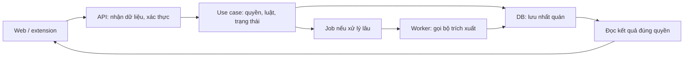
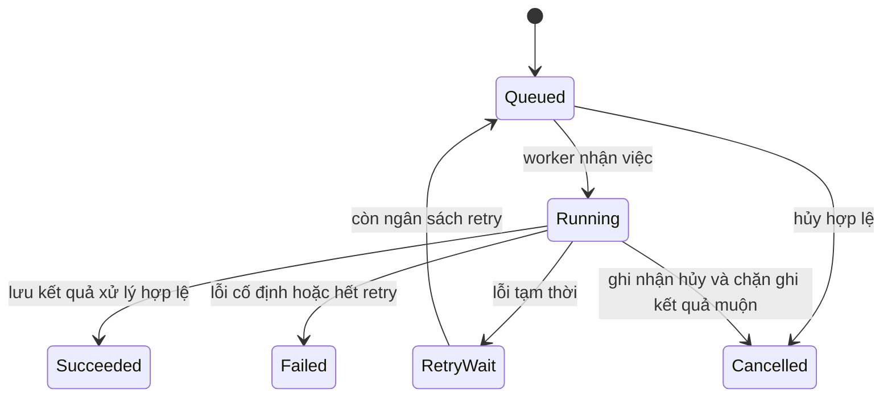

# Từ vibe coding đến làm web có thể bàn giao

> Hiệu chỉnh 11/10/2026 sau phản biện: ví dụ ReNER áp dụng pilot có tài khoản và **catalog nội bộ**, không ngầm mở dữ liệu thật ra Internet. Job và review tách state. Xem [bối cảnh hiện hành](../HIEN-TRANG-VA-QUYET-DINH.md); các ví dụ vẫn chưa triển khai.

**Ngày nghiên cứu: 11/10/2026.** Tài liệu học và bản thảo; chưa triển khai các đề xuất dưới đây. Dùng ReNER-VN làm ví dụ xuyên suốt, giữ nguyên thiết kế v0.2 và mục tiêu demo. Mục tiêu học là làm bài bản để áp dụng tư duy sang nhiều dự án và tiến tới nhận khách.

**Bối cảnh đã xác nhận:** bạn dùng AI viết phần lớn code, muốn hiểu luồng giữa các phần; khó nhất là chuyển ý tưởng/prompt ngắn thành yêu cầu và chia việc. Bạn lo quy tắc cứng hạn chế sáng tạo. Vì vậy tài liệu ưu tiên cách ra quyết định và kiểm chứng hơn việc bắt học hết cú pháp lập trình.

Đọc phần 1–4 để hiểu kết luận nghiên cứu; phần 5–8 để hiểu kỹ thuật; thực hành ngay bằng [sổ tay chia việc](SO-TAY-CHIA-VIEC-CHO-AI.md). Nội dung áp dụng ReNER là **suy luận/đề xuất của lượt nghiên cứu này**, không phải kết quả khảo sát người tìm trọ hoặc tính năng đã được duyệt.

## 1. Điều cần thay đổi trong cách dùng AI

Bạn có thể giao AI phần lớn việc viết code. Nhưng để nhận làm web cho khách, vẫn cần kiểm soát được bốn thứ: **khách thật sự cần kết quả gì; dữ liệu và quyền đi qua đâu; bằng chứng nào cho thấy chức năng đúng; cách phục hồi khi thay đổi sai**. Chưa cần đọc hết code, nhưng không nên bỏ cả khả năng kiểm tra bốn việc này.

Prompt ngắn không tự nó là vấn đề. Vấn đề xuất hiện khi AI biến những chỗ thiếu thông tin thành quyết định nghiệp vụ mà bạn không nhìn thấy. Cách cải thiện: AI phỏng vấn ngắn → viết lại yêu cầu bằng ví dụ → bạn sửa/chốt → AI lập luồng và task. Bạn quyết định kết quả cần đạt; AI đề xuất cách làm và chịu trách nhiệm đưa bằng chứng.

Ví dụ “làm tính năng so sánh giá phòng” còn thiếu: giá phòng hay giá/người, có tính điện nước không, dữ liệu lấy từ đâu, thiếu diện tích xử lý ra sao, ai được xem và khi nào kết luận “rẻ”. Những quyết định này thay đổi từ database đến giao diện. Chọn màu nút trước sẽ không giải quyết sự mơ hồ đó.

### 1.1 Hard rule có làm mất sáng tạo không?

**Có thể, nếu khóa quá sớm cách giải.** “Phải có đúng 12 file, mỗi hàm tối đa 10 dòng, mọi thiếu sót đều dừng hỏi” dễ tạo công việc hình thức. Ngược lại, “không tự công khai tin cá nhân; không biến giá/người thành giá/phòng; phải chỉ ra dữ liệu thiếu” là các ranh giới bảo vệ giá trị sản phẩm.

| Loại quyết định | Cách quản lý đề xuất | Ví dụ ReNER |
|---|---|---|
| Luật nghiệp vụ, quyền, ý nghĩa dữ liệu | Người dùng quyết định; AI phân tích tác động khi muốn đổi | Khi nào một tin được đưa vào dữ liệu thị trường |
| Chi tiết thực hiện dễ đảo ngược | AI tự chọn trong phạm vi, ghi lý do nếu đáng kể | Tên hàm rõ nghĩa, chia component, cách bố trí nhãn |
| Phương án chưa chắc | Thử trên fixture/bản nháp với giới hạn; so sánh rồi chọn | Hai cách trình bày tin thiếu phí dịch vụ |
| Hành động ảnh hưởng dữ liệu thật/chi phí/phát hành | Có phạm vi ủy quyền rõ và bước kiểm tra phù hợp | Migration xóa cột, công khai dữ liệu, mua dịch vụ |

Quy tắc tốt mô tả **điều phải đúng**, thường để mở **cách làm cho đúng**. Có thể yêu cầu AI đề xuất hai phương án đáng cân nhắc, nhưng không bắt mọi thay đổi nhỏ phải họp hoặc viết ADR. *Shape Up* chủ trương mô tả vừa đủ để giải quyết vấn đề, vẫn chừa không gian thiết kế; đây là nguồn cho cách cân bằng trên, không phải nghiên cứu đo “độ sáng tạo của AI”. [Nguồn: Principles of Shaping](https://basecamp.com/shapeup/1.1-chapter-02).

## 2. Các hướng phát triển quốc tế và Trung Quốc đáng học

Đây là **mẫu khảo sát có chọn lọc**, kiểm tra ngày 11/10/2026; không đủ để xếp hạng “dẫn đầu thế giới” hoặc đo thị phần. Phân biệt khả năng do nhà cung cấp mô tả với hiệu quả đã đo độc lập.

| Nguồn/địa bàn | Đã đọc được gì | Bài học có thể dùng |
|---|---|---|
| [Anthropic — agents](https://www.anthropic.com/engineering/building-effective-agents) | Phân biệt workflow định sẵn với agent tự chọn bước; khuyến nghị tăng độ phức tạp khi có nhu cầu | Không biến mọi nghiệp vụ thành hệ nhiều agent; luồng rõ thì dùng code và trạng thái rõ |
| [Claude Code best practices](https://code.claude.com/docs/en/best-practices) | Khám phá, lập kế hoạch, thực hiện, kiểm tra; cho AI phỏng vấn; quản lý context | Một lời nhắn ngắn có thể mở đầu, nhưng cần tạo ra yêu cầu và bằng chứng kiểm tra |
| [Qwen Code — Trung Quốc](https://github.com/QwenLM/qwen-code) | README mô tả agent mã nguồn mở, nhiều giao diện/provider; docs có context/diff/history | Học cơ chế đọc repo, quản lý ngữ cảnh, xem thay đổi; không đồng nhất công cụ với model |
| [TRAE — SOLO 31/03/2026](https://www.trae.ai/blog/new_solo_beta_0331) | Sản phẩm mở rộng từ code sang tài liệu, dữ liệu và deliverable; skills/rules/memory/context | Brief, thiết kế, code và kiểm tra cần có mối nối; bài quảng bá không chứng minh năng suất của bạn |
| [Ant Design — tiếng Trung](https://ant.design/docs/spec/values-cn/) | Tự nhiên, chắc chắn/dễ dự đoán, ý nghĩa và khả năng phát triển; component/pattern giảm công sức lặp | Admin cần hành vi nhất quán, thao tác rõ và trọng tâm nghiệp vụ; không chỉ theme đẹp |
| [DORA 2025](https://dora.dev/research/2025/dora-report/) | Báo cáo mô tả AI khuếch đại điểm mạnh/yếu của hệ thống tổ chức | Đầu tư vào luồng làm việc và phản hồi; mua công cụ mạnh hơn chưa giải quyết yêu cầu mơ hồ |

**Suy luận tổng hợp:** điểm đáng học xuyên các nguồn là nối context → thực thi → phản hồi, tái sử dụng component và làm đầu ra có thể kiểm tra. Không có căn cứ nói tất cả nhóm quốc tế đều làm giống nhau, hoặc một model/stack tối ưu cho mọi web.

### 2.1 X, Bilibili, video ngắn và giới hạn nguồn

| Nguồn | Mức tiếp cận thực tế trong lượt này | Cách sử dụng |
|---|---|---|
| [Boris Cherny trên X](https://x.com/bcherny/status/2007179842928947333) | Mở post bị 403; search có profile/mirror và thảo luận thứ cấp | Giữ làm đầu mối; không khẳng định đã đọc thread gốc hoặc trích lời kỹ thuật từ mirror |
| [Karpathy trên X](https://x.com/karpathy/status/1886192184808149383), [Qwen trên X](https://x.com/Alibaba_Qwen/status/1953835877555151134) | URL được tìm thấy, fetch lỗi | Không dùng làm căn cứ về hiệu năng hiện tại hay chính sách giá |
| [TRAE SOLO trên Bilibili](https://www.bilibili.com/video/BV1LCRiBwEgh/) | Chỉ đọc được mô tả qua search; mở video bị 412 | Biết có nội dung giới thiệu sản phẩm; chưa xem video, chưa xác minh thao tác demo |
| [Bài workflow SOLO trên Bilibili](https://www.bilibili.com/read/cv49747587/) | Search có mô tả; trang mở trả 0 dòng | Không dùng để kết luận workflow đã hoạt động |
| Instagram/Reels | Đã tìm nhưng chưa có nội dung gốc đủ đọc/xem qua công cụ | Chưa có phân tích reel cụ thể đáng tin; không thay số lượt thích bằng nghiên cứu người dùng |
| [NN/g — Explain UX with User-Centered Design](https://www.nngroup.com/videos/explain-ux-user-centered-design/) | Trang giới thiệu video 4 phút, Kim Flaherty, 21/10/2022; không transcript | Tài liệu định hướng giải thích UX cho người không chuyên; không nhận đã xem toàn bộ |
| [Flux Academy — Learn Web Design For Beginners](https://www.youtube.com/watch?v=j6Ule7GXaRs) | Đọc mô tả và chương công khai, 02/02/2024 | Có thứ tự Strategy 05:26 → Structure 10:17 → Design 30:42 → Development 1:48:14; chưa xem toàn khóa |

Các video có transcript đã phân tích ở lượt trước nằm trong [chuyên đề gia công/AI](GIA-CONG-WEB-VA-AI-WORKFLOW.md). Không đếm những video đó thành nội dung vừa xem lại.

Khi xem reel mới, nên ghi: tác vụ nào được giải quyết; trước/sau ra sao; có dữ liệu thật không; có mobile/loading/error không; có test/đo lường không; có bán khóa học/công cụ không. Reel có thể cho ý tưởng thị giác. Nó không tự chứng minh người dùng mục tiêu thích, thao tác tốt hoặc sản phẩm an toàn.

### 2.2 Đừng lấy lời hứa tăng tốc làm kế hoạch giao hàng

METR đo 16 lập trình viên có kinh nghiệm trên 246 task ở repo quen thuộc với công cụ đầu 2025: nhóm dùng AI mất nhiều thời gian hơn 19%. Phạm vi hẹp, không đại diện mọi người hoặc mọi công cụ hiện nay. [Nghiên cứu 10/07/2025](https://metr.org/blog/2025-07-10-early-2025-ai-experienced-os-dev-study/).

Đáng chú ý, chính METR cập nhật 24/02/2026 rằng dữ liệu mới bị ảnh hưởng bởi việc chọn người/chọn task và khó đo thời gian khi dùng nhiều agent; chưa thể ước lượng đáng tin mức tăng tốc hiện tại. Không dùng con số 2025 để kết luận AI 2026 vẫn chậm hơn. [Bản cập nhật](https://metr.org/blog/2026-02-24-uplift-update/).

Ứng dụng đề xuất cho bạn: đo **thời gian từ yêu cầu đến nghiệm thu**, số lần làm lại và lỗi lọt sau bàn giao. Số dòng AI sinh ra, số agent hoặc số prompt không phải kết quả khách mua.

## 3. Người dùng thích gì ở một website?

Không có một thứ “thích nhất” áp dụng cho mọi web. Khách mua dịch vụ, người dùng cuối và admin còn có mục tiêu khác nhau. Đối với ReNER, giả thuyết ưu tiên là tìm được tin phù hợp và hiểu đúng mức giá; cần kiểm tra bằng quan sát người tìm trọ thật.

### 3.1 Ba case có bài học cụ thể

| Case/loại bằng chứng | Phát hiện của nguồn | Bài học đề xuất và giới hạn |
|---|---|---|
| [Vodafone, A/B landing page](https://web.dev/case-studies/vodafone) — 17/03/2021 | Hai bản giống hình thức/chức năng; bản tối ưu LCP tốt hơn 31%, sales tăng 8%. Nguồn nêu giảm JS chặn render, SSR nội dung quan trọng và tối ưu ảnh | Tốc độ có thể ảnh hưởng hành vi ngay khi UI không đổi. Đây là kết quả case đó; không cam kết ReNER tăng 8% |
| [Baymard checkout 2025](https://baymard.com/research-articles/current-state-of-checkout-ux) — benchmark và usability | Người dùng có thể bỏ sót guest checkout dù chức năng tồn tại; ví dụ Room & Board và Sephora | Chức năng phải dễ thấy ở đúng lúc. Suy luận cho ReNER: đặt bộ lọc/đơn vị giá gần thông tin cần quyết định; không chuyển tỷ lệ checkout sang tìm trọ |
| [Shape Up: Write the Pitch](https://basecamp.com/shapeup/1.5-chapter-06) — thực hành sản phẩm của Basecamp | Pitch gắn vấn đề cụ thể, mức đầu tư, hướng giải, điểm khó và ngoài phạm vi | Trước “thêm tab/bộ lọc”, nói rõ tình huống hiện tại gây khó gì. Phương pháp thực hành, không thử nghiệm nhân quả |

### 3.2 Thang ưu tiên UX cho ReNER — giả thuyết để kiểm tra

| Người dùng cần | Ví dụ đúng hướng | Dấu hiệu kiểm tra |
|---|---|---|
| Hiểu được thông tin | 3 triệu/phòng/tháng khác 1,5 triệu/người/tháng; phí chưa rõ ghi chưa rõ | Người thử giải thích đúng giá và giới hạn thông tin |
| Tìm được thứ phù hợp | Lọc địa điểm/giá; giữ lựa chọn khi quay lại từ chi tiết | Hoàn thành nhiệm vụ tìm tin mà không cần người hướng dẫn |
| Tin tưởng có căn cứ | Có nguồn, ngày thu thập, nội dung gốc phù hợp quyền và nhãn chưa xác minh | Người thử biết đây là dữ liệu trích xuất, không xác nhận phòng còn trống |
| Biết hệ thống đang làm gì | Đang nhận/đang xử lý/thất bại/cần sửa được phân biệt | Khi lỗi, người dùng biết bước tiếp theo; không bấm gửi lặp vì im lặng |
| Sửa sai và kiểm soát | Xem lại trước gửi, sửa bản nháp; đóng góp vào catalog nội bộ là hành động riêng | Không vô tình chia sẻ dữ liệu riêng |
| Dùng được trên thiết bị của họ | Chữ, nút, filter trên mobile; thao tác bàn phím; focus rõ | Chạy nhiệm vụ thực tế ở màn hình nhỏ và bằng bàn phím |
| Cảm giác chỉn chu | Nhịp chữ/khoảng cách nhất quán; motion báo thay đổi | Animation không cản đọc giá, không mất vị trí cuộn |

Nền tảng tham khảo: [Nielsen — usability heuristics](https://www.nngroup.com/articles/ten-usability-heuristics/) về trạng thái, ngôn ngữ quen thuộc, phòng lỗi và quyền kiểm soát. Bảng ReNER là cách áp dụng riêng, chưa có số liệu người dùng.

**Motion:** dùng để giúp nhận biết quan hệ và thay đổi; xem mục đích, tần suất và khả năng gây phân tâm. Sidebar đóng/mở hoặc phản hồi nút có thể hữu ích; hiệu ứng dài mỗi lần mở menu có thể cản tác vụ. [NN/g — Animation for Attention and Comprehension](https://www.nngroup.com/articles/animation-usability/). Có đường xử lý cho tùy chọn giảm chuyển động của người dùng. [MDN — prefers-reduced-motion](https://developer.mozilla.org/en-US/docs/Web/CSS/Reference/At-rules/@media/prefers-reduced-motion).

### 3.3 Cách tự kiểm chứng thay vì đoán sở thích

Với bản nháp, mời một nhóm nhỏ người phù hợp thử từng vòng; đây là kiểm tra định tính, không suy ra tỷ lệ toàn thị trường. Giao tình huống: “tìm hai tin phù hợp ngân sách và giải thích tin nào đủ thông tin để so sánh”. Không chỉ chỗ bấm. Ghi tác vụ hoàn thành/chưa, hiểu nhầm, điểm dừng và mức cần trợ giúp. Hỏi lý do sau khi quan sát; sửa vấn đề nghiêm trọng rồi thử lại.

Đừng dùng duy nhất câu “bạn có thích giao diện không?”. Một người có thể thích hình thức nhưng hiểu nhầm giá; với ReNER, đó vẫn là lỗi cần sửa. Chưa thực hiện khảo sát hoặc user test nào trong lượt nghiên cứu này.

## 4. Áp dụng 80/20 và xác định khâu quyết định thành bại

80/20 là cách nhắc ưu tiên số ít yếu tố có tác động lớn; **không phải định luật bảo đảm đúng 20% công sức tạo đúng 80% kết quả của dự án này**. Không có dữ liệu ReNER để xác định tỷ lệ đó. Những yêu cầu hiếm gặp nhưng hậu quả lớn như lộ dữ liệu vẫn cần xử lý.

Với trạng thái hiện tại của bạn, khâu có đòn bẩy lớn nhất theo đánh giá của mình là **làm rõ vấn đề → viết ví dụ đúng/sai → chứng minh một luồng giá trị đầu-cuối**. Đây là nhận định theo bối cảnh, không kết luận rằng mọi dự án đều thất bại ở cùng một khâu.

| Điểm nghẽn | Hỏng thì điều gì xảy ra? | Phép kiểm tra sớm |
|---|---|---|
| Bài toán/nhu cầu | Làm nhanh một thứ người dùng không cần | Quan sát cách họ tìm trọ, xác nhận tình huống gây khó |
| Nguồn và nghĩa dữ liệu | Giao diện đưa ra so sánh sai dù chạy mượt | Một tập tin có đơn vị/ngoại lệ rõ và đáp án do người kiểm tra |
| Luồng lõi | Từng trang đẹp nhưng không nối thành thao tác dùng được | Một tin đi từ chọn → xử lý → người dùng hiểu/sửa → xem kết quả |
| Khả năng thay đổi và kiểm tra | Sửa một tính năng làm hỏng nhiều phần không biết | Task nhỏ, contract rõ, kiểm tra hồi quy luồng quan trọng |
| Bàn giao/vận hành | Chỉ chạy trên máy người làm; không ai phục hồi được | Cài theo README ở môi trường sạch và diễn tập khôi phục |

**Ưu tiên học ReNER:** (1) phân biệt giá và dữ liệu thiếu; (2) một flow đầu-cuối; (3) quyền cá nhân/công bố nội bộ; (4) lỗi và khôi phục; (5) UI giúp tìm và hiểu. Animation trang trí, chatbot hoặc nhiều dashboard chưa có câu hỏi nghiệp vụ là phần xét sau. Không dùng thứ tự này để cắt các yêu cầu nghiên cứu/NLP trong proposal; phải giữ truy vết yêu cầu môn học riêng.

Waterfall vẫn có quản lý thay đổi: bản yêu cầu có mốc chốt để triển khai, nhưng khi sai phải quay lại phần bị ảnh hưởng và lập baseline mới. Chờ đến cuối mới cho người dùng thử làm tăng nguy cơ phát hiện sai muộn. Đề xuất ở đây là tài liệu theo chặng rõ ràng, kèm kiểm tra sớm bằng ví dụ và prototype; không gọi đó là Waterfall thuần hoặc chuẩn duy nhất.

## 5. Backend “gọn nhất” nên hiểu thế nào?

Mục tiêu phù hợp là **ít khái niệm và phụ thuộc phải giữ trong đầu, luật nằm đúng chỗ, thay đổi có vùng ảnh hưởng nhỏ**. Ít dòng code hay ít file chưa chắc dễ hiểu. Một hàm 500 dòng và 30 lớp chỉ chuyển tiếp đều có thể khó bảo trì.

Nguồn học: Ousterhout nghiên cứu cách giảm phức tạp bằng interface đơn giản và che chi tiết bên trong module; trang sách cũng nêu khác biệt với một số quan điểm trong *Clean Code*. Vì vậy không coi “hàm càng ngắn càng tốt” là luật tuyệt đối. Đã đọc trang tác giả/đề cương khóa học, chưa đọc toàn sách; file excerpt bị công cụ web từ chối do kích thước. [Sách](https://web.stanford.edu/~ouster/cgi-bin/book.php), [CS190](https://web.stanford.edu/~ouster/cs190-winter22/).

### 5.1 Kiến trúc đủ gọn để một người hiểu

Với web nghiệp vụ của bạn, nên học mô hình **modular monolith** trước: một backend chia module theo nghiệp vụ, một DB chính, worker riêng chỉ khi cần xử lý nền. Có worker không tự đồng nghĩa microservices. Đây cũng phù hợp bản thảo đang có; chưa đổi stack. [Monolith First](https://martinfowler.com/bliki/MonolithFirst.html) nêu chi phí chọn ranh giới service quá sớm; bài cũng thừa nhận bằng chứng kinh nghiệm và các ngoại lệ.



Học trách nhiệm từng phần thay vì thuộc tên framework:

- API chuyển request thành input có kiểu, xác thực và trả lỗi rõ. Frontend có thể kiểm tra để hỗ trợ UX, nhưng backend vẫn phải thực thi luật/quyền.
- Use case như “gửi tin”, “sửa kết quả”, “duyệt công bố nội bộ” chứa chính sách; không phân tán cùng luật vào nhiều màn hình.
- Module chuẩn hóa giá có thể là hàm thuần: input/output rõ, dễ kiểm tra không cần mạng. Đưa gọi LLM, DB, gửi email vào ranh giới I/O.
- Module nào sở hữu dữ liệu thì điều khiển thay đổi dữ liệu đó; phần khác gọi interface thay vì sửa bảng tùy tiện.
- CRUD đơn giản có thể dùng trực tiếp cơ chế DB của framework. Thêm repository/adapter khi có ích cho thay thế provider, gom query hoặc kiểm thử; không tạo một lớp cho mỗi tên trong sách.

### 5.2 Ví dụ tổ chức code — minh họa, không phải cây repo đã tạo

```text
docs/                 brief, luồng, quyết định, hướng dẫn chạy
web/features/         submission, listing-search, review
api/modules/
  submissions/        nhận tin và quyền sở hữu
  extraction/         trích xuất, chuẩn hóa, revision
  publication/        duyệt và snapshot được phép công bố nội bộ
  catalog/            tìm/lọc và so sánh đúng tập dữ liệu
api/platform/         DB connection, cấu hình, logging, auth plumbing
worker/               entry point chạy use case nền của backend
tests/                ví dụ nghiệp vụ + integration + luồng quan trọng
```

Trong module nhỏ, một vài file đủ dùng: route, use case, schema/query nếu cần. Chỉ tách khi tên/trách nhiệm trở nên rõ hơn. Tránh `utils`/`common` chứa mọi thứ; tránh một `BaseService` bắt nghiệp vụ không giống nhau dùng chung cơ chế phức tạp. Code dùng tiếng Anh nhất quán, glossary giải thích sang tiếng Việt. Comment giải thích **vì sao** có luật, không kể lại cú pháp.

Bạn cần AI giải thích mỗi flow bằng một đường đi cụ thể: nút nào → request gì → luật gì → dữ liệu nào thay đổi → UI hiện gì → lỗi ra sao. Khi code đã có, mọi bước phải trỏ file/symbol thật. Cây trên là ví dụ, không được dùng để bịa rằng các file đã tồn tại.

### 5.3 Tối ưu tốc độ và interface theo phép đo

| Vấn đề quan sát | Điều kiểm tra trước | Hướng xử lý khi có bằng chứng |
|---|---|---|
| Trang chậm hiện nội dung | Network waterfall, kích thước ảnh/JS, phần đang chặn render | Ảnh đúng kích thước, bớt JS, tải phần cần trước; tránh lazy-load ảnh chính một cách máy móc |
| Bấm filter bị khựng | Công việc trên main thread, số item render, request lặp | Phân trang; hủy/bỏ response cũ; debounce chỗ phù hợp; chỉ virtualize khi danh sách đủ lớn |
| API tìm kiếm chậm | Query duration, số query, EXPLAIN, pool/connection | Index theo query thật, tránh N+1, chỉ lấy field cần; đo lại sau sửa |
| Trích xuất lâu | Thời gian model/network, quota, số retry | Job nền, timeout, trạng thái rõ; không giả thông báo thành công |
| Cần cache | Độ lặp lại và chi phí truy vấn, dữ liệu/quyền nào thay đổi | Cache key có phạm vi phù hợp, kế hoạch invalidation; không trộn kết quả riêng giữa người dùng |

Core Web Vitals hiện dùng LCP ≤ 2,5 giây, INP ≤ 200 ms, CLS ≤ 0,1 ở phân vị 75, xét mobile/desktop; đây là hướng dẫn chất lượng trải nghiệm, **không phải kết quả ReNER đã đạt**. Local Lighthouse là phép đo lab, không thay dữ liệu người dùng thật. [Web Vitals](https://web.dev/articles/vitals). Với DB, đọc plan trước khi thêm index theo cảm giác; `EXPLAIN ANALYZE` thực sự chạy câu lệnh nên phải chọn môi trường/query phù hợp. [PostgreSQL EXPLAIN](https://www.postgresql.org/docs/current/using-explain.html).

## 6. Điều phối logic phức tạp mà vẫn hiểu được

Phải tách **AI hỗ trợ viết phần mềm** khỏi **LLM nằm trong sản phẩm**. Agent có thể đề xuất code; điều đó không có nghĩa để LLM tự quyết ai được công bố tin vào catalog nội bộ hoặc tự ghi mọi bảng. Những quyết định rõ quy tắc nên được kiểm soát bởi backend.

Ví dụ học tập cho **một lần thực thi job**, không phải toàn bộ đặc tả retry/cancel. `Succeeded` chỉ nghĩa xử lý xong; candidate review có vòng đời riêng (`pending → approved | rejected`). Người dùng xem/xác nhận kết quả không làm job mới thành công. Chi tiết concurrency theo bản thảo v0.2 §6.4 và §16.5.



| Trường hợp dễ bị bỏ sót | Cơ chế cần hiểu |
|---|---|
| Người dùng bấm gửi hai lần | Idempotency key gắn cùng thao tác/phạm vi user; backend trả lại kết quả đã nhận, không tạo công việc trùng |
| API lưu tin nhưng chưa tạo job thì chết | Với cùng DB, tạo tin và job trong một transaction; tránh nửa thành công |
| Worker chết giữa chừng | Lease/timeout giúp nhận lại; không hứa “chỉ chạy đúng một lần”, mà làm bước ghi kết quả chịu được retry |
| Tin được sửa khi model đang chạy | Job gắn revision; kết quả cũ không ghi đè bản mới; kiểm tra điều kiện ở bước lưu |
| Model trả JSON hợp lệ nhưng sai nghĩa | Schema chỉ kiểm hình dạng; còn cần đối chiếu span, đơn vị và điều kiện nghiệp vụ |
| Job chạy quá lâu | Không giữ transaction DB mở trong lúc gọi model; giới hạn timeout/retry và cho phép xem lỗi |
| Người dùng hủy khi kết quả sắp về | Kiểm tra trạng thái hủy ở bước ghi; gọi mạng đã chạy có thể không hoàn tác được chi phí |
| Dữ liệu ngoài chứa lời ra lệnh | Xử lý nội dung tin như dữ liệu; không cho text trong tin trở thành chỉ dẫn chạy tool hoặc đổi quyền |

Nếu sau này phải phối hợp DB với message broker/email/payment, mới đánh giá outbox, idempotency phía nhận và hành động bù. Một transaction DB không thể tự rollback giao dịch đã xảy ra ở dịch vụ khác. Với demo hiện tại, không thêm Kafka/Saga hay nhiều agent chỉ để trông bài bản.

“Harness” nên được hiểu là phần nối context, công cụ, quyền, kiểm tra và báo cáo quanh agent. File rule chỉ hướng dẫn; script/CI và quyền công cụ mới thực thi được một phần ranh giới. Xem [phân tích harness thực tế trước đó](NGHIEN-CUU-HARNESS-SCALE-AI.md), đặc biệt các giới hạn đã thấy trong ChoThueGiupViec.

## 7. Khách đổi tính năng cốt lõi: quay lại đâu?

**Đổi ý định sản phẩm và sửa lỗi triển khai là hai tình huống khác nhau.** Yêu cầu mới không tự động nghĩa là xóa code cũ. Trước hết ghi hành vi cũ/mới, nguyên nhân và phần nào còn tái sử dụng; sau đó quyết định phạm vi, dữ liệu, thời gian và cách nghiệm thu lại.

### 7.1 Quy trình change request đủ dùng cho một người

1. Viết một ví dụ trước/sau khách đọc hiểu được; đánh dấu đây là thay đổi yêu cầu hay lỗi so với yêu cầu đã chốt.
2. Lần theo luồng bị ảnh hưởng: UI → API → luật → DB → job → báo cáo → quyền; ghi cả dữ liệu và người dùng đang dùng bản cũ.
3. Trình phương án: giữ nguyên, bổ sung tương thích, thay thế dần hoặc đổi scope lớn. Nêu đánh đổi, không tự cam kết ngày khi chưa khảo sát điểm khó.
4. Với việc nhận khách: thống nhất lại đầu ra, mốc nghiệm thu và tác động chi phí theo thỏa thuận. Không cần ký lại mọi thứ cho chỉnh sửa nhỏ; thay đổi lõi phải có dấu vết chấp thuận.
5. Tạo mốc đang chạy được; sao lưu dữ liệu cần giữ và kiểm khả năng phục hồi; thực hiện thay đổi tách biệt, kèm kiểm tra hồi quy.
6. Cho thử phiên bản mới; chỉ loại đường cũ khi điều kiện tương thích và dữ liệu đã được kiểm chứng. Cập nhật brief, contract, task và log liên quan.

### 7.2 Năm loại “back lại” khác nhau

| Cần quay lại | Công cụ/cơ chế | Điều nó không tự giải quyết |
|---|---|---|
| Hội thoại AI đi sai hướng | Chỉnh yêu cầu, khôi phục context/checkpoint nếu công cụ hỗ trợ | Không mặc định hoàn tác DB, shell, deploy hoặc API ngoài |
| Code sai | Git branch/commit, revert thay đổi đã chia sẻ, review diff | Không tự khôi phục dữ liệu đã đổi hoặc cấu hình ngoài Git |
| Bản phát hành lỗi | Triển khai artifact tốt trước đó | Chỉ an toàn nếu schema/config/job vẫn tương thích |
| Một hành vi mới cần tắt | Feature flag có kiểm ở backend khi liên quan nghiệp vụ | Không phải phân quyền, không đảo ngược email/thanh toán/dữ liệu đã ghi |
| Dữ liệu/schema sai | Migration sửa tiếp, phục hồi bản ghi chọn lọc, hoặc restore có kế hoạch | Restore toàn DB có thể mất các giao dịch hợp lệ phát sinh sau backup |

GitHub tạo PR đảo thay đổi khi revert PR; không phải cơ chế quay ngược mọi thứ trong hệ thống. [GitHub Docs](https://docs.github.com/en/pull-requests/how-tos/merge-and-close-pull-requests/reverting-a-pull-request). Feature flags cần chủ sở hữu và ngày xem lại/xóa để tránh tích lũy các đường chạy không kiểm được. [Feature Toggles](https://martinfowler.com/articles/feature-toggles.html).

### 7.3 Ví dụ ReNER: đổi từ “giá thuê” sang “tổng chi phí ở”

Giả sử khách muốn xếp hạng theo tiền thực trả hàng tháng. Đây không đơn giản là đổi nhãn `price`: tiền điện/nước phụ thuộc mức dùng, phí cố định, số người và thời điểm; tiền cọc có thể là chi phí ban đầu chứ không phải chi phí hàng tháng. Cần chốt cách diễn giải trước khi đổi dữ liệu.

Đề xuất học tập: giữ giá thuê gốc và đơn vị; thêm cấu trúc phí/giả định riêng; tổng ước tính ghi rõ phần đã biết và chưa biết, không tự điền 0. Mở thêm contract mới trong khi đường đọc cũ còn hoạt động; chuyển UI/worker/report từng phần; backfill chỉ trường suy ra chắc chắn; kiểm kết quả rồi mới bỏ đường cũ. Đây là cách áp dụng **expand → migrate → contract**. [Parallel Change](https://martinfowler.com/bliki/ParallelChange.html).

Quay lại bản cũ chỉ an toàn trong khoảng thời gian còn tương thích. Sau khi xóa cấu trúc cũ hoặc thay đổi không đảo được dữ liệu, thường phải sửa tiến tới hoặc phục hồi có đối soát. Với demo chỉ có fixture có thể tái tạo, đôi lúc tái sinh DB demo là đơn giản nhất, nhưng phải xác nhận không có dữ liệu cần giữ. Chưa thực hiện bất kỳ migration/rollback nào ở lượt này.

## 8. Một người quản lý toàn bộ dự án với AI

Một người có thể lần lượt đội các vai: chủ sản phẩm, phân tích yêu cầu, người triển khai, người kiểm tra và người bàn giao. Không nhất thiết mở năm agent cùng sửa repo. Với nhu cầu hiện tại, nên có **một task đang sửa code tại một thời điểm**; thử dùng phiên review đọc độc lập khi thay đổi khó, nhưng không coi AI thứ hai là bảo đảm đúng.

| Trước khi AI sửa | Sau khi AI sửa | Bằng chứng để bạn kiểm tra |
|---|---|---|
| Một hành vi và ví dụ đúng/sai | Một diff có cùng mục đích | Không trộn refactor lớn với đổi nghiệp vụ |
| Hiện trạng từ repo, không suy đoán | Danh sách phần thay đổi | File/symbol có thật, có đường đi request |
| Những gì không được làm sai | Test trường hợp thành công và lỗi quan trọng | Log kiểm tra thực tế; nêu phần chưa chạy |
| Dữ liệu/migration/quyền bị ảnh hưởng | Kế hoạch phục hồi tương thích | Không chỉ “git reset là được” |
| Phần AI tự quyết và phần cần bạn chốt | Lý do cho quyết định đáng kể | Không bắt bạn duyệt mọi tên biến |

Board đủ dùng: **Ý tưởng → Cần làm rõ → Sẵn sàng → Đang làm → Kiểm tra → Xong**. Một task chỉ vào “Sẵn sàng” khi biết đầu ra, nguồn dữ liệu, trường hợp sai quan trọng, phụ thuộc và cách thử. “Xong” khi có bằng chứng phù hợp, không chỉ khi AI báo xong. Việc nhỏ dùng checklist trong một issue; không cần ép mọi dự án thành công ty nhiều phòng ban.

### 8.1 Bộ hồ sơ tối thiểu nên duy trì

| Hồ sơ | Trả lời câu hỏi gì? | Khi cập nhật |
|---|---|---|
| Brief ngắn | Ai cần kết quả gì, scope và tiêu chí thành công? | Khi mục tiêu/yêu cầu đổi |
| Bản đồ luồng + glossary | Dữ liệu đi đâu, ai được làm gì, từ này nghĩa gì? | Khi luồng/quyền/nghĩa dữ liệu đổi |
| Contract/schema | Các phần trao đổi thông tin gì? | Cùng thay đổi interface/migration |
| Task và acceptance | Đợt này làm gì, biết đúng bằng cách nào? | Trước làm và khi scope đổi |
| Quyết định quan trọng | Vì sao chọn, phương án bỏ và điều kiện xem lại? | Khi có đánh đổi đáng kể; không cho mọi chỉnh sửa |
| Runbook + log | Chạy, kiểm tra, bàn giao, phục hồi thế nào? | Sau phần việc làm thay đổi cách vận hành |

Đừng sao chép cùng một yêu cầu thành năm bản khác nhau. Chọn một nguồn chính, các trang khác liên kết tới nó. Khi bạn thay đổi ý định, yêu cầu mới của bạn có quyền điều chỉnh baseline; AI phải ghi chỗ xung đột và cập nhật tài liệu liên quan, không dùng spec cũ để bác yêu cầu mới. Chỉ hỏi những điểm chưa rõ có ảnh hưởng thật.

### 8.2 Năng lực cần kiểm chứng trước khi nhận khách

Bạn không phải thuộc framework. Nhưng với từng loại dự án định nhận, cần tự trình bày được: ba luồng chính; dữ liệu nhạy cảm và quyền; test một trường hợp hỏng; cách khách sửa nội dung; nơi giữ mã nguồn/tài khoản/backup; cách tái chạy và phục hồi. Nếu chưa kiểm tra được phần auth/thanh toán/dữ liệu nhạy cảm, nên có người có chuyên môn review phần đó trước khi cam kết bàn giao.

Thước đo học cho ReNER: bạn giải thích một tin đi từ extension đến kết quả trong khoảng vài phút, chỉ được nơi đổi một luật giá mà không dò toàn repo, hiểu một change request tác động gì, và tự thực hiện kịch bản nghiệm thu từ tài liệu. Đây là mục tiêu luyện tập đề xuất, không chứng nhận đủ năng lực nhận mọi dự án.

## 9. Lộ trình đọc sách và câu hỏi tiếp theo

| Nguồn | Đã đọc mức nào trong lượt này? | Bài tập dùng ngay |
|---|---|---|
| [The Mom Test — Rob Fitzpatrick](https://www.momtestbook.com/teachers) | Trang tác giả và gợi ý giảng dạy; chưa đọc toàn sách | Đổi câu “bạn có dùng web này không?” thành câu về lần tìm trọ gần nhất và việc họ thực sự đã làm |
| [Don't Make Me Think — Steve Krug](https://sensible.com/dont-make-me-think/) | Trang tác giả, mục lục công khai và giới thiệu | Viết nhiệm vụ rồi quan sát người khác dùng bản nháp; không dẫn họ tới nút |
| [Shape Up — Ryan Singer](https://basecamp.com/shapeup) | Đọc chọn lọc các chương Principles/Risks/Pitch công khai | Viết một trang vấn đề, giới hạn đầu tư, hướng giải, điểm khó, ngoài phạm vi |
| [A Philosophy of Software Design — John Ousterhout](https://web.stanford.edu/~ouster/cgi-bin/book.php) | Trang tác giả và CS190; chưa đọc toàn sách | Nhờ AI giải thích module đang giấu độ phức tạp nào, có làm người gọi dễ hiểu hơn không |

Các câu hỏi đã trả lời: bạn vướng cả ba khâu, ưu tiên hiểu luồng và chia việc; mục tiêu dài hạn là nhận khách; trước mắt học bài bản bằng proposal/ReNER, không chuyển sang landing page hay làm qua môn.

Các câu hỏi nên mở tiếp theo **khi bắt đầu chốt bài thực hành**, chưa phải yêu cầu bạn trả lời hết ngay:

1. Lấy 3–5 tin thực tế được phép dùng làm ví dụ, tin nào khiến bạn không biết so giá thế nào? Điều này quyết định fixture và luật cần hỏi.
2. Người dùng phải tự hoàn thành việc gì sau 1 phiên demo? Câu trả lời giúp chốt luồng lõi và bỏ tính năng trang trí.
3. Khi thông tin mơ hồ, ưu tiên từ chối kết luận hay cho người dùng sửa? Quyết định này ảnh hưởng cả UX và dữ liệu.
4. Ai chấp nhận kết quả nghiệm thu: bạn, giáo viên hay người tìm trọ thử? Mỗi bên cần bằng chứng khác nhau.
5. Với AI, những quyết định nào bạn muốn xem trước; những phần nào được tự làm rồi báo? Tránh hai cực hỏi mọi thứ và tự quyết mọi thứ.

Hồ sơ nguồn và giới hạn: [README nguồn](sources/solo-ai-2026-10-11/README.md). Lượt này chưa user test, benchmark, chạy thử Qwen/TRAE, chỉnh code ứng dụng, thay kiến trúc v0.2 hoặc triển khai hệ thống.
