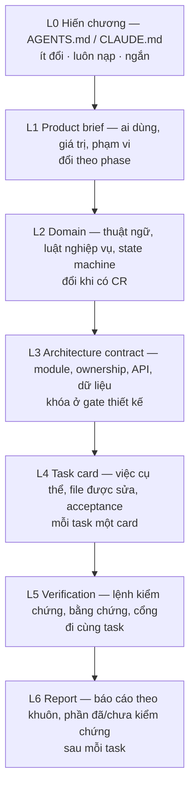

# Quy chuẩn prompt kiến trúc để giao việc cho AI

**Phiên bản 1.2 — phản biện 11/10/2026.** Áp dụng được cho nhiều dự án web/full-stack có AI tham gia code. Ví dụ điền sẵn lấy từ ReNER-VN (TMG301), nhưng khung không phụ thuộc đề tài.

**File này dùng để làm gì:** cho bạn một bộ khuôn có thể copy để giao việc cho AI (Claude Code, Codex, Antigravity, Copilot…) sao cho AI làm đúng phạm vi, không bịa, có bằng chứng, mà vẫn còn chỗ sáng tạo và đi được tới bản demo/deploy.

**Đọc nhanh:** mục 1 nói vì sao cần quy chuẩn. Mục 2 là kiến trúc 7 tầng của một prompt giao việc. Mục 3–9 là khuôn từng tầng. Mục 10 là bộ prompt theo từng giai đoạn. Mục 11 là cách giữ sáng tạo. Mục 12 là danh mục lỗi đã quan sát được. Mục 13 là ví dụ điền đủ cho ReNER-VN. Mục 14 là checklist một trang.

---

> Cập nhật theo xác nhận mới của người dùng: ưu tiên hiểu luồng và chuyển ý tưởng thành task; dùng ReNER/proposal làm bài thực hành bài bản. Xem [sổ tay mới](../kusshoes-to-rener-vn/SO-TAY-CHIA-VIEC-CHO-AI.md), đặc biệt mục 7 về giới hạn của hard rule. Các template phạm vi file/STOP ở bản này là lựa chọn kiểm soát cho task rủi ro cao, không bắt buộc cho mọi chỉnh sửa. Chỉ dẫn hiện hành của chủ dự án có thể thay baseline cũ; AI cần ghi tác động, không lấy tài liệu cũ để bác yêu cầu mới. Bản 1.2 đã rà toàn bộ khuôn: phân biệt ví dụ với bằng chứng thật, giảm gate máy móc và sửa dependency/state/contrast. Không sửa skill đã cài. Mọi cây file, API, lệnh, R/B/AT trong template dưới đây là minh họa; phải kiểm tra hoặc tạo khi triển khai, không phải hiện trạng ReNER. [Bối cảnh hiện hành](../HIEN-TRANG-VA-QUYET-DINH.md).

## 1. Vì sao cần một quy chuẩn, không chỉ một prompt dài

Các nguồn dưới gợi ý chú ý ngữ cảnh, phạm vi và cách kiểm chứng. Đây là tổng hợp thực hành, chưa là thử nghiệm chứng minh một mẫu prompt tối ưu. Độ dài và mức liên quan đều ảnh hưởng khả năng sử dụng context; nhiều chữ không tự tạo yêu cầu rõ ràng.

| Bằng chứng | Nội dung đã đọc | Hệ quả cho quy chuẩn |
|---|---|---|
| [Claude Code best practices](https://code.claude.com/docs/en/best-practices) | Khuyến khích cung cấp cách kiểm kết quả bằng test, build hoặc đối chiếu ảnh | Task code có kiểm chứng thực thi phù hợp; task nghiên cứu có nguồn và điều kiện kết luận |
| Cùng nguồn | Làm rõ phạm vi, interface và cách kiểm hành vi cuối | Nêu ranh giới và cách quan sát kết quả; không ép E2E cho mọi thay đổi |
| Cùng nguồn | Giữ nội dung hướng dẫn có ích; loại phần thừa và đọc tài liệu chi tiết khi cần | Tầng hiến chương phải ngắn; kiến thức dài để ở file đọc khi cần |
| [Anthropic — context engineering](https://www.anthropic.com/engineering/effective-context-engineering-for-ai-agents) (29/09/2025) | Ngữ cảnh là "a finite resource with diminishing marginal returns"; nên giữ "lightweight identifiers" rồi nạp đúng lúc | Prompt chỉ trỏ đường dẫn, không dán cả tài liệu |
| [DORA 2025](https://cloud.google.com/blog/products/ai-machine-learning/announcing-the-2025-dora-report) (24/09/2025) | AI khuếch đại cái đang có; tương quan tích cực với throughput nhưng **tiêu cực với độ ổn định** delivery | Phải có cổng chất lượng và lô nhỏ; tốc độ không bù được thiếu kiểm chứng |
| [DORA AI Capabilities Model](https://dora.dev/ai/capabilities-model/questions/) | 7 năng lực, trong đó có "Strong version control practices", "Working in small batches", "User-centric focus", "AI-accessible internal data" | Task nhỏ, có version control, có tài liệu nội bộ AI đọc được, bám người dùng |
| ChoThueGiupViec `AGENTS.md` (commit `1b45c1f`) | "EVIDENCE OR IT DID NOT HAPPEN"; "No ticket, no code"; allowed paths; tối đa 3 lần tự sửa rồi dừng | Bằng chứng, phạm vi cứng, ngân sách tự sửa |
| ChoThueGiupViec `.spec/decisions.md` | Thứ tự ưu tiên `spec.md > decisions.md > plan`; thiếu thì "STOP, do not guess, ask" | Có thứ tự ưu tiên nguồn sự thật |
| KusShoes `.spec/tasks.md` | Mỗi task ghi "Today …" (hiện trạng sai ở đâu) rồi "Acceptance" | Task card có hiện trạng và điều kiện chấp nhận quan sát được |

Điểm khác của quy chuẩn này so với các nguồn trên: nó **gộp** chúng thành một kiến trúc có tầng, thêm **ngân sách sáng tạo** (mục 11) để AI không bị khóa đến mức thành máy chép, và có **làn demo/deploy** để kết quả đi tới chỗ người khác dùng được. Đây là thiết kế tổng hợp của tài liệu này, không phải tiêu chuẩn của một tổ chức nào.

---

## 2. Kiến trúc 7 tầng của một lần giao việc

Một lần giao việc tốt không phải một prompt, mà là **7 tầng thông tin có vòng đời khác nhau**. Tầng trên ít đổi, tầng dưới đổi theo từng task.



| Tầng | Nơi lưu | Ai viết | Khi nào AI đọc | Lỗi khi thiếu |
|---|---|---|---|---|
| L0 Hiến chương | `AGENTS.md` (CLAUDE.md chỉ import nó) | Trưởng nhóm | Mọi phiên | AI tự đặt quy ước, sửa lung tung |
| L1 Product brief | `docs/product/brief.md` | Chủ sản phẩm | Khi task chạm hành vi người dùng | Làm đẹp nhưng sai bài toán |
| L2 Domain | `docs/domain/glossary.md`, `rules.md`, `states.md` | Chủ sản phẩm + người nắm nghiệp vụ | Khi task chạm dữ liệu/luật | Giá theo người bị so như giá phòng |
| L3 Architecture contract | `docs/architecture/*.md`, `openapi.json`, migration | Kiến trúc/trưởng BE | Khi task chạm module/API | Hai module cùng sửa một bảng; FE đoán field |
| L4 Task card | GitHub Issue (nguồn sự thật) | Người chia việc | Đầu task | Task chung chung, AI tự mở rộng |
| L5 Verification | Task card + `harness/verify` | Người chia việc + CI | Trong và cuối task | "Looks done" được coi là xong |
| L6 Report | PR description + work log | AI/dev làm task | Cuối task | Không biết cái gì thật sự đã chạy |

**Quy tắc quản lý yêu cầu:** chỉ dẫn hiện hành của chủ dự án có thể cập nhật brief/domain/contract đã duyệt; khi xung đột, AI chỉ ra tác động và cập nhật các tài liệu liên quan trong phạm vi được giao. Nếu chưa có thay đổi mới, dùng brief → domain → contract → task để tra cứu tính nhất quán. Hỏi khi thiếu quyết định nghiệp vụ, quyền, dữ liệu hoặc thay đổi khó đảo ngược; chi tiết triển khai dễ đảo ngược có thể tự chọn và ghi giả định. Mọi hành động vẫn chịu quyền công cụ và chính sách hệ thống, không bị một file Markdown tự cấp quyền.

**Quy tắc ngắn gọn:** ưu tiên thông tin liên quan và nạp dần. 150 dòng không phải ngưỡng khoa học; tài liệu tầng dưới cũng cần mục lục và phạm vi đọc. Không nhân bản cùng một luật vào bảy nơi; có thể gộp tầng thành một brief/task ngắn cho dự án một người.

---

## 3. L0 — Khuôn hiến chương (`AGENTS.md`)

`AGENTS.md` là định dạng Markdown mở, không có schema bắt buộc, được đưa vào Agentic AI Foundation thuộc Linux Foundation tháng 12/2025 ([OpenAI](https://openai.com/index/agentic-ai-foundation/)). Claude Code đọc `CLAUDE.md`; để giữ một nguồn sự thật, cho `CLAUDE.md` chỉ chứa dòng `@AGENTS.md` (cơ chế import có trong [docs Claude Code](https://code.claude.com/docs/en/best-practices)).

Chỉ đưa vào L0 những gì AI **không tự suy ra được từ code** và **áp dụng cho mọi task**. Bảng include/exclude theo docs Claude Code: nên có lệnh build/test, quy ước khác mặc định, quyết định kiến trúc riêng, gotcha; không đưa thứ đọc code là biết, tutorial dài, mô tả từng file.

```markdown
# AGENTS.md

## Project in one line
<Product> helps <primary user> to <job> by <mechanism>. Demo target: <date / audience>.

## Source of truth (precedence, highest first)
1. docs/product/brief.md (approved)
2. docs/domain/rules.md, docs/domain/states.md (approved)
3. docs/architecture/contract.md + openapi.json (approved at gate G2)
4. The GitHub Issue you were assigned (task card)
Current owner instructions can update this baseline: identify impacts and keep affected documents consistent. Ask about unresolved business, permission, data, or irreversible decisions; choose reversible implementation details within scope and record material assumptions.

## Commands (run from repo root)
- Install: <cmd>
- Dev: <cmd web> | <cmd api> | <cmd worker>
- Verify fast (lint + types): <cmd>
- Verify full (tests + build): <cmd>
- Generate API client after schema change: <cmd>

## Hard rules
1. Evidence or it did not happen: every "done/fixed/works" cites a command + output, a test name, or file:line.
2. Work from a clear task and acceptance criteria; a small task may use a checklist rather than a separate ticket. Respect protected boundaries. Explain any material scope expansion before dependent work; routine internal helpers within scope do not require new approval.
3. Verify existing packages, endpoints and symbols before relying on them. Propose new helpers or interfaces when needed within scope; label them as new, and assess contract, dependency, permission and migration impacts.
4. No drive-by refactors or reformatting outside the ticket diff.
5. Never bypass gates: no --no-verify, no disabling tests/lint, no force push, no direct push to main.
6. Self-correction: investigate each failure; change hypotheses using evidence. Escalate when progress stalls, required information is missing, or an agreed cost/time budget is exhausted. Do not repeat the same failing action blindly.
7. Secrets never enter code, logs, prompts or commits.

## Architecture rules that are easy to break
- <e.g. Authorization is enforced in the API/use case; UI hiding is presentation only.>
- <e.g. Money is integer VND; timestamps UTC; display Asia/Saigon.>
- <e.g. Frontend never computes business statistics; it renders API DTOs.>

## Protected paths (only if the ticket lists them literally)
.github/**, harness/**, AGENTS.md, migrations/** (schema steward only), .env*

## Report format at the end of every task
Changed / Verified (command + result) / Not verified / Deviations from ticket / Next.
```

**Nguồn và mức thực thi:** khuôn tham khảo ChoThueGiupViec rồi điều chỉnh cho dự án này. `scope-check` kiểm vùng file; guard-command/hook chặn một số mẫu lệnh; verify chạy các kiểm tra được cấu hình. Chúng không chứng minh mọi luật 1–6 đều được ép, nghiệp vụ đúng hoặc mọi đường thực thi đều an toàn. Rule Markdown, kiểm tra CI và quyền công cụ là ba cơ chế khác nhau. Xem [nghiên cứu harness §2](../kusshoes-to-rener-vn/NGHIEN-CUU-HARNESS-SCALE-AI.md).

---

## 4. L1 — Khuôn product brief

Brief trả lời "xây gì, cho ai, đến đâu". Không có công nghệ ở đây.

```markdown
# Product brief — <name> (status: draft | approved <date> by <owner>)

## Problem (one paragraph, from the user's side)
## Primary user and their job
- Primary: <who> wants to <job> so that <outcome>.
- Secondary (supporting roles, not the target): <reviewer/admin/researcher>.
## Value test
If we remove <feature>, can the primary user still <job>? If no -> it is core (P0).
## Scope
| Priority | Feature (R-id) | Why it is needed | Observable output |
|---|---|---|---|
| P0 | R01 ... | ... | ... |
| P1 | ... | ... | ... |
| Out of scope | payments, booking, ... | reason | — |
## Demo definition
Audience: <teacher/team/client>. Runs on: <local | LAN | tunnel | cloud>. Data: <fixture | real-permitted>.
The demo is successful when: <3–5 observable steps>.
## Constraints
Deadline, team size, budget/quota, legal/data limits.
## Open decisions (each blocks something)
| ID | Question | Blocks | Default if unanswered |
```

**Điểm phải có:** "Value test" (câu hỏi bỏ tính năng đi thì còn giá trị không) và "Demo definition". Thiếu định nghĩa demo thì nhóm dễ làm 10 màn mà không màn nào chạy trọn một hành trình.

---

## 5. L2 — Khuôn domain: thuật ngữ, luật, trạng thái

Đây là tầng AI hay làm sai nhất vì **nó trông giống kiến thức phổ thông nhưng thực ra là quyết định riêng của dự án**. Ví dụ ReNER: "giá" có thể là theo phòng, theo người, theo ngày; "cọc" không phải giá thuê.

### 5.1 Glossary (thuật ngữ) — mỗi dòng một khái niệm, có "tránh dùng"

```markdown
| Term (code name) | Meaning in THIS project | Not the same as | Avoid saying |
|---|---|---|---|
| asking_rent | Monthly rent stated in a post, per rental unit | deposit, utilities, per-person price | "giá" alone |
```

Mẫu "Avoid" học từ `CONTEXT.md` của KusShoes (mỗi khái niệm có `_Avoid_:`). Cách này ngăn AI dùng lẫn từ gần nghĩa.

### 5.2 Business rules — có mã, có ví dụ biên

```markdown
| ID | Rule | Example that passes | Example that must fail | Owner |
|---|---|---|---|---|
| B04 | "from 3M", "3–5M", "inbox for price" are not an exact price | "3tr2/tháng" -> 3,200,000 exact | "từ 3tr" -> form=starting_from, not used in median | Product |
```

Ví dụ biên là phần quan trọng nhất: AI viết test thẳng từ cột này. ChoThueGiupViec ghi biên kiểu "30.00 → UP_TO_30, 30.01 → FROM_31_TO_80" trong contract; đó là mức cụ thể cần có.

### 5.3 State machines — trạng thái, chuyển hợp lệ, ai được chuyển

```markdown
## Job
Example only: queued -> running -> succeeded | failed.
Transient retry, cancellation and owner retry need their own transition table:
actor + current state + allowed error + quota + revision/lease -> next state.
Choose explicitly whether retry requeues the job or creates a linked new attempt; do not infer from this sketch.
Reject unsupported user transitions; stale worker updates are fenced at persistence.
Review states are separate from execution states.
Invariant: "succeeded" means processing finished, NOT that the result is approved.
```

Bất biến (invariant) ghi rõ những gì trạng thái **không** chứng minh. Nhiều lỗi UI đến từ việc coi "job thành công" là "dữ liệu đã duyệt".

### 5.4 Configurable values — số nghiệp vụ nằm một chỗ

Mọi ngưỡng (N tối thiểu, cửa sổ ngày, timeout, quota) nằm trong một file cấu hình có ghi `DEFAULT — to be confirmed at G2`. Học từ `decisions.md` §G-4 của ChoThueGiupViec: "Do not scatter numbers in handlers". Ngưỡng có ý nghĩa nghiệp vụ cần quyết định rõ; mặc định kỹ thuật dễ đảo có thể đề xuất kèm lý do và phép đo, không ngầm biến thành yêu cầu đã duyệt.

---

## 6. L3 — Khuôn architecture contract

Tầng này biến "kiến trúc" từ hình vẽ thành **luật AI kiểm tra được**. Năm phần bắt buộc:

### 6.1 Module và quyền sở hữu dữ liệu

```markdown
| Module | Owns (tables/state) | Public interface | Must NOT |
|---|---|---|---|
| review | candidate_revision, duplicate_decision | approve(), reject(), merge() | write listing directly (calls catalog.publish) |
| catalog | listing, published_pointer | publish(), hide(), query() | decide approval |
```

Quy tắc đề xuất: một bảng có một module chịu trách nhiệm ghi. Use case xuyên module gọi interface công khai trong cùng transaction, không viết SQL vào bảng module khác. Bài học từ thiết kế ReNER v0.2 mục 16.2 (đối chiếu Medusa, Saleor, Outline). ChoThueGiupViec có quy ước port/event và kiểm dependency theo một số mẫu import; không suy rằng CI chứng minh mọi ranh giới module đã đúng.

### 6.2 Quy tắc phụ thuộc giữa các lớp

```markdown
page/component -> feature hook -> generated API client -> HTTP -> use case
use case -> pure domain rules (no I/O)
use case -> repository/provider adapter -> DB/external service
Forbidden: component imports SQL/LLM key; domain rule calls network; worker re-implements extraction logic.
```

Không bắt mọi route đủ 6 lớp. CRUD nhỏ có thể gọn như FastAPI template (truy cập DB ngay trong route); nghiệp vụ nhiều bước mới tách use case như Medusa workflow. Đây là phát hiện khi đối chiếu 10 repo (sổ kiến thức mục 23.2).

### 6.3 API contract là nguồn sinh code, không phải tài liệu tham khảo

- Một schema backend → `openapi.json` → client TypeScript sinh tự động cho web và extension (ví dụ công cụ: [@hey-api/openapi-ts](https://npmjs.com/package/@hey-api/openapi-ts) hoặc Orval; chọn một và ghim phiên bản).
- Client sinh ra **không sửa tay**. Đổi API thì sinh lại; CI so sánh client đã commit với client sinh mới để bắt lệch.
- Lỗi có `code` ổn định để UI xử lý; `message` có thể đổi.
- Envelope, casing, định dạng thời gian, mã lỗi 401/403/404/409/422/429 ghi một lần ở `contract.md` §conventions, các contract module dẫn chiếu lại (cách ChoThueGiupViec làm với `identity.md` §1).

### 6.4 Dữ liệu

ERD khái niệm + bảng ràng buộc: tiền là số nguyên, thời gian UTC, khóa idempotency, unique constraint, soft-delete hay hard-delete, retention. Nhóm nhiều người chỉ định người chịu trách nhiệm schema; làm một mình thì cùng người đảm nhiệm nhưng vẫn cần migration review/backup phù hợp rủi ro.

### 6.5 Ba loại state ở frontend

| State | Lưu ở | Ví dụ |
|---|---|---|
| Điều kiện người dùng muốn xem | URL (có kiểm tra schema) | bộ lọc, sort, trang |
| Dữ liệu server | Query cache theo user/scope | danh sách tin, chi tiết, job |
| Tương tác/nháp | State component; preference không nhạy cảm có thể localStorage | drawer mở, nháp reviewer |

Kèm hai luật: đổi tài khoản thì hủy request và xóa cache riêng; không optimistic-update cho thao tác có thẩm quyền (duyệt, gộp, gỡ). Rút từ thiết kế v0.2 §16.4 sau khi đối chiếu Next.js Commerce, React-admin, Refine.

---

## 7. L4 — Khuôn task card (phần dùng nhiều nhất)

Task card là đơn vị giao việc. **Một card nên tạo một kết quả kiểm chứng được.** Feature thường chia lát dọc; nghiên cứu, scaffold hoặc pure normalizer có đơn vị khác. Branch theo thay đổi cần review; không bắt buộc một agent hay một PR cho từng card.

```markdown
## [R03-T2] Reviewer approves a candidate with an edited rent
Type: feature | bugfix | refactor | spike | docs
Trace: R03 · B05, B08, B13 · AT09, AT12
Owner: <member> · Tool/agent: <if used> · Review scope: <bounded outcome and risks>
Blocked by: R03-T1 (candidate API) — must be merged

### Today (current behaviour, with evidence)
<Inspect current files/runtime and attach actual evidence. This example does not assert that a review UI, API, or source file exists.>

### Goal (user-visible outcome)
A reviewer edits the rent field with a reason and approves; the listing appears in search with the new rent; audit shows who/what/why.

### Context pack (read these, nothing else unless needed)
- docs/domain/rules.md#B05 #B08 #B13
- docs/domain/states.md#candidate-review
- docs/architecture/contract.md#review  and openapi.json paths /admin/reviews/*
- Pattern to follow: apps/api/app/modules/catalog/publish.py (transaction + audit)

### Allowed paths
apps/api/app/modules/review/**, apps/api/tests/review/**, apps/web/src/features/reviews/**
### Protected / out of scope
migrations/** (ask schema steward), catalog internals, any styling outside features/reviews

### Locked decisions (do not change)
- Approval is one DB transaction: check permission+revision -> validate rules -> save revision -> publish pointer -> audit.
- Stale revision -> 409; the UI keeps the reviewer's draft.
### Open decisions (you may choose; record why)
- Diff presentation of before/after values in the UI.

### Acceptance (Given / When / Then, observable)
1. Given a pending candidate rev=3, When reviewer posts expected_revision=3 with rent=3200000 and a reason, Then 200, listing rev=4 is searchable, audit row exists.
2. Given rev changed to 4 meanwhile, When reviewer posts expected_revision=3, Then 409 and no listing change.
3. Given a normal user token, When calling the same endpoint, Then 403 (real policy, not a mock).
4. Given missing reason on an edited field, Then 422 with field_errors.rent_reason.
5. UI: loading, conflict (409), error and success states rendered; keyboard-only flow works.

### Verification (must pass; paste output)
- `pytest apps/api/tests/review -q`
- `npm --prefix apps/web run typecheck && npm --prefix apps/web test -- reviews`
- E2E: `npx playwright test e2e/review-approve.spec.ts` + screenshot of success and 409 states
### Stop conditions
- Unresolved business/permission decision changes acceptance -> ask; reversible implementation detail -> choose and record.
- Need a file outside allowed paths -> Scope exception.
- No progress after evidence-based investigation or agreed budget exhausted -> report evidence and the missing input.
### Definition of Done
Acceptance 1–5 pass with evidence · no file outside allowed paths · client regenerated if schema changed · PR links this issue and lists what was NOT verified.
```

**Từng phần dùng để làm gì:**

| Phần | Chống lỗi gì | Nguồn học |
|---|---|---|
| Trace R/B/AT | Code không nối được về yêu cầu | Thiết kế ReNER mục 12–13 |
| Today | AI làm lại thứ đã có hoặc sửa sai chỗ | KusShoes `.spec/tasks.md` |
| Context pack | AI đọc lan man, đầy context ("infinite exploration") | Claude Code best practices; context engineering |
| Allowed paths | Sửa ngoài vùng, xung đột merge | ChoThueGiupViec scope-check |
| Locked vs Open decisions | AI vừa phá quyết định đã chốt vừa không dám sáng tạo chỗ được phép | Thiết kế của quy chuẩn này (mục 11) |
| Acceptance có trường hợp lỗi và quyền | Chỉ test đường vui; mock quyền thay policy thật | Phát hiện Cal.diy (sổ kiến thức 23.2) |
| Verification có lệnh cụ thể | "Looks done" | Claude Code best practices |
| Stop conditions | Vòng lặp vô hạn, đoán luật | ChoThueGiupViec rule 8 |

**Definition of Ready:** biết kết quả, phạm vi, ví dụ đúng/sai và cách kiểm phù hợp. Task quyền cần kiểm quyền; pure normalizer cần ca dữ liệu; docs cần đối chiếu nguồn/link. Khi scaffold chưa có command, task phải tạo và chứng minh command thay vì giả có sẵn. Blocker là dữ liệu/interface cần thiết, không mặc định mọi task trước phải merge.

**Kích thước:** giới hạn theo một hành vi và khả năng review; dòng generated, migration và logic phức tạp có chi phí đọc khác nhau. Không dùng 400 dòng như chuẩn phổ quát.

---

## 8. L5 — Kiểm chứng và bằng chứng

### 8.1 Bốn mức cổng

| Mức | Chạy khi nào | Kiểm gì | Không chứng minh được |
|---|---|---|---|
| V1 nhanh | Thay đổi code/cấu hình có kiểm tra tương ứng | format, lint, type-check | Logic đúng |
| V2 đơn vị | Thay đổi logic/contract | unit test, contract test | Tích hợp DB thật |
| V3 tích hợp | Thay đổi DB/quyền/tích hợp | integration với DB thật, policy thật, build | Trải nghiệm người dùng |
| V4 hành trình | Thay đổi flow quan trọng hoặc bàn giao demo | E2E Playwright + screenshot các trạng thái + a11y | Tải lớn, dữ liệu thật ngoài fixture |

Bài học từ ChoThueGiupViec: verify L3 của họ không gọi frontend test, và một PR ghi "migration chưa áp dụng, chưa test với DB thật" dù CI xanh. Vì vậy **báo cáo phải ghi rõ mức nào đã chạy**, không gói thành "CI xanh".

### 8.2 Kiểm chứng giao diện là kiểm chứng bằng mắt + đo

- Khi sửa UI, mở trang thật, kiểm hành vi và đọc ảnh các trạng thái liên quan. [Playwright MCP](https://github.com/microsoft/playwright-mcp) có công cụ thao tác trình duyệt; việc có tool không tự chứng minh UI đã được kiểm.
- Review: dùng screenshot/visual regression khi thay đổi giao diện hoặc có rủi ro hồi quy; PR tài liệu/logic thuần không cần dựng ảnh vô ích.
- Đo màu thực tế: chữ thường 4,5:1; chữ lớn đủ định nghĩa WCAG 3:1. Thông tin thị giác cần để nhận biết control/trạng thái cần 3:1 với màu kề, có ngoại lệ; không phải mọi viền trang trí đều phải đạt. Kiểm bàn phím, focus, tên truy cập và lỗi form riêng; script contrast không xác nhận toàn bộ WCAG. [W3C: text](https://www.w3.org/WAI/WCAG22/Understanding/contrast-minimum.html), [non-text](https://www.w3.org/WAI/WCAG22/Understanding/non-text-contrast.html).

### 8.3 Khuôn bằng chứng (dán vào PR)

```markdown
### Evidence
| Check | Command | Result | Log/artifact |
|---|---|---|---|
| Unit | <actual command> | NOT RUN — replace only after execution | <actual log path> |
| E2E | <actual command if applicable> | NOT RUN | <actual screenshot/log path> |
### Not verified
- Load with >2 concurrent reviewers (no load test in this task).
```

**Quy tắc:** test pass nhưng process exit khác 0 thì **không** ghi là pass (bài học từ KusShoes: 205 pass, 13 skip, exit 1).

### 8.4 Reviewer độc lập

Với thay đổi rủi ro cao, review ở lượt đọc độc lập: bắt đầu từ diff + task card, rồi đọc caller, policy, schema và test liên quan để kiểm nhận định. Reviewer không sửa trong lúc đánh giá; việc dùng subagent tùy công cụ và ủy quyền, không bắt buộc. Docs Claude Code cảnh báo reviewer được yêu cầu tìm lỗi sẽ luôn tìm ra vài thứ; chỉ sửa lỗ hổng ảnh hưởng tính đúng hoặc yêu cầu đã nêu, tránh over-engineering.

---

## 9. L6 — Khuôn báo cáo sau task

```markdown
## Report — [R03-T2]
Changed: <actual files and behavior>
Verified: NOT RUN until commands/results/exit codes are attached
Not verified: <remaining claims and why>
Deviations: <actual difference from plan, or none>
Decisions taken in open area: <choice and reason, if material>
Next: <remaining work, not an invented completed task>
```

Cột **Deviations** bắt nguồn từ `executing-plans` (STOP-and-REGAIN): kế hoạch là dự đoán, code là sự thật; lệch nhỏ thì sửa và ghi, lệch cấu trúc thì dừng và hỏi.

---

## 10. Bộ prompt theo giai đoạn (copy và điền)

Mỗi prompt dưới đây giả định L0 đã có. Phần trong `<>` là chỗ điền.

### P1 — Phỏng vấn để ra brief (trước khi có gì)

```text
I want to build <one-sentence idea> for <primary user>, demo for <audience> by <date>.
Interview me using AskUserQuestion. Skip obvious questions; dig into: who is the primary user,
what job they do today and where it hurts, what must work end-to-end in the demo, data sources
and legal limits, team size and skills, budget/quota. After each round, list assumptions you are
making. When done, write docs/product/brief.md using the brief template in <path>, with an
"Open decisions" table. Do not propose technology yet.
```

Docs Claude Code khuyến nghị cách "Let Claude interview you" rồi mở phiên mới để thực thi theo spec.

### P2 — Domain và luật nghiệp vụ

```text
Read docs/product/brief.md. Produce docs/domain/glossary.md, rules.md, states.md using the
templates in <path>. For every rule give one passing and one failing boundary example.
For every state machine list allowed transitions, who may trigger each, and what the state
does NOT prove. Mark every number as DEFAULT and list it in config. Flag rules you inferred
(not stated by me) with [inferred] so I can confirm or reject them.
```

### P3 — Kiến trúc có phương án (chỗ cho sáng tạo)

```text
Read brief + domain docs. If there is a material unresolved tradeoff, compare 2–3 plausible options,
including the simplest one; otherwise justify one choice. For each: components, ownership, how a P0 journey flows,
operational cost, what breaks first, team-skill fit. Recommend one and say what evidence would
make you switch. Then, for the chosen option, write docs/architecture/contract.md with: module
ownership table, dependency rules, API conventions, data constraints, frontend state rules,
and an "Architecture checks" list (AR-ids) that can be tested later. No code.
```

### P4 — Chia task thành lát dọc

```text
Read the approved brief, domain and contract. Break P0 into vertical slices. Order: walking
skeleton (one request through every layer with fixture data) first, then one slice per journey
step. For each slice write a task card using the template in <path>: Today, Goal, Context pack,
Allowed paths, Locked/Open decisions, Acceptance (main path and relevant failure cases;
permission/UI cases when affected), Verification commands or planned bootstrap checks, Stop conditions.
Bound each card by a reviewable outcome rather than a fixed line count. Output dependencies;
identify parallel work only if requested and independent in both files and contracts.
```

### P5 — Thực thi một task card

```text
Implement issue #<n> exactly as written. Before editing, list the assumptions the card makes
(files, signatures, commands) and check each against the repo with evidence. If one is false and
the fix is small, adapt and record it as a deviation; if structural, stop and report.
Work within the authorized scope. Use meaningful regression tests for logic, security or data changes;
use proportionate checks for docs or low-impact reversible changes. Run applicable verification commands and paste outputs. For UI, take screenshots of each state
listed and look at them. Finish with the report template. Do not mark done while any check fails.
```

### P6 — Thiết kế giao diện cho một bề mặt

```text
Surface: <route>. Primary user: <who>. The single job of this screen: <job>.
Read docs/design/tokens.json (or the project token file) and docs/domain/glossary.md.
Ask me up to 3 blocking questions only if the answer changes the design. Then propose ONE
direction: layout concept with one signature element, how each domain field and its evidence
is shown, every state (loading, empty, error, partial, insufficient data, success), keyboard
path, and motion budget that respects prefers-reduced-motion. Build it in the project stack,
render, screenshot every state, measure contrast with a script, and report what you saw.
Never show progress percentages or "Live" badges that the backend cannot back up.
```

### P7 — Review đối kháng

```text
You are reviewing PR #<n> against issue #<m> in a fresh context. Start from the diff, the issue and
its context pack; inspect related callers, policies, schemas and tests to verify suspected failures. Report, with file:line: (1) acceptance items not implemented or
not tested, (2) changes outside allowed paths, (3) authorization or data-ownership violations,
(4) states missing in UI, (5) claims in the PR without evidence. Only report gaps that affect
correctness or stated requirements. No style preferences.
```

### P8 — Demo và deploy

```text
Goal: a reproducible demo of journey <J> for <audience> on <local | LAN | tunnel | cloud>.
Write docs/ops/demo.md with: exact start commands, seed/fixture reset command, demo accounts,
what is live vs fixture (label fixture screens in the UI), fallback if the LLM quota or network
fails, and a smoke test that exercises the real journey (submit -> job -> result -> visible to the
right user only). Run the smoke test on a clean checkout and paste the output. Do not store
secrets in the repo; list required env vars in .env.example.
```

### P9 — Debug có kỷ luật

```text
Symptom: <what the user saw>. Where: <route/endpoint>. Expected: <what fixed looks like>.
Reproduce first with a failing test or script; paste the failure. Find the root cause with
evidence (file:line, log). Fix the cause, not the symptom; do not suppress errors or loosen
tests. Re-run the reproduction and the related suite; paste both.
```

---

## 11. Giữ sáng tạo mà không mất kỷ luật

Kỷ luật quá chặt làm AI thành máy chép task; quá lỏng làm AI tự đổi kiến trúc. Quy chuẩn này tách hai vùng rõ ràng.

| Vùng | Ví dụ | AI được làm gì |
|---|---|---|
| **Locked** (đã chốt) | Luật nghiệp vụ, contract API, ownership, quyền, tiền/thời gian | Tuân thủ. Thấy sai thì đề xuất CR, không tự sửa |
| **Open** (được chọn) | Cách trình bày, tên biến nội bộ, cấu trúc component trong feature, microcopy, hiệu ứng trong motion budget | Tự quyết, ghi một dòng lý do trong report |
| **Explore** (spike) | Thử thư viện, thử layout mới, thử prompt LLM | Làm trong branch spike, không merge; trả về so sánh + khuyến nghị |

Ba cơ chế cụ thể:

1. **So sánh khi có lựa chọn thực sự** (P3): quyết định lớn có thể cần 2–3 phương án, gồm phương án đơn giản; chi tiết dễ đảo không cần bịa thêm lựa chọn. Nêu bằng chứng nào sẽ làm đổi lựa chọn. Cách này giữ được tư duy so sánh mà không mở vô hạn.
2. **Hai lượt cho thiết kế giao diện** (theo `frontend-aesthetics.md` §9): lượt một đề xuất hệ token gọn, lượt hai tự phê bình "phần nào trông như mặc định chung chung?", sửa rồi mới dựng. Mặc định một hướng quyết đoán; nhiều hướng chỉ khi chủ động khám phá.
3. **Spike có hạn giờ**: ví dụ 2 giờ, đầu ra là bảng so sánh + demo nhỏ, không phải code production.

---

## 12. Danh mục lỗi đã quan sát được (đưa vào acceptance để chặn)

| Lỗi | Quan sát ở đâu | Chặn bằng |
|---|---|---|
| PermissionCheckService cục bộ có phương thức trả `true`, test thay field này bằng mock | Cal.diy: file BookingAccessService tại commit đã ghim (sổ kiến thức §23.2); đây là phát hiện trong file, chưa chứng minh toàn app bị vượt quyền | Acceptance có case 403 chạy qua policy thật |
| Đổi kiểu hiển thị làm mất bộ lọc | Refine Finefoods `keepQuery=false` | Acceptance: đổi card/table giữ filter |
| Badge "Live" không có cơ chế realtime | KusShoes AdminSidebar | Luật L0: không hiện Live/% khi backend không chứng minh |
| "Tiến độ %" thực ra là tỉ lệ job đang chạy | KusShoes `bakePct` | Định nghĩa metric trong contract |
| README mô tả Node/Express, code là FastAPI | KusShoes | Task docs có bước đối chiếu README với manifest |
| CI xanh nhưng không chạy frontend test / chưa test DB thật | ChoThueGiupViec verify L3, PR #260 | Report tách V1–V4 |
| Test pass nhưng exit 1 | KusShoes frontend (205 pass, 13 skip, exit 1) | Luật bằng chứng: exit code là một phần kết quả |
| Grounding có thể null; span có thật vẫn sai vai trò | LangExtract `data.py`; phân tích proposal | UI hiện "không tìm được bằng chứng"; acceptance kiểm vai trò giá |
| Tài liệu mô tả kiến trúc cũ | Immich docs nhắc container không còn trong Compose | Ghim commit; đối chiếu docs với file chạy thật |
| Control trông như chạy được nhưng không nối gì | `build-ui` gotchas | Acceptance: control không có backend thì disable và nói lý do |

---

## 13. Ví dụ điền đủ: ReNER-VN

### 13.1 L0 rút gọn

```markdown
# AGENTS.md — ReNER-VN
Project: helps students renting near campus read rent/fees correctly and compare asking rent with
similar posts. Demo for TMG301 on <date>, local + fixture data labelled DEMO.
Source of truth: docs/product/brief.md > docs/domain/rules.md (B01–B15) > docs/architecture/contract.md + openapi.json > issue.
Commands: <discover from actual manifests; create and test scripts in scaffold task if absent>
Hard rules: (AGENTS.md template §3, unchanged)
Easy-to-break rules:
- LLM returns span + label only; deterministic code converts numbers (B05).
- Missing value = null + reason, never 0 (B02). Per-person price never mixed with per-room (B03).
- N < 10 -> insufficient_data, no median shown (B11). Frontend never computes median.
- Fixture/demo data never enters research metrics (B12).
```

### 13.2 Một task card cho phần NLP

```markdown
## [R02-T1] Regex extractor v0 for rent and fees
Trace: R02 · B02 B03 B04 B05 · AT03 AT04 AT05
Today: NOT VERIFIED — inspect extractor and fixtures first; this template does not assert 20 fixtures already exist.
Goal: extract(text) returns candidates with fields rent, area, room, fees[], each with value, unit,
basis, form (exact|range|starting_from|none), state, span(start,end,raw), rule_id.
Context pack: docs/domain/rules.md#B02-B05, docs/domain/glossary.md, fixtures/posts/README.md
Allowed: apps/api/app/modules/extraction/regex/**, apps/api/tests/extraction/**
Locked: offsets are Unicode code points on the locked text version; money is int VND.
Open: rule organisation, abbreviation dictionary format.
Acceptance:
1. "Thuê 5tr5/tháng/phòng, điện 3k5/số, cọc 1 tháng" -> rent 5500000 exact per_room monthly; electricity 3500 per kWh; deposit 1 month; no fee counted as rent.
2. "inbox giá" -> rent null, state=hidden_explicit.
3. "từ 3tr" -> form=starting_from, not eligible for median.
4. "1tr5/người" -> basis=per_person.
5. Every non-null field has a span whose raw text equals text[start:end]; semantic role must also match.
6. "5tr5/th" alone does not establish per_room; keep basis unknown unless an approved, evidenced context rule resolves it.
Verification: pytest apps/api/tests/extraction -q ; python scripts/eval_dev.py --split dev (prints P/R/F1 per field; dev only, never the locked test split)
Stop: any post that needs a rule not in B01–B15 -> list it in the PR as a question, do not invent.
```

### 13.3 Một task card cho extension chọn một tin — cần thử khả thi

```markdown
## [R01-T1] Extension: send the selected text for analysis
Trace: R01 · B01 B07 · AT01 AT21
Goal: user selects a post's text on an allowed page, clicks the extension, previews the minimized text (PII policy applied; masking phone alone is not anonymization), presses "Phân tích tin này"; receives a job id; closing/reopening the popup resumes the same job.
Allowed: apps/extension/**, e2e/extension/**
Locked: MV3; permissions activeTab, scripting, storage; host permission only for the configured API origin; token in chrome.storage.session; idempotency key per submission.
Open: popup layout within design tokens.
Acceptance: no selection -> guidance, no request; double click -> one job; page not in allow-list -> nothing sent; expired token -> reconnect prompt, no job.
Verification: npm --prefix apps/extension run build ; npx playwright test e2e/extension (load unpacked) + screenshots of preview, sent, error.
```

### 13.4 Một prompt P6 cho màn tìm trọ

```text
Surface: /tim-tro. Primary user: a student renting near campus. Single job: find posts within budget
and understand the stated asking rent, period, basis and known/missing fees quickly. Read docs/design/tokens.json and docs/domain/glossary.md.
Each card must show rent (or "Chưa có giá"), area (or "Chưa rõ"), fees known/missing, observed date,
and a DEMO label for fixture data. Filters live in the URL; switching card/table keeps filters.
States: loading, empty store, no match (with one-click remove of each filter), API error, missing price.
Build, screenshot every state at 375px and 1440px, measure contrast, report what you saw.
```

---

## 14. Checklist một trang trước khi bấm gửi cho AI

- [ ] L0 ngắn và liên quan; lệnh đã xác minh hoặc được giao tạo trong task scaffold.
- [ ] Task trỏ được về một R-id và các B-id liên quan.
- [ ] Có "Today" với bằng chứng hiện trạng.
- [ ] Context pack đủ cho task, có đường mở sang caller/policy/schema khi cần; không giới hạn 5 file máy móc.
- [ ] Allowed paths cụ thể; protected paths nêu rõ.
- [ ] Tách Locked / Open decisions.
- [ ] Acceptance có đường chính và ca biên liên quan; quyền/UI chỉ bắt buộc khi thay đổi chạm chúng.
- [ ] Biết cách chứng minh kết quả; phân biệt command đã có với command cần tạo.
- [ ] Có điều kiện báo vướng dựa trên thiếu thông tin, không tiến triển hoặc ngân sách đã thống nhất.
- [ ] Biết kết quả sẽ được review bởi ai (phiên mới/subagent/người).
- [ ] Biết dữ liệu dùng là fixture hay thật, và màn demo có nhãn.

---

## Nguồn

Nguồn ngoài (đọc trực tiếp ngày 10/10/2026 trừ khi ghi khác):

- [Claude Code — Best practices](https://code.claude.com/docs/en/best-practices)
- [Anthropic — Effective context engineering for AI agents](https://www.anthropic.com/engineering/effective-context-engineering-for-ai-agents), 29/09/2025
- [Google Cloud — Announcing the 2025 DORA report](https://cloud.google.com/blog/products/ai-machine-learning/announcing-the-2025-dora-report), 24/09/2025
- [DORA AI Capabilities Model — questions](https://dora.dev/ai/capabilities-model/questions/)
- [OpenAI — Agentic AI Foundation](https://openai.com/index/agentic-ai-foundation/) (AGENTS.md vào AAIF; số liệu mức phổ biến lấy từ blog thứ cấp nên không dùng)
- [GitHub Spec Kit](https://github.com/github/spec-kit) — nguồn dự án; cần ghim phiên bản khi áp dụng, không coi mọi workflow là bắt buộc
- [Hey API](https://heyapi.dev/docs/openapi/typescript/get-started), [Orval](https://orval.dev/) — tài liệu chính thức; chưa chọn hoặc cài công cụ cho ReNER
- [Playwright MCP](https://github.com/microsoft/playwright-mcp) — repo Microsoft; chưa chạy trong lượt audit tài liệu

Nguồn nội bộ đã đọc trong workspace:

- ChoThueGiupViec, commit `1b45c1f4cce8a5b40bdae9d24ac262437b857b0d`: `AGENTS.md`, `HARNESS.md`, `.spec/decisions.md`, `.spec/plan/00-overview.md`, `.spec/contracts/booking.md`
- KusShoes, commit `fc3e0178c91ee8ce29e0f47d342c14bc296c672a`: `.spec/tasks.md`, `CONTEXT.md`, `AGENTS.md`, báo cáo chạy local
- `notes/design-rener-vn-waterfall.md` v0.2 (mục 5, 12, 13, 16), `notes/kusshoes-to-rener-vn/KIEN-THUC-TONG-HOP.md` mục 23, `NGHIEN-CUU-HARNESS-SCALE-AI.md` phần 2

**Giới hạn:** quy chuẩn này chưa được chạy thử trên một dự án thật. Các khuôn là tổng hợp có nguồn; hiệu quả cần đo khi áp dụng (ví dụ: số lần AI phải sửa lại, số PR bị trả về vì ngoài phạm vi).
