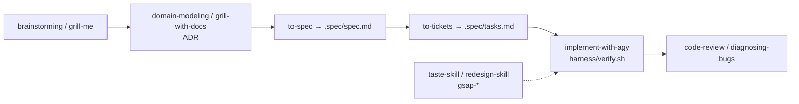

# Bộ skill mà KusShoes cài cho AI agent

[Về chặng](README.md) · Nguồn: thư mục `.agents/skills/` và file `skills-lock.json` của [KusShoes](https://github.com/EXE-CAPSTONE-TEAM/KusShoes) tại commit `89eac6a`, đọc ngày 22/10/2026.

**Skill là gì:** một thư mục có file `SKILL.md` (tên, mô tả, hướng dẫn) mà agent như Claude Code, Codex hay Antigravity đọc khi gặp việc khớp mô tả. Skill không phải thư viện chạy trong app. Nó là "sổ tay nghề" cho AI.

## 1. Thống kê (Đã quan sát)

- 52 thư mục skill.
- `skills-lock.json` chỉ khóa nguồn và hash cho **9 skill**: 8 skill GSAP từ `greensock/gsap-skills` và `responsive-adapter` từ `sergeyizmailov/knowledge-delta-skills`.
- 43 skill còn lại **không có trong lock file**. Nguồn được suy từ tên và nội dung, ghi rõ mức chắc chắn ở bảng dưới.

## 2. Sáu nhóm

| Nhóm | Skill | Nguồn | Mức chắc chắn |
|---|---|---|---|
| **A. GSAP chính thức** (8) | `gsap-core`, `gsap-timeline`, `gsap-scrolltrigger`, `gsap-plugins`, `gsap-react`, `gsap-frameworks`, `gsap-performance`, `gsap-utils` | [greensock/gsap-skills](https://github.com/greensock/gsap-skills) | Đã quan sát (có trong lock, có hash) |
| **B. Responsive** (1) | `responsive-adapter`, kèm 12 file tham khảo (touch target, fluid typography, menu/drawer…) | `sergeyizmailov/knowledge-delta-skills` | Đã quan sát (có trong lock) |
| **C. Quy trình kỹ sư** (21) | `ask-matt`, `setup-matt-pocock-skills`, `grill-me`, `domain-modeling`, `codebase-design`, `improve-codebase-architecture`, `prototype`, `implement`, `tdd`, `code-review`, `diagnosing-bugs`, `resolving-merge-conflicts`, `research`, `triage`, `to-questionnaire`, `handoff`, `teach`, `wait-what`, `wayfinder`, `wizard`, `writing-for-agents` | Tên `setup-matt-pocock-skills` và `ask-matt` chỉ về bộ skill của Matt Pocock; cả 21 skill đều có `agents/openai.yaml` cùng khuôn | Suy luận, chưa đối chiếu repo gốc |
| **D. Thẩm mỹ giao diện** (13) | `taste-skill`, `taste-skill-v1`, `gpt-tasteskill`, `redesign-skill`, `soft-skill`, `minimalist-skill`, `brutalist-skill`, `stitch-skill`, `output-skill`, `imagegen-frontend-web`, `imagegen-frontend-mobile`, `image-to-code-skill`, `brandkit` | `taste-skill` có `name: design-taste-frontend`, trùng skill hiện có trong [Leonxlnx/taste-skill](https://github.com/Leonxlnx/taste-skill). Repo đó hiện chỉ còn một skill, các biến thể còn lại không đối chiếu được | Một phần đã quan sát, phần còn lại chưa biết |
| **E. Harness OpenClaw/AGY** (3) | `implement-with-agy`, `session-subagents`, `ghibli-character-animator` | Có chữ "openclaw" trong nội dung; đi cùng `AGENTS.md` và `harness/verify.sh` do OpenClaw sinh ra | Đã quan sát (nội dung), nguồn công khai chưa biết |
| **F. Suy nghĩ và đặc tả** (6) | `brainstorming`, `grilling`, `grill-with-docs`, `sequential-thinking`, `to-spec`, `to-tickets` | Không có trong lock | Chưa biết |

## 3. Luồng làm việc mà bộ skill gợi ra (Đã quan sát qua mô tả skill)

Một ý tưởng được "hỏi vặn" trước, chốt thuật ngữ và ADR, viết thành spec, chia ticket theo lát dọc, rồi mới giao cho agent làm, có harness kiểm. Nhóm D và A là sổ tay nghề cho bước làm giao diện.

## 4. Bài học cho ReNER (Đề xuất)

1. **Khóa nguồn mọi skill cài vào repo.** KusShoes chỉ khóa 9/52. Skill không rõ nguồn là chỉ dẫn chưa kiểm cho agent; nếu cài, ghi URL, commit, hash.
2. **Ít mà đúng việc.** Năm biến thể "taste" trong cùng repo dễ cho chỉ dẫn mâu thuẫn (một bản bảo phẳng, một bản bảo brutalist). ReNER nên chọn một skill thẩm mỹ và một bộ GSAP chính thức.
3. **Skill không thay luật dự án.** Ở ReNER, `AGENTS.md` và từ điển dữ liệu đứng trên mọi skill. Một skill bảo "random layout cho đẹp" không được thắng quy tắc "thiếu là thiếu".
4. **Skill nằm ở đâu.** Theo ranh giới đã chốt, cấu hình skill của agent (nếu có) để ở môi trường người làm hoặc ở handbook, không nhét vào repo sản phẩm `rener-vn`.

## 5. Chưa biết

- Phiên bản gốc của 43 skill không có trong lock.
- Nhóm KusShoes có thực sự dùng hết 52 skill hay chỉ cài sẵn. Repo không có log chứng minh skill nào đã được gọi.
